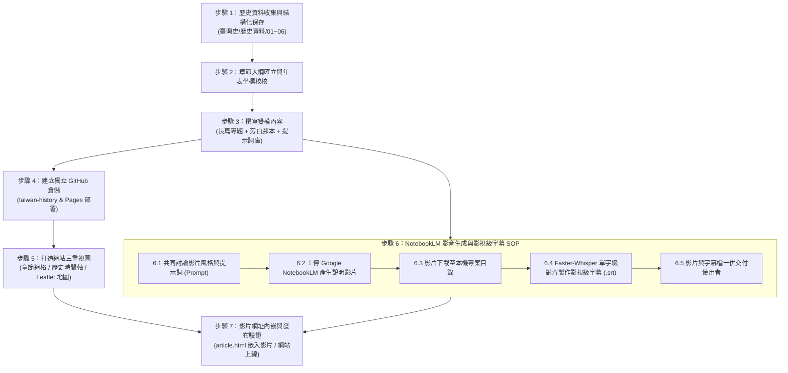

# 《臺灣史》專題寫作與數位文庫計畫書

> **計畫代號**：Project FormosaChronicles  
> **專案目標**：以系統化通史編年架構（六大時期、18 大專題），融合「深度歷史敘事 ＋ 互動時空地圖 ＋ 時間軸流變 ＋ 影視級影音字幕」，打造兼具學術考證深度、空間地理座標與視聽傳播力的新一代臺灣歷史數位文庫。

---

## 壹、 計畫願景與總體定位

臺灣座落於西太平洋花彩列島之核心，從史前舊石器時代、南島語族航向大洋的原鄉，到大航海時代東西方帝國的競逐，再經歷明鄭、清領、日治與戰後民主轉型，終至當代成為全球高科技「矽島」。

本專案旨在突破傳統歷史教材的枯燥斷代，建立一套具有現代互動體驗的臺灣歷史文庫：
1. **空間地理感（Spatial Context）**：每一章節皆精確標註歷史事件發生的真實地理座標（WGS84 經緯度），結合互動式臺灣地圖，讓讀者看見「歷史就發生在我們腳下的這片土地」。
2. **時間流變感（Temporal Flow）**：提供直觀的歷史時間軸，呈現數萬年來臺灣如何在不同強權、族群與制度交替下完成蛻變。
3. **視聽傳播力（Audio-Visual Synergy）**：每一專題皆採「雙模架構」（深度歷史長文 ＋ 影視旁白錄音腳本），並嚴格比照影視級 AI 字幕製作 SOP，產出單字級對齊、8～12 字黃金視線帶的高品質字幕。
4. **開放自託管（Open & Portable）**：文庫將以獨立 GitHub Repository 與 GitHub Pages 形式部署，完全開源且自包含，隨時可離線閱讀或發布上線。

---

## 貳、 六大時期與 18 章節總體架構表

本專案依編年通史劃分為 **六大歷史時期**，共計收錄 **18 個關鍵轉折專題**（每時期 3 章）：

| 時期 | 章節代號 | 章節完整名稱 | 時代範圍 | 代表地點與坐標 (Lat, Lng) | 核心人物與關鍵焦點 |
| :--- | :--- | :--- | :--- | :--- | :--- |
| **第一時期：史前文明與南島之源** | `ch01` | **第 01 章：黑潮上的遠古足跡——長濱文化、左鎮人與舊石器時代的曙光** | 舊石器時代 (距今約 3 萬～5 千年) | 臺東長濱八仙洞<br>`23.3965, 121.4828` | 宋文薰、長濱先民。<br>冰河期陸橋、海蝕洞穴居與臺灣最早的人類文明印記。 |
| | `ch02` | **第 02 章：大海是唯一的路徑——南島語族的原鄉假說與跨太平洋的獨木舟** | 新石器時代 (距今約 6 千～2 千年) | 新北八里十三行遺址<br>`24.9015, 121.3980` | 彼得·貝爾伍德 (Peter Bellwood)、南島航海家。<br>「出臺灣說 (Out of Taiwan)」、卑南玉石貿易與黑潮遠征。 |
| | `ch03` | **第 03 章：部落聯盟與土地精靈——原住民族的社會秩序、神話祭儀與獵場智慧** | 歷史前期～早期接觸 | 臺中大肚山大肚溪流域<br>`24.1530, 120.5510` | 大肚王（Camachat）、各族頭目與祭司。<br>跨部落聯邦體系「大肚王國」、階層制度與土地共存哲學。 |
| **第二時期：大航海時代與荷西競逐** | `ch04` | **第 04 章：熱蘭遮的紅毛城旗——荷蘭東印度公司（VOC）與大員貿易霸權** | 1624 – 1662 | 臺南安平熱蘭遮城<br>`22.9997, 120.1605` | 宋克（Martinus Sonck）、長老教會宣教士。<br>VOC 東亞轉口樞紐、鹿皮砂糖白銀貿易、新港文書拼音。 |
| | `ch05` | **第 05 章：聖多明哥的十字架——西班牙人在基隆與淡水的北臺灣競逐** | 1626 – 1642 | 基隆和平島聖薩爾瓦多城<br>`25.1558, 121.7645` | 伐爾得斯（Carreño Valdés）、道明會神父。<br>天主教傳教、硫磺貿易、北臺灣堡壘與荷西驅逐決戰。 |
| | `ch06` | **第 06 章：血濺赤崁與大鹿港——郭懷一抗荷事件與早期漢人移民的悲歌** | 1652 | 臺南赤崁樓與油車行<br>`22.9975, 120.2025` | 郭懷一、荷蘭總督長官、原住民盟軍。<br>苛捐人頭稅起義、漢荷原角力與早期漢人移民拓墾悲歌。 |
| **第三時期：明鄭東寧與海上孤忠** | `ch07` | **第 07 章：決戰大員九個月——鄭成功驅荷復臺與熱蘭遮城大圍城** | 1661 – 1662 | 臺南鹿耳門<br>`23.0235, 120.1292` | 鄭成功、揆一（Frederik Coyett）。<br>奇襲鹿耳門登陸、熱蘭遮圍城攻防戰與荷蘭在臺統治終結。 |
| | `ch08` | **第 08 章：海外別立乾坤——陳永華的屯墾、孔廟儒學與東寧王國治理** | 1664 – 1680 | 臺南全臺首學孔廟<br>`22.9904, 120.2043` | 鄭經、陳永華。<br>營盤田軍屯、開創全臺首學文教、設府置縣與反清基地經營。 |
| | `ch09` | **第 09 章：澎湖海戰與帝國落幕——施琅水師破浪與東寧王國降清** | 1683 | 澎湖馬公風櫃尾<br>`23.5412, 119.5358` | 施琅、劉國軒、鄭克塽、康熙皇帝。<br>澎湖海戰風向逆轉、東寧降清與「棄留臺灣」廷議大辯論。 |
| **第四時期：清領時代的拓墾、烽火與變革** | `ch10` | **第 10 章：唐山過臺灣的黑水溝血淚——渡臺禁令、六死三留一回頭與開拓墾號** | 1684 – 1860 | 彰化鹿港水門<br>`24.0560, 120.4326` | 施世榜、郭蒙渡、渡臺漢人先民。<br>黑水溝偷渡、羅漢腳現象、八堡圳與瑠公圳引水拓荒。 |
| | `ch11` | **第 11 章：三年一反，五年一亂？——朱一貴、林爽文與全島械鬥的生存博弈** | 1721 – 1788 | 臺中大里杙林爽文故居<br>`24.0998, 120.6792` | 朱一貴、林爽文、乾隆福康安。<br>天地會結社、反清民變、閩粵漳泉分類械鬥與基層生存爭奪。 |
| | `ch12` | **第 12 章：開港通商與現代化急先鋒——沈葆楨開山撫番到劉銘傳建省新政** | 1860 – 1895 | 基隆獅球嶺鐵路隧道<br>`25.1165, 121.7332` | 沈葆楨、劉銘傳、馬偕、約翰·陶德。<br>牡丹社事件開山撫番、茶糖樟腦外銷全球、建省與首條鐵路。 |
| **第五時期：日治時期的殖民統治、轉型與抗爭** | `ch13` | **第 13 章：乙未悲歌與武裝抗日——臺灣民主國、黑旗軍與噍吧哖事件的終曲** | 1895 – 1915 | 彰化八卦山抗日戰場<br>`24.0792, 120.5489` | 唐景崧、劉永福、余清芳、簡大獅。<br>馬關割臺、臺灣民主國、全島義勇反抗與武裝抗日終曲。 |
| | `ch14` | **第 14 章：現代化骨架與殖民之刃——縱貫鐵路、嘉南大圳與後藤新平的科學統治** | 1898 – 1930 | 臺南官田烏山頭水庫<br>`23.2005, 120.3662` | 兒玉源太郎、後藤新平、八田與一。<br>三大基礎調查、縱貫鐵路通車、嘉南大圳水利與米糖經濟榨取。 |
| | `ch15` | **第 15 章：臺灣人的臺灣——文化協會、議會設置請願運動與霧社事件的警鐘** | 1920 – 1937 | 臺北大稻埕文協舊址<br>`25.0565, 121.5098` | 蔣渭水、林獻堂、蔡培火、莫那·魯道。<br>新文化運動、議會請願政治啟蒙、以及賽德克族尊嚴絕地反擊。 |
| **第六時期：戰後重構、民主浪潮與矽島傳奇** | `ch16` | **第 16 章：時代巨變與傷痕記憶——戰後接收、二二八事件與白色恐怖年代** | 1945 – 1987 | 臺北二二八和平公園<br>`25.0428, 121.5147` | 陳儀、湯德章、柯旗化、受難知識份子。<br>接收摩擦、惡性通膨、二二八事件創傷與長達 38 年戒嚴人權史。 |
| | `ch17` | **第 17 章：走出戒嚴的民主奇蹟——美麗島事件、野百合學運與總統直選之路** | 1979 – 1996 | 高雄美麗島站圓環<br>`22.6314, 120.3019` | 黃信介、施明德、野百合學生、李登輝。<br>黨外運動、美麗島大審、解嚴開放黨禁報禁、終止動員戡亂與全民直選總統。 |
| | `ch18` | **第 18 章：矽島崛起與世界舞台——從客廳即工廠、竹科奇蹟到台積電的半導體傳奇** | 1966 – 當代 | 新竹科學園區<br>`24.7820, 121.0068` | 孫運璿、李國鼎、潘文淵、張忠謀。<br>加工出口區外銷、引進半導體技術轉移、晶圓代工模式與「矽盾」形成。 |

---

## 參、 七大步驟工作流程與標準作業程序（SOP）



### 步驟 1：歷史資料收集與結構化建檔 SOP
- **存放路徑**：`臺灣史/歷史資料/[時期目錄]/`
- **收集優先來源**：
  1. 中央研究院臺灣史研究所數位檔案、臺灣歷史文化地圖（THM）
  2. 國史館臺灣文獻館、國家圖書館「臺灣記憶」系統
  3. 國立臺灣歷史博物館典藏資料、清代臺灣地方志（臺灣府志、諸羅縣志等）
  4. 國史館及中研院近代史研究所口述歷史記錄
- **建檔規範**：每個時期以結構化 Markdown 檔保存，內容必須涵蓋：
  - `歷史事件背景與年代考證`
  - `核心引文與一手文獻出處`（公文、碑文、日記、契約）
  - `地理坐標校對清單`（精確到 WGS84 小數點後四位）
  - `重要名詞與人名統一對照表`（為 Whisper 提示詞做準備）

### 步驟 2：章節大綱與專案架構規劃
- 確認每章的核心問題意識（Why & How）：當時面臨什麼轉折？為什麼這項事件徹底改變了臺灣的命運？
- 統整 18 個章節的中繼資料（Metadata），為網站的 `data.js` 建立基礎定義。

### 步驟 3：雙模文章撰寫規範（Dual-Mode Content）
每一章節 Markdown 文件必須包含兩大核心部分：
1. **甲部：長篇深度歷史專題（深度閱讀用）**
   - 歷史現場重現、人物心理與制度博弈、深層社會文化影響、史料互證。
   - 包含章節摘要、年代區間、關鍵人物、關鍵詞標籤。
2. **乙部：影視旁白錄音腳本與 Whisper 提示詞（影片製作專用）**
   - **錄音朗讀稿**：口語化、具畫面感、依節奏劃分景次（Scene 01～05）。
   - **分鏡畫面提示（Visual Cues）**：建議搭配的歷史照片、古地圖、空拍或文獻影像。
   - **Whisper 專用專有名詞提示庫（Initial Prompt）**：收錄章節內所有人名、地名、文獻名、族語或外文拼音，確保 ASR 辨識 0 錯字。

### 步驟 4：獨立 GitHub Repository 與 GitHub Pages 發布規範
- **專案名稱**：`taiwan-history`
- **目錄組織**：
  ```text
  臺灣史/
  ├── 00_專案計畫與規範/
  ├── 歷史資料/ (01~06 時期資料庫)
  ├── 01_史前文明與南島之源/ (第 01~03 章 Markdown)
  ├── 02_大航海時代與荷西競逐/ (第 04~06 章 Markdown)
  ├── 03_明鄭東寧與海上孤忠/ (第 07~09 章 Markdown)
  ├── 04_清領時代的拓墾烽火與變革/ (第 10~12 章 Markdown)
  ├── 05_日治時期的統治轉型與抗爭/ (第 13~15 章 Markdown)
  ├── 06_戰後重構民主浪潮與矽島傳奇/ (第 16~18 章 Markdown)
  ├── index.html (首頁：卡片 / 時間軸 / 地圖三重視圖)
  ├── article.html (專案文章閱讀器 + YouTube 內嵌播放器)
  ├── css/ (樣式檔)
  ├── js/
  │   ├── data.js (全庫章節 Metadata、地理坐標、影片連結)
  │   ├── app.js (首頁三重視角邏輯、搜尋、篩選)
  │   ├── article.js (Markdown 解析與文章導航)
  │   └── map.js (Leaflet.js 臺灣歷史地圖組件)
  └── assets/ (歷史地圖、標記圖標、圖檔)
  ```
- **部署方式**：啟用 GitHub Pages（Branch: `main`, Folder: `/root`），支援 HTTPS 靜態直出。

### 步驟 5：網站三重視角互動設計規範
1. **章節卡片目錄（Grid View）**：
   - 支援依時期分類 Tab 篩選、關鍵字全文搜尋（標題、人物、摘要）。
   - 狀態標籤（已上線 / 撰寫中 / 影片已就緒）。
2. **歷史時間軸視角（Timeline View）**：
   - 垂直交錯式時間軸，標註歷史紀元與重大歷史節點，流暢滾動導覽。
3. **臺灣歷史地圖探索（Leaflet Map View）**：
   - 使用輕量開源地圖函式庫 `Leaflet.js` 搭配臺灣高對比靜態圖資。
   - 點擊地圖上的歷史錨點（Pin），彈出客製化資訊卡：包含章節名稱、發生年代、歷史簡介與「閱讀章節 / 觀看影片」直接跳轉按鈕。
   - 支援與時間軸聯動過濾（例如只顯示「清領時期」的歷史地圖點）。

### 步驟 6：Google NotebookLM 影片生成與影視級 AI 字幕 SOP
承襲《科技歷史》成熟之經驗，並結合 Google NotebookLM 影音生成能力，採「五階段一條龍」作業標準：

1. **子步驟 6.1：風格討論與專屬提示詞（Prompt）擬定**
   - 撰寫完每一章節後，AI 主動與使用者討論說明影片的敘事風格、受眾偏好與演繹焦點（如：歷史紀錄片肅穆感、故事解說戲劇感、雙人深入對談或教育科普節奏）。
   - 共同擬定注入 Google NotebookLM 的專屬 Prompt 與對焦指引，精確框定歷史論點、核心人物與關鍵情節。
2. **子步驟 6.2：上傳至 Google NotebookLM 生成說明影片**
   - 將該章節 Markdown 核心史料與論述文本匯入 Google NotebookLM 作為 Knowledge Source。
   - 應用擬定之 Prompt 與風格指令，觸發生成章節解說影片／影音導覽（Overview Video/Audio）。
3. **子步驟 6.3：說明影片下載與本機歸檔**
   - 影片生成完畢後，透過自動化工具或輔助下載，將影片檔（`.mp4`）安全儲存至 `臺灣史/` 對應時期資料夾中。
4. **子步驟 6.4：影視級 Faster-Whisper 字幕製作（四階段 SOP）**
   - **四大黃金原則**：
     1. *黃金視線帶*：單行 8～12 個中文字（極限不超過 16 字，嚴禁隨意跨行腰斬）。
     2. *口語呼吸律*：依語法結構意群（Constituency）斷句，非機械依秒數切分。
     3. *名詞零容忍*：注入章節專屬 `initial_prompt`，針對 NotebookLM 語音同音錯字進行 100% 逆向考證還原。
     4. *時間軸單調遞增與 BOM 防護*：單調不重疊，最小停留時間保護（0.5 秒），一律採用 `UTF-8 with BOM`。
   - **四階段作業**：
     1. `Faster-Whisper` 帶入初始提示詞，提取單字級微秒時間戳 JSON（`word_timestamps=True`）。
     2. 產出切句校對稿（`字幕校對稿_第XX章_請確認.txt`），與使用者或歷史史實校核。
     3. `SequenceMatcher` 序列強制對齊演算法，將校對完成文字精確對齊至音訊時間點。
     4. 導出工業級標準 `.srt` 檔案。
5. **子步驟 6.5：影音雙成果一併交付**
   - 每章完工後，將**「下載之高畫質說明影片檔（.mp4）」**與**「影視級校對字幕檔（.srt）」**一併整理並交付給使用者。

### 步驟 7：YouTube 上傳、排程發布與網頁內嵌規範

為確保專題影音傳播效果最大化與品牌一致性，影片上傳與發布流程嚴格依循下列標準規範：

1. **專屬播放清單歸屬**：
   - 所有單元影片上傳後，必須統一加入專屬播放清單：**「台灣史」**。
2. **影片標題與說明欄（Description）標準格式**：
   - **標準標題格式**：
     > `臺灣史 第 [XX] 章：[主標題]——[副標題] | 臺灣史專題文庫`  
     > *(例如：臺灣史 第 01 章：黑潮上的遠古足跡——長濱文化、左鎮人與舊石器時代的曙光 | 臺灣史專題文庫)*
   - **標準說明欄內容（Description）**：
     - 本章歷史背景核心摘要與轉折重點
     - 關鍵歷史現場地理座標與歷史人物
     - **GitHub 線上深度圖文與時空地圖直達連結**：
       `🌐 完整專題圖文、時空地圖與一手史料：https://clive520.github.io/taiwan-history/article.html?file=[時期目錄]/[章節檔案名稱]`
     - 播放清單連結：收錄於「台灣史」完整播放清單
     - 引用考證文獻與免責版權宣告
3. **公開播放與隱私設定**：
   - 影片發布狀態一律設定為 **「公開（Public）」**（或依下表設定排程公開）。
4. **排程發布時間表（每日下午 17:30，一日一單元）**：
   - **首單元排程時間**：第一章於 **2026 年 10 月 26 日（週一）下午 17:30（17:30:00 CST）** 準時首播。
   - **全系列 18 單元連續排程發布時刻表**：
     | 章節代號 | 章節名稱 | YouTube 排程公開時間 |
     | :--- | :--- | :--- |
     | **第 01 章** | 黑潮上的遠古足跡——長濱文化、左鎮人與舊石器時代的曙光 | **2026-10-26 (一) 17:30** |
     | **第 02 章** | 大海是唯一的路徑——南島語族的原鄉假說與跨太平洋的獨木舟 | **2026-10-27 (二) 17:30** |
     | **第 03 章** | 部落聯盟與土地精靈——原住民族的社會秩序、神話祭儀與獵場智慧 | **2026-10-28 (三) 17:30** |
     | **第 04 章** | 熱蘭遮的紅毛城旗——荷蘭東印度公司（VOC）與大員貿易霸權 | **2026-10-29 (四) 17:30** |
     | **第 05 章** | 聖多明哥的十字架——西班牙人在基隆與淡水的北臺灣競逐 | **2026-10-30 (五) 17:30** |
     | **第 06 章** | 血濺赤崁與大鹿港——郭懷一抗荷事件與早期漢人移民的悲歌 | **2026-10-31 (六) 17:30** |
     | **第 07 章** | 決戰大員九個月——鄭成功驅荷復臺與熱蘭遮城大圍城 | **2026-11-01 (日) 17:30** |
     | **第 08 章** | 海外別立乾坤——陳永華的屯墾、孔廟儒學與東寧王國治理 | **2026-11-02 (一) 17:30** |
     | **第 09 章** | 澎湖海戰與帝國落幕——施琅水師破浪與東寧王國降清 | **2026-11-03 (二) 17:30** |
     | **第 10 章** | 唐山過臺灣的黑水溝血淚——渡臺禁令、六死三留一回頭與開拓墾號 | **2026-11-04 (三) 17:30** |
     | **第 11 章** | 三年一反，五年一亂？——朱一貴、林爽文與全島械鬥的生存博弈 | **2026-11-05 (四) 17:30** |
     | **第 12 章** | 開港通商與現代化急先鋒——沈葆楨開山撫番到劉銘傳建省新政 | **2026-11-06 (五) 17:30** |
     | **第 13 章** | 乙未悲歌與武裝抗日——臺灣民主國、黑旗軍與噍吧哖事件的終曲 | **2026-11-07 (六) 17:30** |
     | **第 14 章** | 現代化骨架與殖民之刃——縱貫鐵路、嘉南大圳與後藤新平的科學統治 | **2026-11-08 (日) 17:30** |
     | **第 15 章** | 臺灣人的臺灣——文化協會、議會設置請願運動與霧社事件的警鐘 | **2026-11-09 (一) 17:30** |
     | **第 16 章** | 時代巨變與傷痕記憶——戰後接收、二二八事件與白色恐怖年代 | **2026-11-10 (二) 17:30** |
     | **第 17 章** | 走出戒嚴的民主奇蹟——美麗島事件、野百合學運與總統直選之路 | **2026-11-11 (三) 17:30** |
     | **第 18 章** | 矽島崛起與世界舞台——從客廳即工廠、竹科奇蹟到台積電的半導體傳奇 | **2026-11-12 (四) 17:30** |
5. **網頁即時內嵌**：
   - 影片排程完成後，將 YouTube 專屬影片 ID 寫入 `data.js` 的 `youtube` 欄位（例如 `https://youtu.be/[ID]`）。
   - `article.html` 偵測到網址後，於文章開頭直接啟用 16:9 播放視窗，達成「YouTube 影音導流至 GitHub 圖文、GitHub 網頁即時觀看影片」的雙向聯動生態。

---

## 肆、 網站資料庫結構定義（`data.js` 規格）

每一章節在中繼資料庫中必須具備下列完整欄位：

```javascript
{
  id: "ch04-zeelandia-voc",
  chapterNo: "04",
  period: "age-of-discovery",
  periodName: "大航海時代與荷西競逐",
  periodFolder: "02_大航海時代與荷西競逐",
  title: "熱蘭遮的紅毛城旗",
  subtitle: "荷蘭東印度公司（VOC）與大員貿易霸權",
  era: "1624 – 1662",
  coordinates: {
    lat: 22.9997,
    lng: 120.1605,
    locationName: "臺南安平熱蘭遮城（今安平古堡）"
  },
  figures: ["宋克 (Martinus Sonck)", "長老教會宣教士", "濱田彌兵衛"],
  keywords: ["熱蘭遮城", "VOC", "轉口貿易", "鹿皮砂糖", "新港文書"],
  summary: "荷蘭人如何將大員打造成東亞轉口貿易樞紐？鹿皮、砂糖、白銀貿易與基督教長老教會羅馬字拼音（新港文書）的深遠影響。",
  status: "draft", // "draft" | "writing" | "published"
  youtube: "", // 影片網址，如 "https://youtu.be/..."
  srtFile: "第04章_熱蘭遮的紅毛城旗.srt",
  articleFile: "第04章_熱蘭遮的紅毛城旗.md"
}
```

---

## 伍、 里程碑與推進時程表

| 階段 | 工作項目 | 檢核產出 |
| :--- | :--- | :--- |
| **第一階段：基礎架構** | 建立完整資料夾結構、計畫書、標準文章模板與影視級字幕 SOP。 | ✅ 計畫書、範本檔與目錄建立完畢 |
| **第二階段：史料收集** | 收集六大時期核心文獻、坐標清單與學術考證，存入 `歷史資料/`。 | 📁 6 個時期結構化歷史資料 Markdown |
| **第三階段：網站原型** | 建立 `taiwan-history` 前端工程（卡片、時間軸、Leaflet 地圖互動）。 | 🌐 可運作之 `index.html` 與 `article.html` |
| **第四階段：內容撰寫** | 依序撰寫 18 個章節的深度專題文章與影視旁白腳本。 | 📝 18 篇雙模文章 Markdown |
| **第五階段：影音生成與字幕** | 與使用者討論風格與提示詞，上傳 NotebookLM 產出說明影片、下載本機，並以 Faster-Whisper 產出影視級 .srt 字幕，一併交付使用者。 | 🎬 18 部說明影片檔（.mp4）與 18 份影視級 .srt 字幕檔完整交付 |
| **第六階段：部署與上線** | 內嵌影片網址、更新 `data.js`、推播至 GitHub Repository 並啟用 Pages。 | 🚀 臺灣史數位文庫全面上線 |

---
*本計畫書由 Antigravity 團隊依照與使用者之深度訪談確認規格後制定，作為後續所有寫作、資料收集、網站開發與字幕工程之唯一指引方針。*
