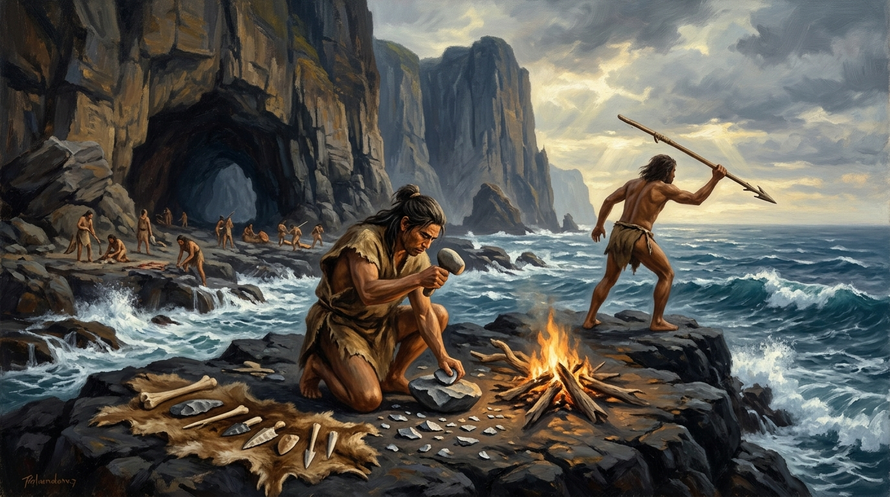

# 第 01 章：黑潮上的遠古足跡——長濱文化、左鎮人與舊石器時代的曙光

> **時期分類**：第一時期：史前文明與南島之源  
> **時代跨度**：舊石器時代晚期至末次冰期（距今約 30,000 年 – 5,000 年）  
> **關鍵人物**：宋文薰、林朝棨、郭德鈴、何傳坤、長濱先民  
> **歷史現場與坐標**：臺東長濱八仙洞（`23.3965, 121.4828`）、臺南左鎮菜寮溪（`23.0583, 120.3958`）  
> **核心突破與歷史轉折**：從冰河期臺灣海峽成陸的大陸哺乳動物遷徙，到東海岸海蝕洞穴中敲擊出的第一聲石器脆響；科學定年逆轉「左鎮人」迷思，確立長濱文化作為臺灣數萬年文明破曉的真正基石。  
> **影音連結**：  

---

## 【甲部：深度歷史專題長文】


*▲ 歷史概念復原圖：距今約 25,000 年前末次冰盛期，臺灣海峽乾涸為草原陸橋，古菱齒象、德氏水牛與舊石器獵人逐水草走向東方晨曦中的中央山脈。*

### 壹、 歷史破曉：冰河期的臺灣海峽陸橋與猛獸長征

若將臺灣的歷史濃縮成一場二十四小時的漫長電影，荷蘭紅毛船駛入安平大員的時刻，不過是午夜十一點五十九分最後的數十秒；而在那漫長如永夜的清晨之前，這座島嶼早已經歷了驚心動魄的滄海桑田。

時間倒回距今約兩萬五千年前的「末次冰盛期（Last Glacial Maximum）」。那時，厚重的冰川覆蓋了歐亞大陸與北美洲的廣袤地帶，大量水分子被鎖定在陸地冰帽之中，全球海平面劇烈暴跌了一百二十到一百四十公尺。

今天那條將臺灣與亞洲大陸阻隔開來、平均水深僅約六十公尺的蔚藍海峽，在當時是一片浩瀚無垠、平坦廣袤的乾燥草原與泥濘河道——地質學界稱之為「臺灣海峽陸橋」。

| 地理生態分區 | 古地理環境與氣候特徵 | 代表性遷徙古生物群 | 人類活動與生業適應型態 |
| :--- | :--- | :--- | :--- |
| **亞洲大陸（華南陸地）** | 冰河期氣候極度酷寒乾燥，高緯度植被大幅退縮南移 | 溫帶與亞熱帶森林草原哺乳動物 | 尋求溫暖避寒棲地與水源之古狩獵採集社群 |
| **臺灣海峽古草原陸橋** | 平均水深 -60m 全面乾涸露乾，形成平坦開闊之冷溫帶草原與泥濘河道 | 淮河古菱齒象、劍齒象、早坂中國犀、德氏水牛、四不像鹿、野豬 | 追隨大型獵物足跡跨越陸橋、逐步踏上臺灣島之舊石器智人（Homo sapiens） |
| **臺灣東部太平洋沿岸** | 中央山脈天然屏障阻絕寒風，黑潮暖流日夜流經，高位海蝕洞穴林立 | 黑潮迴游魚群、海龜、潮間帶貝類、淺山山羌與野豬 | 長濱文化先民進駐八仙洞，打製單面砍砸器與骨魚叉，開創海洋共生生活 |

那是一場橫跨千年的物種大遷徙。棲息於亞洲北方的古菱齒象、猛獁象、劍齒象、四不像鹿與德氏水牛，為了躲避西伯利亞狂暴的酷寒，沿著這座新形成的平原陸橋一路向東南方覓食南下。而在這些巨獸的蹄印身後，一群手握粗糙碎石、身裹獸皮的古人類，悄然跟隨獵物的足跡踏上了這座島嶼。

他們是舊石器時代晚期的智人（Homo sapiens）。對他們而言，這裡不是遠渡重洋的異域，而是一座充滿甘泉、茂密森林與豐沛獵場的溫暖避難所。當冰河期在距今一萬年前宣告終結，融化的冰雪讓海水如萬馬奔騰般重灌臺灣海峽，陸橋瞬間沉入波濤之下。而留下來的人類與獸群，從此被浩瀚大洋環抱，孤懸於西太平洋的花彩列島上，開啟了臺灣島獨特且漫長的史前傳奇。

---

### 貳、 風暴核心：八仙洞的巨岩海蝕洞與第一聲石器脆響


*▲ 歷史概念復原圖：長濱文化先民棲身於臺東八仙洞潮音洞內，洞外是怒濤洶湧的太平洋黑潮，洞內篝火旁打製單面礫石砍砸器與骨魚叉。*

1968 年歲末，冬日的太平洋風浪正猛烈拍打著臺東縣長濱鄉的險峻海岸。

臺灣大學考古人類學系宋文薰教授與地質學泰斗林朝棨教授帶領著調查隊，攀爬上長濱鄉三間村那一座高拔面海、宛如巨神屏風般的安山岩峭壁。在那裡，海水在數十萬年的地殼抬升過程中，雕鑿出一座座巨大的垂直海蝕洞穴——民間稱之為「八仙洞」。

此時的八仙洞早已被民間建廟奉祀，香火繚繞。然而，當宋文薰穿過「潮音洞」與「海雷洞」內厚重的香灰與現代泥沙，向幽暗的洞底層層下挖時，眼前的景象讓他屏住了呼吸。

在厚達數公尺、未受擾動的古地層中，沒有任何一片陶器，也沒有任何一件磨光精緻的石器。出土的，是數以千計由海灘礫石直接敲擊而成的粗獷打製石器：
- **砍砸器（Choppers）**：利用鵝卵石的一端用力打去幾片石片，露出鋒利如鋸齒的石刃，用以劈砍堅硬的骨髓與木料；
- **石片器與刮削器（Flake tools & Scrapers）**：薄而尖銳的石片，邊緣帶著人類細緻修整的微小崩損痕跡，用以刮削獵物毛皮、剔除骨肉；
- **精密的骨角器**：更令人震驚的是細長帶孔的骨針、骨錐與帶倒鉤的魚叉骨器，這是當時東亞史前遺址中極罕見的精緻獵具。

> 「八仙洞潮音洞所出土之石器，全數以天然礫石打擊而成，純為先陶期之產物。此文化層下部之碳十四測定年代，遠在萬年之前……臺灣原非歷史短淺之蠻荒，自舊石器時代晚期，島上即有薪火代代相傳。」  
> ——宋文薰，《長濱文化：臺灣首次發現的先陶文化》，1969 年

這項轟動國際學術界的發現，正式被命名為**「長濱文化（Changpinian Culture）」**。

長濱文化的先民是典型依海而居的獵人與採集者。他們選擇棲身在距離海平面數十公尺高的海蝕洞內，既能避開太平洋強勁的東北季風與猛獸襲擊，又能居高臨下俯瞰湧動著深藍黑潮的海面。白天，男子手持骨叉與砍砸器在近海潮間帶捕魚、獵捕前來飲水的野鹿；婦孺則在林間採集草木塊莖與貝類。洞穴內厚重的炭灰與燒焦的動物碎骨證實，他們早已熟練地駕馭火，在海潮轟鳴的夜晚，圍繞著篝火縫製獸皮，度過冰河期漫漫長夜。

八仙洞的發現，一舉將臺灣的人類文明史向前推進了至少兩萬年。


*▲ 歷史概念復原圖：長濱先民於臺東八仙洞海岸岩台上打製安山岩單面砍砸器，身旁同伴手持骨魚叉注視著黑潮浪濤中的魚群。*

| 核心生業特徵 | 考古出土實證（八仙洞、小馬洞穴） | 史前生計與環境適應意涵 |
| :--- | :--- | :--- |
| **先陶打製石器工藝** | 全無陶器伴出，純採直接打擊法之安山岩礫石砍砸器、石片器與刮削器 | 臺灣已知最早的人類工具製作體系，主要用於敲骨吸髓、劈砍木料與切割獵物毛皮 |
| **骨角複合獵捕工具** | 精細磨製之帶孔骨針、骨錐、倒鉤骨魚叉與雕刻骨器 | 展現熟練的獸皮縫紉禦寒工藝，以及面向太平洋黑潮潮間帶與近海的捕撈技術 |
| **海蝕洞穴控制用火** | 潮音洞、海雷洞厚達數公尺未擾動地層中的炭屑灰燼與燒灼碎骨 | 善用地殼劇烈抬升形成的天然安山岩海蝕洞遮風避雨，具備高度穩定的用火與烹飪能力 |

---

### 參、 迷霧散去：菜寮溪化石群與「左鎮人」年代的科學大逆轉


*▲ 歷史概念復原圖：距今約兩萬五千年前臺南菜寮溪古盆地，淮河古菱齒象與早坂中國犀在古河道邊覓食，沉積層深埋著印證陸橋年代的豐富動物化石。*

在長濱文化確認後的數年間，另一個關於臺灣史前人類的巨大謎團，在中央山脈另一側的臺灣西南平原悄然揭開。

臺南市左鎮區的菜寮溪，是一條看似不起眼的內陸溪流。然而每逢夏季暴雨山洪沖刷過後，溪床裸露的古沈積岩中，總會被沖出大量奇異的黑色骨骼化石。當地的業餘化石採集家郭德鈴、何傳坤等人，長年在滾滾溪水中涉水摸索，陸續撿拾出驚動學界的犀牛化石（早坂中國犀）、劍齒象齒臼以及成千上萬的古鹿角——這正是印證末次冰盛期動物大遷徙的「左鎮動物群」。

1970 年夏天，一片微小而弧度特殊的黑色骨片被送到了日本古生物學家鹿間時夫教授的手中。經過與解剖學專家的反覆拼湊，這片骨骼被證實是**人類右頂骨的一部分**；隨後數年間，菜寮溪又陸續採集到前額骨與後頂骨碎片。

鹿間時夫與佐倉朔教授採用當時國際通行的「氟、錳化學元素沈積定年法」，將頭骨與同地層出土的更新世犀牛骨進行比對，推估這批人類化石的年代為**距今兩萬至三萬年前**。

消息傳出，全臺震動。這批化石被隆重命名為**「左鎮人」**，並寫進了臺灣所有中學教科書的第一章——全臺灣人都深信不疑：左鎮人就是臺灣最早的居民，也是長濱文化的石器製造者。

**然而，科學最迷人的力量，正是敢於親手推翻自己寫下的定論。**

隨著放射性同位素檢測技術的飛躍進展，國際考古學界發現傳統的「氟錳沈積定年」極容易受到溪流地下水礦物質流動的污染而產生巨大偏差。如果左鎮人真的是兩萬年前的冰河期獵人，為什麼菜寮溪出土了成千上萬件巨獸化石，卻**從未發現過哪怕一件舊石器時代的石器工具**？

為了解開這個深埋了四十年的學術懸案，國立臺灣史前文化博物館在 2013 年至 2015 年展開了一場終極科學求證。研究團隊將左鎮人的頭骨化石取樣，分別送往澳洲國立大學與美國 BETA 放射性實驗室，動用當代最高精度的**「加速器質譜儀碳十四定年（AMS 14C）」**進行直接測定。

2015 年底，測試報告出爐，結果震驚了整個考古界：
- 被檢測的左鎮人頭骨碎片，實際年代並非三萬年前，而是**距今約三千年前（新石器時代晚期）至數百年前**！

教科書上的神話在一夜之間被顛覆。這場翻案並非一場難堪的挫敗，而是現代臺灣考古學成熟的偉大里程碑：

| 檢證維度 | 傳統教科書定論（1970 年代～2010 年代） | 現代科學翻案定論（2015 年迄今） | 歷史學與考古學重大啟示 |
| :--- | :--- | :--- | :--- |
| **檢驗樣本與方法** | 菜寮溪人頂骨與額骨碎片；採用「氟、錳化學元素沈積定年法」 | 同批左鎮人骨骼樣本；送交澳洲國立大學與美國 BETA 實驗室以「加速器質譜儀碳十四（AMS 14C）」直接測定 | 排除溪流地下水礦物二次沈積所造成的嚴重化學定年偏差 |
| **科學測定年代** | 推估距今約 **20,000 至 30,000 年前**（舊石器時代晚期） | 確證年代為距今約 **3,000 年前（新石器時代晚期）至數百年前** | 宣告「左鎮人為臺灣最早人類」的半世紀教科書定論徹底走入歷史 |
| **出土伴隨遺物** | 溪床中伴隨大量更新世犀牛、象齒等動物化石，但**全無任何舊石器石器** | 確認菜寮溪「左鎮動物群」巨獸化石確實屬於冰盛期（數萬年前），但人骨為晚期沖刷混入 | 嚴謹釐清古生物化石地層與晚期原住民墓葬遺骨的混雜地質現象 |
| **臺灣文明史坐標** | 曾被視為「舊石器時代長濱文化的製造者」 | 左鎮人回歸新石器晚期原住民族祖先序列；**長濱文化獨尊臺灣已知唯一舊石器時代文明黎明** | 去除神話迷霧，使八仙洞長濱文化的舊石器時代歷史地位更加純粹且堅不可摧 |

---

### 肆、 歷史迴響：黑潮暖流與島嶼文明的黎明啟示

當我們今天站在臺東長濱八仙洞的懸崖石梯上遠眺，腳下奔騰不息的正是西太平洋最澎湃的海流——黑潮（Kuroshio Current）。

這股自赤道發源、水溫溫暖、鹽度極高的深藍色暖流，數萬年來以每天數十海里的速度從臺灣東部外海洶湧掠過。正是這股黑潮帶來的豐富魚群與溫暖海風，撫育了洞穴裡的長濱先民，讓他們在嚴酷的全球冰河期中，找到了能夠繁衍生息的避風港。

| 歷史分期 | 地質年代與距今年代 | 代表性史前文化／重大地質事件 | 核心文明器物與生業型態 | 歷史坐標與啟示 |
| :--- | :--- | :--- | :--- | :--- |
| **舊石器時代晚期** | 更新世晚期<br>（約 30,000 – 15,000 年前） | **長濱文化**<br>（臺東八仙洞、小馬洞穴） | 安山岩打製砍砸器、骨魚叉、海蝕洞穴居、控制性用火 | 臺灣文明最早火種，依傍黑潮之海洋捕撈與狩獵採集先驅 |
| **冰後轉型過渡期** | 更新世末至全新世初<br>（約 15,000 – 7,000 年前） | **全球海進・海峽成海**<br>（海平面暴升 120 公尺） | 冰川融化海水倒灌，臺灣海峽古草原陸橋沉入波濤 | 阻隔大陸陸生動物遷徙，確立臺灣孤立且四面環海之島嶼地理格局 |
| **新石器時代早期** | 全新世中前期<br>（約 7,000 – 4,500 年前） | **大坌坑文化**<br>（新北八里、臺南南科南關里東） | 粗繩紋陶、磨製石錛、定居聚落、根莖小米農耕、舷外浮筒獨木舟 | 南島語族原鄉之破曉，開啟跨越太平洋與印度洋之全球大擴散 |

長濱文化為臺灣留下了至關重要的歷史啟示：
- **臺灣從來不是文化的無根之地**：在世界許多文明尚未萌芽的遠古時代，臺灣島上已經有先民在此敲石生火、磨製魚叉、與大洋共生。
- **島嶼海洋性格的胚胎期**：無論先民最初是否沿著陸橋走來，當海平面上升的那一刻起，臺灣人就注定與海洋締結不可分割的宿命。

那一聲聲在八仙洞漆黑岩壁間迴盪的礫石敲擊聲，正是這座島嶼在茫茫歷史長河中，向世界發出的第一聲文明啼聲。

---

## 【乙部：Google NotebookLM 影音提示詞、旁白腳本與字幕專用庫】

### 一、 Google NotebookLM 影片風格設定與生成提示詞（Prompt）

#### 1. 建議風格與受眾定位
- **敘事風格定位**：深度歷史探索紀錄片風格（深沉、壯麗、富含哲思與科學懸念，兼具地理滄桑感）。
- **受眾定位**：對臺灣本土文史、史前考古及地球科學有濃厚興趣的大眾與學生讀者。
- **播音語氣指引**：節奏穩健、語調富含感染力，在描述冰河期與八仙洞時帶出遠古空靈感，在敘述左鎮人科學翻案時展現嚴肅求真的學術戲劇張力。

#### 2. NotebookLM 專用生成提示詞（Prompt）
> **複製以下提示詞輸入至 Google NotebookLM：**
> 
> 「請依據所附本章歷史文獻與專題長文，為第 01 章《黑潮上的遠古足跡——長濱文化、左鎮人與舊石器時代的曙光》製作一段精彩的影音解說內容。
> 
> **重點演繹要求**：
> 1. **破題懸念**：打破『臺灣只有四百年歷史』的傳統刻板印象，將鏡頭拉回兩萬多年前末次冰盛期，生動重現臺灣海峽是一座古菱齒象奔馳的陸橋草原。
> 2. **核心現場**：以臺東長濱八仙洞（潮音洞）為視覺焦點，詳細描繪宋文薰教授發現先陶文化礫石砍砸器與骨魚叉的震撼現場，確立『長濱文化』的劃時代意義。
> 3. **科學反轉的高潮**：特別深入探討菜寮溪『左鎮人』從教科書神話到 2015 年碳十四 AMS 精準測年翻案的過程，強調科學客觀求真精神，並說明為何這次翻案反而讓八仙洞長濱文化成為真正的破曉基石。
> 4. **歷史昇華**：結尾扣回黑潮暖流與海洋島嶼宿命，展現臺灣自舊石器時代以來堅韌的文明火種。
> 請保持語句精煉生動、口吻沉穩大器、專有名詞嚴謹無誤。」

---

### 二、 影視級口播旁白稿（搭配分鏡節奏）

#### 【場景一：破題懸念與冰河之島（0:00 - 1:30）】
- **畫面建議**：[深邃深藍的海底鏡頭，漸漸退潮，浮現出長滿荒草的古大陸；字幕浮現：距今 25,000 年前]
- **旁白台詞**：
  > 很多人以為，臺灣的故事只有四百年。
  > 但如果把歷史的鏡頭，拉回兩萬年前的冰河時代，
  > 這座島嶼的面貌，將會徹底顛覆你的想像。
  > 當時的臺灣海峽，沒有滔天巨浪，
  > 而是一片寬廣無垠的大草原。
  > 猛獁象與古菱齒象，成群漫步在海峽陸橋上，
  > 而追隨巨獸腳步的遠古獵人，
  > 就這樣悄悄踏上了這座島嶼。

#### 【場景二：八仙洞的燧石之光（1:30 - 4:00）】
- **畫面建議**：[空拍臺東長濱八仙洞巨大岩壁，切入洞穴深處宋文薰教授考古黑白照片與出土礫石砍砸器特寫]
- **旁白台詞**：
  > 1968 年底，在臺東長濱面海的八仙洞內，
  > 考古學家宋文薰與林朝棨，
  > 在厚重的地層深處，挖出了驚世的秘密。
  > 這裡沒有陶片，也沒有磨製玉石，
  > 只有一塊塊用海灘礫石粗獷打擊出的石器。
  > 砍砸器、刮削器，以及精密的骨魚叉，
  > 證實早在三萬年前的舊石器時代，
  > 長濱先民就已經棲身於海蝕洞內，
  > 迎著太平洋的黑潮，敲擊出文明的第一道火花。
  > 這就是名震世界的「長濱文化」。

#### 【場景三：菜寮溪與科學大逆轉（4:00 - 6:30）】
- **畫面建議**：[臺南左鎮菜寮溪流水湍急，顯微鏡下的化石碎片，碳十四實驗室儀器跳動數據與報章檔案]
- **旁白台詞**：
  > 然而在臺灣歷史教科書中，
  > 曾有一個糾纏了四十年的名字——「左鎮人」。
  > 1970 年代，臺南菜寮溪撿起的人類頭骨化石，
  > 一度被判定為三萬年前的臺灣最早人類。
  > 但真正的科學，從不懼怕推翻自己。
  > 2015 年，史前館透過最先進的碳十四檢測，
  > 震撼證實：左鎮人其實只有三千年歷史。
  > 這不是失敗，而是一場偉大的求真。
  > 它洗去了神話迷霧，
  > 更加無可動搖地確立了：
  > 八仙洞長濱文化，才是臺灣史前文明唯一的破曉起點。

#### 【場景四：黑潮長歌與終局迴響（6:30 - 8:00）】
- **畫面建議**：[日出灑滿太平洋黑潮波光，八仙洞輪廓剪影，現代臺灣地圖漸變點亮各史前遺址]
- **旁白台詞**：
  > 當冰河融化，海水再次淹沒海峽陸橋，
  > 這群遠古先民，選擇留在島嶼與大洋搏擊。
  > 黑潮的暖流，日夜奔流了數萬年，
  > 滋養了八仙洞岩壁間那不滅的篝火。
  > 臺灣從來不是沒有根的漂泊之島，
  > 早在數萬年前的岩穴深處，
  > 我們腳下這片土地，
  > 就已經響起了人類最倔強的生存之歌。

---

### 三、 Faster-Whisper 專用提示詞庫（Initial Prompt）

> **使用方式**：使用 Faster-Whisper 轉錄 NotebookLM 影音檔時，請將以下字詞填入 `initial_prompt`：

```text
臺灣史, 史前文明, 長濱文化, 八仙洞, 潮音洞, 海雷洞,
宋文薰, 林朝棨, 舊石器時代晚期, 末次冰盛期, 臺灣海峽陸橋,
淮河古菱齒象, 劍齒象, 左鎮動物群, 菜寮溪, 郭德鈴, 何傳坤,
鹿間時夫, 佐倉朔, 左鎮人, AMS碳十四定年, 加速器質譜儀,
砍砸器, 石片器, 骨角器, 先陶文化, 黑潮暖流
```

