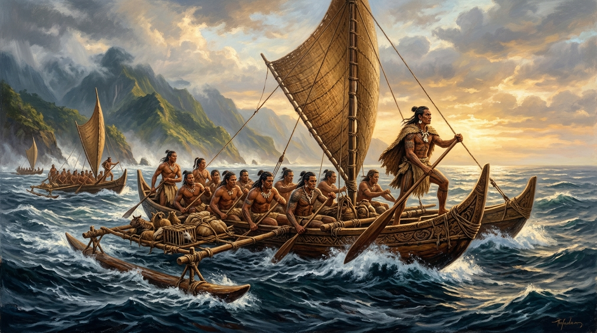
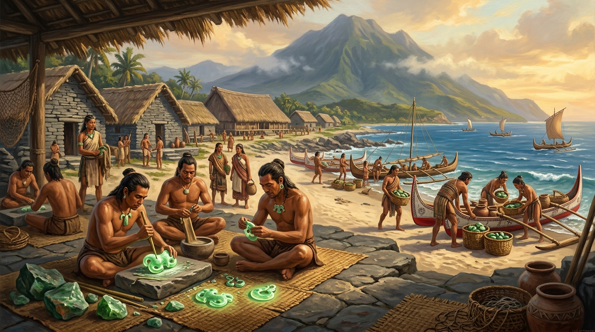
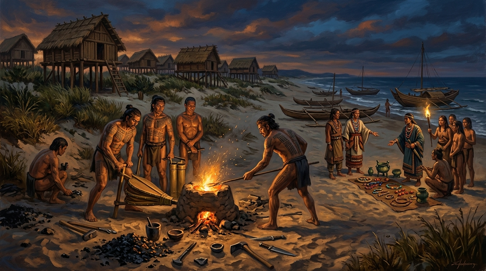

# 第 02 章：大海是唯一的路徑——南島語族的原鄉假說與跨太平洋的獨木舟

> **時期分類**：第一時期：史前文明與南島之源  
> **時代跨度**：新石器時代早期至金屬器時代（距今約 6,000 年 – 500 年）  
> **關鍵人物**：彼得·貝爾伍德（Peter Bellwood）、白樂思（Robert Blust）、宋文薰、洪曉純、飯塚義之、南島航海先民  
> **歷史現場與坐標**：新北八里大坌坑遺址（`25.1386, 121.4014`）、臺東市卑南遺址（`22.7885, 121.1197`）、花蓮壽豐豐田玉礦（`23.8647, 121.5034`）、新北八里十三行遺址（`24.9015, 121.3980`）  
> **核心突破與歷史轉折**：全球南島語系十大一級分支中高達九個深植於臺灣；大坌坑粗繩紋陶的定居農耕、跨越巴士海峽的舷外浮筒獨木舟、卑南「臺灣玉」橫跨三千公里的東南亞跨洋貿易圈，徹底確立了臺灣作為太平洋南島大擴散原鄉的關鍵歷史地位。  
> **影音連結**：[YouTube 重點解說影片](https://youtu.be/7UHNACoGMps)｜[YouTube 雙人深度對談播客](https://youtu.be/nCPvm8Wm3bc)｜[Google NotebookLM 專案](https://notebook.google.com/notebook/cfe2bb5a-8730-4d61-a162-5637634d849c)  

---

## 【甲部：深度歷史專題長文】


*▲ 歷史概念復原圖：距今約 5,000 年前大坌坑文化時期，南島先民乘雙體舷外浮筒獨木舟（Outrigger canoe）揚帆出海，觀星辨位跨越巴士海峽的狂暴黑潮，航向無垠大洋。*

### 壹、 歷史破曉：被太平洋環抱的原鄉——白樂思樹狀圖與「九比一」的語言奇蹟

翻開當今世界的語言分佈圖，有一支語系所涵蓋的地表面積，超越了人類歷史上任何一個古老帝國的疆域。

它向西直達非洲東海岸的馬達加斯加島，向東跨越浩瀚無垠的南太平洋、直至孤懸於南美洲外海的復活節島（Rapa Nui）；向南深抵紐西蘭的毛利人家園，向北則止於臺灣。這片橫跨東經四十度到西經一百零九度、涵蓋全球三分之二水域、人口逾三億八千萬的龐大語言文化體系，正是**「南島語系（Austronesian language family）」**。

長久以來，十九世紀的西方探險家與人類學者始終被一個巨大的謎團所困擾：這些在哥倫布發現新大陸之前數千年，便能憑藉無釘木舟、穿梭於萬頃狂瀾之中的超凡航海民族，究竟發源於何處？他們的祖先是從亞洲大陸深處走來，還是從中南半島、印尼群島漂泊而起？

| 地理極限方位 | 極限端點島嶼／地理位置 | 現代代表族群／語言 | 距臺灣原鄉直線距離與大洋跨度 |
| :--- | :--- | :--- | :--- |
| **最北端（原鄉起點）** | **臺灣（Taiwan）** | 泰雅、排灣、阿美、鄒等 16 族南島原住民族 | 0 km（保留全球南島語最多樣古老之 9 大一級分支） |
| **最南端** | **紐西蘭（Aotearoa）** | 毛利人（Māori / 毛利語） | 約 9,000 km（跨越南太平洋，波里尼西亞終點航程） |
| **最東端** | **復活節島（Rapa Nui）** | 拉帕努伊人（南美智利外海） | 約 16,000 km（深抵南太平洋東陲，面迎南美大陸） |
| **最西端** | **馬達加斯加島（Madagascar）** | 馬拉加斯人（Malagasy / 東非外海） | 約 8,500 km（橫渡整座印度洋，抵達非洲東岸） |

解開這道世紀謎題的鑰匙，不是黃金或文字石碑，而是一門嚴謹如數學公式的科學——**歷史語言學（Historical Linguistics）**。

在語言演化學中有一條著名的鐵律：「一個語系的分化中心，必然坐落在其語言內部多樣性最高、保留最古老分支的地理區域。」這如同在森林中尋找一棵參天古樹的根部，分枝最密集、形態最古老之處，必然是種子落下的地方。

二十世紀後半葉，夏威夷大學語言學大師白樂思（Robert Blust）投入畢生心血，對全球南島語系中超過一千兩百種現存語言進行音韻對應、語法結構與核心詞彙的深度比對，繪製出了震撼國際學術界的「南島語系樹狀結構模型（Austronesian Tree Model）」。

白樂思發現，若將整個南島語系劃分為最頂層的 **「十個一級分支（Primary Subgroups）」**：
- **第一到第九分支**：全部、毫無例外地集中在 **臺灣島內**，分別對應著泰雅語群、鄒語群、排灣語群、布農語群、魯凱語群等臺灣原住民族的語言！
- **第十個分支**：被統稱為「馬來-玻里尼西亞語族（Malayo-Polynesian）」。而這孤伶伶的單一分支，竟然囊括了菲律賓群島、印尼、馬來西亞、馬達加斯加、密克羅尼西亞、美拉尼西亞、夏威夷以及紐西蘭毛利人在內的海外全體南島語言！

| 分支階層 | 語言學分支名稱 | 分佈地理範圍 | 代表性族群／語言群 | 學術考證與演化意義 |
| :--- | :--- | :--- | :--- | :--- |
| **第一分支** | 泰雅語群（Atayalic） | 臺灣北部與中央山脈北段 | 泰雅族、賽德克族、太魯閣族 | 保留極古老之音韻與詞彙特徵 |
| **第二分支** | 鄒語群（Tsouic） | 臺灣中南部阿里山與玉山山區 | 阿里山鄒族、卡那卡那富族、拉阿魯哇族 | 保留多樣性極高之古南島語法結構 |
| **第三分支** | 排灣語群（Paiwanic） | 臺灣南部中央山脈南段 | 排灣族 | 詞彙系統完整，名詞與動詞焦點系統完備 |
| **第四分支** | 布農語群（Bunun） | 臺灣中部中央山脈高山帶 | 布農族 | 保留古南島語子音清濁分化特徵 |
| **第五分支** | 魯凱語群（Rukaic） | 臺灣南部高山溪谷地帶 | 魯凱族 | 保留原始南島語古老格位標記系統 |
| **第六分支** | 卑南語群（Puyuma） | 臺灣東南部臺東平原 | 卑南族 | 語法結構極度古老，獨立成單一分支 |
| **第七分支** | 賽夏語群（Saisiyat） | 臺灣西北部苗栗、新竹山區 | 賽夏族 | 語音形態極具地方特殊性與古層遺留 |
| **第八分支** | 西北臺灣南島語群（Northwest Formosan） | 臺灣西北部沿海與丘陵 | 巴宰族、噶哈巫族、道卡斯族等 | 平埔族群古老南島語支，展現豐富多樣性 |
| **第九分支** | 東臺灣南島語群（East Formosan） | 臺灣東部縱谷與海岸平原 | 阿美族、噶瑪蘭族、撒奇萊雅族 | 具備高度海洋詞彙與生態適應標記 |
| **第十分支** | **馬來-玻里尼西亞語族**<br>（Malayo-Polynesian, MP） | **除臺灣以外之全球南島區域**<br>（菲律賓、印尼、太平洋島嶼、馬達加斯加） | 菲律賓他加祿語、馬來語、爪哇語、夏威夷語、大溪地語、毛利語等上千種語言 | **單一分支席捲兩大洋**：印證全體海外南島語言皆源自臺灣原鄉之向外分化擴散 |

這項驚人的「九比一」分佈，在統計學與演化生物學上只有一種唯一合理的解釋：**臺灣正是整個南島語族的原鄉與分化搖籃。**

當我們傾聽紐西蘭毛利人將「眼睛」稱為 *mata*、排灣族人同樣稱其為 *matsa*；當夏威夷人指著「天空」說出 *lani*，而泰雅族人祈求的至高天神之界名為 *kayal/langi*——這些散落在太平洋數萬座島嶼上、相隔萬里的發音迴響，正是數千年前先民從臺灣海岸出發時，帶入浩瀚大洋的永恆胎記。

---

### 貳、 風暴核心：大坌坑文化的破浪遠征——粗繩紋陶、小米與舷外浮筒獨木舟

語言學的推論無比精闢，但若沒有泥土中沉睡的實物相印證，原鄉假說終究只是空中樓閣。而將這項假說化為堅不可摧之學術定論的，是澳洲國立大學考古泰斗彼得·貝爾伍德（Peter Bellwood）與臺灣考古團隊長達數十年的地層深掘。

距今約六千年前（約公元前 4000 年），隨著冰河完全融化、全球氣候轉入溫暖濕潤，臺灣的海岸線與河口沼澤生態進入了黃金發育期。正在此時，一種具有鮮明特徵的嶄新文明形態在全島沿海破土而出——這便是臺灣新石器時代的最早基層：**「大坌坑文化（Tapenkeng Culture）」**。

| 核心地層面向 | 考古出土實物與特徵 | 歷史與生業文化意義 |
| :--- | :--- | :--- |
| **陶器工藝** | 低溫燒製手捏粗砂褐陶，器身壓印縱橫粗繩紋（Cord-marked），口沿刻劃波浪紋與微侈厚唇 | 標誌臺灣正式跨入新石器時代，具備成熟陶器成型與燒製控溫技術 |
| **農業遺留** | 臺南科學園區南關里東遺址出土大量碳化稻米（稉稻）、小米、芝麻種子 | 印證南島先民早已掌握定居農耕技術，擺脫純採集狩獵的不穩定生計 |
| **墓葬與習俗** | 全國最早家犬側身完整墓葬（南關里東）、成年人上顎雙側門齒拔牙習俗 | 確立早期馴化家畜伴侶關係，展現高度分化且具一致性的泛南島成年禮俗 |
| **遠洋捕撈** | 兇猛灰鯖鮫（鯊魚）牙齒飾品、大型旗魚脊椎骨、深海石網墜、跨海採集之澎湖玄武岩石錛 | 證實已具備航向太平洋深海與跨越臺灣海峽澎湖水道之深水航行能力 |

在淡水河口的八里大坌坑遺址，以及臺南科學園區的南關里東遺址，考古學家清理出了令世界動容的史前生活圖景：


*▲ 歷史概念復原圖：距今約 5,000 年前大坌坑文化聚落生活現場。在淡水河口敞棚下，先民以粗繩壓印粗砂陶罐，身旁是馴化家犬與小米耕地，遠山為觀音山晨霧。*

大坌坑先民不再像舊石器時代的長濱人那樣居無定所地浪跡海崖。他們在平原上立柱架起干欄式木屋，開墾田地栽種小米、旱稻與芋頭，並馴化了家豬與獵犬。南關里東遺址甚至出土了臺灣最早的「家犬完整骨骸墓葬」——狗兒被小心翼翼地側身安置於土坑中，頭部朝向聚落，顯示出四千五百年前人與工作犬之間深厚的夥伴情感。

然而，更具革命性的是他們對海洋的征服。

考古學家在遺址的貝塚中發現了大量深海迴游魚類的骨骼，包括兇猛的灰鯖鮫（鯊魚）、大型旗魚與海龜。如果沒有足以承受大洋暗湧的重型航海載具，單憑簡陋的竹筏絕對無法在黑潮的狂濤中搏殺這些深海巨物。

歷史重構顯示，大坌坑先民正是掌握了改變人類遷徙歷史的關鍵發明——**舷外浮筒獨木舟（Outrigger canoe）** 與 **雙體帆船（Double-hulled canoe）**。

| 船體核心構件 | 構造與造船材料工藝 | 流體力學與遠洋航行功能 |
| :--- | :--- | :--- |
| **主舟身（Main Hull）** | 選用直徑逾一公尺之樟木或烏心石巨木，經火烤掏空、以玄武岩錛精細鑿削成單木獨木舟 | 具備流線型深吃水與尖銳切浪舟艏，提供強韌船體與人員、作物、陶罐載重容積 |
| **平衡浮筒（Ama）** | 選用極輕質天然浮木精削成流線浮體，配置於主舟單側或雙側 | 產生強大橫向槓桿力矩，徹底抵消黑潮湧浪之側向傾覆力，賦予大洋遠航抗翻穩定性 |
| **橫向連接木樑（’Iako）** | 以堅韌藤條（黃藤）與木栓，將浮筒牢固綁縛於主舟舷側之橫樑系統 | 具備柔韌彈性結構，能吸收大洋風浪劇烈扭曲應力，防止硬性斷裂 |
| **三角蟹爪帆（Crab-claw Sail）** | 以耐鹽防腐之林投葉精心密織而成的倒三角或蟹爪形狀風帆 | 產生極高空氣動力升力，允許先民逆風「迎角航行」（Tacking），破除單向順風限制 |

先民伐倒直徑超過一公尺的樟木或烏心石，以火炙烤、以玄武岩錛精細鑿刻出流線型的單木舟身；隨後以堅韌的藤條與木栓，在舟身一側或兩側橫向架設一根長長的輕質木浮筒（Ama）。

這看似簡單的力學構件，卻是一項天才般的流體力學傑作：浮筒形成的巨大槓桿力矩，能輕易抵消海浪對船體的側向翻覆力，使獨木舟在遭遇巴士海峽三至四公尺的湧浪時依然平穩如履平地。再配上以林投葉編織成的三角「蟹爪帆」，獨木舟甚至能巧妙運用季風「逆風迎角航行」。

距今約五千年前，由於定居農業帶來的人口急劇膨脹，以及島內河谷耕地的飽和，一批又一批年輕的大坌坑探險者，在舟舯裝載了耐儲存的小米、甘藷、陶罐淡水，並帶著馴化的幼豬與家犬，告別了臺灣西南海岸。

彼得·貝爾伍德在其名著《最初的農民》中生動地描述了這場壯舉：
> 「這是一場由農業技術驅動、以非凡航海力為翅膀的全球大擴散。在公元前三千年左右，大坌坑文化先民跨越了寬達一百五十公里的巴士海峽。他們看著海鳥的歸巢方向、感應著洋流在舟舷震顫的頻率、夜觀牽牛星與南十字座的方位，將文明的火種一路播撒向呂宋島、蘇拉威西、並最終席捲整個大洋洲。」  
> ——彼得·貝爾伍德，《出臺灣說的考古鏈條》

---

### 參、 跨洋奇蹟：三千公里的綠色血脈——卑南「臺灣玉」與史前東南亞貿易帝國


*▲ 歷史概念復原圖：距今約 3,000 年前卑南文化先民聚落現場。玉匠以細砂礪石與竹管精心研磨花蓮豐田閃玉（人獸形玉玦與雙獸首耳飾），遠景都蘭山下，商隊將精緻玉石裝載於遠洋獨木舟，航向南海三千公里海上貿易網絡。*

如果說大坌坑時代的擴散是為了尋找生存新天地的拓殖浪潮，那麼進入新石器時代中晚期（距今約 3,500 – 2,300 年前），臺灣的南島先民則將這片汪洋轉化為一條繁忙的國際貿易航線。

這場史前跨洋商貿奇蹟的真正核心主角，是一種在陽光下泛著溫潤翠綠光澤的礦石——**「臺灣玉（豐田閃玉，Taiwan Nephrite）」**。

1980 年夏，臺東市卑南火車站（今臺東站）進行擴建工程。當推土機剷開覆土的一剎那，一處沉睡了三千年的巨大史前帝國聚落重見天日——這就是名震寰宇的 **「卑南遺址」**。

| 卑南文明指標 | 考古實證發現（卑南遺址） | 歷史深度與文明震撼 |
| :--- | :--- | :--- |
| **聚落規模全臺第一** | 聚落面積逾 30 萬平方公尺，發掘逾 2,000 具板岩石板棺 | 東亞與太平洋環形圈已知最大史前石板棺墓葬聚落，展現龐大人口與組織動員力 |
| **靈魂導航聖山信仰** | 所有石板棺無論聚落走向，棺身長軸均嚴格朝向都蘭山聖山 | 具備高度統一且跨世代傳承的靈魂歸宿信仰體系，視都蘭山為祖靈安息之地 |
| **社會分層萌芽現象** | 少數墓葬隨葬上百件精美玉器與管珠，多數墓葬僅有簡樸陶器 | 顯現出史前財富分化、社會階層與家族世系分工的早期雛形 |
| **極致玉石微雕工藝** | 出土全臺最豐富精緻之雙獸首玉耳飾、玉玦、玉管珠及國寶「人獸形玉玦」 | 掌握高難度線切、管鑽與拋光技術，奠定臺灣作為環南海玉器工藝源頭之地位 |

卑南遺址出土了數以萬計由臺灣閃玉打磨而成的精緻飾品：細如髮絲的玉管珠、直徑數十公分的巨型玉璧，以及被指定為中華民國國寶的「人獸形玉玦」——其造型為兩人並立，頭頂雙耳高聳的神獸，線條洗練優雅，展現出匪夷所思的微雕研磨技術。

但令人百思不解的是：整個卑南平原在漫長的地質史上根本不產一粒閃玉！這些成千上萬的玉器原料究竟來自何方？

經過中央研究院林朝棨教授與當代地質學家反覆比對，全臺灣唯一能產出優質透閃石軟玉的源頭，只有位在中央山脈東側、花蓮壽豐鄉的 **「豐田玉礦區」**（地處險峻的白鮑溪與豐田溪上游）。卑南先民必須冒著生命危險，沿著花東縱谷向北跋涉上百公里採礦，或透過東海岸的海運網絡將原石運回臺東加工。

更令全球考古界震撼的轉折，發生在二十一世紀初。

在菲律賓的巴拉望島（Palawan）、呂宋島，甚至在跨越整個南海的越南南部沙黃文化遺址（Sa Huynh）、泰國南部的三通岬（Sam Sam Sam），以及馬來西亞的婆羅洲，東南亞考古學家陸續在公元前一千紀的史前高等墓葬中，發現了一種造型極為奇特、帶有三個尖突或雙獸頭造型的翠綠色玉耳飾（Lingling-o）。

長達數十年，西方學界一直認為這是中南半島或印度文明本土開採製造的高級隨葬品。

直到 2007 年，臺灣考古學者洪曉純與中央研究院地質專家飯塚義之博士，在《美國國家科學院院刊（PNAS）》發表了一篇顛覆性的重磅論文：《三千年古代玉器繪製出的東南亞史前交換網絡》。

| 貿易網絡節點 | 遺址與地理位置 | 航程與流通模式 | 出土玉器型制與 EPMA 礦物指紋分析 |
| :--- | :--- | :--- | :--- |
| **玉石開採源頭** | **臺灣花蓮壽豐（豐田玉礦區）** | 產於白鮑溪與豐田溪上游險峻蛇紋岩山區 | 透閃石軟玉（Nephrite）母礦，具備高鎂、特定鐵錳比之「唯一地質指紋」 |
| **琢磨加工集散中心** | **臺灣臺東卑南聚落及東海岸** | 沿花東縱谷陸路或東海岸海運南下集散加工 | 出土國寶人獸形玉玦、雙獸首耳飾、玉管珠，展現極高精雕與線切管鑽水準 |
| **第一跨海中繼站** | **菲律賓呂宋島、巴拉望島（杜永洞）** | 乘雙體獨木舟橫越 150 公里巴士海峽南下 | 出土 Lingling-o 雙獸首玉耳飾與玉斧；EPMA 光譜 **100% 完全重合豐田玉** |
| **中南半島西緣網絡** | **越南南部沿海（沙黃文化遺址群）** | 沿南海季風海流向西橫渡南中國海抵達越南 | 出土大量臺灣型制獸首玉玦；EPMA 光譜 **100% 完全重合豐田玉** |
| **馬來海峽貿易樞紐** | **泰國南部三通岬、馬來西亞婆羅洲** | 順南海西南航線深入暹羅灣與馬來半島咽喉 | 伴隨東南亞高等貴族墓葬出土；EPMA 光譜 **100% 完全重合豐田玉** |

這項轟動全球的發現證實：**早在大漢帝國開闢陸上絲綢之路、早在大航海時代歐洲帆船抵達亞洲三千年前，臺灣的南島先民就已經憑藉著驚人的航海意志與工藝技術，建立了一個橫跨臺灣、菲律賓、越南、泰國與婆羅洲、長達三千多公里的環南海海上玉石貿易圈！**

臺灣不是與世隔絕的蠻荒邊陲，而是遠古亞洲海洋貿易網絡中，最璀璨耀眼的奢侈品出口心臟。

---

### 肆、 歷史迴響：從十三行高爐到太平洋浪潮——刻在基因與風帆上的島嶼座標

時光流轉，當新石器時代的玉石光芒逐漸隱退，距今約一千八百年前（公元兩百年左右），臺灣北部的淡水河口再次爆發出一場工藝與技術的飛躍——金屬器時代的 **「十三行文化（Shihsanhang Culture）」** 登上歷史舞台。

在八里污水處理廠興建工程中搶救發掘出的十三行遺址，讓今人看見了遠古臺灣與世界連結的另一種繁榮面貌：
- **島內最早的冶鐵高爐**：十三行先民不再依賴石器，他們利用赤鐵礦與磁鐵礦砂，在耐火陶管（鼓風管）的高溫助燃下自行冶煉生鐵，鍛造出銳利的鐵刀、鐵斧與鐵矛；
- **全球化商貿樞紐**：遺址地層中出土了數以百計的中國唐代「開元通寶」、宋代與明代的珍貴青瓷、白瓷殘片，以及來自東南亞、甚至遠溯自西亞波斯灣的五彩玻璃珠、琉璃管珠與金箔飾品。


*▲ 歷史概念復原圖：距今約 1,500 年前十三行文化沙丘煉鐵現場。鍛工在泥製高爐前以雙管風箱鼓風冶煉鐵砂，海灘上海洋商船運來外來玻璃珠與青銅器交換鐵刃。*

| 十三行文明指標 | 考古出土實證（十三行遺址） | 歷史意義與文明飛躍 |
| :--- | :--- | :--- |
| **本土冶煉工藝革命** | 出土大型耐火陶質鼓風管、厚重爐渣、鐵塊與鍛造砧石 | 臺灣本土自主掌握高溫冶鐵技術，正式告別石器時代，跨入金屬器文明 |
| **遠程跨洋貿易網絡** | 伴出中國唐宋「開元通寶」、宋代青瓷、西亞波斯灣彩色琉璃珠與金箔飾品 | 淡水河口成為西太平洋多元貿易中繼站，深嵌於東亞及東南亞航海貿易鏈中 |
| **海洋取向屈肢葬俗** | 遺骸多採「側身屈肢葬」，頭部與面向多數嚴格朝向淡水河口與浩瀚海洋 | 展現高度凝聚之靈魂向海信仰，保留強烈的大洋島嶼文化認同 |
| **平埔原住民族先祖** | 體質人類學骨骼形態與古 DNA 比對，與現代凱達格蘭族高度同源 | 證實為臺北盆地與東北角平埔族凱達格蘭族、噶瑪蘭族之直系遠古先祖 |

十三行文化的繁華，印證了臺灣在史前歷史晚期，已經發展成為一處北連琉球群島與東亞大陸、南接菲律賓與南洋諸島的多元轉口站。這些長眠於河海交界處、面朝大洋的先民骨骸，以基因和骨骼形態向現代科學證明，他們正是今日生活在臺北盆地與東北角的平埔族群——凱達格蘭族（Ketagalan）與噶瑪蘭族（Kavalan）的直系祖先。

近年來，隨著分子生物學與古 DNA（aDNA）技術的爆發性進展，馬克斯·普朗克演化人類學研究所與中央研究院的研究再次證實：散布於萬里之外的波里尼西亞人、東加人、薩摩亞人體內的粒線體 DNA 與 Y 染色體單倍群，與臺灣阿美族、泰雅族及新石器時代遺址出土古人的基因特徵，有著極高比例的不可磨滅的同源標記。

回望這段長達五千年的漫長航程：
從八仙洞岩蔭下躲避冰河期酷寒的長濱獵人，到大坌坑先民第一次把粗繩紋陶罐與小米搬上雙體木舟；從卑南玉匠將花蓮青玉打磨成跨越南海的權力象徵，到十三行鐵匠在熊熊爐火旁清點遠方運來的唐代青瓷……

臺灣這座島嶼的身世，從一開始就不是背靠大陸的封閉殘存，而是面對整個太平洋的廣闊起點。

正如南島航海家在無邊無際的黑夜中所堅信的哲學：
**陸地並非唯一的依靠，大海才是連接萬物的唯一路徑。**

---

### 伍、 關鍵歷史大事記（Timeline）

| 時間坐標 | 歷史分期／時代 | 關鍵歷史事件與考古突破 | 文明里程碑意義 |
| :--- | :--- | :--- | :--- |
| **距今約 6,000 年前**<br>（約 4000 BCE） | 新石器時代早期 | **大坌坑文化破曉**<br>新北八里、臺南南科聚落興起 | 發展小米與稻作定居農業，掌握粗繩紋陶與舷外浮筒獨木舟，南島語族原鄉成型 |
| **距今約 5,000 年前**<br>（約 3000 BCE） | 新石器時代早期 | **「出臺灣說」大航海啟動**<br>跨越巴士海峽向外擴散 | 南島先民駕雙體帆船向呂宋島與東南亞拓殖，拉開席捲太平洋與印度洋萬里遠征之序幕 |
| **距今約 3,500 – 2,300 年前**<br>（約 1500 – 300 BCE） | 新石器時代中晚期 | **卑南文化與環南海玉石網絡**<br>臺東卑南大聚落興盛 | 建造逾 2,000 具石板棺；花蓮豐田閃玉遠銷 3,000 公里至越南、泰國與婆羅洲 |
| **距今約 1,800 – 500 年前**<br>（約 200 – 1500 CE） | 金屬器時代 | **十三行文化與跨國商貿**<br>新北八里淡水河口貿易樞紐 | 本土高爐冶煉鐵器，進口唐宋銅錢、青瓷與西亞琉璃珠，奠定北部凱達格蘭族社會根基 |
| **1980 年** | 現代考古發現 | **卑南火車站施工搶救發掘** | 揭露臺灣規模最大史前墓葬聚落與國寶級人獸形玉玦，震撼國際史前考古界 |
| **1999 年** | 現代語言學考證 | **白樂思發表南島語系樹狀模型** | 以「十個一級分支中有九個全在臺灣」的語言多樣性鐵證，確立臺灣為南島語族原鄉 |
| **2007 年** | 現代地球科學證實 | **洪曉純、飯塚義之發表 PNAS 論文** | 以無損電子探針微分析（EPMA）證實東南亞出土史前玉耳飾 100% 源自臺灣花蓮豐田 |

---

### 陸、 參考資料與權威文獻清單

1. **白樂思（Blust, Robert）**，1999，《*Subgrouping, circularity and extinction: some issues in Austronesian comparative linguistics*》，Symposium on Austronesian Studies, Academia Sinica。
2. **彼得·貝爾伍德（Bellwood, Peter）**，2005，《*First Farmers: The Origins of Agricultural Societies*》，Blackwell Publishing。
3. **洪曉純、飯塚義之等（Hung, Hsiao-chun, Yoshiyuki Iizuka, et al.）**，2007，《*Ancient Jades Map 3,000 Years of Prehistoric Exchange in Southeast Asia*》，Proceedings of the National Academy of Sciences (PNAS), 104 (50): 19745–19750。
4. **宋文薰、連照美**，1984，《*臺東縣卑南遺址發掘報告（一）*》，國立臺灣大學考古人類學專刊。
5. **臧振華**，2001，《*臺灣得天獨厚的史前文化*》，國立中央圖書館臺灣分館。
6. **劉益昌**，2011，《*臺灣史前史專題研究：從舊石器到金屬器時代的文化流變*》，聯經出版公司。
7. **臧振華、李匡悌**，2013，《*南科的考古發現：大坌坑文化南關里東遺址發掘報告*》，臺南市政府文化局。

---

## 【乙部：Google NotebookLM 影音提示詞、旁白腳本與字幕專用庫】

### 一、 Google NotebookLM 影片風格設定與生成提示詞（Prompt）

- **敘事風格定位**：宏大史詩歷史紀錄片風格（Epic Historical Documentary Style）
- **受眾定位**：大眾歷史文化愛好者、大洋地理與考古探索讀者
- **NotebookLM 聚焦提示詞（Generation Prompt）**：
  > 「請依據本章所附的歷史資料與專題長文，聚焦於『臺灣作為全球南島語族原鄉』的雙重科學考證：白樂思的語言學九比一分支樹狀模型，以及彼得·貝爾伍德的農業航海『出臺灣說』。著重刻劃大坌坑先民如何發明舷外浮筒獨木舟克服太平洋巨浪，以及卑南文化『花蓮豐田閃玉』如何跨越三千公里征服東南亞南海貿易圈。語調深沉磅礡、兼具科學嚴謹度與探索史詩感，強調『大海不是阻隔，而是唯一的路徑』的核心哲理。」

---

### 二、 影視級口播旁白稿（搭配分鏡節奏）

#### 【場景一：破題懸念——橫跨半個地球的語言密碼（0:00 - 1:45）】
- **畫面建議**：
  - 鏡頭自外太空俯瞰蔚藍的太平洋，隨後金色光點自臺灣綻開，向夏威夷、復活節島、紐西蘭與非洲馬達加斯加萬里延展；切入白樂思教授的十個一級分支樹狀圖特寫。
- **旁白台詞**：
  > 橫跨半個地球的汪洋之上，  
  > 居住著三億八千萬南島語族。  
  > 從西非外海的馬達加斯加，  
  > 到南美極東的復活節島。  
  > 他們說著一千多種語言，  
  > 卻對「眼睛」與「天空」有著相同的發音。  
  > 長久以來，全世界都在尋找他們的起點。  
  > 直到語言學大師白樂思，  
  > 繪製出一張震撼學界的樹狀圖：  
  > 南島語系頂層的十大一級分支裡，  
  > 竟然有整整九個，全都在臺灣！  
  > 這座看似孤懸的島嶼，  
  > 正是太平洋所有浪濤出發的原鄉。  

#### 【場景二：怒海搏浪——大坌坑的粗陶與獨木舟奇蹟（1:45 - 3:45）】
- **畫面建議**：
  - 八里大坌坑粗繩紋陶器細節特寫，切入南科南關里東出土的碳化稻米與家犬墓葬；隨後轉為電影級 3D 復原畫面：先民用整根巨木鑿空製成舷外浮筒獨木舟，揚起蟹爪帆在巴士海峽的狂瀾黑潮中破浪前行。
- **旁白台詞**：
  > 距今約五千年前的新石器時代，  
  > 大坌坑先民在臺灣沿海定居。  
  > 他們種植小米、收割稻穀，  
  > 在陶罐上印下如波浪般的粗繩紋。  
  > 農業帶來繁榮，也逼出了跨海的勇氣。  
  > 他們發明了舷外浮筒獨木舟，  
  > 橫向木樑上的輕巧浮筒，  
  > 巧妙化解了風浪翻覆的致命威脅。  
  > 先民夜觀牽牛星與南十字座，  
  > 迎著強勁的黑潮暖流，  
  > 跨越了一百五十公里的巴士海峽。  
  > 這場由臺灣出發的遠征，  
  > 成為人類史上最宏大的海洋大擴散。  

#### 【場景三：綠色血脈——三千公里的臺灣玉奇蹟（3:45 - 6:00）】
- **畫面建議**：
  - 臺東卑南遺址兩千具石板棺遠景與國寶「人獸形玉玦」翠綠微雕特寫；地圖上由花蓮豐田閃玉礦區延伸至菲律賓杜永洞、越南沙黃文化與泰國三通岬的跨國光譜數據分析動畫。
- **旁白台詞**：
  > 三千年前的臺東卑南平原，  
  > 曾崛起一座規模空前的史前聚落。  
  > 數以千計的石板棺，  
  > 陪葬著工藝登峰造極的翠綠軟玉。  
  > 令人驚嘆的是，  
  > 這些玉石全產自百公里外險峻的花蓮豐田。  
  > 更不可思議的真相，  
  > 在二十一世紀被電子探針徹底揭開：  
  > 遠在菲律賓、越南南部、  
  > 泰國與婆羅洲出土的史前耳飾，  
  > 其微量元素指紋，  
  > 百分之百全來自臺灣花蓮！  
  > 早在西方大航海時代三千年前，  
  > 臺灣先民就用獨木舟與意志，  
  > 建立了綿延三千公里的海上玉石帝國。  

#### 【場景四：回望大洋——刻在風帆上的島嶼座標（6:00 - 7:30）】
- **畫面建議**：
  - 八里十三行高爐煉鐵殘渣特寫，出土唐宋銅錢與西亞琉璃珠旋轉展示；最後銜接當代空拍臺灣壯麗海岸線與太平洋浩瀚日落，字幕浮現本章核心哲理。
- **旁白台詞**：
  > 當歲月走入金屬器時代，  
  > 八里十三行的煉鐵爐火熊熊燃起。  
  > 來自唐宋的青瓷與西亞的彩色琉璃珠，  
  > 在這座島嶼上交相輝映。  
  > 現代遺傳學與 DNA 考證更證實，  
  > 太平洋島民的血液裡，  
  > 流淌著源自臺灣東部的古老基因。  
  > 臺灣從來不是與世隔絕的邊陲，  
  > 而是連通浩瀚大洋的樞紐。  
  > 數千年來，先民向著波濤前行，  
  > 給這座島嶼留下了最深沉的啟示：  
  > 大海不是阻隔，  
  > 大海是唯一的路徑。  

---

### 三、 Faster-Whisper 專用提示詞庫（Initial Prompt）

```text
臺灣史, 南島語族, 出臺灣說, 彼得·貝爾伍德, Peter Bellwood,
白樂思, Robert Blust, 大坌坑文化, 卑南文化, 十三行文化,
豐田閃玉, 臺灣玉, 雙獸頭形玉玦, 人獸形玉玦, 舷外浮筒獨木舟,
Outrigger canoe, 馬來-玻里尼西亞語族, 巴士海峽, 凱達格蘭族,
沙黃文化, Sa Huynh, 杜永洞, 洪曉純, 飯塚義之, 黑潮
```

