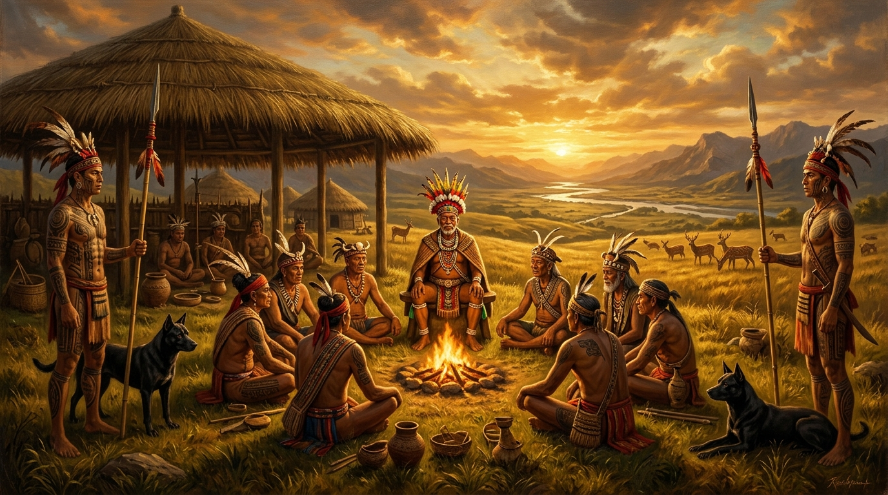
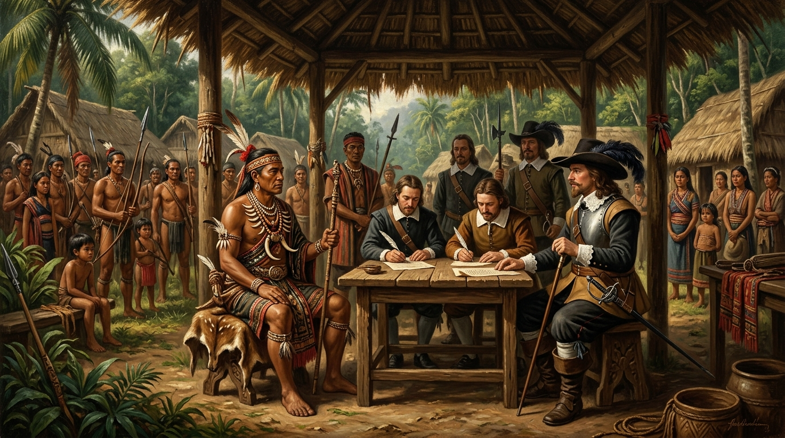
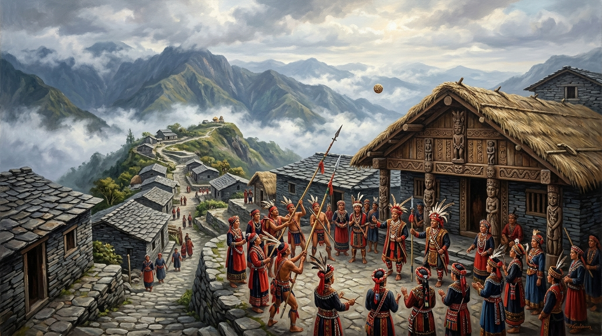
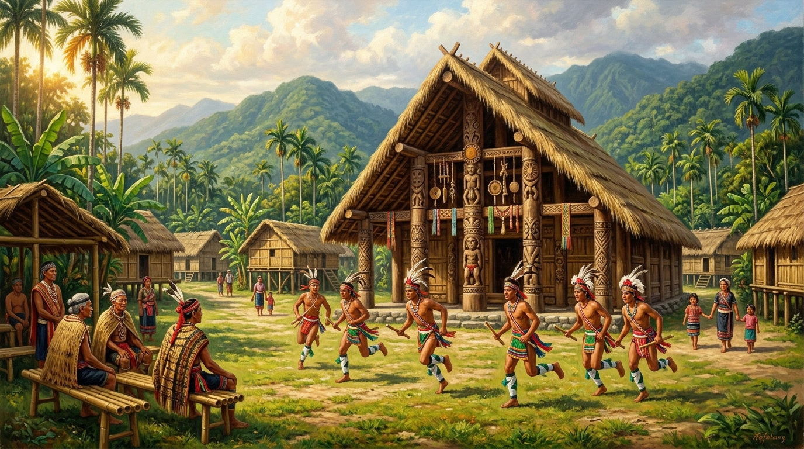
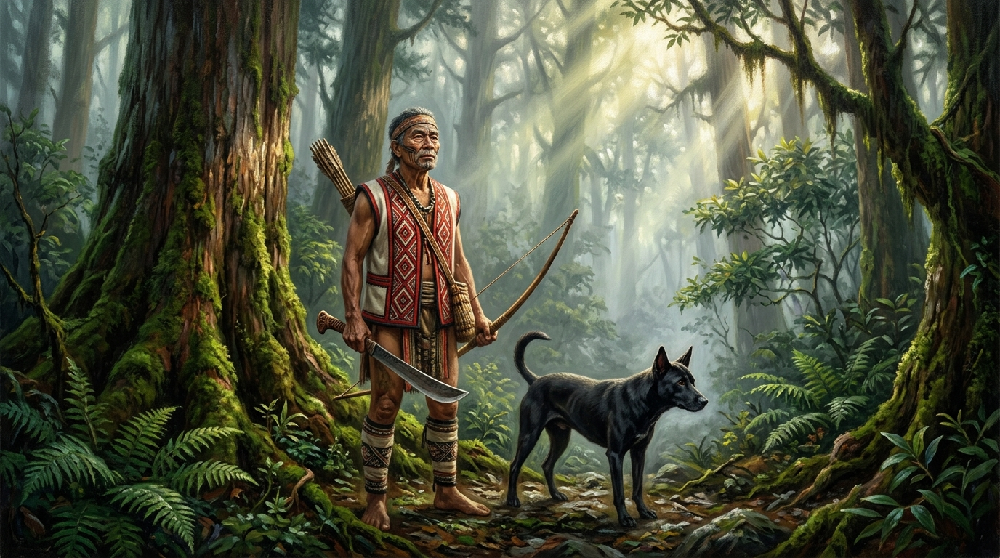

# 第 03 章：部落聯盟與土地精靈——原住民族的社會秩序、神話祭儀與獵場智慧

> **時期分類**：第一時期：史前文明與南島之源  
> **時代跨度**：史前晚期至荷蘭接觸時期（約 1000 CE – 1660s）  
> **關鍵人物**：甘馬轄·阿興（Camachat Asing）、甘馬轄·馬洛（Camachat Maloe）、彼得·文伯恩（Pieter Boon）、黃叔璥、劉國軒  
> **歷史現場與坐標**：臺中大肚社遺址（`24.1530, 120.5510`）、臺中沙鹿沙轆社（`24.2335, 120.5602`）、屏東泰武老排灣石板屋（`22.5856, 120.6558`）、花蓮光復太巴塱部落（`23.6698, 121.4308`）  
> **核心突破與歷史轉折**：在文字歷史破曉前，臺灣島上已形成超部落的本土跨族群聯邦「大肚王國」，以及依循自然律法生生不息的多元原住民族社會秩序與生態獵場智慧。  
> **影音連結**：[重點解說影片 (YouTube)](https://youtu.be/zUdGDyUpf9g) ｜ [雙人對談播客 (YouTube)](https://youtu.be/C3thxaXg7Fc) ｜ [NotebookLM 專案](https://notebook.google.com/notebook/ee42169d-1eeb-4a2f-a2df-2fc81a758348)  


*▲ 歷史概念復原圖：17 世紀中葉臺中大肚山台地，大肚王國首領甘馬轄·阿興（Camachat Asing）召集拍瀑拉、巴布薩、巴宰與洪雅各社頭目長老舉行會盟大典。夕陽籠罩廣袤的中臺灣草原，獵犬與鹿群奔馳於大肚溪畔。*

---

## 【甲部：深度歷史專題長文】

### 壹、 歷史破曉：在山海與林野之間——未被文字記載的島嶼文明多樣性

在歐洲大航海時代的風帆尚未刺破福爾摩沙的晨霧之前、在明鄭王朝的大軍尚未渡過黑水溝之前，臺灣島從來不是一片靜默無聲的荒蠻之境。

在這座南北縱長近四百公里、從海拔零公尺的蔚藍潮間帶拔地而起直衝近四千公尺玉山巔峰的島嶼上，高山深谷阻隔了強烈的季風，也雕琢出世界上生態跨度最密集、地貌最複雜的自然舞台。在長達數千年的歲月裡，南島語族的子孫依循著洋流、山脊、河谷與林野的脈動，在此開枝散葉。

長久以來，受限於「無文字即無歷史」的傳統文明偏見，許多人誤以為十七世紀之前的臺灣原住民只是一盤分散於深山林野中、孤立而原始的部落碎屑。然而，當代歷史學、人類學與歷史語言學的跨界考證卻揭示出一個完全不同的壯麗景象：

臺灣原住民族不僅孕育出全亞洲乃至全球南島語系中形態最多樣的社會結構，更在中臺灣的大肚溪流域與嘉南平原邊緣，締造了一個超越單一部落血緣、橫跨多個語言族群的本土政治實體——**「大肚王國（Kingdom of Middag）」**。與此同時，在高山深谷與縱谷海岸間，排灣族的世襲貴族制度、阿美族的母系年齡階級、泰雅族的祖訓 Gaga 獵場誓約，以及布農族以天籟八部合音敬畏粟作的宇宙觀，共同交織出一套極度精密、講求天人平衡的人性法則與生態智慧。

這座島嶼在文字歷史黎明前夕所展現的，不是未開化的空白，而是一部寫在山川草木、紋刺在先民肌膚、吟唱於祭典夜空中的深沉史詩。

---

### 貳、 風暴核心：中臺灣平原上的跨族群奇蹟——「大肚王國」（Kingdom of Middag）與甘馬轄·阿興


*▲ 歷史概念復原圖：1645 年大肚社聚落，大肚王首領甘馬轄·阿興佩戴骨飾與鹿皮披肩，手持長矛端坐於集會所前，平靜堅定地與荷蘭東印度公司全權代表彼得·文伯恩（Pieter Boon）上尉簽署互不侵犯協議，堅持保留王國各社祖靈傳統與自治權。*

1644 年歲末，一封自臺灣熱蘭遮城發往荷蘭巴達維亞（今印尼雅加達）總督府的機密公文，打破了荷蘭殖民當局對臺灣原住民的輕蔑認知：

> 「大員以北之中部廣袤原野，非如南部各村社之各自為政。其地有大君長名曰 Camachat，威震十八社，轄民剽悍善射，出入跨鹿，土地肥沃而野生鹿隻成群……彼等不納王稅，不尊客教，儼然一獨立之邦。」  
> ——摘譯自荷蘭東印度公司《熱蘭遮城日誌》

這個被荷蘭人敬畏地稱為 **「米達格王國（Kingdom of Middag）」**、被清代漢人稱作 **「大肚番王」** 的本土政權，正是臺灣歷史上破天荒第一個確立存在的跨部落聯盟國家實體。

#### 一、 邦聯的版圖與族群構造
大肚王國的核心腹地坐落於今日臺中市的大肚山台地與烏溪（大肚溪）流域，北達大甲溪南岸，南抵彰化平原濁水溪北岸，東面直逼南投埔里盆地的山腳邊緣。

這並非單一民族的封閉氏族，而是一個包含了**拍瀑拉族（Papora）**、**巴布薩族（Babuza）**、**巴宰族（Pazeh）** 與 **洪雅族（Hoanya）** 四大族群、共計 18 至 27 個大型聚落社群的「超部落聯邦（Tribal Confederation）」。其中，拍瀑拉族的大肚社（Middag）、水裡社（今龍井）、沙轆社（Camachat，今沙鹿）與牛罵社（今清水），是大肚王國最精銳的核心基石。

#### 二、 領袖「Quataong」與統治哲學
大肚王國的至高統治者擁有本土尊號 **「Quataong（華達旺）」**，荷蘭文獻尊稱為「Keizer van Middag（米達格皇帝）」。十七世紀前半葉在位的偉大領袖名為 **甘馬轄·阿興（Camachat Asing）**。

與歐亞大陸專制集權的帝王截然不同，Quataong 的權力建築在一套精巧的南島聯邦共治秩序之上：
1. **最高仲裁權而非專制生殺**：當不同村社因獵場邊界、婚嫁或水源爆發衝突時，Quataong 親自召開長老會議進行調解裁斷，其判決各社莫敢不從；
2. **戰事總動員令**：當外敵或海盜進犯時，Quataong 有權向轄下各社發出烽火號召，在極短時間內動員數千名步履如飛、善使長矛與毒箭的勇士；
3. **土地與獵場統籌保護**：王國嚴格禁止外族擅自闖入中部平原開墾或過度獵捕梅花鹿，維持了生態生生不息的平衡。

#### 三、 抵禦外侮與鐵血輓歌
1644 年 11 月，企圖壟斷全臺灣鹿皮外銷與打通南北交通走廊的荷蘭東印度公司，派出陸軍上尉彼得·文伯恩（Pieter Boon）率領數百名裝備滑膛槍的荷軍與各社僕從軍北伐大肚王國。然而，深入大肚山密林與溪谷的荷蘭軍隊遭遇了阿興王勇士的游擊伏擊，死傷慘重，被迫狼狽撤回赤崁。

1645 年初，荷蘭當局調集重兵、動用戰船封鎖海岸二度來犯。面對外來火器的優勢射程，睿智的甘馬轄·阿興展現了高超的外交智慧：他在沙轆社與文伯恩會面談判，同意出席荷蘭的「地方長老評議會（Landdag）」，形式上與東印度公司締結和平友好盟約；但他同時**嚴厲拒絕荷蘭派駐軍隊，更堅決禁止基督教傳教士進入王國各社傳教**。大肚王國成功在西方殖民強權的夾縫中，捍衛了中臺灣自主的政治獨立與祖靈傳統。

然而，大肚王國能阻擋荷蘭紅毛番的洋槍，卻難以阻擋三十年後明鄭王朝以軍屯開墾為名的雷霆撲殺。1670 年代，鄭經政權因軍糧困窘派遣大將劉國軒大舉北進，遭遇沙轆社族人的殊死抵抗。劉國軒採取殘酷圍剿策略，血洗沙轆社，屠滅數百名抗暴勇士。大肚王國元氣大傷，王風漸熄，最終在清雍正年間（1731–1732 年）的大甲西社抗暴事件後，徹底消逝在歷史塵煙之中。

---

### 參、 制度與靈性：臺灣原住民族的四大社會形態與生態獵場智慧

大肚王國展現了原住民在平原政治組織上的巔峰造極，而在臺灣的高山、縱谷與海濱，因應不同生態環境所孕育出的四大社會組織形態，更構成了臺灣文化多樣性最燦爛的基因庫。


*▲ 歷史概念復原圖：屏東泰武大武山下排灣族老部落。層疊深黑的頁岩與板岩石板屋錯落於雲霧山脊間，頭目家屋門楣雕刻著神聖的百步蛇紋與人首圖騰，貴族族人身著織錦刺繡盛裝、配戴琉璃珠，舉行神聖五年祭迎靈儀式。*

#### 一、 貴族階層與石板家屋：排灣族與魯凱族的嚴謹等級秩序
深居於南部中央山脈兩麓的排灣族（Paiwan）與魯凱族（Rukai），建立了一套全世界南島語族中罕見的嚴密**貴族階層體制（Hierarchical Society）**：

- **四大階級結構**：社會嚴格劃分為大頭目（Mamazangiljan）、貴族、勇士與平民。頭目掌握著部落土地、河流與獵場的名義所有權，平民向頭目租佃土地耕作並繳納部分收穫作為稅賦，頭目則負責庇護全族、調解爭端並主持重大祭儀。
- **家屋名與長嗣繼承制**：排灣族實行「長嗣繼承（無論男女，第一個出生的孩子即為繼承人）」，家屋不僅是一棟建築，更是擁有專屬名字、神聖地位與歷史記憶的法人主體。
- **岩石雕琢的永恆家園**：依山而建的「石板屋（Slate house）」是排灣與魯凱先民的建築奇蹟。他們運用大自然層理分明的板岩與頁岩，仿造百步蛇鱗片的排列層疊搭建，既能抵禦強烈颱風的狂風暴雨，又具備冬暖夏涼的被動節能效果。門楣上繁複雕刻的百步蛇紋與祖靈人首，是貴族家屋尊貴地位的永恆象徵。


*▲ 歷史概念復原圖：花蓮光復太巴塱部落，巨大茅草覆頂的原木青年會所（Sfi）前，阿美族成年男子年齡階級（Kapah）青年正在長老監督下進行長跑與體魄操練，會所外圍是母系氏族溫馨掌管的高腳干欄穀倉與竹木住屋。*

#### 二、 母系傳承與青年會所：阿美族與卑南族的年齡階級社會
在花東縱谷與太平洋海岸平原上，阿美族（Amis）與卑南族（Puyuma）展現了另一種剛柔並濟的社會智慧——**母系社會（Matrilineal Society）** 與 **年齡階級體系（Age-grade Organization）** 的完美分工：

- **母系繼承與從妻居**：在家庭內部，財產（包括土地與房舍）由女性繼承，男子結婚時「入贅從妻居」。女性是家庭的核心管理者與靈魂守護者。
- **青年會所與年齡階級**：在部落公共領域，所有成年男子依年齡嚴密編入不同的階級（例如阿美族的 *Kapah*）。男童在進入會所（*Sfi*）後，接受長達數年的野外求生、戰技搏擊、歷史歌謠傳承與集體勞動考驗。每隔數年舉行成年禮晉級，整個部落的防衛、水利開鑿、道路修築與公共決策，全數由這個高度紀律化的男性年齡階級共同承擔。
- **敬老制度與平權民主**：最高權力不屬於世襲單一家族，而是歸於最高年齡階級的長老群體。在太巴塱與馬蘭部落的豐年祭（*Ilisin*）上，青年階級必須謙卑地服侍長老，唯有凝聚了長幼有序的集體協同，部落才能在滔天風浪與外敵進犯中屹立不搖。


*▲ 歷史概念復原圖：中央山脈海拔兩千公尺雲霧原始檜木林中，泰雅族文面獵人手持獵刀、背負藤編獵網，凝視著山嵐深處的獵場。他身心虔敬地恪守祖訓 Gaga，嚴格遵循不濫捕懷胎母獸、敬畏自然神靈的生態永續誓約。*

#### 三、 祖訓 Gaga 與無階級誓約：泰雅族與太魯閣族的純粹平權
棲息於中央山脈險峻高山帶的泰雅族（Atayal）與太魯閣族（Truku），發展出一種令現代政治哲學家驚嘆的**完全平權社會（Egalitarian Society）**：

- **不存在世襲頭目**：族群內部沒有貴族，也沒有階級剝削。部落領袖通常由最勇敢正直的獵人或智慧長老推舉產生，其權力僅限於協調，絕無專制號令的特權。
- **神聖祖訓「Gaga」**：維繫整個社會運作的不是成文法律或國家軍隊，而是至高無上的 **Gaga（祖訓律法）**。Gaga 是祖先留下來的道德規範、生活戒律與宇宙秩序。凡是通姦、偷竊、濫捕獵物或破壞誓約者，都被視為「玷污了 Gaga」，會招致祖靈的降怒（乾旱、傳染病或獵場歉收）。族人必須殺豬分食、舉行和解儀式以洗淨污名。
- **文面榮耀與靈橋審判**：男女在成年時於臉頰刺上深藍墨色的「文面（Facial Tattoo）」，男子必須證明具備守護部落的狩獵勇氣，女子則必須展現精湛神妙的織布技藝。文面是通往死後祖靈安息之地——「彩虹橋（Hongu Utux）」的永恆通行證。唯有生前恪守 Gaga、純潔無瑕的靈魂，才能昂首踏過彩虹橋，回到祖先溫暖的懷抱。

#### 四、 天籟八部合音與粟作宇宙：布農族與鄒族的父系大家族
在玉山與中央山脈的高海拔心臟地帶，布農族（Bunun）與鄒族（Cou）以其對植物生長律動的超凡直覺，建立了與高山共生的神聖秩序：

- **父系大家族與長老會**：十幾口甚至數十口人同居於以巨木與板岩構築的大長屋中，以父系血脈凝聚為堅不可摧的氏族（*Qanitu*）。
- **Pasibutbut（祈禱小米豐收歌）的宇宙共鳴**：布農族是臺灣唯一發明「象形原始繪曆（小米祭曆）」的民族。在播種小米的春季，部落男子圍成緊密同心圓，低頭肅穆，發出奇蹟般的泛音共振——這便是聞名全球的 **「八部合音（Pasibutbut）」**。他們深信，歌聲必須完美和諧地從低音攀升至無可挑剔的純八度天籟，直到迴盪在山谷岩壁之間，才能取悅掌管五穀豐收的天神（*Dihanin*），祈求小米如瀑布般豐收。

---

### 肆、 歷史迴響：土地的精靈與現代島嶼的文化源流

當我們今日重新審視這段前殖民時代的原住民族歷史，所看見的不僅僅是人類學標本，而是現代臺灣最珍貴的文明資產與生態哲理：

1. **多元平等的政治雛形**：無論是中臺灣跨族群大肚王國的酋邦聯邦制，還是泰雅族恪守祖訓 Gaga 的無階級自治，證明了臺灣這座島嶼在接觸西方現代國家機器之前，早已有能力建立成熟、具備自我糾錯能力與調解機制的公共政治體系。
2. **生態永續與敬畏自然的獵場倫理**：原住民族的禁獵期、獵場輪休、不捕懷孕母獸與幼獸的禁忌，本質上是高度超前的現代生態保育科學。他們將自己視為大地母親的守護者，而非狂暴掠奪資源的主宰者。
3. **不可磨滅的島嶼文化身世**：今天流淌在臺灣地名裡的音節——臺北的「艋舺（Bangka，獨木舟之意）」、宜蘭的「噶瑪蘭」、臺中的「沙鹿（Salach）」、屏東的「打狗（Takau，竹林之意）」——全部都是原住民族烙印在島嶼土地上的永恆印記。

那些在大肚山台地上奔馳呼嘯的風聲、在泰武石板屋門前跳躍的篝火、在太巴塱聚會所裡徹夜響徹的踏步歌聲，從未真正散去。它們化為土地的精靈，深刻形塑了臺灣人面對大自然時的堅韌、包容與謙卑。

---

### 伍、 核心史料與歷史指標對照表（標準 Markdown 表格規範）

#### 1. 臺灣原住民族四大核心社會型態與制度文化對照表
| 社會組織型態 | 代表族群 | 核心社會結構與繼承制度 | 居住建築與工藝特徵 | 核心信仰精神與標誌祭儀 | 歷史與生態哲學意涵 |
| :--- | :--- | :--- | :--- | :--- | :--- |
| **貴族階層社會** | 排灣族（Paiwan）<br>魯凱族（Rukai） | 頭目、貴族、勇士、平民嚴格等級；長嗣繼承制（不分男女）；世襲家屋名 | 層疊板岩與頁岩石板屋；門楣百步蛇木雕；琉璃珠與古陶壺 | 百步蛇祖靈崇拜；五年祭（Maleveq）；刺球祈福 | 強調家屋法人地位與土地世襲秩序，展現高度分工的精緻宮廷工藝與社會穩定性 |
| **母系年齡階級** | 阿美族（Amis）<br>卑南族（Puyuma） | 母系財產繼承（從妻居）；男子嚴密年齡階級（Kapah）；長老會議集體共治 | 高腳干欄式竹木建築；男子專屬集會所（Sfi）；巨型糧倉 | 敬老尊賢；豐年祭（Ilisin）；卑南大獵祭（Mangayau） | 家庭內女性掌權、公共領域男性集體承擔，以年齡階級打破世襲壟斷，彰顯平權民主精神 |
| **無階級平權社會** | 泰雅族（Atayal）<br>太魯閣族（Truku） | 無世襲階級；推舉具獵德與智慧者為領袖；以氏族血親為核心紐帶 | 半穴居或竹木高腳家屋；精湛苧麻編織與獵網製作 | **祖訓 Gaga**；成年文面榮耀；彩虹橋（Hongu Utux）靈魂審判 | 以道德戒律取代國家暴力，強調天人誓約與獵場永續，恪守不濫捕的生態平衡 |
| **父系大家族與粟作** | 布農族（Bunun）<br>鄒族（Cou） | 父系大家族共居制；氏族長老議事；高海拔深山活動與巡獵 | 板岩木構大家族長屋；男子會所（Kuba，鄒族）；木刻小米祭曆 | **八部合音（Pasibutbut）**；天神（Dihanin）信仰；小米打獵祭 | 緊密配合小米粟作生長節氣，以人聲泛音與自然共鳴，展現最純粹之泛神生態敬畏 |

#### 2. 大肚王國（Kingdom of Middag）歷史發展與外交抗爭對照表
| 歷史事件／衝突階段 | 發生年代與核心地點 | 對峙勢力與關鍵領袖 | 事件經過與博弈焦點 | 最終協議與歷史結果 | 對臺灣通史之深遠影響 |
| :--- | :--- | :--- | :--- | :--- | :--- |
| **荷軍初次北伐大肚王國** | 1644 年 11 月<br>大肚山台地與溪谷 | 荷蘭東印度公司（Pieter Boon 上尉）<br>vs 大肚王國（甘馬轄·阿興） | 荷軍試圖打通南北交通走廊並壟斷鹿皮出口，率軍北伐遭遇伏擊敗退 | 荷軍傷亡受挫撤退，大肚王國成功守住獨立疆界 | 確立大肚王國為荷治時期臺灣中部不可輕侮的本土強權實體 |
| **荷軍二次北伐與和平協議** | 1645 年 1 月 – 4 月<br>沙轆社與熱蘭遮城 | 荷蘭長官弗朗索瓦·卡隆<br>vs 甘馬轄·阿興 | 荷軍調集大軍與戰船二度進逼，雙方於沙轆社進行高層政治談判 | 阿興王同意出席地方評議會，但**堅拒荷軍駐紮並嚴禁傳教士進駐** | 達成表面臣服但實質高度自治的外交均勢，保留本土文化信仰完整性 |
| **明鄭政權北進軍屯血洗** | 1670 年代<br>臺中沙鹿沙轆社遺址 | 明鄭左武衛劉國軒<br>vs 拍瀑拉族沙轆社族人 | 明鄭政權因糧餉短缺向北強制軍屯搶奪土地，沙轆社奮起抵抗遭慘烈鎮壓 | 劉國軒採屠殺滅絕策略，沙轆社幾乎覆滅，大肚王國名存實亡 | 摧毀了臺灣本土最成熟的跨部落聯邦結構，開啟漢人大規模湧入中部拓墾序幕 |

#### 3. 臺灣原住民族四大歲時神聖祭儀與宇宙觀對照表
| 祭儀名稱 | 代表族群與舉辦週期 | 祭儀核心神明／祖靈標的 | 儀式核心過程與特徵 | 現代文化象徵與精神傳承 |
| :--- | :--- | :--- | :--- | :--- |
| **五年祭（Maleveq）** | 排灣族（每五年舉行一次） | 創世神、守護神與歷代祖靈 | 豎立高聳刺球架，勇士手持十餘公尺竹竿，合力爭刺拋向空中的神聖藤球（代表吉凶與獵運） | 連結天界、人間與祖靈的宏大紐帶，展現貴族組織動員力與部落團結誓約 |
| **八部合音（Pasibutbut）** | 布農族（每年初春小米播種時） | 天神 Dihanin 與小米神 | 男子圍成同心圓，無伴奏合唱，從極低音逐漸產生多部重疊泛音共振，模仿蜜蜂震翅天籟 | 世界上複音音樂（Polyphony）之奇蹟，祈求粟作豐收與萬物平衡共生 |
| **大獵祭（Mangayau）** | 卑南族（每年歲末年終） | 祖靈與山林獵場神祇 | 長老帶領青年男子入山紮營狩獵數日，歸來時婦女在部落入口為勇士編織花環加冕 | 嚴格考驗青年野外求生與護衛能力，並透過除喪儀式告慰亡靈、迎向新生 |
| **祖靈祭與文面成年禮** | 泰雅族（收穫後與成年之際） | 歷代祖靈（Utux） | 敬獻新熟小米與醃肉，長老檢查族人是否遵循 Gaga，為合格男女刺面紋身 | 確立個人在部落群體中的成熟人格與道德清白，為踏上彩虹橋之神聖指引 |

---

### 陸、 關鍵歷史大事記（Timeline 編年表格）

| 時間坐標 | 歷史分期／時代 | 關鍵歷史事件與重大突破 | 文明里程碑意義 |
| :--- | :--- | :--- | :--- |
| **約 1000 – 1600 CE** | 史前晚期至早期接觸 | **大肚王國在中臺灣建立邦聯**<br>拍瀑拉、巴布薩、巴宰、洪雅等社聯盟 | 突破單一部落孤立型態，形成全臺第一個跨族群、超部落的本土政治聯邦實體 |
| **1603 年** | 明末接觸時期 | **陳第隨沈有容追擊海盜至臺灣，撰寫《東番記》** | 一手詳細記錄大員周邊原住民無階級、無徭稅、崇尚自然獵捕之純樸社會圖景 |
| **1644 年 11 月** | 荷治初期 | **荷蘭陸軍上尉彼得·文伯恩（Pieter Boon）首度北征大肚王國受挫** | 大肚王國勇士於大肚山密林擊退裝備滑膛火槍之荷軍，捍衛本土主權 |
| **1645 年 1 月 – 4 月** | 荷治初期 | **甘馬轄·阿興（Camachat Asing）與荷蘭簽署和平盟約** | 雙方達成互不侵犯，大肚王國堅拒傳教士與駐軍，維持「表面宗主、實質獨立」 |
| **1648 年** | 荷治中期 | **甘馬轄·馬洛（Camachat Maloe）繼承大肚王位** | 延續聯邦體制，有效調解各社糾紛，維持中臺灣二十餘社數十年穩定繁榮 |
| **1670 年** | 明鄭時期 | **明鄭將領劉國軒北征拓墾，血洗沙轆社** | 大肚王國遭遇毀滅性軍事打擊，精銳部落受重創，王國勢力自此急遽衰退 |
| **1722 年** | 清領初期 | **巡臺御史黃叔璥巡歷全臺，著《臺海使槎錄·番俗六考》** | 詳盡記錄大肚王昔日「統轄數十社、出入乘鹿」之盛況，為大肚王國留下珍貴漢文史料 |
| **1731 – 1732 年** | 清領雍正年間 | **大甲西社抗暴聯合事件爆發** | 中部平埔各社因官吏苛斂爆發最後一次大規模武裝抗暴，遭清廷平定後大肚王國徹底瓦解 |

---

### 柒、 參考資料與一手權威文獻清單

1. **江樹生 譯註**，2000，《*熱蘭遮城日誌（第一至三冊）*》，臺南市政府文化局。
2. **黃叔璥**，1722（臺灣文獻叢刊本 1957），《*臺海使槎錄*》，臺灣銀行經濟研究室。
3. **陳第**，1603（臺灣文獻叢刊本 1959），《*東番記*》，收錄於沈有容《閩海贈言》。
4. **康培德（Peter Kang）**，2003，《*殖民接觸與帝國邊陲：從荷蘭文獻看 17 世紀中臺灣原住民的社會變遷*》，國立臺灣大學歷史學系。
5. **翁佳音**，2008，《*大肚王國與十七世紀中臺灣平埔族群的政治實體*》，中央研究院臺灣史研究所。
6. **李亦園**，1982，《*臺灣土著民族的社會與文化*》，聯經出版事業公司。
7. **衛惠林**，1965，《*臺灣省通志稿·卷八·同胄志·原住民各族社會組織篇*》，臺灣省文獻委員會。
8. **中央研究院民族學研究所**，1996，《*臺灣原住民歷史文化圖說*》，聯經出版事業公司。

---

## 【乙部：Google NotebookLM 影音提示詞、旁白腳本與字幕專用庫】

### 一、 Google NotebookLM 影片風格設定與生成提示詞（Prompt）

#### 1. 建議風格與受眾定位
- **敘事風格定位**：壯麗史詩歷史探索風格（兼具原始山林空靈感、部落聯邦磅礡氣度與文明制度深層思辨）。
- **受眾定位**：大眾文史愛好者、大專與高中學生、對臺灣原住民族文化歷史及人類學有濃厚興趣之讀者。
- **播音語氣指引**：深沉、具敬畏感與歷史厚度；在講述大肚王國抵禦外侮時語調激昂堅定；在講述排灣石板屋、泰雅 Gaga 與布農八部合音時，語氣轉為神聖寧靜與崇高感。

#### 2. NotebookLM 專用生成提示詞（Prompt）
> **複製以下提示詞輸入至 Google NotebookLM：**
> 
> 「請依據本章所附的歷史資料與專題長文，為第 03 章《部落聯盟與土地精靈——原住民族的社會秩序、神話祭儀與獵場智慧》製作一段精彩的影音解說內容。
> 
> **重點演繹要求**：
> 1. **破題懸念**：打破『臺灣在十七世紀前是無文明蠻荒』的刻板印象，生動展現原住民族如何在山海之間建立了世界上最豐富多元的社會秩序與生態智慧。
> 2. **核心現場（大肚王國）**：深入描繪中臺灣『大肚王國（Kingdom of Middag）』跨越四大族群的酋邦聯邦體制，重點刻劃領袖甘馬轄·阿興（Camachat Asing）如何以游擊戰挫敗荷蘭軍隊，並在會談中堅守自治與祖靈傳統的外交智慧。
> 3. **四大社會制度的哲理對照**：對比排灣族的世襲貴族與石板家屋、阿美族的母系社會與青年年齡階級、泰雅族恪守祖訓 Gaga 的無階級誓約，以及布農族以天籟八部合音（Pasibutbut）共振小米宇宙的敬畏。
> 4. **歷史昇華**：結尾扣回原住民獵場智慧對現代環境保護的啟示，強調這些深印在島嶼地名與血脈中的精神，正是現代臺灣文明永恆的靈魂根基。
> 請保持語句精煉生動、大氣磅礡、專有名詞嚴謹無誤。」

---

### 二、 影視級口播旁白稿（搭配分鏡節奏）

#### 【場景一：破題懸念與山林低語（0:00 - 1:30）】
- **畫面建議**：[空拍晨霧繚繞的中央山脈檜木林海，鏡頭俯衝掠過奔騰的大肚溪與太平洋巨浪，淡入古地圖與紋面長老凝視鏡頭]
- **旁白台詞**：
  > 在外來的船帆刺破島嶼的晨霧之前，
  > 臺灣，從來不是一片沉睡的荒原。
  > 在這座從深海拔起、直衝雲霄的島嶼上，
  > 先民依循著山脊與獵場的脈動，
  > 繁衍出生生不息的文明火種。
  > 這裡沒有森嚴的皇宮與帝國長城，
  > 卻有跨越族群的平原王國，
  > 以及刻在岩石與肌膚上的永恆誓約。
  > 這是一段屬於部落聯盟，
  > 與土地精靈的古老傳奇。

#### 【場景二：大肚山風雲與阿興王的會盟（1:30 - 4:00）】
- **畫面建議**：[大肚山台地夕陽下，拍瀑拉族與巴宰族長老圍繞營火，荷蘭文獻《熱蘭遮城日誌》泛黃羊皮紙手稿與甘馬轄阿興堅定眼神特寫]
- **旁白台詞**：
  > 十七世紀中葉，當荷蘭紅毛軍隊，
  > 扛著滑膛火槍開進中臺灣時，
  > 他們震驚地發現：
  > 這裡屹立著一個強大的本土政權——「大肚王國」。
  > 首領甘馬轄·阿興，
  > 統轄著跨越四大族群、近三十個村社。
  > 他們步履如飛、善使長矛，
  > 在密林中重創了不可一世的殖民軍隊。
  > 在沙轆社的談判桌前，
  > 阿興王以驚人的智慧，
  > 迫使荷蘭人承認王國的自治。
  > 臺灣本土的第一個跨部落聯邦，
  > 在歷史的晨曦中，刻下了不屈的尊嚴。

#### 【場景三：四大制度與天地誓約（4:00 - 6:30）】
- **畫面建議**：[快速切換四大場景：排灣族板岩家屋與百步蛇雕、太巴塱部落男子會所長跑、泰雅獵人彩虹橋壁畫、布農族八部合音圍圓仰望天穹]
- **旁白台詞**：
  > 走出平原，走進高山深谷，
  > 臺灣原住民族孕育了令人驚嘆的社會智慧。
  > 在南方，排灣族以層疊石板屋，
  > 築起嚴密的世襲貴族與家屋榮耀；
  > 在東海岸，阿美族將財產交給女性，
  > 讓男子青年階級，以鐵的紀律捍衛部落；
  > 在險峻的中央山脈，泰雅獵人沒有頭目，
  > 卻將神聖的「祖訓 Gaga」紋在臉上，
  > 誓死守護獵場的純潔；
  > 而布農先民圍成緊密的圓圈，
  > 以天籟般的八部合音，
  > 唱出與自然萬物共生的永恆謙卑。

#### 【場景四：歷史迴響與大地之魂（6:30 - 8:00）】
- **畫面建議**：[今日臺灣繁華都市空拍漸變回古地圖，出現「艋舺、沙鹿、打狗」字樣，鏡頭拉回玉山頂峰的金色日出]
- **旁白台詞**：
  > 歲月流轉，大肚王國的烽火已然熄滅，
  > 但祖靈的智慧，早已融入這片土地的血脈。
  > 從獵場輪休的永續哲學，
  > 到我們今天口中呼喚的每一個古老地名，
  > 都是先民留給這座島嶼最深沉的胎記。
  > 臺灣不是無根的漂泊之舟，
  > 尊重山海、敬畏天地、包容多元，
  > 這是臺灣原住民族，
  > 留給這座島嶼最永恆的立國之魂。

---

### 三、 Faster-Whisper 專用提示詞庫（Initial Prompt）

> **使用方式**：使用 Faster-Whisper 轉錄 NotebookLM 影音檔時，請將以下字詞填入 `initial_prompt`：

```text
臺灣史, 史前文明, 原住民族, 大肚王國, Middag, 甘馬轄阿興, 甘馬轄馬洛, Camachat, 華達旺, Quataong, 拍瀑拉族, 巴布薩族, 巴宰族, 洪雅族, 大肚社, 沙轆社, 牛罵社, 彼得文伯恩, Pieter Boon, 熱蘭遮城日誌, 臺海使槎錄, 黃叔璥, 劉國軒, 排灣族, 魯凱族, 石板屋, 百步蛇, 五年祭, 阿美族, 卑南族, 太巴塱, 年齡階級, Kapah, 青年會所, Sfi, 豐年祭, 大獵祭, 泰雅族, 太魯閣族, Gaga, 祖訓, 文面, 彩虹橋, 布農族, 鄒族, 八部合音, Pasibutbut, 小米祭曆, Dihanin
```
