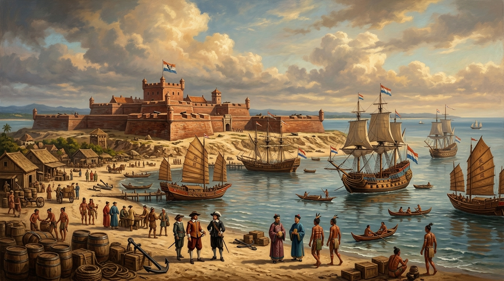
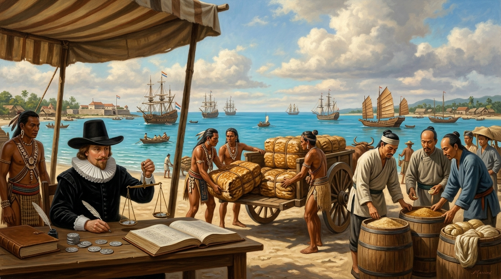
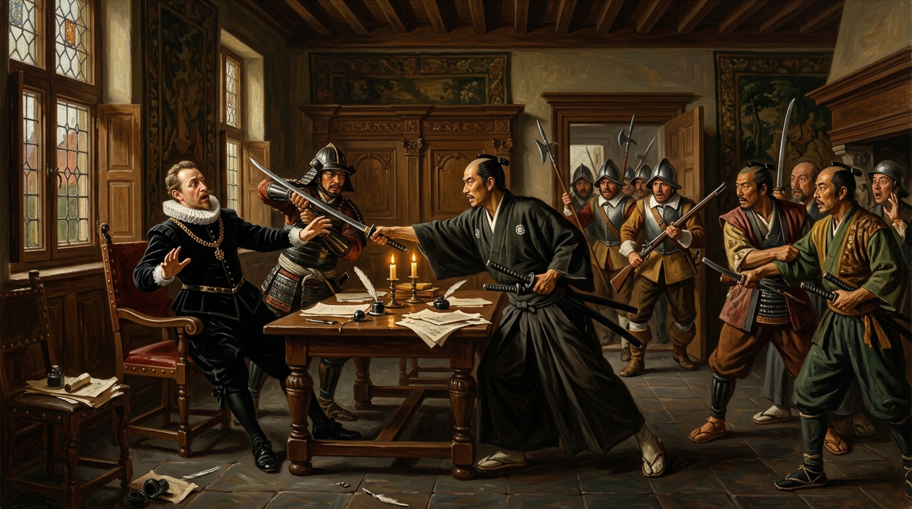

# 第 04 章：熱蘭遮的紅毛城旗——荷蘭東印度公司（VOC）與大員貿易霸權

> **時期分類**：第二時期：大航海時代與荷西競逐  
> **時代跨度**：荷治荷蘭東印度公司時期（1624 – 1662）  
> **關鍵人物**：宋克（Martinus Sonck）、彼得·奴易茲（Pieter Nuyts）、濱田彌兵衛、甘治士（Georgius Candidius）、尤羅伯（Robertus Junius）、普特曼斯（Hans Putmans）、鄭芝龍（一官）  
> **歷史現場與坐標**：臺南安平熱蘭遮城（`22.9997, 120.1605`）、臺南中西區普羅民遮城（`22.9976, 120.2025`）、臺南新市新港社（`23.0786, 120.2925`）、臺南麻豆麻豆社（`23.1818, 120.2482`）、澎湖馬公風櫃尾荷蘭城堡（`23.5412, 119.5358`）  
> **核心突破與歷史轉折**：荷蘭東印度公司（VOC）以熱蘭遮城為軍政要塞，將臺灣大員打造成串聯阿姆斯特丹、巴達維亞、長崎與廈門的東亞轉口貿易樞紐；透過鹿皮與砂糖出口、贌社制度、地方會議與新港文書羅馬字化，將臺灣正式推向近代世界資本主義體系的風口浪尖。  
> **影音連結**：[重點解說影片 (YouTube)](https://youtu.be/F9PmvVUY7no) ｜ [雙人對談播客 (YouTube)](https://youtu.be/-NUWwkAHEPA) ｜ [NotebookLM 專案](https://notebook.google.com/notebook/1a1e5998-4182-485f-927a-fe0fcc5f7259)  


*▲ 歷史概念復原圖：17 世紀中葉臺灣大員（今臺南安平一鯤鯓），荷蘭東印度公司（VOC）築造的巍峨紅磚棱堡「熱蘭遮城（Fort Zeelandia）」高聳於沙洲之巔，三色親王旗迎海風飄揚。臺江內海藍天碧波間，滿載生絲與白銀的荷蘭東印度蓋倫戰船、武裝快船（Fluyt）與福建商船、西拉雅獨木舟交織梭巡。*

---

## 【甲部：深度歷史專題長文】

### 壹、 歷史破曉：從風櫃尾到一鯤鯓——荷蘭東印度公司的東來與大員築城

1624 年 8 月底的臺南安平海岸，季風初起，臺江內海的沙洲在海浪拍擊下泛起層層白沫。幾艘懸掛著荷蘭東印度公司（Vereenigde Oostindische Compagnie, 簡稱 **VOC**）三色親王旗的武裝商船，緩緩駛入了大員（Tayouan）水道。

這不是一次偶然的漂流，而是十七世紀資本主義全球擴張最精準的殖民計算。

#### 一、 全球第一家股份制跨國帝國機器的崛起
成立於 1602 年的荷蘭東印度公司，是近代世界史上最龐大的特許商貿與軍事復合體。它發行了人類歷史上第一張股票，建立了現代證券交易所，更獲得荷蘭共和國國會（States-General）授權，在好望角以東擁有宣戰、媾和、佔領領土、鑄造貨幣與招募軍隊的獨立主權權力。

為了打破西班牙與葡萄牙對東方香料群島的壟斷，荷蘭人在爪哇島巴達維亞（今印尼雅加達）建立了亞洲總部。然而，巴達維亞總督們更渴望獲得的，是通往中國龐大生絲市場與日本巨額白銀寶庫的咽喉要道。

#### 二、 風櫃尾的血淚圍困與李旦的斡旋
荷蘭人的早期擴張極為坎坷。1622 年，荷蘭海軍將領雷爾生（Cornelis Reijersen）率艦隊強攻葡萄牙控制的澳門，遭遇慘烈挫敗。心有不甘的雷爾生隨後北上，強行佔領了明朝領土——澎湖群島，並在風櫃尾半島構築起一座具備四座稜堡的方形城堡。

荷蘭軍隊在澎湖強徵數千名福建漢人漁民為奴工，因飢餓、疾病與虐待，死者過半。這一侵略行徑徹底激怒了明朝萬曆與天啟朝廷。1624 年初，新任福建巡撫南居益調集上萬水陸大軍、兩百餘艘戰船直撲澎湖，將風櫃尾城堡重重包圍。

在彈盡糧絕、水井乾涸的絕境之中，縱橫海峽的海商巨賈兼海盜頭領 **李旦（Andrea Dittis）** 出面居中斡旋。南居益向荷蘭人開出嚴正底線：**「澎湖乃大明版圖，寸土不讓；若欲互市通商，澎湖之外化外之地（如大員），聽其自便，朝廷不加干涉。」**

1624 年 8 月，荷蘭第一任臺灣長官 **宋克（Martinus Sonck）** 下令拆毀風櫃尾城堡，將殘存的火砲、磚木與輜重裝船，揚帆航向僅一峽之隔的臺灣大員（一鯤鯓沙洲）。

#### 三、 熱蘭遮城與普羅民遮城：紅磚砌築的西洋稜堡
抵達大員後，荷蘭人在突出的狹長沙洲一鯤鯓上，選定了一處能完全封鎖臺江內海咽喉航道的制高點，開始修築名為 **「奧倫治城（Fort Orange）」** 的要塞，後於 1627 年正式定名為 **「熱蘭遮城（Fort Zeelandia）」**。

為了在缺乏石料的沙洲上建立永固防禦，荷蘭人展示了十七世紀歐洲最先進的軍事工程技術：
1. **紅磚遠洋船運**：早期大量紅磚直接由爪哇巴達維亞經由船艙壓艙物載運而來，質地極為密實沉重；
2. **三合土黏結配方**：就地取材，利用臺江內海盛產的蚵殼高溫燒製成蚵灰，混合糯米汁、糖漿製成堅不可摧的「三合土」作為砂漿；
3. **星形稜堡防禦**：依據文藝復興時代義大利式稜堡（Trace Italienne）理論，設計出互為火力交叉掩護的凸出稜堡，無論敵軍從海面還是陸地沙洲進攻，都將遭遇全無死角的重砲射擊。

1653 年，為進一步威懾內陸赤崁市鎮日益增多的漢人移民，荷蘭當局又在對岸赤崁市街修築了 **「普羅民遮城（Fort Provintia，今赤崁樓）」**。熱蘭遮與普羅民遮兩座要塞隔著臺江內海遙遙相望，標誌著荷蘭紅毛城旗在臺灣西南平原的軍事霸權正式確立。

---

### 貳、 風暴核心：絲銀交織與鹿皮王國——大員轉口貿易體系與三角商貿網絡


*▲ 歷史概念復原圖：1640 年代赤崁港市集，西拉雅原住民獵手以牛車載運捆紮整齊的梅花鹿皮前來交售，漢人糖商檢驗滿桶甘蔗紅糖與生絲，荷蘭東印度公司商務員（Koopman）端坐於帳篷下，手持鵝毛筆與天平秤量西班牙銀圓（Reales），逐筆登載入東印度公司貿易總帳。*

在荷蘭東印度公司的全球商業地圖中，臺灣從來不是一個單純的殖民拓殖點，而是整個東亞轉口貿易體系的 **「心臟與樞紐（Entrepôt）」**。

#### 一、 閉關鎖國與海禁陰影下的「絕妙轉運站」
十七世紀上半葉的東亞國際貿易處於極端扭曲的封閉狀態：
- **中國明朝政府**：嚴厲實施海禁政策，禁止臣民直接前往日本貿易，亦禁止葡萄牙、西班牙與荷蘭商船自由停泊中國港口；
- **日本德川幕府**：自 1630 年代起逐步頒布鎖國令（1635 鎖國令、1639 驅逐葡萄牙人），嚴禁日本船隻出海，僅允許荷蘭東印度公司與中國海商在長崎出島進行嚴格受限的貿易。

在此背景下，既不屬於明帝國管轄、又緊鄰中國東南沿海、且位於黑水溝與黑潮航線交匯處的大員，成為這場跨國黑市與特許貿易的完美中繼站。

#### 二、 三角商貿大循環的金流與物流
荷蘭東印度公司圍繞大員構建了一套精準運轉的跨國貿易三角循環：

```
                    【中國東南沿海（廈門／漳泉）】
                       /                     \
        中國生絲、綢緞、瓷器              西班牙銀圓、香料、胡椒
                     /                         \
                    v                           v
          【臺灣大員（熱蘭遮城）】 <===========> 【印尼巴達維亞（VOC總部）】
                    \                           ^
         生絲、砂糖、鹿皮                       |
                    \                           | 日本白銀
                     v                          | (轉運回荷蘭本土)
                    【日本長崎（出島商館）】 ======+
```

1. **生絲與綢緞的黑洞**：明代江南盛產的高品質生絲是日本京都貴族與武士階層最狂熱的需求。荷蘭商船利用大員作為掩護，向鄭芝龍等福建海商大批收購中國生絲，轉運往長崎出島；
2. **日本白銀的巨流**：日本石見銀山與生野銀山出產的大量純白銀，是世界銀本位經濟的推手。荷蘭人以中國生絲在日本換取白銀，再將部分白銀載回大員收購下一批絲貨，其餘白銀則運往印度與巴達維亞購買香料，甚至直接匯回阿姆斯特丹，支撐荷蘭共和國黃金時代的金融霸權；
3. **臺灣本土兩大特產：鹿皮與砂糖**：
   - **梅花鹿皮（Deerskin）**：臺灣西南平原與丘陵曾棲息著數十萬隻野生梅花鹿。鹿皮在日本被廣泛鞣製為武士甲冑的內襯、刀劍柄纏繩、皮馬靴與生活坐墊。在荷治極盛時期，大員每年外銷日本的鹿皮高達 **十萬至十五萬張**，導致臺灣西南部野生鹿群遭遇近乎滅絕的浩劫；
   - **甘蔗種植與砂糖（Sugar）**：荷蘭當局從福建招攬了上萬名熟練農民來臺，在赤崁周邊平原大面積開墾蔗田、建立糖廍。臺灣產出的砂糖不僅大量銷往日本長崎，更遠銷波斯灣與荷蘭本土，成為東印度公司獲利最豐厚的商品之一。

根據 VOC 官方檔案統計，在 1640 至 1650 年代，**臺灣大員商館的利潤曾高居東印度公司全亞洲二十餘處商館之冠，單年淨利潤佔整個東印度公司全球利潤的 25% 至 30%**！這座位於遙遠東方沙洲上的熱蘭遮城，成為阿姆斯特丹十七世紀金庫中最耀眼的聚寶盆。

#### 三、 殖民財政掠奪的三大支柱
為了將利潤壓榨到極致，荷蘭人在臺灣建立了一套極為嚴密的殖民稅捐體制：
1. **贌社制度（Verpachting）**：荷蘭當局將原住民各村社的商業交易特許權，每年在熱蘭遮城公開拍賣（稱為「競贌」）。得標的漢人商人（稱為「社商」或「贌商」）取得獨佔專賣權，得以壟斷該社的原住民鹿皮收購與日用食鹽、布匹、鐵鍋販售。社商以低價剝削原住民，再轉手高價賣給公司，成為公司轉嫁統治成本的得力代理人；
2. **人頭稅（Polltax）**：自 1640 年起，荷蘭長官規定所有在臺灣居住的十六歲以上漢人，不分男女，每月必須繳納四分之一里爾（後提高至一里爾）的人頭稅。未持有人頭稅收據者將遭重罰或拘禁；
3. **特許證與什一稅（Convooi-gelden）**：對出海獵鹿的漢人徵收「鹿陷捕執照稅（牌照稅）」；對進出大員港的所有商船貨品，抽取 10% 的出入口海關稅（什一稅）。

這套高度重商主義的稅制，在為 VOC 帶來滾滾銀流的同時，也為日後漢人移民的暴力起義埋下了血腥的炸藥。

---

### 參、 權力折衝與火砲外交：濱田彌兵衛事件與料羅灣海戰的海洋博弈

強權的崛起從來伴隨著暴烈的碰撞。荷蘭人在大員確立貿易霸權的過程中，遭遇了日本武士與中國海商集團最頑強的挑戰。


*▲ 歷史概念復原圖：1628 年 6 月 29 日熱蘭遮城長官官邸內，日本長崎朱印船船長濱田彌兵衛與其隨行武士在談判破裂瞬間拔出日本武士刀，跨過巴洛克式橡木公案將荷蘭第三任臺灣長官彼得·奴易茲（Pieter Nuyts）死死壓制在座椅上，荷蘭衛兵驚恐失措，桌上鵝毛筆墨汁四濺、公司公文散落滿地。*

#### 一、 濱田彌兵衛事件（1628）：熱蘭遮城裡的日本武士突襲
在荷蘭人來到大員之前，日本商人早已在臺灣西南沿海進行了數十年的自由生絲貿易。長崎富商兼代官末次平藏旗下的朱印船，定期前來大員收購中國商船運來的生絲。

1627 年，性格傲慢專橫的荷蘭第三任臺灣長官 **彼得·奴易茲（Pieter Nuyts）** 到任。奴易茲宣布大員為荷蘭領地，強制向日本朱印船課徵 10% 的輸出稅。日本船長 **濱田彌兵衛（Hamada Yahei）** 嚴詞拒絕，憤慨地抗議：**「我等在此貿易數十年，紅毛番來此不過數載，安敢視我等為屬民而課重稅？」**

濱田彌兵衛憤而將新港社的十六名西拉雅原住民帶往日本長崎與江戶，誆稱是「臺灣原住民使節團」，向德川第三代將軍德川家光呈獻臺灣土地，試圖藉幕府之手驅逐荷蘭人。奴易茲得知後勃然大怒，在奴易茲由江戶出使失敗返臺後，濱田彌兵衛的船隊再度於 1628 年進港大員。

奴易茲下令扣押日本船上的武器、船具與生絲，並將十六名新港社原住民全數逮捕下獄。雙方在熱蘭遮城長官官邸展開談判。

1628 年 6 月 29 日，當奴易茲在官邸內再次盛氣凌人地拒絕放行時，濱田彌兵衛與身邊十餘名日本武士突然暴起！武士刀瞬間出鞘，如閃電般直逼奴易茲咽喉。在荷蘭衛兵反應過來之前，奴易茲已被濱田死死按在公案之上，奴易茲幼小的兒子勞倫斯（Laurens Nuyts）亦被劫持為人質。

面對寒光閃閃的日本太刀與決死一搏的日本武士，被嚇得魂飛魄散的奴易茲被迫妥協，全數簽署同意釋放日本船隻、歸還沒收武器與貨品，並交換人質讓濱田彌兵衛安全返航。

然而，事件並未就此平息。消息傳回日本，德川幕府對荷蘭人在大員的專橫暴行震怒萬分，立即下令查封長崎平戶的荷蘭東印度公司商館，扣押九艘荷蘭商船，全面中止與荷蘭長達數年的貿易往來！這對依賴日本白銀的 VOC 而言是毀滅性的打擊。巴達維亞總督府在極度恐慌下，最終於 1632 年徹底撤銷奴易茲的長官職務，並於 1636 年將奴易茲作為戴罪之人引渡至日本江戶長達四年之久，向德川幕府屈膝賠罪，方才換得平戶商館重新開張。

這場發生在熱蘭遮城官邸內的拔刀劫持案，證明了十七世紀大航海時代的海洋規則，本質上是實力與膽魄的血腥博弈。

#### 二、 料羅灣海戰（1633）：紅毛巨艦遭遇鄭芝龍火攻神機
解決了日本人的危機，荷蘭人又將目光轉向中國大陸。第四任長官 **普特曼斯（Hans Putmans）** 企圖以船堅砲利逼迫明帝國開放自由貿易口岸。

1633 年 7 月，普特曼斯親率由數十艘荷蘭主力蓋倫戰艦與海盜劉香船隊組成的聯合艦隊，突襲福建南澳與廈門，焚毀大量明朝水師戰船與民船，勒索明朝開放貿易。

明朝崇禎朝廷任命鄒維璉為福建巡撫，命剛剛受明朝招撫的海商梟雄——福建水師都督 **鄭芝龍（Nicholas Iquan）** 率水師迎戰。

1633 年 10 月 22 日清晨，震撼東亞海域的 **「料羅灣海戰（Battle of Liaoluo Bay）」** 在金門料羅灣海域全面爆發。普特曼斯原本自信荷蘭戰艦船身厚實、艦砲射程遠超明軍戰船，然而鄭芝龍卻採用了東方水戰最致命的 **「火船搭鈎火攻」** 戰術：
- 鄭芝龍將上百艘輕快火船填滿松香、硫磺與火藥，以順風之勢直衝荷蘭艦隊；
- 敢死水師官兵在衝撞瞬間將巨大鐵搭鈎死死卡住荷蘭蓋倫船的船舷與繩梯，隨即點燃火船跳水游回；
- 烈焰如火龍般迅速吞噬了荷蘭旗艦與主力戰船，荷軍火藥庫接連劇烈殉爆。

在漫天濃煙與烈火中，荷蘭艦隊遭受重創，旗艦被焚毀，多艘戰船被俘獲或擊沉，普特曼斯狼狽率殘艦逃回熱蘭遮城。

料羅灣海戰是十七世紀西方大航海殖民擴張史上罕見的重大軍事挫敗。此役徹底粉碎了荷蘭東印度公司企圖以武力強行打開中國沿海市場的野心。VOC 痛定思痛，不得不放棄軍事威懾政策，轉而承認鄭芝龍在臺灣海峽的海上霸主地位。雙方簽署和平通商協定：荷蘭人只能留在大員，被動等待鄭芝龍的船隊將中國生絲運至熱蘭遮城收購。鄭芝龍自此壟斷了明鄭集團對荷蘭大員商貿的海上咽喉。

---

### 肆、 信仰與改造：長老教會宣教、地方會議與「新港文書」奇蹟

在槍砲與金錢之外，荷蘭東印度公司在臺灣推動了一場深刻改變原住民社會形態的文化與語言革命。


*▲ 歷史概念復原圖：1636 年臺南新港社（Sinckan）開放式竹木茅草學堂內，荷蘭歸正長老教會宣教士手持白堊石，於黑木板上書寫拉丁字母（A B C D E...）及西拉雅拼音單字。身著苧麻長衫的新港社族人、年長頭目與孩童圍坐於竹蓆前，專注地以石筆在石板上刻劃字句，陽光穿透椰林樹影灑滿書塾。*

#### 一、 麻豆社事件與 1635 年聖誕節大平定
荷蘭人剛抵達大員時，鄰近的西拉雅族（Siraya）村社對這些紅毛外來者抱持著高度戒備甚至敵意。其中實力最強大的麻豆社（Mattauw），始終拒絕臣服。

1629 年 6 月，麻豆社勇士設下巧妙圈套，假意邀請六十三名深入內陸巡查的荷蘭全副武裝士兵渡河。當荷蘭士兵走到河流中央時，麻豆社勇士突然將他們的火槍與火繩奪走沉入水中，隨後一擁而上，將六十三名荷蘭士兵全數圍殲於麻豆溪中！這場 **「麻豆社事件」** 震動了整個巴達維亞與阿姆斯特丹，使荷蘭殖民威信跌入谷底。

隱忍六年的荷蘭當局在 1635 年底從巴達維亞調來數百名歐洲正規軍，在普特曼斯長官指揮下發動雷霆反擊。1635 年 11 月 23 日，荷軍裝備大口徑野戰砲直搗麻豆社，縱火將整座村落燒成焦土，斬殺二十六名麻豆戰士。

震懾於火砲威力的麻豆社與蕭壠社（Soulang），於同年聖誕節前夕被迫與荷蘭簽署降約。麻豆社頭目向荷蘭長官獻上滿盛本鄉泥土的檳榔葉與小檳榔樹，象徵性地將土地主權移交給荷蘭國會與東印度公司。

#### 二、 地方會議（Landdag）體制：藤杖與間接統治
在軍事平定西南平原後，荷蘭當局深知單憑數百名荷蘭駐軍根本無法直接統治成千上萬的原住民村社。因此，他們設計出一套極富巧思的間接治理制度——**「地方會議（Landdag，又稱長老會議）」**。

荷蘭人將全臺灣管轄範圍劃分為四大區域：
1. **北部評議區**（涵蓋大肚王國周邊至淡水、基隆）；
2. **南部評議區**（涵蓋鳳山、下淡水溪流域與瑯嶠）；
3. **東部評議區**（涵蓋卑南一帶）；
4. **大員核心區**（臺南周邊新港、蕭壠、麻豆、目加溜灣四大社）。

每年春季，各地村社的頭目長老必須齊聚熱蘭遮城或指定集會地點，舉行盛大的地方會議。在儀式上：
- 各社頭目宣誓效忠荷蘭東印度公司與荷蘭聯合省；
- 荷蘭長官向各社欽點的合格長老頒發象徵權力授權的 **「銀頭藤杖（Gilded Silver-headed Cane）」**，杖頭刻有 VOC 官方印記；
- 宣佈各社一年的刑事裁決、調解各社獵場邊界紛爭，並頒布新的法令規章。

地方會議成功將分散割裂的臺灣原住民村社，首度納入一套由西方殖民政權主導的跨區域政治秩序之中。

#### 三、 甘治士、尤羅伯與文字文明的誕生
在伴隨軍隊開拓疆土的同時，荷蘭歸正長老教會（Reformed Church）的牧師們帶來了一項足以載入臺灣文明史冊的創舉。

1627 年，第一位正式派駐臺灣的傳教士 **甘治士（Georgius Candidius）** 抵達新港社。他拒絕住在舒適的熱蘭遮城官邸中，毅然搬進原住民的茅草屋，學習西拉雅族語言，並撰寫了著名的民族學專著《福爾摩沙島與居民之短記》（*A Short Account of the Island of Formosa*）。

隨後抵達的 **尤羅伯（Robertus Junius）** 牧師更展現了驚人的實幹精神。他與甘治士合作，做出了歷史性的決策：**不強迫原住民學習艱深的荷蘭語，而是利用荷蘭拉丁羅馬字母（Latin Alphabet），為沒有文字的西拉雅語創立一套完整的拼音文字系統！**

宣教士們在新港社、蕭壠社、目加溜灣社開辦全島最早的西式學校：
- 製作羅馬字母拼音教材，教授原住民孩童與成人拼讀西拉雅語；
- 將基督教《馬太福音》、《約翰福音》與《海德堡教義問答》翻譯為西拉雅羅馬字文本；
- 尤羅伯在臺十四年間，創立了數十所村社學校，受洗的原住民信徒超過五千人，培養出數百名能流利讀寫羅馬字母的本土原住民教師與文書。

#### 四、 「新港文書」：穿越兩個世紀的文字契約奇蹟
這套原本為了傳播基督教福音而發明的拼音文字，在原住民社會中展現了頑強的生命力。原住民迅速將這套文字應用於日常生活、財產記錄以及土地產權的維護上，這便是臺灣歷史上著名的 **「新港文書（Sinkang Manuscripts）」**。

即使在 1662 年鄭成功攻佔熱蘭遮城、將所有荷蘭官員與傳教士驅逐出臺灣之後，基督教信仰雖然逐漸消退，但這套西拉雅羅馬拼音文字卻奇蹟般地在臺南平原的原住民家庭與部落中代代相傳！

到了清朝康熙、雍正、乾隆乃至嘉慶年間（長達 150 年之後），當漢人移民大批湧入臺南平原開墾時，西拉雅族人依然使用這套被漢人稱為 **「番仔契」** 或 **「紅毛字」** 的新港羅馬字，與漢人簽訂雙語（西拉雅文與漢文並列對照）的土地買賣、典押與租借契約書。

直至十九世紀末西方傳教士重返臺灣時，驚訝地在臺南新市、左鎮一帶的原住民後裔家中，發現了大量泛黃但字跡清晰的十八世紀新港羅馬字契約。這是臺灣原住民族跨出無文字史前時代、邁入文字法律文明的最珍貴歷史證物。

---

### 伍、 歷史迴響：重商主義帝國的黃昏與現代啟示

荷蘭東印度公司在臺灣三十八年的統治（1624–1662），其本質是一場純粹的「資本主義商業殖民試驗」。

VOC 從未將臺灣視為永久繁衍的家園，它的最高指導原則永遠是阿姆斯特丹十七人董事會（Heeren XVII）帳本上的投資回報率（ROI）。為了追求極致利潤，荷蘭殖民當局對在臺漢人開墾者施加了極其嚴苛的壓榨：沉重的人頭稅、嚴苛的鹽酒專賣、專橫的進出口關稅，以及任由社商壟斷的暴利。

這種高壓掠奪在 1652 年終於引爆了漢人移民的怒火——**「郭懷一事件（Guo Huaiyi Rebellion）」** 爆發。四千餘名忍無可忍的漢人農民手持柴刀、長矛夜襲赤崁市街。儘管這場起義最終在荷蘭軍隊的滑膛槍與召集而來的兩千名西拉雅原住民戰士聯合夾擊下遭到殘酷鎮壓，數千漢人橫屍赤崁原野，但荷蘭人在臺灣的統治根基已徹底動搖。

九年之後的 1661 年 4 月，當明延平王 **鄭成功（Koxinga）** 率領四百餘艘戰艦、兩萬五千名大軍浩浩蕩蕩跨過鹿耳門水道時，長期遭受壓迫的漢人移民紛紛揭竿充當內應，而原住民各社亦因荷蘭人長期的賦稅盤剝而選擇冷眼旁觀。經過長達九個月的熱蘭遮城大圍城，孤立無援的末任長官揆一（Frederik Coyett）終於在 1662 年 2 月簽署降書，降下了熱蘭遮城上的三色紅毛旗。

#### 現代啟示：大員印記與全球化起點
當我們今天回望這段三百多年前的歷史，荷蘭時期的遺產早已深深烙印在臺灣的現代肌理中：
1. **國名的由來**：荷蘭人所稱的「Tayouan（大員 / 臺員）」，原本只是安平一鯤鯓沙洲上的西拉雅社群之名，隨著荷蘭人在當地的全島治理，逐步擴大為整座島嶼的稱號——**「臺灣（Taiwan）」**；
2. **近代農業生態的塑造**：荷蘭人引進的「荷蘭牛（黃牛）」徹底革新了臺灣平原的水田耕作；引進的芒果（檨仔）、釋迦、高麗菜、豌豆（荷蘭豆）、菸草，深刻重塑了臺灣的飲食地貌；
3. **全球貿易基因的啟蒙**：荷治時期是臺灣歷史上第一次被無縫接入全球航運與資本循環網絡。臺灣從一座孤立在東亞邊陲的島嶼，一躍成為連接歐洲、印尼、中國與日本的世界經貿樞紐。

熱蘭遮城的殘破磚牆至今依然矗立在安平古堡的夕陽下，那些深紅色的磚石與白色的蚵灰，無聲地訴說著臺灣在大航海浪潮中最初的陣痛、博弈與榮耀。

---

### 陸、 核心史料與歷史指標對照表（標準 Markdown 表格規範）

#### 1. 荷蘭東印度公司（VOC）在臺轉口貿易網絡與貨物金流矩陣表
| 貿易起點／來源地 | 中轉樞紐 | 貿易終點／市場 | 主要進出口貨物 | 結算貨幣與金流方式 | 經濟與地緣戰略意義 |
| :--- | :--- | :--- | :--- | :--- | :--- |
| **中國大陸（福建廈門／漳泉）** | 臺灣大員（熱蘭遮城） | 日本（長崎出島商館） | 中國生絲、絲綢、茶葉、瓷器、金錠 | 西班牙銀圓（Reales）、日本白銀 | 繞過明朝海禁政策，滿足日本江戶幕府對高品質生絲的龐大需求，賺取巨額貿易逆差 |
| **日本（長崎）** | 臺灣大員（熱蘭遮城） | 東南亞（巴達維亞）／歐洲 | 日本白銀（石見銀山產）、銅塊、日用漆器 | 白銀現貨結算（銀錠與沙金） | 獲取亞洲最強硬通貨，支撐荷蘭東印度公司在印尼收購香料及匯回荷蘭阿姆斯特丹資本總部 |
| **臺灣西南平原（西拉雅各社）** | 臺灣大員（熱蘭遮城） | 日本（長崎） | 野生梅花鹿皮（每年 10~15 萬張）、鹿脯、鹿筋 | 荷蘭荷幣、鐵鍋、布匹與食鹽物資折算 | 鹿皮製成日本武士甲冑與生活皮革，成為大員商館利潤最豐厚的本土專賣資源 |
| **臺灣赤崁平原（漢人糖廍）** | 臺灣大員（熱蘭遮城） | 日本、波斯灣、荷蘭本土 | 甘蔗砂糖（黑糖、白糖）、稻米 | 荷蘭盾（Guilder）、西班牙銀圓 | 引進荷蘭牛與福建漢人開墾，奠定臺灣作為近代熱帶經濟作物外銷基地的雛形 |
| **印尼群島（巴達維亞總部）** | 臺灣大員（熱蘭遮城） | 中國大陸與日本市場 | 摩鹿加群島丁香、豆蔻、胡椒、檀香木 | 貨物以物易物或白銀對沖 | 將東南亞辛香料打入中日高階消費市場，完整閉合 VOC 泛東亞多角貿易大循環 |

#### 2. 荷治時期臺灣三大權力博弈事件對照表
| 歷史事件名稱 | 爆發時間與核心地點 | 對峙勢力與關鍵領袖 | 事件導火線與核心衝突 | 關鍵轉折與作戰手段 | 協議代價與歷史深遠影響 |
| :--- | :--- | :--- | :--- | :--- | :--- |
| **濱田彌兵衛事件** | 1628 年 6 月<br>熱蘭遮城長官官邸 | 日本長崎朱印船（濱田彌兵衛）<br>vs 荷蘭臺灣長官（彼得·奴易茲） | 荷蘭強徵 10% 出口關稅並扣押日本船隻與新港社原住民「使節團」 | 濱田率武士談判時暴起拔刀，跨桌生擒奴易茲，劫持其幼子為質 | 德川幕府查封平戶荷蘭商館；VOC 被迫將奴易茲引渡日本幽禁四年，荷蘭對日貿易主權受挫 |
| **料羅灣海戰** | 1633 年 10 月<br>金門料羅灣海域 | 明朝福建水師（鄭芝龍）<br>vs 荷蘭東印度艦隊（普特曼斯） | 荷蘭企圖以武力強開中國沿海貿易口岸，勾結海盜劉香騷擾福建 | 鄭芝龍動用上百艘順風火船「搭鈎火攻」，烈焰焚毀荷軍旗艦與主力戰船 | 荷蘭遠洋艦隊在亞洲最慘烈挫敗；VOC 被迫承認鄭芝龍制海權，奠定鄭氏集團海商霸權 |
| **麻豆社之役與大平定** | 1635 年 11 月<br>臺南麻豆溪與各社平原 | 西拉雅族麻豆社勇士<br>vs 荷軍主力與新港僕從軍（普特曼斯） | 1629 年麻豆社設伏全殲 63 名過河荷軍，荷蘭殖民威信跌入谷底 | 荷軍自巴達維亞調集歐洲精兵，裝備野戰大砲將麻豆社聚落夷為平地 | 麻豆、蕭壠等社屈膝臣服，獻土受封；確立地方會議體制，荷蘭開啟全島平原軍政霸權 |

#### 3. 荷蘭殖民統治核心制度與文化機構對照表
| 制度／機構名稱 | 設立時間與管轄對象 | 核心組織權力與運作機制 | 經濟與統治特權 | 對臺灣本土社會之深遠衝擊 |
| :--- | :--- | :--- | :--- | :--- |
| **熱蘭遮城大員評議會** | 1624 年建立<br>全臺最高決策核心 | 由臺灣長官（Gouverneur）主持，由商務員、駐軍司令、牧師等 6-8 人組成 | 統攬全島軍事、行政、司法審判、關稅制定與對外外交全權 | 荷蘭共和國在東亞邊陲的國家機器代理人，純粹以商業資本增值為治理導向 |
| **地方會議（Landdag）** | 1635 年確立<br>南北各原住民村社 | 劃分南北路四大集會區，每年長老晉見長官宣誓效忠，頒發「銀頭藤杖」 | 仲裁部落獵場糾紛，宣讀法令，指派各社代理頭目長老 | 打破原住民原有的部落孤立體制，首度建立跨區域的官方行政與司法約束網絡 |
| **贌社制度（Verpachting）** | 1644 年推廣<br>原住民村社商業貿易 | 將各社商業交易特許權每年公開招標拍賣，價高者得，得標漢商稱為「社商」 | 社商獨佔村社鹿皮收購權與食鹽布匹販賣權，包繳固定稅額給 VOC | 社商從中壓榨剝削原住民，加劇原漢族群矛盾，成為殖民者轉嫁統治成本的工具 |
| **漢人人頭稅（Polltax）** | 1640 年推行<br>在臺 16 歲以上漢人居民 | 每人每月繳納 0.25 至 1 里爾稅金，發給紙質完稅執照，荷警隨時盤查 | 成為大員商館最穩定的現金稅收來源，無證者拘禁罰工 | 沉重的人頭稅激起底層農民與羅漢腳的強烈憤恨，直接引爆 1652 年郭懷一武裝起義 |
| **新港文書學校與長老教會** | 1627 年起陸續創立<br>西拉雅各社原住民 | 甘治士與尤羅伯牧師以拉丁羅馬字母拼寫西拉雅語，設立學校教授讀寫與聖經 | 基督教歸正宗信仰灌輸，培訓原住民本土教師與書記人員 | 使臺灣原住民跨入文字時代，新港羅馬字契約（番仔契）在民間自發流傳使用逾 150 年 |

#### 4. 荷治臺灣歷任長官（Gouverneur van Formosa）編年對照表
| 任次 | 長官姓名（荷蘭文原名） | 在任年代 | 治臺核心歷史政績與重大事件 | 歷史定位與時代轉折 |
| :---: | :--- | :---: | :--- | :--- |
| **1** | **馬丁努斯·宋克**<br>Martinus Sonck | 1624 – 1625 | 帶領荷軍自澎湖撤退至大員，於一鯤鯓沙洲啟動熱蘭遮城築城工程 | 荷蘭在臺統治奠基者，確立大員要塞基地 |
| **2** | **傑拉德·弗雷德里克茲·德·威特**<br>Gerard Frederikszoon de With | 1625 – 1627 | 擴建大員市鎮，抵禦海盜騷擾，初次派兵探查周邊原住民村社 | 鞏固熱蘭遮城防禦體系，推展早期轉口貿易 |
| **3** | **彼得·奴易茲**<br>Pieter Nuyts | 1627 – 1629 | 專橫課徵日本出口稅引發「濱田彌兵衛事件」遭拔刀挾持；出使日本受辱 | 激化荷日矛盾導致平戶商館被封，遭引渡日本幽禁 |
| **4** | **漢斯·普特曼斯**<br>Hans Putmans | 1629 – 1636 | 料羅灣海戰慘敗於鄭芝龍；發動麻豆社之役大平定；確立地方長老會議制度 | 確立大員在東亞貿易均勢，奠定對西南原住民統治權 |
| **5** | **約翰·范·德·勃爾格**<br>Johan van der Burg | 1636 – 1640 | 大規模引進福建漢人移民拓墾平原蔗田；開徵人頭稅；設立更多村社學校 | 農業殖民拓荒期，大員糖業與鹿皮出口進入黃金期 |
| **6** | **保羅·特羅登紐斯**<br>Paulus Traudenius | 1640 – 1643 | 派軍北上驅逐基隆與淡水的西班牙勢力；全面推動贌社制度包稅拍賣 | 終結西班牙在臺十六年統治，荷蘭達成全島名義霸權 |
| **7** | **弗朗索瓦·卡隆**<br>François Caron | 1644 – 1646 | 完善地方會議（Landdag）體制；派遣彼得·文伯恩北伐中臺灣大肚王國 | 外交與軍事手腕高超，奠定 VOC 在臺獲利巔峰時期 |
| **8** | **彼得·安東尼斯宗·歐沃特瓦特**<br>Pieter Anthoniszoon Overtwater | 1646 – 1649 | 加強鹿皮外銷配額管控；擴建大員港口碼頭倉儲設施 | 財政重商主義深化，大員商館年淨利突破全亞洲榜首 |
| **9** | **尼可拉斯·費爾堡**<br>Nicolas Verburg | 1649 – 1653 | 築造普羅民遮城（赤崁樓）；血腥鎮壓 1652 年郭懷一漢人起義 | 殖民掠奪激化階級矛盾，赤崁大屠殺埋下覆滅伏筆 |
| **10** | **科內利斯·西撒爾**<br>Cornelis Caesar | 1653 – 1656 | 強化熱蘭遮城外圍防禦工事；應對鄭成功沿海封鎖與海禁對峙 | 海峽情勢緊張，荷蘭轉口生絲供應鏈受鄭氏嚴重擠壓 |
| **11** | **弗雷德里克·揆一**<br>Frederik Coyett | 1656 – 1662 | 堅守熱蘭遮城長達九個月對抗鄭成功大軍圍攻；1662 年 2 月簽約降鄭交城 | 荷治臺灣末代長官，撰寫《被遺誤的臺灣》自辯流芳 |

---

### 柒、 關鍵歷史大事記（Timeline 編年表格）

| 時間坐標 | 歷史分期／時代 | 關鍵歷史事件與重大突破 | 文明與地緣政治意義 |
| :--- | :--- | :--- | :--- |
| **1602 年** | 大航海時代破曉 | **荷蘭東印度公司（VOC）於阿姆斯特丹正式成立** | 全球第一家股份制跨國企業誕生，獲荷蘭國會授予海外戰爭與殖民特權 |
| **1622 年 7 月** | 荷軍東來澎湖 | **雷爾生攻打澳門失利，轉進佔領澎湖風櫃尾築城** | 荷蘭勢力首度侵入臺灣海峽，強擄漢人築城引發大明帝國強烈交涉 |
| **1624 年 1 – 8 月** | 澎湖海戰與轉進 | **南居益率明軍圍困風櫃尾；經李旦斡旋，宋克轉進臺灣大員** | 荷蘭退出澎湖，在臺灣安平一鯤鯓沙洲建立統治據點，開啟荷治臺灣 38 年序幕 |
| **1627 年** | 宣教與文教破曉 | **甘治士（Georgius Candidius）抵達大員，展開新港社宣教** | 深入原住民村社，著手研發以羅馬字母拼寫西拉雅語之「新港文書」系統 |
| **1628 年 6 月** | 荷日外交爆發 | **「濱田彌兵衛事件」爆發：日本武士在官邸拔刀生擒長官奴易茲** | 長崎朱印商抗議荷蘭重稅，江戶幕府隨後封閉平戶商館，荷蘭對日貿易重創 |
| **1629 年 6 月** | 麻豆社抗暴血戰 | **「麻豆社事件」：麻豆社勇士設伏全殲 63 名荷蘭士兵於麻豆溪** | 荷蘭在西南平原統治威信跌入谷底，促使巴達維亞決定調派歐洲主力正規軍進剿 |
| **1633 年 10 月** | 臺海制海權決戰 | **「料羅灣海戰」：鄭芝龍率明朝水師以火攻神機大破荷蘭艦隊** | 徹底粉碎荷蘭武力封鎖中國海疆企圖，確立鄭芝龍在臺灣海峽的絕對貿易霸權 |
| **1635 年 11 – 12 月** | 嘉南平原大平定 | **普特曼斯發動「麻豆社之役」夷平聚落，確立地方長老會議（Landdag）** | 逼使西南平原各大村社臣服，頒發銀頭藤杖，建立荷蘭間接統治原住民體制 |
| **1636 年** | 新港文書學校創立 | **尤羅伯（Robertus Junius）在新港社創辦第一所羅馬字學校** | 臺灣原住民正式邁入文字文明時代，奠定往後百餘年「番仔契」契約法律傳統 |
| **1642 年 8 月** | 逐退西班牙勢力 | **荷軍北征雞籠，攻陷聖薩爾瓦多城，西班牙人全面撤離臺灣** | 荷蘭東印度公司達成對臺灣全島之名義獨佔統治權 |
| **1644 年** | 財政掠奪深化 | **荷蘭全面實施「贌社制度（Verpachting）」包稅拍賣** | 將原住民各社貿易特許權招標轉移給漢人社商，殖民利潤壓榨達於極致 |
| **1652 年 9 月** | 漢人抗暴血濺赤崁 | **「郭懷一事件」爆發：數千漢人起義反抗人頭稅，遭殘酷鎮壓** | 荷治時期最大規模反殖民起義，暴露重商壓榨致命弊端，動搖荷蘭統治根基 |
| **1653 年** | 構築內陸堡壘 | **荷蘭長官尼可拉斯·費爾堡於赤崁市街築造普羅民遮城（赤崁樓）** | 強化對內陸漢人移民防備，與熱蘭遮城形成控制臺江內海之雙要塞格局 |
| **1661 年 4 月 – 1662 年 2 月** | 鄭成功驅荷復臺 | **鄭成功大軍登陸鹿耳門，大圍城九個月，末代長官揆一開城投降** | 荷蘭在臺三十八年統治正式終結，臺灣歷史翻開明鄭東寧王朝嶄新篇章 |

---

### 捌、 參考資料與一手權威文獻清單

1. **江樹生 譯註**，2000–2003，《*熱蘭遮城日誌（De Dagregisters van het Kasteel Zeelandia, Taiwan: 1629–1662）*》（全四冊），臺南市政府文化局。
2. **甘治士（Georgius Candidius）著，甘為霖（William Campbell）英譯**，1903（中文版 2003），《*荷蘭時代的福爾摩沙（Formosa under the Dutch）*》，前衛出版社。
3. **揆一（Frederik Coyett）**，1675（李雄揮 譯，2011），《*被遺誤的臺灣（'t Verwaarloosde Formosa）*》，前衛出版社。
4. **曹永和**，1979，《*臺灣早期歷史研究*》，聯經出版事業公司。
5. **曹永和**，2000，《*臺灣早期歷史研究續集*》，聯經出版事業公司。
6. **張德水**，1992，《*激動！臺灣歷史：臺灣人的自立之路*》，前衛出版社。
7. **林偉盛**，2004，《*羅漢腳的世界：清代臺灣社會的轉型*》，自立晚報社文化出版部。
8. **中村孝志 著，吳密察 等譯**，1997–2002，《*荷蘭時代臺灣史研究（上、下卷）*》，稻鄉出版社。
9. **韓家寶（Pol Heyns）**，2002，《*荷蘭時代臺灣的經濟·土地與稅務*》，播種者文化。
10. **翁佳音**，2008，《*大肚王國與十七世紀中臺灣平埔族群的政治實體*》，中央研究院臺灣史研究所。

---

## 【乙部：Google NotebookLM 影音提示詞、旁白腳本與字幕專用庫】

### 一、 Google NotebookLM 影片風格設定與生成提示詞（Prompt）

#### 1. 建議風格與受眾定位
- **敘事風格定位**：大航海時代海洋史詩與地緣博弈風格（節奏緊湊、張力強烈，兼具要塞砲火對決、密室拔刀驚險、跨國商貿金流運轉與文明文字誕生的深沉反思）。
- **受眾定位**：大眾歷史愛好者、大專與中學生、喜愛世界海洋史、十七世紀全球化貿易與臺灣本土歷史的廣大閱聽大眾。
- **播音語氣指引**：沉穩大氣、富有電影預告片般的懸念推進感；在描述濱田彌兵衛拔刀與料羅灣火攻時節奏加快、語調激昂緊迫；在論述新港文書與西拉雅文字傳承時，語調轉為溫暖、深情且具歷史厚度。

#### 2. NotebookLM 專用生成提示詞（Prompt）
> **複製以下提示詞輸入至 Google NotebookLM：**
> 
> 「請依據本章所附的權威歷史文獻與專題長文，為第 04 章《熱蘭遮的紅毛城旗——荷蘭東印度公司（VOC）與大員貿易霸權》製作一段精彩生動的影音解說內容。
> 
> **重點演繹要求**：
> 1. **破題懸念**：從 1624 年荷軍自澎湖撤退至臺灣大員一鯤鯓沙洲切入，揭示全球首家跨國股份制企業『荷蘭東印度公司（VOC）』如何用三合土紅磚築起熱蘭遮城，將臺灣推向世界貿易風口。
> 2. **核心商貿網絡**：深入解析大員如何成為串聯中國生絲、日本白銀、巴達維亞香料以及臺灣本土十萬張梅花鹿皮與砂糖的東亞轉口總樞紐，說明其利潤高居全亞洲之冠的驚人奇蹟。
> 3. **暴烈權力衝突**：生動演繹兩大歷史高潮——熱蘭遮城官邸內日本武士濱田彌兵衛拔刀生擒長官奴易茲的驚心動魄，以及料羅灣海戰中鄭芝龍以火攻神機大破荷蘭遠洋艦隊的海洋博弈。
> 4. **文化奇蹟與歷史終局**：講述甘治士與尤羅伯宣教士創立羅馬字『新港文書』、使西拉雅族跨入文字時代並流傳百餘年契約的文明奇蹟；結尾反思 VOC 重商壓榨引發郭懷一事件，並為鄭成功攻臺終結紅毛統治埋下伏筆。
> 請保持敘事節奏緊湊明快、大氣磅礡、專有名詞嚴謹無誤。」

---

### 二、 影視級口播旁白稿（搭配分鏡節奏）

#### 【場景一：破題懸念與風櫃尾轉進（0:00 - 1:30）】
- **畫面建議**：[海風呼嘯，大智若愚的古航海圖上浮現 VOC 標誌，鏡頭推向安平海岸滔天巨浪，淡入熱蘭遮城紅磚稜堡剪影與飄揚的親王旗]
- **旁白台詞**：
  > 1624 年盛夏，
  > 當大航海時代的浪潮席捲全球，
  > 幾艘懸掛著三色親王旗的荷蘭武裝商船，
  > 緩緩駛入了臺灣西南海岸的大員水道。
  > 這是人類歷史上第一家跨國股份制巨獸——
  > 荷蘭東印度公司（VOC）。
  > 他們在澎湖風櫃尾遭遇明朝水師重重包圍，
  > 被迫拆毀城堡，轉進這片孤懸海外的沙洲。
  > 他們以糯米汁、糖漿與蚵灰三合土，
  > 在一鯤鯓沙洲上築起巍峨的「熱蘭遮城」。
  > 一場將臺灣深深捲入世界資本主義浪潮的三十八年大冒險，
  > 在此破曉啟航。

#### 【場景二：熱蘭遮築城與貿易霸權（1:30 - 4:00）】
- **畫面建議**：[快速切換動畫航線：巴達維亞、長崎出島、廈門港、大員港，特寫堆積如山的中國生絲、泛著銀光的日本白銀條塊、捆紮整齊的梅花鹿皮與甘蔗砂糖桶]
- **旁白台詞**：
  > 荷蘭人要的，從來不是土地，
  > 而是流淌在東亞海疆上的萬里財富。
  > 在明朝海禁與日本鎖國的夾縫中，
  > 大員，成為整個東亞最不可思議的轉口心臟。
  > 福建商船載來江南最精緻的生絲與瓷器，
  > 在大員換裝荷蘭大船，直駛日本長崎；
  > 長崎換回的巨量純白銀，
  > 又如水銀瀉地般流向巴達維亞與歐洲。
  > 更有西南平原每年十餘萬張的野生梅花鹿皮，
  > 以及漢人農民日夜熬製的甘蔗砂糖。
  > 大員商館的利潤，高居荷蘭全亞洲商館之冠！
  > 遙遠阿姆斯特丹十七人董事會的帳本上，
  > 臺灣，成了東方最耀眼的聚寶盆。

#### 【場景三：武士拔刀與海戰火攻——濱田彌兵衛與料羅灣（4:00 - 6:30）】
- **畫面建議**：[熱蘭遮城總督官邸內燭火搖晃，日本太刀閃爍寒光逼住荷蘭長官咽喉；鏡頭劇烈切換至金門料羅灣海域，漫天火海中鄭芝龍火船搭鈎烈焰焚燒荷蘭蓋倫巨艦]
- **旁白台詞**：
  > 然而，海洋霸權的冠冕，浸透著狂暴的鮮血。
  > 1628 年，因不滿荷蘭長官彼得·奴易茲強徵重稅，
  > 日本朱印船長濱田彌兵衛率十餘名武士，
  > 直闖熱蘭遮城官邸！
  > 刀光閃過，狂傲的荷蘭長官被死死壓制在桌案上，
  > 荷蘭人被迫屈服，奴易茲甚至被引渡日本幽禁四年。
  > 五年後的金門料羅灣海面上，
  > 第四任長官普特曼斯的無敵艦隊，
  > 遭遇了海商梟雄鄭芝龍的殊死反撲。
  > 上百艘滿載火藥的明軍火船順風狂飆，
  > 以鐵搭鈎鎖住荷蘭戰艦舷窗，烈焰沖天！
  > 料羅灣海戰的慘敗，讓荷蘭人徹底清醒：
  > 在這片驚濤駭浪的大海之上，
  > 誰也不能憑一己之力，號令整片汪洋。

#### 【場景四：新港文書與紅毛城旗落幕（6:30 - 8:00）】
- **畫面建議**：[新港社茅草學堂內，荷蘭牧師在黑板上寫下羅馬字母，西拉雅族老人與孩童用鵝毛筆在泛黃契約上簽字；畫面漸變至 1662 年熱蘭遮城大圍城，降旗儀式與現代安平古堡夕照]
- **旁白台詞**：
  > 在砲火與白銀之外，
  > 傳教士甘治士與尤羅伯，走進了西拉雅族村社。
  > 他們以拉丁羅馬字母，
  > 替這座島嶼的原住民，寫下了歷史上第一批文字——「新港文書」。
  > 即使在荷蘭人離去一百五十年後，
  > 平埔族先民依然用這套字，簽訂守護土地的「番仔契」。
  > 1662 年歲末，歷經鄭成功大軍九個月的大圍城，
  > 末代長官揆一簽下降書，
  > 熱蘭遮城上飄揚了三十八年的三色旗，緩緩降下。
  > 荷蘭人走了，但他們帶來的全球貿易血脈、
  > 刻在大地上的紅磚與地名，
  > 已經永遠將臺灣，釘在了近代世界歷史的坐標之上。

---

### 三、 Faster-Whisper 專用提示詞庫（Initial Prompt）

> **使用方式**：使用 Faster-Whisper 轉錄 NotebookLM 影音檔時，請將以下字詞填入 `initial_prompt`：

```text
臺灣史, 大航海時代, 荷蘭東印度公司, VOC, 熱蘭遮城, 普羅民遮城, 大員, 一鯤鯓, 赤崁, 宋克, Martinus Sonck, 彼得奴易茲, Pieter Nuyts, 普特曼斯, Hans Putmans, 揆一, Frederik Coyett, 濱田彌兵衛, 末次平藏, 朱印船, 出島, 長崎, 巴達維亞, 料羅灣海戰, 鄭芝龍, 鄒維璉, 西拉雅族, 新港社, 蕭壠社, 麻豆社, 目加溜灣社, 甘治士, Georgius Candidius, 尤羅伯, Robertus Junius, 新港文書, 番仔契, 贌社制度, 社商, 人頭稅, 地方會議, Landdag, 銀頭藤杖, 郭懷一事件, 鹿皮貿易, 砂糖, 生絲, 西班牙銀圓, 阿姆斯特丹
```
