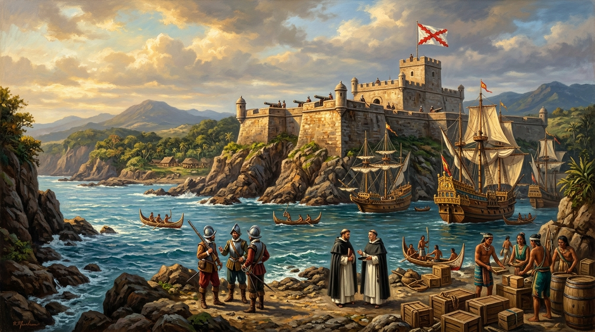
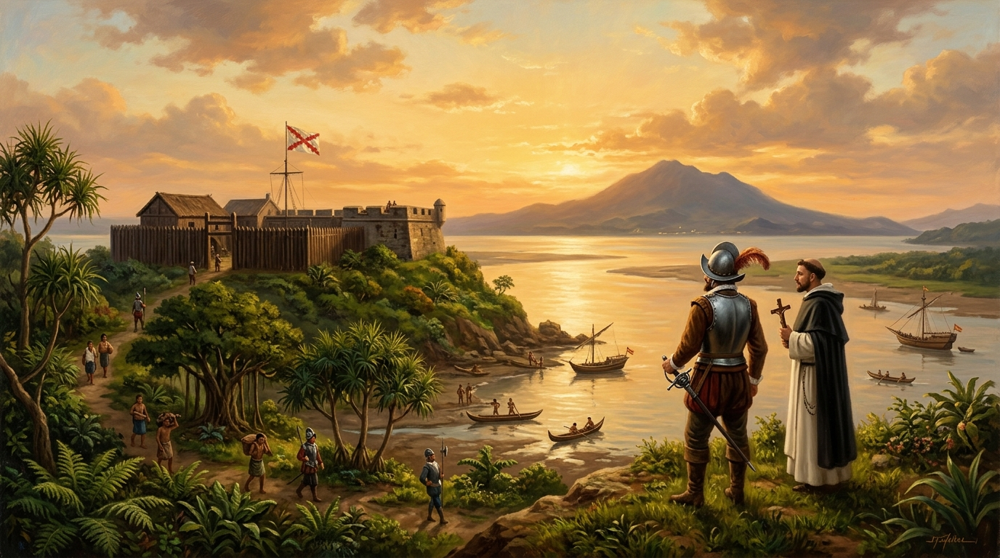
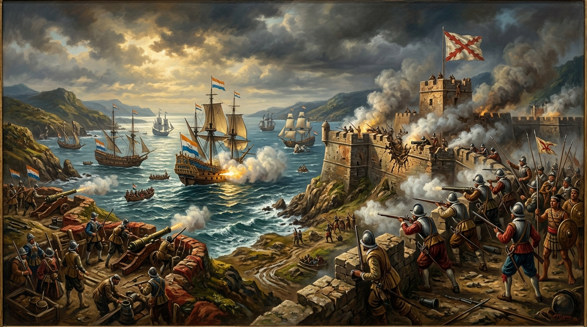

# 第 05 章：聖多明哥的十字架——西班牙人在基隆與淡水的北臺灣競逐

> **時期分類**：第二時期：大航海時代與荷西競逐  
> **時代跨度**：西治北臺灣時期（1626 – 1642）  
> **關鍵人物**：伐爾得斯（Antonio Carreño Valdés）、阿爾卡拉索（Juan de Alcarazo）、艾斯基維（Jacinto Esquivel）、波提紐（Gonzalo Portillo）、哈魯斯（Hendrik Harouse）  
> **歷史現場與坐標**：基隆和平島聖薩爾瓦多城遺址（`25.1582, 121.7644`）、和平島諸聖修道院遺址（Todos los Santos, `25.1568, 121.7635`）、新北淡水紅毛城原址（聖多明哥城 Fort San Domingo, `25.1754, 121.4328`）、宜蘭蘇澳哆囉滿產金地（`24.5956, 121.8524`）、新北貢寮三貂角（Santiago, `25.0083, 122.0022`）  
> **核心突破與歷史轉折**：西班牙菲律賓都督府為遏阻荷蘭東印度公司的航線截擊與日本傳教封鎖，北上基隆社寮島築造聖薩爾瓦多城，並於淡水河口建立聖多明哥城；天主教道明會艾斯基維神父深入巴賽族部落編纂臺灣歷史上第一部本土原住民語辭典《淡水語辭典》；歷經十六年經營、黃金探勘與瘟疫圍困，最終於 1642 年荷蘭艦隊強大砲火北伐下落幕，為北臺灣留下深刻的西式城堡遺跡、地名遺緒與多元海洋族群記憶。  
> **影音連結**：[重點解說影片 (YouTube)](https://youtu.be/1xV__Smr_Xs) ｜ [雙人對談播客 (YouTube)](https://youtu.be/5R-t3fwEDws) ｜ [NotebookLM 專案](https://notebook.google.com/notebook/1623ac44-c978-4c70-915f-8b599e72f4d8)  


*▲ 歷史概念復原圖：17 世紀初西班牙帝國在雞籠社寮島（今基隆和平島）築造的石構要塞「聖薩爾瓦多城（Fort San Salvador）」。城頭高插西班牙勃艮第十字旗（Cross of Burgundy），基隆灣內停泊著往返馬尼拉的武裝蓋倫排槳戰船與巴賽族（Basay）原住民獨木舟，海岸邊西班牙士兵、道明會白袍修士與平埔巴賽族人在微風與夕陽下交會。*

---

## 【甲部：深度歷史專題長文】

### 壹、 歷史破曉：無敵艦隊的東方偏師——西班牙為何北上福爾摩沙

1626 年 5 月初夏，基隆外海風平浪靜。一支由十四艘大小船隻組成、由西班牙陸軍遠征司令 **安東尼奧·卡雷紐·伐爾得斯（Antonio Carreño Valdés）** 率領的西菲聯合艦隊，繞過了臺灣東北角的岬角。為了紀念西班牙的主保聖人聖雅各（Santiago），伐爾得斯將這座突出的海角命名為 **「聖地牙哥（Santiago）」**——這正是今日臺灣最東端岬角 **「三貂角」** 漢語音譯的由來。

艦隊隨後駛入天然良港雞籠灣（Keelung），登陸港口外圍的社寮島（今和平島）。西班牙士兵在神父帶領下高舉木製十字架，向天地鳴砲三響，宣布這片土地屬於西班牙國王費利佩四世（Felipe IV），並正式將社寮島定名為 **「至聖三位一體島（Isla de la Santísima Trinidad）」**。

這場跨越巴士海峽的北征，並非西班牙帝國盲目的疆域擴張，而是西班牙菲律賓都督府（Capitanía General de las Filipinas）在面對荷蘭致命包圍網時，進行的一場生死攸關的地緣戰略反擊。

#### 一、 馬尼拉大帆船航線的地緣危機
自 1571 年西班牙征服馬尼拉建立亞洲殖民首府以來，西班牙帝國在太平洋構建了一條維繫其東亞殖民命脈的全球航線——**「馬尼拉大帆船貿易（Galeón de Manila）」**：
1. 西班牙商船自墨西哥阿卡普爾科（Acapulco）運載數以百萬計的美洲白銀跨越太平洋來到馬尼拉；
2. 駐馬尼拉的西班牙總督以此白銀，大量向福建海商收購中國高品質生絲、絲綢、陶瓷與香料；
3. 滿載絲貨的蓋倫大帆船（Manila Galleon）隨後藉由黑潮暖流與西風帶，自呂宋島北上，沿著臺灣東部外海向東北橫渡北太平洋返回墨西哥。

然而，1624 年荷蘭東印度公司（VOC）在臺灣西南海岸的大員（安平）築起熱蘭遮城，扼守臺灣海峽南端咽喉。荷蘭私掠戰船頻繁出沒於巴士海峽與呂宋海峽，攔截自福建前往馬尼拉的中國商船，甚至企圖切斷馬尼拉帆船北返墨西哥的黑潮航道。西班牙菲律賓總督 **費爾南多·德·席爾瓦（Fernando de Silva）** 敏銳地意識到：**若任由荷蘭人進一步佔領臺灣北部雞籠或淡水，西班牙往返中國、日本與美洲的海上生命線將被徹底絞殺！**

#### 二、 重返日本與殉道天主教的宗教狂熱
除了世俗商業利益，十七世紀初西班牙帝國的擴張始終伴隨著無比狂熱的宗教使命感。當時日本德川幕府正厲行嚴酷的禁教令（1612 年幕府禁教令、1614 年全面逐教），大批在長崎與九州的天主教傳教士（道明會、方濟各會、耶穌會）遭到釘十字架、火刑與穴吊殘酷殉道。

天主教托缽修會——特別是 **道明會（Dominican Order）** 與 **方濟各會（Franciscan Order）** 的修道士們，將北臺灣視為潛入日本長崎宣教、哪怕殉道亦在所不惜的最佳跳板基地。他們迫切希望在雞籠與淡水建立修道院，作為重啟日本宣教事業的秘密後方基地。

#### 三、 伐爾得斯登陸與和平島破土
1626 年 2 月，席爾瓦總督正式指派伐爾得斯率領包含兩艘大型蓋倫排槳戰船（Galeotas）、十二艘武裝平底帆船（Sampanes）、以及由三百餘名西班牙正規軍步兵、菲律賓邦板牙族（Pampangos）戰士、卡加延（Cagayan）水手組成的遠征軍，從馬尼拉出發，於 5 月 12 日平安抵達雞籠社寮島。

登陸當天，神父們在海灘築起祭壇舉行隆重彌撒，軍士則隨即揮汗動工，在一座直面雞籠港灣水道的火山砂岩高地上築造起北臺灣第一座石構棱堡——**「聖薩爾瓦多城（Fort San Salvador）」**。

---

### 貳、 雙城壁壘：聖薩爾瓦多城與聖多明哥城的要塞軍事建築體系


*▲ 歷史概念復原圖：1630 年代西班牙在淡水河口小丘上構築的「聖多明哥城（Fort San Domingo）」。粗獷的木石複合堡壘外設有深溝與木柵防線，西班牙守軍與道明會神父攜帶十字架駐守於小丘制高點，俯瞰波光粼粼的淡水河口與暮色籠罩下的觀音山，河面上穿梭著原住民的獵魚舟艇。*

面對北方險峻的東北季風波濤與內陸未知的原住民族群，西班牙人在北臺灣規劃了以 **「基隆聖薩爾瓦多城」** 為母城、**「淡水聖多明哥城」** 為副翼的雙要塞防禦體系。

#### 一、 雞籠社寮島的聖薩爾瓦多城要塞群
聖薩爾瓦多城坐落於社寮島西南端，其設計充分展現了文藝復興晚期歐洲石構棱堡築城法：
1. **主堡（La Fuerza）**：主城呈不對稱四角形，四個角落分別構築名為聖安東尼奧（San Antonio）、聖路易斯（San Luis）、聖約翰（San Juan）與聖安娜（Santa Ana）的凸出火砲稜堡。城牆基礎採用基隆當地的砂岩巨石砌成，外覆厚重石灰砂漿，城內建有指揮官官邸、軍械火藥庫、營房與水井；
2. **退守堡（El Retiro）與看守堡（El Cubo）**：為防止敵軍佔領社寮島後方的制高山頭居高臨下砲轟主城，西班牙人在島上最高峰築造了一座名為 **「退守堡（El Retiro，又稱圓堡）」** 的石造砲塔；並在港灣入口處扼守狹窄水道的高地上修築了 **「看守堡（El Cubo）」** 與 **「木堡（La Mira）」**，形成多層次立體交叉火力網；
3. **諸聖修道院（Convento de Todos los Santos）**：位於城堡東北側平地上，由道明會修士主持，建有石造小聖堂、修士居所與專門安葬歐洲人及皈依原住民的天主教墓園。

> [!NOTE]
> **和平島當代重大考古發現（2011–2020 年）**：
> 數百年來，聖薩爾瓦多城主體因遭荷蘭人改建、清代與日治造船廠建設覆蓋而隱沒。2011 年起，由中央研究院歷史語言研究所臧振華院士與西班牙學者鮑曉鷗（José Eugenio Borao Mateo）教授組成的跨國考古團隊，在和平島平一路成功發掘出 **「諸聖修道院（Todos los Santos）」** 遺址！
> 現場出土了完整的修道院石造基石、教堂中殿地基，更挖掘出二十餘具完好的人類骨骸。經 DNA 與同位素分析，其中包含多具典型歐洲高加索人種骨骸（雙手於胸前交疊、面向西方安葬的天主教禮儀），並出土了十七世紀道明會青銅十字架、卡拉拉大理石珠念珠、美洲黑曜石箭鏃以及明代青花瓷片。這些珍貴出土文物，讓消失在歷史迷霧中將近四百年的西班牙天主教聖殿，生動重現於世人眼前。

#### 二、 淡水河口的聖多明哥城（1628）
佔領雞籠兩年後，西班牙第二任臺灣長官 **胡安·德·阿爾卡拉索（Juan de Alcarazo）** 深刻體會到雞籠腹地狹窄、多雨陰冷，且無法有效切斷淡水河內陸的豐富物產（特別是硫磺與鹿皮）。

1628 年 4 月，阿爾卡拉索親率大軍航向淡水河口，擊潰了淡水河口原住民部落的頑強抵抗，在淡水河北岸俯瞰出海口的小山丘上（即今日淡水紅毛城舊址），修築了另一座木石複合要塞——**「聖多明哥城（Fort San Domingo，以道明會創立者聖多明哥命名）」**。

淡水聖多明哥城的戰略地位極其關鍵：
- **扼守大屯山硫磺貿易**：硫磺是製造火藥不可或缺的原料。淡水河流域（北投、磺溪周邊）盛產優質硫磺，漢人商人與原住民早已在此進行頻繁的硫磺開採；
- **控制內陸稻米供應**：淡水河上游平原（臺北盆地）氣候溫暖，土壤肥沃，比起長年陰雨的雞籠社寮島，更能提供駐軍急需的稻米與新鮮蔬果；
- **監控淡水河航道**：此城如同一把鋒利的匕首，直接鎖死了任何外來船隻深入臺北盆地的航道入口。

---

### 參、 語言與信仰的文明曙光：艾斯基維神父與《淡水語辭典》


*▲ 歷史概念復原圖：1632 年基隆諸聖修道院石室書齋內，西班牙道明會艾斯基維神父（Father Jacinto Esquivel）手持鵝毛筆，在泛黃的羊皮手稿《淡水語辭典（Vocabulario de la lengua de los Indios Tanchui）》上逐字記錄拉丁拼音。對坐的原住民巴賽族長老以生動手勢講述本族語彙，燭光映照出人類跨文化理解與早期語言學啟蒙的溫暖光芒。*

在槍砲防禦的冷酷外表下，西班牙在北臺灣統治期間最璀璨的文化成就，是由一批懷抱純粹信仰與人文好奇心的天主教神父所締造的——其中最卓越的靈魂，莫過於道明會神父 **哈辛托·艾斯基維（Jacinto Esquivel de Rosario）**。

#### 一、 深入蠻荒的宣教先行者
1631 年，年僅三十歲的艾斯基維神父自馬尼拉抵達臺灣。與許多縮在城堡砲台內恐懼未知的士兵不同，艾斯基維神父毫不畏懼瘧疾與原住民獵首習俗，毅然脫下堅固的防護，換上素樸的白袍道明會會服，在幾名熟悉水道的巴賽族通譯引領下，獨自深入淡水河下游、基隆沿海以及臺北盆地的各個原住民部落。

他在淡水設立了「玫瑰聖母小堂」，在北投建立了宣教點，甚至深入至金包里（今新北金山）、三貂社（今貢寮）等聚落。神父以醫藥救治罹患熱病的族人，為垂危嬰兒施洗，逐漸贏得了原住民各社頭目的信任與敬重。

#### 二、 《淡水語辭典》：臺灣歷史上第一部本土語言辭典
在與北臺灣原住民——特別是平埔族群 **巴賽族（Basay）** 與 **凱達格蘭族（Ketagalan）** 的長期朝夕相處中，艾斯基維敏銳地察覺到：若要真正傳播福音與文明價值，不能強迫原住民學習西班牙語，而必須學會原住民的母語。

在諸聖修道院與淡水簡陋的書齋燭光下，艾斯基維日以繼夜地訪談各社頭目與長老，於 1632 至 1633 年間，用拉丁字母與西班牙文釋義，親筆編纂出了兩部震古爍今的手稿巨作：
1. **《淡水原住民語言辭典》（Vocabulario de la lengua de los Indios Tanchui）**：收錄了數千個北臺灣巴賽族語的生活詞彙、動植物名稱、親屬稱謂、航海天文用語與文法結構。這是 **臺灣歷史上人類所記錄的第一部本土原住民語言辭典**！
2. **《淡水語教理書》（Doctrina cristiana en la lengua de los Indios Tanchui）**：將天主教基本教義、天主經、聖母經以及祈禱文，以巴賽語羅馬拼音翻譯印行，作為原住民信徒朗讀與背誦的啟蒙教本。

這兩部語言學手稿，比起荷蘭宣教士在大員出版《新港語馬太福音》早了整整近三十年，為後世人類學家與語言學家保存了十七世紀北臺灣南島語族珍貴的語音結構與生活世界遺存。

#### 三、 殉道之血染紅長崎海疆
艾斯基維神父心中最崇高的夢想，始終是重返殘酷迫害基督徒的日本長崎，哪怕被釘上十字架亦無怨無悔。1633 年秋季，在完成了《淡水語辭典》的編纂後，艾斯基維神父告別了他深愛的北臺灣巴賽族教友，登上了一艘偽裝成明朝商船的走私帆船，冒死潛往日本長崎。

然而，商船剛抵達日本薩摩海域即遭幕府密探查獲。艾斯基維神父在被捕後遭受了慘無人道的嚴刑拷打，但他至死堅守信仰，最終在長崎殉道受害。這位給臺灣留下第一部語言辭典的西班牙修士，將其熱血永遠留在了大航海時代的海洋史詩之中。

---

### 肆、 黃金之鄉的誘惑與挫敗：哆囉滿採金探勘與噶瑪蘭交鋒

在十六至十七世紀歐洲冒險家的狂熱幻想中，新大陸的「黃金國（El Dorado）」始終是驅使他們揚帆涉險的永恆幻影。而在北臺灣的西班牙人眼中，這個黃金國的名字叫做 **「哆囉滿（Turoboan）」**。

#### 一、 哆囉滿產金傳奇的發酵
早在西班牙人登陸雞籠前，往返馬尼拉與澳門的海商之間就廣泛流傳著一個傳言：臺灣東部海岸的崇山峻嶺與急流溪谷中，盛產純度極高的天然砂金！

1632 年，一艘自馬尼拉出發滿載軍餉與給養的西班牙補給帆船，在航向雞籠途中遭遇狂暴颱風，船隻失控漂流至臺灣東北角的「噶瑪蘭平原（Cavalan，今宜蘭平原）」。船上八十餘名西班牙官兵與水手雖然僥倖游上海灘生還，卻遭到當地對外來侵略者充滿戒心的噶瑪蘭族原住民包圍突襲，全數遇害。

消息傳回雞籠，長官阿爾卡拉索震怒萬分，於同年派遣由陸軍上尉佩德羅·德·莫利亞斯（Pedro de Molyas）率領的精銳遠征隊南下宜蘭，展開武力報復。西班牙部隊焚毀了數個噶瑪蘭村莊，並在原住民戰士撤退時遺留的屋舍中，繳獲了許多打磨得極為精緻的黃金耳環、鼻環與金箔裝飾！

這些黃金首飾經西班牙冶金師化驗，確認純度極高。當被俘虜的原住民被逼問黃金來源時，他們指向了更南方的險峻海岸與巨石峽谷——那就是今日花蓮立霧溪出海口周邊的 **「哆囉滿（Turoboan）」**。

#### 二、 溯溪探金：險阻、瘧疾與幻滅
自 1636 年起，西班牙當局多次組織全副武裝的採金探險隊，搭乘小艇並由巴賽族嚮導帶領，沿著蘇澳海岸一路向南深入立霧溪口。然而，這場淘金夢想很快化為一場殘酷的噩夢：
1. **地勢險絕，狂濤駭浪**：蘇花海岸高聳入雲的斷崖峭壁（清水斷崖周邊）缺乏天然避風良港，西班牙人的小艇頻繁在洶湧暗礁中傾覆粉碎；
2. **太魯閣族與卑南族伏擊**：深山峽谷中的高山原住民族善於隱蔽射箭與滾石伏擊，西班牙士兵沉重的鐵甲與火繩槍在茂密雨林與湍急溪谷中毫無施展空間，死傷慘重；
3. **微薄產量與補給斷絕**：西班牙人在溪床砂石中歷盡千辛萬苦淘洗出的砂金數量極其稀少，連支付探險隊隨行口糧與藥品開銷都捉襟見肘。

到了 1640 年，哆囉滿的淘金熱徹底幻滅。西班牙人不僅未能在東臺灣建立任何穩固的產金殖民地，反而激化了與噶瑪蘭族及太魯閣族之間的血腥世仇。

---

### 伍、 帝國斜陽與大圍攻：1642 年荷軍北伐與西班牙開城退出


*▲ 歷史概念復原圖：1642 年 8 月雞籠聖薩爾瓦多城最後決戰。荷蘭東印度公司北伐艦隊封鎖港灣，大口徑艦砲持續轟擊社寮島城堡石壁，硝煙瀰漫海灣；荷軍陸戰隊佔領制高點砲轟退守堡，城內殘存的西班牙守軍在末代長官波提紐（Gonzalo Portillo）指揮下，於殘破的勃艮第十字旗旁作最後的抵抗。*

進入十七世紀 30 年代末期，遠在歐洲本土的「三十年戰爭（1618–1648）」與西班牙本土的財政破產，開始無情地抽乾西班牙帝國海外前哨站的血液。

#### 一、 致命自殘：科奎拉總督的縮編政策
1635 年，新任西班牙菲律賓總督 **塞巴斯蒂安·烏爾塔多·德·科奎拉（Sebastián Hurtado de Corcuera）** 上任。科奎拉是個極具爭議的軍人，他將全部軍事重心投入到征討菲律賓南部棉蘭老島（Mindanao）的穆斯林蘇丹國，對北臺灣這個長年虧損、長官頻繁索要軍餉與兵力的孤懸前哨站極其反感。

1638 年，科奎拉做出了一項自掘墳墓的致命決策：**下令撤除淡水聖多明哥城的全部駐軍，並將要塞徹底拆毀焚毀！** 與此同時，基隆聖薩爾瓦多城的守軍亦被裁撤超過三分之二，僅留下不到一百名老弱殘兵與菲律賓僱傭兵駐守，重砲與彈藥亦被大批運回馬尼拉。

淡水要塞的自行拆除與撤防，等於直接向南方的荷蘭東印度公司發出了一封赤裸裸的虛弱信號。

#### 二、 荷蘭人的步步進逼與招降通牒
在大員熱蘭遮城的荷蘭長官 **保羅·特羅登紐斯（Paulus Traudenius）** 獲悉西班牙防線崩潰後，敏銳地察覺到拔除西班牙這根眼中釘的歷史時刻已然成熟。

1641 年 8 月，荷蘭派遣艦隊北上基隆示威，並向西班牙雞籠長官 **貢薩洛·波提紐（Gonzalo Portillo）** 遞交了極為傲慢的招降通牒，要求西班牙人立即開城投降撤離。波提紐雖然手頭兵力極度匱乏，但依然以西班牙貴族的傲骨親筆回覆了一封鏗鏘有力的拒絕信：
> **「我乃西班牙國王之忠誠臣僕，受命以生命捍衛此城。大員長官何必多費唇舌？城內尚有火藥與勇士，請閣下以火砲來說話！」**

荷軍因時值深秋颱風季節將至，加上社寮島石構城牆依舊堅固，首次北上並未強攻，而是退回大員調集更多攻城重砲與歐洲主力正規軍。

#### 三、 1642 年 8 月大決戰：哈魯斯司令的致命一擊
1642 年 8 月，荷蘭東印度公司巴達維亞總督府派遣戰功卓著的海軍上校兼艦隊司令 **亨德里克·哈魯斯（Hendrik Harouse）**，親率由四艘大型主力蓋倫巡防艦、數艘武裝快船、三百六十九名精銳歐洲荷蘭步兵以及數百名西拉雅原住民戰士組成的強大北伐軍團，直撲雞籠。

此時駐守聖薩爾瓦多城的西班牙軍隊，僅剩下三十餘名西班牙正規士兵、數十名菲律賓邦板牙戰士以及二十名荷蘭籍叛逃者，在兵力與火砲配置上處於十比一的絕對劣勢。

戰役進程完全驗證了軍事防禦設計的致命漏洞：
1. **8 月 19 日**：荷蘭大軍在八尺門海灣強行登陸，迅速擊退了巴賽族與西班牙散兵；
2. **8 月 20 日 – 24 日**：荷軍將數門大口徑攻城重砲，歷經千辛萬苦拖運至社寮島制高山丘後方，居高臨下對西班牙人的制高砲塔 **「退守堡（El Retiro）」** 展開狂轟濫炸。在三千發以上重砲彈的連續轟擊下，退守堡石牆崩塌，守軍傷亡殆盡，退守堡失陷；
3. **8 月 25 日**：荷軍在佔領的退守堡架設重砲，直接俯瞰砲轟聖薩爾瓦多城主城內部庭院與指揮所。砲彈直接砸入營房與修道院，城內守軍無處藏身，火藥庫隨時面臨殉爆慘禍。

#### 四、 降旗與開城：十六年西治時代的落幕
8 月 26 日清晨，面對彈盡糧絕、外無援軍且城破在即的絕境，末代長官波提紐在修道院神父與部屬的力勸下，無奈地在殘破城垛上升起了白旗。

波提紐與哈魯斯司令簽署了頗具尊嚴的降約：荷軍准許西班牙官兵保留隨身佩劍、行李與私人財產，神父得以帶走聖物與教會文書，並由荷蘭船隻將全體守軍與神職人員體面護送至巴達維亞，再行遣返回馬尼拉。

1642 年 8 月底，城頭飄揚了十六年的西班牙勃艮第十字旗緩緩降下，荷蘭東印度公司的三色親王旗取而代之升起。

西班牙人北上福爾摩沙的十六年冒險，至此畫上了句號。荷蘭人隨後拆毀了聖薩爾瓦多城的三座稜堡，將主城縮小改建為 **「北教堂堡（Fort Noort-Holland）」**；又進軍淡水，在聖多明哥城的焦黑廢墟上，用堅實磚石修築起今日聳立在淡水河口的紅磚城堡——這便是民間俗稱的 **「淡水紅毛城（Fort Antonio）」**。

---

## 【專業對照表格專區】

### 表格一：西班牙（馬尼拉都督府）與荷蘭（VOC）在臺統治模式全維度對比表

| 比較維度 | 西班牙治北臺灣（1626 – 1642） | 荷蘭東印度公司治南臺灣（1624 – 1662） |
| :--- | :--- | :--- |
| **宗主政權性質** | **西班牙絕對君主專制帝國**（哈布斯堡王朝）之海外封疆偏師 | **荷蘭聯省共和國特許跨國股份制企業**（世界首家上市公司） |
| **殖民首腦機關** | **菲律賓都督府**（Capitanía General de las Filipinas，首府馬尼拉） | **東印度評議會**（Raad van Indië，亞洲首府巴達維亞／今雅加達） |
| **在臺統治中樞** | 雞籠社寮島 **「聖薩爾瓦多城（Fort San Salvador）」** | 臺南安平一鯤鯓沙洲 **「熱蘭遮城（Fort Zeelandia）」** |
| **核心戰略目標** | 遏阻荷蘭攔截馬尼拉帆船；維護對日傳教通道；探勘金礦 | 壟斷中日生絲白銀轉口貿易；壓榨鹿皮、砂糖與熱帶物產利潤 |
| **宗教宣教體系** | **羅馬天主教**（道明會 Dominican、方濟各會 Franciscan） | **基督新教喀爾文歸正宗**（Reformed Church） |
| **傳教手法與態度** | 深入各社村落、建立聖堂、尊重本土語言、同理救治醫療 | 伴隨軍事征討進駐村社、破除祖靈崇拜、設立長老教理學校 |
| **原住民文教遺產** | 艾斯基維神父編纂 **《淡水語辭典》**、巴賽語教理手稿 | 甘治士與尤羅伯創立 **「新港文書」**、羅馬字羅馬拼音契約 |
| **主要防禦要塞** | 聖薩爾瓦多城、退守堡、看守堡、淡水聖多明哥城 | 熱蘭遮城、普羅民遮城（赤崁樓）、風櫃尾城堡 |
| **經濟獲利模式** | 多年財政淨虧損，依賴馬尼拉每年撥付軍餉補助；採金失敗 | 高度重商主義暴利，淨利潤曾佔全亞洲商館總和 25% – 30% |
| **稅收與剝削體制** | 未建立嚴密包稅制，僅向少數原住民徵收少量物產微稅 | 嚴苛推行 **「贌社制度」** 包稅拍賣、全島漢人強制課徵人頭稅 |
| **原住民治理機制** | 與部落頭目建立血盟或結親；缺乏常設制度化全島會議體系 | 創立 **「地方會議（Landdag）」**、每年頒發銀頭藤杖實施間接統治 |
| **最終落幕原因** | 總督自削駐軍、彈盡糧絕，遭荷蘭正規艦隊重砲攻陷開城降服 | 遭民族英雄鄭成功率大軍登陸包圍九個月，末代長官揆一開城投降 |

---

### 表格二：西班牙北臺灣主要防禦要塞與建築群體系表

| 要塞建築名稱 | 建造年份 | 建築形態與工程規格 | 地理位置與坐標現場 | 戰略軍事功能與歷史下場 |
| :--- | :--- | :--- | :--- | :--- |
| **聖薩爾瓦多主城**<br>（Fort San Salvador） | 1626 年 | 不對稱四角星形棱堡，砂岩基石配四座突出稜堡，內設軍械庫與水井 | 基隆和平島西南海岸<br>（`25.1582, 121.7644`） | 西班牙統治首府；1642 年降荷後三稜堡遭拆除改為「北教堂堡」；今為台船基隆廠區 |
| **退守堡**<br>（El Retiro / 圓堡） | 1632 年 | 巨石砌築之雙層圓形砲塔，配備重砲四門，扼守社寮島最高山頂 | 和平島最高制高點山巔<br>（`25.1596, 121.7658`） | 防範敵軍佔領高地俯瞰主城；1642 年遭荷軍三千發砲彈轟塌失陷，成為全城淪陷關鍵破口 |
| **看守堡**<br>（El Cubo） | 1627 年 | 方形石砌砲台哨所，設於社寮島外圍突出岬角岩壁之上 | 和平島臨海海角峽口<br>（`25.1610, 121.7630`） | 監控雞籠港灣主航道，防止敵艦於外海夜襲或盲區登陸；戰後殘蹟融入地質海蝕平台 |
| **諸聖修道院**<br>（Todos los Santos） | 1626 – 1628 年 | 歐式石造長方形小教堂、木造修道院迴廊、附設天主教專用墓園 | 和平島平一路遺址<br>（`25.1568, 121.7635`） | 道明會傳教核心，艾斯基維神父在此翻譯辭典；2011–2020 年考古出土歐洲遺骸與十字架 |
| **淡水聖多明哥城**<br>（Fort San Domingo） | 1628 年 | 粗獷木樁柵欄與泥石混合雙重圍牆堡壘，後逐步以石塊強化 | 新北淡水河口小丘<br>（`25.1754, 121.4328`） | 扼守淡水河口與臺北盆地硫磺通道；1638 年遭西總督科奎拉下令自行拆毀，荷蘭其後於原址築紅毛城 |
| **三貂角哨所**<br>（San Diego Redoubt） | 1626 年 | 臨時石砌防禦哨站與木造守望瞭望塔 | 新北貢寮三貂角岬角<br>（`25.0083, 122.0022`） | 西班牙艦隊初抵臺灣之登陸觀測點，保障往來馬尼拉與基隆船隻之導航防護 |

---

### 表格三：西班牙統治時期北臺灣原住民族群接觸與語言文化矩陣表

| 原住民族群／社名 | 分布地理空間 | 社會形態與生計特徵 | 與西班牙統治者接觸互動關係 | 文教轉化與重要歷史事件 |
| :--- | :--- | :--- | :--- | :--- |
| **巴賽族**<br>（Basay，雞籠社群） | 雞籠社寮島、基隆港周邊、深澳、八斗子 | 精通航海捕魚、操舟貿易，善於以手工業品換取內陸農產 | 初起戒備，後建立密切同盟，受僱擔任通譯、工匠與領航員 | 深度接受天主教信仰；艾斯基維神父以此族母語編纂成全臺首部《淡水語辭典》 |
| **淡水社群**<br>（Tanchui 各社） | 淡水河下游、大屯山麓、北投、關渡 | 兼營農耕、捕魚與硫磺採集，受漢人海商貿易影響深 | 1628 年遭西班牙武力攻伐降服；後因不滿駐軍欺壓，多次反叛圍困聖多明哥城 | 艾斯基維神父於淡水設立「玫瑰聖母堂」，引導部分頭目受洗皈依天主教 |
| **噶瑪蘭族**<br>（Cavalan，三十六社） | 蘭陽平原（今宜蘭壯圍、五結、冬山等） | 密集稻作定居農業、發達水網聚落，族群尚武且團結 | 1632 年殺害失事漂流之 80 餘名西班牙官兵，引發西班牙大軍南下報復焚社 | 雙方長期處於敵對僵局；西班牙繳獲其精美黃金耳飾，引爆後續哆囉滿淘金狂潮 |
| **哆囉滿社群**<br>（Turoboan，花蓮沿海） | 太魯閣山麓、立霧溪出海口、崇德海岸 | 善於山林狩獵、採集溪流天然砂金，居住於險峻峽谷 | 屢遭西班牙探險隊渡海溯溪騷擾，以滾石伏擊射殺多名西班牙士兵與通譯 | 西班牙採金幻滅後斷絕接觸，原住民成功守護山林砂金秘密直至清代晚期 |
| **金包里社**<br>（Quimaurri / Kimauri） | 今新北市金山、萬里沿海平原 | 善於操舟捕魚，與巴賽族同語系，經營北海岸硫磺交換 | 與西班牙人保持友好朝貢互市關係，常提供駐軍乾魚與口糧 | 接受道明會神父巡迴受洗，為北臺灣最早接受天主教洗禮之濱海村社之一 |

---

### 表格四：西班牙駐臺灣歷任長官（1626 – 1642）編年與重大歷史功過表

| 任次 | 長官中文譯名／西文原名 | 在任時間 | 核心施政作為與重大歷史事件 | 歷史評價與功過總結 |
| :---: | :--- | :---: | :--- | :--- |
| **1** | **安東尼奧·卡雷紐·伐爾得斯**<br>Antonio Carreño Valdés | 1626 – 1629 | 率西菲艦隊繞過三貂角登陸社寮島，主持聖薩爾瓦多城之破土奠基；擊退巴賽族初次騷擾 | 西班牙治臺開山拓殖者，在惡劣天候與瘟疫中奠定北臺灣雙稜堡軍事框架 |
| **2** | **胡安·德·阿爾卡拉索**<br>Juan de Alcarazo | 1629 – 1632 | 進佔淡水河口築造「聖多明哥城」；派兵深入宜蘭平原報復噶瑪蘭族；全面開闢淡水基隆陸路交通 | 軍事作風剛毅果決，成功將西班牙勢力推進至臺北盆地與宜蘭，打通雙要塞聯絡線 |
| **3** | **阿隆索·加西亞·羅梅洛**<br>Alonso García Romero | 1634 – 1635 | 組織多次前往花蓮哆囉滿之砂金探險隊；強化社寮島退守堡防禦工事；支持艾斯基維神父文教宣教 | 穩健行政管理者，積極探索東臺灣礦產資源，但在熱帶熱病與補給困境下無功而返 |
| **4** | **弗朗西斯科·埃爾南德斯**<br>Francisco Hernández | 1637 – 1639 | 面對菲律賓總督科奎拉削編政策，被迫執行拆毀淡水聖多明哥城指令，將守軍收縮回雞籠孤島 | 悲劇性過渡期長官，執行錯誤撤軍命令使西班牙喪失淡水戰略縱深與糧食基地 |
| **5** | **貢薩洛·波提紐**<br>Gonzalo Portillo | 1640 – 1642 | 斷然回絕荷蘭長官特羅登紐斯招降通牒；1642 年率數十殘兵血戰哈魯斯北伐艦隊，退守堡失陷後簽約降服 | 西班牙在臺末代長官，雖盡職堅守至最後一刻，終究無法挽回帝國落日之必然敗局 |

---

### 表格五：關鍵歷史大事記（Timeline 編年表格，1571 – 1642）

| 時間坐標 | 歷史分期／時代 | 關鍵歷史事件與重大突破 | 文明與地緣政治意義 |
| :--- | :--- | :--- | :--- |
| **1571 年** | 西班牙東亞立足 | **黎牙實比（Legazpi）征服馬尼拉，開啟馬尼拉大帆船跨太平洋貿易** | 西班牙在東亞建立殖民核心，中國生絲與美洲白銀航線成為全球化貿易核心主軸 |
| **1624 年 8 月** | 荷蘭進駐大員 | **荷蘭東印度公司拆除澎湖風櫃尾城堡，轉進臺灣大員築造熱蘭遮城** | 荷蘭掌控臺灣海峽咽喉，對西班牙馬尼拉大帆船航道構成致命戰略威脅 |
| **1626 年 5 月 12 日** | 西班牙登陸雞籠 | **伐爾得斯率艦隊繞經三貂角，登陸社寮島並築造「聖薩爾瓦多城」** | 西班牙正式將北臺灣納入帝國版圖，展開在基隆與淡水長達十六年之統治 |
| **1628 年 4 月** | 進佔淡水河口 | **長官阿爾卡拉索派軍佔領淡水，修築「聖多明哥城」** | 西班牙完成基隆－淡水雙城防禦格局，有效監控臺北盆地硫磺貿易與內陸水道 |
| **1631 – 1633 年** | 語言文化破曉 | **道明會艾斯基維神父編纂臺灣首部本土原住民語辭典《淡水語辭典》** | 臺灣本土語言首度以拉丁文字系統化記錄，奠定人類學跨文化交流之崇高典範 |
| **1632 年** | 宜蘭流血交鋒 | **西班牙補給船漂流宜蘭海岸遭噶瑪蘭族全殲；西軍南下焚社報復** | 西班牙勢力首次深入蘭陽平原，繳獲原住民精美金飾，引爆後續哆囉滿淘金狂潮 |
| **1636 – 1637 年** | 哆囉滿淘金挫敗 | **西班牙組織精銳部隊探勘立霧溪與東海岸砂金，遭高山原住民重挫** | 地形險峻與熱病肆虐致採金計畫破產，終結西班牙在臺灣東部建立殖民點之野心 |
| **1638 年** | 戰略致命收縮 | **菲律賓總督科奎拉推行縮編，強令拆毀淡水聖多明哥城、抽調基隆守軍** | 西班牙自毀防線，喪失淡水河防禦縱深與糧食基地，為四年後荷軍北伐埋下禍根 |
| **1641 年 8 月** | 荷蘭招降通牒 | **荷蘭艦隊北上雞籠示威遞交降書；長官波提紐堅拒降服並誓言死守** | 兩大歐洲海上強權在臺灣北部的正面對決不可避免，荷蘭巴達維亞決定調派主力決戰 |
| **1642 年 8 月 19 – 26 日** | 雞籠大決戰 | **哈魯斯司令率荷軍猛烈砲轟攻佔退守堡，波提紐長官開城投降撤離** | 西班牙在臺十六年統治正式終結，荷蘭東印度公司確立對臺灣全島之獨佔名義霸權 |

---

### 陸、 參考資料與一手權威文獻清單

1. **鮑曉鷗（José Eugenio Borao Mateo）著**，2001–2002，《*西班牙人在臺灣的文獻（Spaniards in Taiwan: Documents on the Mexican and Spanish presence in Taiwan, 1626–1642）*》（全二冊），國立臺灣大學出版中心。
2. **鮑曉鷗（José Eugenio Borao Mateo）著，南南 譯**，2008，《*西班牙人的臺灣體驗 1626–1642：一項文藝復興時代的海洋拓展及其與東亞的交會*》，中央研究院·南天書局。
3. **李毓中 著**，2006，《*西班牙統治臺灣史研究（1626–1642）*》，國立清華大學歷史研究所博士論文。
4. **李毓中、吳孟真 等 譯註**，2019，《*艾斯基維神父淡水語辭典與教理手稿考釋*》，中央研究院臺灣史研究所。
5. **臧振華、鮑曉鷗 著**，2017，《*基隆和平島諸聖修道院遺址考古發掘成果報告*》，基隆市文化局與中央研究院歷史語言研究所。
6. **翁佳音 著**，1998，《*大臺北古地圖考釋*》，臺北縣立文化中心。
7. **曹永和 著**，1979，《*臺灣早期歷史研究*》，聯經出版事業公司。
8. **中村孝志 著，吳密察 等譯**，1997，《*荷蘭時代臺灣史研究*》，稻鄉出版社。
9. **江樹生 譯註**，2000，《*熱蘭遮城日誌（第 1–2 冊）*》，臺南市政府文化局。
10. **張德水 著**，1992，《*激動！臺灣歷史：臺灣人的自立之路*》，前衛出版社。

---

## 【乙部：Google NotebookLM 影音提示詞、旁白腳本與字幕專用庫】

### 一、 Google NotebookLM 影片風格設定與生成提示詞（Prompt）

#### 1. 建議風格與受眾定位
- **敘事風格定位**：大航海時代帝國競逐與文明接觸史詩風格（兼具北海狂濤、要塞重砲轟鳴、密林淘金狂熱、以及修士燭光下編纂原住民辭典之人文溫情與悲愴）。
- **受眾定位**：大眾歷史愛好者、大專與中學師生、對大航海時代地緣政治、天主教傳教史及北臺灣本土歷史感興趣之廣大閱聽群眾。
- **播音語氣指引**：大氣沉著、節奏分明；在講述大帆船航線與要塞對決時具備史詩戰爭片之澎湃力量感；在敘述艾斯基維神父與《淡水語辭典》時轉為深沉溫暖、極富人文敬意；在結尾降旗時流露出歷史興衰與滄桑厚重感。

#### 2. NotebookLM 專用生成提示詞（Prompt）
> **複製以下提示詞輸入至 Google NotebookLM：**
> 
> 「請依據本章所附的權威歷史文獻與專題長文，為第 05 章《聖多明哥的十字架——西班牙人在基隆與淡水的北臺灣競逐》製作一段精彩生動的影音解說內容。
> 
> **重點演繹要求**：
> 1. **地緣戰略破題**：從 1626 年西班牙菲律賓都督府派遣伐爾得斯艦隊北上三貂角、登陸社寮島切入，揭示西班牙如何為保護『馬尼拉大帆船』航線與重返日本傳教，在北臺灣建立聖薩爾瓦多城與淡水聖多明哥城。
> 2. **文明與語言奇蹟**：生動講述道明會艾斯基維神父深入原住民部落，在燭光下克服艱險，編纂出臺灣歷史上第一部本土原住民語辭典《淡水語辭典》與巴賽語教理手稿的壯舉。
> 3. **黃金夢與要塞落日**：演繹西班牙遠征隊深入宜蘭噶瑪蘭與花蓮哆囉滿探勘天然砂金的挫敗；深入剖析菲律賓總督科奎拉自毀長城拆毀淡水城、削弱基隆守軍之致命戰略錯誤。
> 4. **1642 年大決戰與歷史遺緒**：生動再現荷蘭哈魯斯司令率艦隊砲轟退守堡、波提紐長官開城投降之壯烈歷史現場；結尾反思和平島諸聖修道院當代考古發掘與紅毛城歷史身世，彰顯多元海洋族群在臺灣土地上留下的深遠印記。
> 請保持敘事節奏緊湊明快、氣勢恢宏磅礡、專有名詞嚴謹無誤。」

---

### 二、 影視級口播旁白稿（搭配分鏡節奏）

#### 【場景一：三貂角的帆影與社寮島築城（0:00 - 1:30）】
- **畫面建議**：[海風呼嘯，鏡頭掃過臺灣東北角三貂角險峻岩岸與白色燈塔浪花，古老馬尼拉大帆船航海圖漸變出西班牙勃艮第十字旗，推向和平島聖薩爾瓦多石構稜堡]
- **旁白台詞**：
  > 1626 年初夏，
  > 幾艘懸掛著紅色十字旗的西班牙戰船，
  > 繞過了臺灣最東端的岬角。
  > 他們以主保聖人聖雅各之名，
  > 稱呼這片海岸為「聖地牙哥」——
  > 這就是今天臺灣「三貂角」名字的由來。
  > 為了保護滿載絲綢與白銀的「馬尼拉大帆船」，
  > 遏阻南方大員荷蘭人的海上封鎖，
  > 西班牙艦隊開進了基隆社寮島。
  > 他們向天地鳴砲，樹立起木十字架，
  > 用巨石築起巍峨的「聖薩爾瓦多城」。
  > 一場兩大西方海洋霸權在臺灣島上的正面較量，
  > 在北海的驚濤駭浪中，拉開了序幕。

#### 【場景二：雙城鎖江與《淡水語辭典》的人文奇蹟（1:30 - 4:00）】
- **畫面建議**：[淡水河口夕照掩映下的聖多明哥城小丘，鏡頭切入修道院石室燭光，特寫神父鵝毛筆在泛黃手稿上寫下巴賽語辭彙，對坐的原住民長老神情安詳]
- **旁白台詞**：
  > 西班牙人隨後挺進淡水河口，
  > 築起「聖多明哥城」，
  > 牢牢扼守大屯山的硫磺寶庫與內陸航道。
  > 然而，在砲火與城垛背後，
  > 卻誕生了一段被歲月塵封的文明奇蹟。
  > 年輕的道明會艾斯基維神父，
  > 脫下了笨重的盔甲，換上一襲素樸白袍。
  > 他獨自走進平埔巴賽族人的聚落，
  > 在跳動的燭光下，
  > 他一字一句傾聽、記錄長老口中的母語。
  > 這部《淡水語辭典》，
  > 是臺灣歷史上人類編纂的第一本本土原住民語言字典！
  > 在大航海時代刀光劍影的殺伐之中，
  > 這盞微弱的人文燭光，
  > 永遠照亮了臺灣跨文化理解的晨曦。

#### 【場景三：哆囉滿的淘金夢碎與自毀長城（4:00 - 6:30）】
- **畫面建議**：[蘇花斷崖驚濤駭浪，西班牙小艇在峽谷激流中艱難前行，原住民箭雨掠過；畫面切換至馬尼拉總督府案前簽署撤軍令，淡水聖多明哥城在烈焰中坍塌]
- **旁白台詞**：
  > 驅使征服者冒險的，還有那永恆的黃金狂熱。
  > 傳說在東部險峻的花蓮海岸，
  > 「哆囉滿」的溪流裡流淌著純金的砂粒。
  > 西班牙探險隊頂著狂風巨浪溯溪而上，
  > 迎接他們的，卻是高山原住民凌厲的箭雨與無情的熱病。
  > 黃金之鄉的幻象破滅了，
  > 帝國的斜陽也無情落下。
  > 遠在馬尼拉的總督為了節省開銷，
  > 竟做出了自掘墳墓的決策：
  > 他下令拆毀淡水聖多明哥城，
  > 將基隆的守軍裁撤殆盡！
  > 這記致命的自殘，
  > 讓孤懸在社寮島上的最後幾十名士兵，
  > 成了狂風暴雨中隨時會被吞噬的孤島。

#### 【場景四：1642 雞籠大決戰與和平島重生（6:30 - 8:00）】
- **畫面建議**：[1642 年荷蘭戰艦萬砲齊鳴，重砲猛轟退守堡碎石紛飛，波提紐長官開城降旗；畫面漸變至當代和平島諸聖修道院考古現場出土的十字架與現代安平、淡水紅毛城晴空]
- **旁白台詞**：
  > 1642 年 8 月，大員的荷蘭艦隊重兵北伐。
  > 三千發重砲彈如暴雨般傾瀉在社寮島制高點，
  > 西班牙人的「退守堡」在一片火海中崩塌。
  > 面對十倍於己的荷軍，
  > 殘存的西班牙守軍在彈盡糧絕之下開城投降。
  > 城頭飄揚了十六年的十字旗緩緩降下，
  > 西班牙時代在北臺灣黯然謝幕。
  > 但歷史從未真正消失。
  > 四百年後，中研院考古團隊在和平島地底，
  > 挖出了「諸聖修道院」完整的石造地基，
  > 以及長眠於此的歐洲修士骨骸與青銅十字架。
  > 西班牙人留下的三貂角、淡水紅毛城舊基，
  > 以及刻在地層深處的文化基因，
  > 都在向世人訴說：
  > 臺灣，一直都是世界大航海時代風雲匯聚的璀璨舞台。

---

### 三、 Faster-Whisper 專用提示詞庫（Initial Prompt）

> **使用方式**：使用 Faster-Whisper 轉錄 NotebookLM 影音檔時，請將以下字詞填入 `initial_prompt`：

```text
臺灣史, 大航海時代, 西班牙帝國, 菲律賓都督府, 馬尼拉大帆船, 伐爾得斯, Antonio Carreño Valdés, 阿爾卡拉索, Juan de Alcarazo, 波提紐, Gonzalo Portillo, 聖薩爾瓦多城, Fort San Salvador, 退守堡, El Retiro, 看守堡, El Cubo, 和平島, 社寮島, 諸聖修道院, Todos los Santos, 聖多明哥城, Fort San Domingo, 淡水紅毛城, 艾斯基維, Jacinto Esquivel, 淡水語辭典, 巴賽語, 巴賽族, 凱達格蘭族, 噶瑪蘭族, 哆囉滿, Turoboan, 砂金, 三貂角, Santiago, 哈魯斯, Hendrik Harouse, 荷蘭東印度公司, VOC, 硫磺貿易, 考古發掘
```
