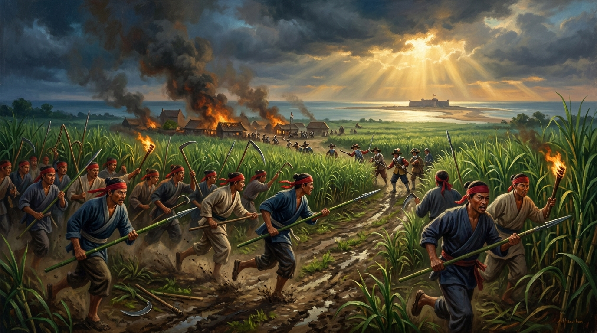
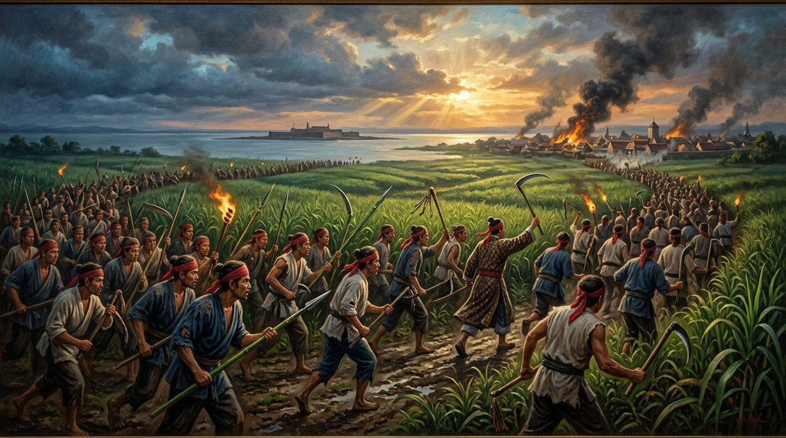
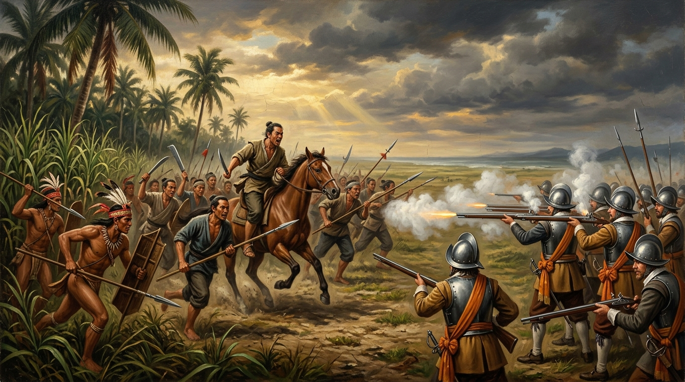

# 第 06 章：血濺赤崁與大鹿港——郭懷一抗荷事件與早期漢人移民的悲歌

> **歷史時期**：第二時期：大航海時代與荷西競逐  
> **核心時代**：西元 1650 – 1653 年（荷蘭殖民統治中晚期）  
> **歷史現場坐標**：
> - 臺南赤崁市街與油車行（起義密謀與首戰現場）：`22.9975° N, 120.2025° E`
> - 臺南將軍歐汪庄（主力決戰與郭懷一殉難地）：`23.2012° N, 120.1583° E`
> - 臺南安平熱蘭遮城（荷蘭東印度公司統治中樞）：`22.9997° N, 120.1605° E`
> - 臺南中西區普羅民遮城／赤崁樓（要塞鎮壓遺構）：`22.9978° N, 120.2026° E`  
> **核心人物**：郭懷一（Quo-qua / 漢人領袖）、長官費爾勃格（Nicolas Verburg / 荷蘭第十任長官）、揆一（Frederick Coyett / 荷蘭大尉）、西拉雅盟軍戰士、赤崁開墾漢農  
> **影音連結**：[重點解說影片 (YouTube)](https://youtu.be/qdRyKFYwhPk) ｜ [雙人對談播客 (YouTube)](https://youtu.be/FBCapmmopgI) ｜ [NotebookLM 專案](https://notebook.google.com/notebook/c5354897-5c84-4a22-81e7-bc4ee2d0585b)  

---


*圖 1：西元 1652 年秋，赤崁油車行與甘蔗田邊爆發的郭懷一抗荷大起義。手持削尖竹槍、柴刀與火把的數千貧困漢人拓墾農民，在夜色中如潮水般湧向赤崁市街，向荷蘭東印度公司的殘酷殖民統治發出歷史上第一聲憤怒怒吼。*

---

## 導言：泥土、血淚與殖民絞肉機

十七世紀中葉的臺灣西南平原，在世界地圖上正閃耀著無比繁華的金黃光芒。

在荷蘭東印度公司（VOC）巴達維亞總督府的財政帳冊上，「大員」（Tayouan）是一隻源源不絕擠出暴利的金牛——成千上萬張從內陸平原剝下的梅花鹿皮堆積如山，運往日本長崎換取白銀；廣達數千甲的綠色甘蔗海隨風翻湧，無數土法糖廍日夜噴吐白煙，熬製出一桶桶純白砂糖，裝上吃水深重的東印度大帆船，轉運波斯與阿姆斯特丹。在荷蘭人的官方敘事裡，這座島嶼秩序井然、基督教化蓬勃發展，是阿姆斯特丹商人經營殖民貿易的「典範樂土」。

然而，在這片看似繁榮的熱帶沃土之下，卻埋藏著無數拓墾漢民咬牙切齒的血淚與絕望。

這群為了躲避明末閩粵戰亂、冒死穿越黑水溝來到臺灣的漢人農民，抵達大員後才赫然發現：這座島嶼並不是沒有主人的天賜避風港，而是一座運轉精密、手段殘酷的殖民經濟絞肉機。荷蘭人以「領地所有者」自居，推行全島王田體制，漢人流血流汗開墾的田園皆非己有，收成十之四五繳作地租與雜稅；更令人窒息的是，年滿七歲的漢人移民，無論老幼男女，每月都必須向荷蘭稅吏繳納昂貴的「人頭稅」（Hoofdgeld）。

當 1651 至 1652 年間，臺灣西南平原連續遭遇嚴重蝗災、旱災與鹿隻銳減的經濟重創時，荷蘭殖民當局不但沒有減免賦稅，反而派遣武裝黑人士兵與稅吏逐戶搜捕、抄沒口糧、鞭打拘禁貧農妻子充作苦役。生存的底線被徹底擊穿，在「繳不出稅是死、餓死也是死」的絕境逼迫下，積怨已久的怒火終於如火山般噴湧爆發。

西元 1652 年 9 月，由漢人農民領袖郭懷一領導的武裝抗暴風暴席捲赤崁。這場在臺灣史上被稱為「郭懷一事件」的起義，雖然僅持續了短短十數天，並在荷蘭火槍火砲與數千原住民盟軍的殘酷夾擊下化為血流成河的慘劇，但它卻以最悲壯的形式，粉碎了荷蘭東印度公司不可一世的統治神話，並直接促成了「普羅民遮城」（Provintia，即今日赤崁樓）的興築，更為九年後鄭成功的復臺之役埋下了不可逆轉的歷史伏筆。

---

## 第一幕：甘蔗、鹿皮與人頭稅——荷蘭王田體制下的殘酷絞肉機

要理解 1652 年那場震驚東亞海域的農民起義，必須先揭開荷蘭東印度公司在臺灣建立的制度性剝削本質。

荷蘭東印度公司本質上是一間追求股東最大利潤回報的股份制武裝商業巨頭，而非來臺灣進行慈善開墾的拓荒者。自 1624 年立足大員以來，歷任長官的施政核心只有一個：**將臺灣本地的所有資源與勞動力，以最低的邊際成本榨取成最高額的商業利潤**。在這一最高指導原則下，荷蘭當局逐步建構起一套涵蓋人身、土地、商品與貿易流通的嚴密租稅天網。

| 稅賦／制度名稱 | 課稅對象與標準 | 荷蘭當局徵收手段 | 漢人移民承擔之社會壓迫與苦難 |
| :--- | :--- | :--- | :--- |
| **人頭稅（Hoofdgeld）** | 凡在臺漢人年滿 7 歲以上者，每人每月強制徵收 1/4 里爾（Real，銀幣），年繳 3 里爾以上。 | 稅吏隨身配備荷蘭火槍兵與爪哇黑人士兵，定期封鎖市街，挨家挨戶突擊清查，核對身分木牌。 | 極度貧困的農民家庭，全家辛勞整月所得往往不足繳納人頭稅；欠稅者遭公開鎖頸示眾、受鞭刑抽打，甚至被迫賣兒鬻女。 |
| **王田與十分之一抽餉（Tienden）** | 臺灣全島土地法定歸荷蘭公司所有，漢人開墾土地為租佃關係，除繳交佃租外，每年收成強制抽繳 1/10 實物稅。 | 荷蘭農業官員在秋收時親赴蔗田與稻田量測，先扣除 10% 優質作物，其餘產量依官方極度壓低之固定公定價格強行收購。 | 開荒需自備耕牛、農具與種籽，承擔瘴氣疫病風險；收成扣除稅租與高利貸後所剩無幾，農民淪為永世不得翻身的農奴。 |
| **贌社制度與捕鹿牌照（Perk / Licentie）** | 將平埔原住民村落之交易壟斷權公開拍賣（贌社），漢人進入內陸山林獵鹿必須每年購買昂貴的「捕鹿執照」。 | 荷蘭派駐各社之政務員（Politiek）嚴格盤查，未佩帶捕鹿銅牌或越界狩獵者，一律沒收獵物、舟車，並處以三年重勞役或死刑。 | 傳統仰賴獵鹿、熬製鹿肉乾（鹿脯）維生的底層單身漢（羅漢腳）失去生計，被迫湧入赤崁街淪為甘蔗日工或黑市流民。 |
| **商品進出口稅與屠宰稅** | 凡進出大員港之米、布、鹽、油、鐵器課徵 10% 關稅；民間屠宰豬隻、釀酒皆須額外繳納特許規費。 | 荷蘭稅務官與海關關卡常駐赤崁碼頭，對往來舢舨嚴密搜身搜艙，違禁走私者船貨全數沒收。 | 民生日用品價格居高不下，基層工匠與小商販獲利空間被完全剝奪，社會游離人口與底層民怨急劇蓄積。 |

### 人身自由的桎梏：掛在脖子上的恥辱木牌

在所有苛捐雜稅中，最令漢人感到人格受辱與生存窒息的，莫過於**人頭稅**。

為了防止漢人逃稅，荷蘭政廳發給每位繳稅者一面刻有編號、年月份與總督印信的鉛印木牌。漢人出門在外，無論下田耕作、進城買鹽或乘渡駁船，都必須將木牌隨身懸掛於腰間或胸前。每逢月底，荷蘭士兵與巡捕便會在赤崁街頭佈設路障，凡查獲未帶木牌或過期未繳者，當場用鐵鏈鎖拿，送進熱蘭遮城地下大牢。

如果貧農無錢贖身，荷蘭長官便指派其前往大員海灘搬運巨石修築城牆，或將其妻女送入官營作坊碾磨胡椒與穀物，直到勞役抵清稅款為止。在《熱蘭遮城日誌》中，隨處可見荷蘭評議會討論「如何清查逃稅支那人（Chinesen）」與「派遣武裝分隊下鄉逐村追繳」的冷酷公文記載。對於視尊嚴與家族如生命的漢人開墾者而言，這不僅是生計的剝奪，更是刻骨銘心的奇恥大辱。

---

## 第二幕：中秋密謀與油車行之誓——「寧為反抗死，不做亡國奴」

時鐘撥至西元 1652 年秋天，壓垮駱駝的最後一根稻草終於降臨。

在過去兩年內，臺灣西南平原連續遭遇異常氣候。1651 年夏天的嚴重旱災導致早稻大面積枯死；隨後，數以億計的蝗蟲鋪天蓋地席捲嘉南平原，將綠油油的甘蔗田啃食殆盡；緊接著，內陸山林的梅花鹿群因數十年來每年十數萬張鹿皮的過度濫捕，族群數量呈現雪崩式銳減。

農業歉收、鹿皮暴跌，民間糧價飆漲數倍。然而，當時在任的第十任長官**費爾勃格（Nicolas Verburg）**，卻是一位行事冷酷、好大喜功的官僚。為了向巴達維亞評議會展示政績，他非但嚴拒赤崁漢人長老減免稅收的請願，反而下達更為嚴厲的追繳令，派出軍隊強行查封農戶糧倉，甚至頒布法令：**「嚴禁任何漢人私藏鐵製長矛、番刀與甲冑，違者以謀反論處。」**

赤崁平原上，飢寒交迫的農民已到了易子而食的懸崖邊緣。


*圖 2：西元 1652 年中秋之夜，郭懷一於赤崁油車行甘蔗作坊秘密召集漢人佃農與獵戶首領。眾人在燭光下割臂歃血、共飲血酒，立下「寧為反抗死，不做亡國奴」的生死誓言。*

### 蔗田裡的密謀：領袖郭懷一其人

在無路可退的絕境中，一位名叫**郭懷一**的人站了出來。

郭懷一，福建同安人，早年曾隨鄭芝龍在東南沿海縱橫海浪，具備豐富的航海歷練與江湖威望。崇禎年間渡臺後，他在赤崁北部的「油車行」（約今日臺南市永康區與北區交界一帶）開墾，建立起大規模的甘蔗種植園，並經營花生榨油坊與糖廍。由於他為人仗義疏財、通曉商情，在數千漢人移民中聲望卓著，荷蘭當局因而任命他為赤崁地區的漢人「頭家／長老」（Cabessa），專門協助傳達政令與協調紛爭。

然而，荷蘭人不知道的是，這位表面上恭順配合的漢人長老，私底下卻是同胞們最堅實的庇護所。郭懷一的甘蔗園常年收留無力繳稅的流亡飢民，他的油車行更成為各地漢農訴說苦難的秘密集會點。

1652 年農曆八月十五日（公曆 9 月 7 日）夜，中秋明月高懸。

郭懷一在油車行的大莊園內大擺筵席，名義上是按照漢人傳統歡慶中秋節、犒賞長工蔗農，實則密召赤崁周邊三十六庄的拓墾頭人、獵戶領袖與青年佃農數百人齊聚一堂。在昏黃搖曳的桐油燈火下，大夥借酒澆愁，滿腔悲憤終於在郭懷一的一聲怒吼中化為燎原烈火：

> **「紅毛人待我等如犬豕！今日繳稅是死，明日無糧亦是死！与其束手就擒、受鞭撻凌辱而死於囹圄，何不奮起一搏，殺盡紅毛番，奪取大員，自立為這片土地的主人？！」**

莊園大堂內頓時群情激憤。郭懷一拔出暗藏的短刀割破手臂，將鮮血滴入大陶碗中，在場數百位漢人領袖紛紛拔刀割腕，歃血共飲，立下生死盟誓。他們約定：**於八月十六日黎明趁荷蘭守軍熟睡之際，兵分三路席捲赤崁市街，奪取牲畜糧秣，切斷渡海交通，隨後強攻熱蘭遮城！**

---

## 第三幕：赤崁焚城與熱蘭遮震動——竹槍對決火繩槍的悲壯破曉

歷史的命運，往往在最關鍵的時刻被卑劣的背叛所扭轉。

就在油車行歃血盟誓的同一深夜，參與密謀的一位漢人頭家（荷蘭文獻稱 Guo Ting 或其他親荷包稅商），因恐懼荷蘭軍隊的恐怖火器與事敗誅族的慘烈後果，竟在黎明前夕悄悄溜出莊園，雇用小舟冒險橫渡臺江內海，直奔熱蘭遮城向長官費爾勃格告密！

費爾勃格聞訊大驚失色，立刻敲響城防警鐘，召集大員評議會緊急會議，並下令全城守軍進入最高戰備狀態。

### 搶先發難：憤怒的破曉進軍

在油車行，機敏的郭懷一很快發現密謀已經洩漏。

「天不假年，事已至此，唯有死戰！」郭懷一當機立斷，不再等待約定的黎明時分，連夜召集莊園內外數千名早已義憤填膺的農民。當時起義農民幾乎沒有正規武器，他們砍伐蔗田周邊高聳堅韌的刺竹，用柴刀將竹尖斜削成鋒利的竹槍；將收割甘蔗的長柄彎刀綁在木棍上充作長戟；甚至拿起打穀的連枷、鋤頭與鐵搭。

9 月 8 日清晨，朝陽尚未穿透晨霧，赤崁平原上已爆發出震天動地的吶喊。四千多名頭裹紅巾、手持削尖竹槍與燃燒火把的農民大軍，如決堤洪流般向赤崁市街發起猛烈衝擊！

起義軍勢如破竹，迅速攻入赤崁街區。駐守當地的少數荷蘭士兵與政務官員猝不及防，只得倉皇逃入堅固的磚石貨棧抵抗。憤怒的農民放火焚燒荷蘭稅務所、傳教士住所與親荷商行，滾滾濃煙直衝雲霄，連隔著數海里臺江內海的熱蘭遮城守軍都能清晰看見赤崁市街化為一片火海。在最初的混亂中，數名荷蘭稅吏與十餘名衛兵被憤怒的群眾刺死在街頭。

### 臺江搶渡：揆一火槍隊的致命增援

然而，起義農民面對的是當時世界上火器與組織紀律最頂尖的歐洲殖民武力。

熱蘭遮城長官費爾勃格在確認赤崁失陷後，展現出極其狠辣果決的軍事反應。他指派當時擔任評議會大尉的**揆一（Frederick Coyett）**率領 120 名身披鋼甲、裝備荷蘭最新式重型火繩槍（Musket）與短加農砲的精銳職業士兵，搭乘數艘機動平底平底駁船（Sloops），冒險強渡風浪險惡的臺江內海。

揆一的部隊在赤崁海灘強行登陸，迅速在市街邊緣的高地上排開戰列。面對數千名狂呼衝鋒的漢人農民，荷蘭軍隊展現了冷酷無情的歐洲近代線列步兵戰術：

| 戰力要素 | 郭懷一漢人農民起義軍 | 荷蘭東印度公司（VOC）正規軍 | 戰術優劣勢對比分析 |
| :--- | :--- | :--- | :--- |
| **總兵力規模** | 約 4,000 – 5,000 人（起義最高峰） | 正規軍約 120 – 150 名火槍兵，後續增援砲兵與水手約 100 名。 | 起義軍在人數上佔有 20:1 的絕對優勢，具備極高士氣與必死決心。 |
| **主要武器裝備** | 削尖竹槍、長柄蔗刀、鐮刀、鋤頭；無甲冑防具；僅有數支自製鳥銃與獵弓。 | 口徑 18–20mm 重型火繩槍、鋼製胸甲（Cuirass）、西班牙闊劍（Rapier）、艦載火砲。 | 荷軍裝備完全碾壓農民軍；火繩槍鉛彈在 100 米內可輕易擊穿人體，近身肉搏有鋼甲防護。 |
| **作戰指揮戰術** | 蜂擁衝鋒（Human Wave）、利用蔗田掩護突襲；缺乏步兵陣形與協同訓練。 | 荷蘭莫里斯親王改良版「卡拉科爾排槍輪射術」（Caracole），前排射擊、後排裝填，火力連續不絕。 | 農民軍的竹槍衝鋒在進入 50 米致命火力殺傷區時，遭到連續齊射屠殺，難以逼近白刃戰。 |
| **後勤與通訊支援** | 孤懸內陸，無糧道補給，全靠隨身乾糧；通訊依賴鑼鼓與煙火信號。 | 掌控臺江制海權，隨時可由熱蘭遮城運補彈藥火藥與糧食；水上砲艇提供火力掩護。 | 荷軍擁有絕對戰略機動性與海上退路，隨時可攻可守；農民軍一旦受挫即陷入背水死地。 |

當起義農民如潮水般逼近荷軍陣地時，揆一下令前排火槍兵齊射。伴隨著震耳欲聾的爆鳴與濃烈刺鼻的硝煙，拇指般粗大的鉛彈直接將前排衝鋒的農民成片撕碎。在未曾見識過近代齊射火力的農民眼中，這片死亡彈幕是他們手中脆弱竹槍永遠無法跨越的深淵。

經過數小時血腥激戰，衝鋒受挫的農民軍死傷數百人，赤崁街道屍橫遍野。郭懷一見強攻無果，且荷蘭砲艇已開始向市街轟擊葡萄彈，只得痛苦地下達撤退命令，率領主力部隊向東北方向的歐汪平原與山區撤退，尋求重整旗鼓。

---

## 第四幕：歐汪血戰與大鹿港悲歌——殖民大清剿與原漢撕裂的傷痕

退往內陸的農民軍並沒有迎來喘息的機會，一場更加殘酷的滅頂風暴正在等待著他們。

在熱蘭遮城，長官費爾勃格做出了荷蘭統治臺灣三十八年間最具破壞力、也最深遠撕裂族群關係的決定——**動員平埔西拉雅族原住民戰士，參與清剿漢人起義軍！**

### 族群的悲劇：被挑唆的原漢同室操戈

荷蘭殖民當局自 1630 年代起，便透過長老教會宣教士深入西拉雅族的新港社、麻豆社、蕭壠社與大武壟社，建立了穩固的「地方會議」（Landdag）宗主權。荷蘭人長年向原住民宣傳：**「漢人是來搶奪你們祖傳鹿場與土地的強盜，荷蘭公司才是保護你們的父親。」**

在郭懷一起義爆發後，費爾勃格派出通事帶給各社頭目大量紅布、銀鈴、火藥與鐵器，並許下承諾：**「凡斬獲漢人叛徒首級一名者，賞銀若干；繳獲漢人之耕牛、農具與財物，全數歸原住民勇士所有！」**

在新仇舊恨與高額賞賜的誘惑下，新港、麻豆、蕭壠、目加溜灣等社迅速動員了超過 **2,000 名精壯驍勇的青年戰士**。這群熟悉臺灣熱帶叢林地形、擅長奔馳追蹤與近身肉搏的原住民部隊，在荷蘭火槍連隊的帶領下，展開了一場全島規模的地毯式獵殺大搜捕。


*圖 3：西元 1652 年 9 月 11 日，歐汪平原最後決戰。荷蘭精銳火槍隊在平原上展開排槍齊射，西拉雅盟軍戰士自兩翼包抄。郭懷一身先士卒中彈力戰，壯烈犧牲在血染的田野中。*

### 歐汪平原的絕命死戰

西元 1652 年 9 月 11 日清晨，兩軍在今日臺南將軍區一帶的**「歐汪庄」（Ouwang）**狹路相逢。

此時的郭懷一部隊已在連日急行軍與飢餓中疲憊不堪，但面對步步進逼的追兵，四千餘名漢人農民展現出寧死不屈的最後勇氣。郭懷一騎在一匹耕馬上，揮舞長刀，親自帶領敢死隊向荷軍線列發動孤注一擲的反衝鋒！

戰場瞬間陷入天昏地暗的血肉搏殺。農民軍不顧密集的槍林彈雨，硬生生頂著排槍衝入荷軍陣列，用竹槍與柴刀與荷蘭士兵爆發慘烈肉搏。然而，就在雙方陷入混戰之際，2,000 名原住民戰士自兩側密林如狂風般突襲殺出。他們手持長矛與番刀，利用驚人的敏捷身手切斷了農民軍的退路。

腹背受敵的起義軍頓時崩潰。在激戰的最高峰，一顆荷蘭火繩槍的流彈擊中了身先士卒的郭懷一，這位英勇的農民領袖重重墜落馬下，隨即被蜂擁而上的敵軍斬首。

主帥戰死，群龍無首的起義軍徹底瓦解，殘部四散逃入高聳的甘蔗林與沼澤濕地。隨後的數日裡，平原化為人間地獄。荷軍與原住民追兵在方圓數十里內展開殘酷的縱火與搜捕，凡被捕獲的起義農民，不問老幼，全遭就地處決。

### 關鍵七日：郭懷一事件大事記

| 日期（1652年） | 歷史戰況推進 | 關鍵作戰地點 | 傷亡與歷史代價 |
| :--- | :--- | :--- | :--- |
| **9 月 7 日（中秋夜）** | 郭懷一於油車行宴請群雄歃血為盟；深夜親荷漢商告密洩漏軍機。 | 臺南赤崁油車行莊園 | 荷蘭總督費爾勃格徹夜宣布熱蘭遮城戒嚴，密謀提前曝光。 |
| **9 月 8 日（黎明）** | 郭懷一率 4,000 農民提前發難，強攻赤崁市街，焚毀荷蘭稅務所與官邸。 | 臺南赤崁市街（今赤崁樓周邊） | 數名荷蘭官員被擊斃；市街化為火海，起義聲勢達於頂峰。 |
| **9 月 8 日（午後）** | 揆一大尉率 120 名精銳火槍兵強渡臺江登陸赤崁，以排槍陣形阻截起義軍。 | 赤崁海灘與市街交界高地 | 農民軍竹槍衝鋒遭遇排槍齊射慘重傷亡，郭懷一下令向東北撤退。 |
| **9 月 9 – 10 日** | 荷蘭當局以重金與特權動員新港、麻豆、蕭壠等社 2,000 名西拉雅戰士參戰。 | 西南平原各平埔番社 | 原漢族群撕裂加劇，起義軍陷入腹背受敵、進退失據之絕境。 |
| **9 月 11 日（拂曉）** | 歐汪平原決戰爆發；荷軍火器與原住民聯軍夾擊農民軍；郭懷一中彈壯烈犧牲。 | 臺南將軍歐汪庄平原 | 起義軍陣亡逾千人，郭懷一遺體遭斬首，主力部隊徹底潰散。 |
| **9 月 12 – 15 日** | 殘部退往大鹿港（二層行溪一帶）遭地毯式清剿；荷軍懸首示眾，事件落幕。 | 臺南灣裡、二層行溪至大鹿港 | **全案漢人死亡高達 3,000 至 4,000 人**，佔當時全臺漢人總人口逾五分之一。 |

郭懷一被斬下的頭顱，被荷蘭士兵用石灰防腐後，高高插在赤崁市街中心的一根長木樁上示眾數月之久；其被俘的弟弟郭廷及數十名核心將領，亦在熱蘭遮城前遭受極刑處死。

一場震撼全島的抗暴史詩，最終在數千具拋屍荒野的拓墾者白骨中，化為臺江海風裡最深沉的哀鳴。

---

## 第五幕：普羅民遮城的冷酷巨石——一座要塞如何註定荷蘭帝國的終局？

郭懷一事件被血腥鎮壓後，荷蘭長官費爾勃格在慶功之餘，內心卻被無邊的恐懼所吞噬。

在大員評議會的秘密檢討報告中，荷蘭軍事工程官指出了一個致命弱點：**熱蘭遮城雖然雄踞海口一鯤鯓沙洲，掌控了進出臺灣的深水港道，但它與臺灣本島之間隔著遼闊的臺江內海。一旦生活在赤崁本土的數萬漢人再度叛亂，在風浪惡劣或退潮淺灘時，熱蘭遮城的駐軍根本無法及時渡海增援！**

如果下一次漢人擁有正規的火器與組織，赤崁將徹底脫離控制，熱蘭遮城甚至會被孤立封鎖在沙洲上活活困死。


*圖 4：西元 1653 年，荷蘭東印度公司為嚴密監控漢人移民，在赤崁高地強徵漢民苦力修築「普羅民遮城」（Provintia，即今日赤崁樓）。這座荷式磚石堡壘成為殖民強權的壓迫象徵，亦敲響了荷蘭統治的倒數喪鐘。*

### 普羅民遮城：恐懼中誕生的紅毛樓

為了徹底撲滅任何潛在的反抗火種，費爾勃格於 1653 年正式下令：**在赤崁平原的核心高地，興建一座全磚石結構的永久性軍事要塞——「普羅民遮城」（Fort Provintia）**。

「Provintia」在拉丁文意為「省城」或「自治領」，荷蘭人以此命名，企圖宣告赤崁平原永遠是聯省共和國不可分割的殖民領土；而臺灣民間則因其紅磚高聳、駐紮紅髮洋兵，世代俗稱為**「紅毛樓」**或**「赤崁樓」**。

| 比較項目 | 熱蘭遮城（Fort Zeelandia / 安平古堡） | 普羅民遮城（Fort Provintia / 赤崁樓） | 歷史戰略角色演變 |
| :--- | :--- | :--- | :--- |
| **興建年代** | 1624 – 1634 年 | 1653 – 1655 年（郭懷一事件次年） | 前者為立足大航海貿易之海防核心，後者為鎮壓本土農民起義之內陸治安堡壘。 |
| **地理位置** | 一鯤鯓沙洲頂端（外海門戶） | 赤崁平原高台（直面本土市街與農田） | 兩城隔著臺江內海遙相呼應，構成荷蘭「外防外敵、內控漢番」的雙子星體系。 |
| **建築結構** | 多層次厚重磚石稜堡（Bastion Trace），外城與內城結構，配備數十門重加農砲。 | 四方形荷蘭式磚木防衛要塞，設有深達數丈之地窖防空洞與兩座突出稜堡，配備中小型火砲。 | 普羅民遮城更著重於以居高臨下之重砲射界，直接威懾並俯瞰整條赤崁漢人商業街市。 |
| **統治功能** | 臺灣長官官邸、大員評議會、全球轉口貿易貨棧金庫。 | 赤崁地方行政中心、稅務徵收處、常備騎兵與火槍隊駐防兵營。 | 成為殖民官僚監視漢民日常起居之「全景敞視監獄」（Panopticon）實體化象徵。 |
| **終局命運** | 1662 年遭鄭成功大軍圍城九個月後條約開城降服。 | 1661 年鄭成功鹿耳門登陸後僅抵抗數日即遭斷絕水源，守將貓難實叮（Jacob Valentyn）開城投降。 | 諷刺的是，這座為防範漢人而興建的堅壘，在鄭成功大軍登陸時第一時間遭漢民嚮導包圍斷水，成為鄭氏復臺的第一座戰利品！ |

諷刺的是，修築普羅民遮城的厚重紅磚與糯米石灰漿，全是荷蘭當局強徵經歷屠殺劫後餘生的漢人苦力所砌成。在鞭笞與烈日下，每一塊紅磚的縫隙裡，都凝結著郭懷一死難同胞未乾的熱血。

---

## 終局與省思：泥土裡埋葬的拓荒骸骨，點燃臺灣人反抗命運的星火

西元 1652 年的「郭懷一事件」，是臺灣歷史長河中極具轉折意義的悲壯碑石。

從數字上看，這是一場力量懸殊、代價慘痛的徹底失敗。四千多名鮮活的生命在短短一週內消逝於平原與溝壑之間，當時臺灣西南平原的漢人拓墾社會幾乎被腰斬。無數甘蔗田荒蕪，赤崁市街化為焦土，荷蘭人的統治似乎在普羅民遮城的堅固磚牆保護下，變得更加不可撼動。

然而，歷史的深層暗流，卻從這一刻起發生了根本性的逆轉：

### 1. 殖民神話的破滅與防線崩解
郭懷一事件用鮮血無情地撕碎了荷蘭東印度公司宣稱的「良性統治」謊言。它向全世界宣告：在刺竹與甘蔗深處，存在著一股殖民者永遠無法馴服的強大力量。荷蘭人從此陷入了無休止的恐懼與偏執之中，長官費爾勃格與後續的揆一，每日都在提防漢人的二次起義，整個殖民體系的統治成本暴增，駐軍防衛疲於奔命。

### 2. 鄭成功復臺的決定性內應
最致命的報應，在九年之後降臨。

當西元 1661 年 4 月，明延平王鄭成功的數百艘戰艦穿過鹿耳門水道、奇襲赤崁海面時，長官揆一赫然發現：普羅民遮城外的赤崁漢人百姓，沒有一個人願意為荷蘭統治者通風報信或運送彈藥！相反地，赤崁漢民群情沸騰，紛紛拿出私藏的糧草、挑著茶水迎接鄭家軍，甚至主動引導鄭軍切斷普羅民遮城的水源，並向鄭成功詳細稟報荷軍兵力部署。

當年郭懷一未能完成的遺願——「驅逐紅毛、奪回土地」，在九年後由鄭成功的漢人軍隊徹底實現。荷蘭人在臺灣三十八年的商業殖民帝國，最終在他們親手種下的民族仇恨與歷史烈焰中轟然倒塌。

### 3. 臺灣先民反抗命運的歷史魂魄
連橫在《臺灣通史》中感嘆：「臺灣漢人之革命，實自懷一始！」

郭懷一與那三千多名連姓名都沒有留下來的赤崁農夫，並不是歷史教科書上微不足道的冰冷數字。他們是第一批跨越黑水溝、在瘴癘毒蛇出沒的荒野上用雙手開拓出家園的無名英雄。當制度性暴政將他們逼至退無可退的絕境時，他們沒有選擇跪下乞求施捨，而是拿起了手中最簡陋的削尖竹槍，向著當時稱霸全球的歐洲海上強權發起了壯烈的衝鋒。

那灑在赤崁紅土與大鹿港荒草間的鮮血，從未真正冷卻。它化作臺灣這座島嶼最深沉的文化基因——**一種在絕境中敢於向強權怒吼、在苦難中堅韌不拔的拓荒之魂**。

---

## 乙部：影視級口播分鏡腳本（7~8 分鐘核心重點解說影片）

> **影片標題**：【臺灣史 EP06】血濺赤崁與大鹿港：郭懷一抗荷事件與早期漢人移民的悲歌  
> **片長**：約 7 分 30 秒（標準影視紀錄片節奏）  
> **敘事基調**：史詩壯烈、沉鬱反思、節奏緊湊、戲劇張力鮮明  

---

### 場景一：破題懸念——甘蔗田下的絞肉機（00:00 - 01:45）

- **【畫面視覺建議】**：
  - 鏡頭特寫：17 世紀荷蘭人繪製的大員古地圖，鏡頭緩緩推近熱蘭遮城與赤崁平原，金黃色陽光灑在遼闊的甘蔗波浪上。
  - 轉場剪輯：畫面突然切換為昏暗濕冷的荷蘭地下監獄，沉重鐵鏈拖地的刺耳摩擦聲，一塊刻有「Hoofdgeld」（人頭稅）與編號的破舊鉛印木牌被重重扔在泥地上，鮮血緩緩滲出。
  - 視覺重現：Hero Banner 精裝插圖動態平移——1652 年秋夜赤崁甘蔗田邊，無數高舉火把與削尖竹槍的紅巾農民，眼神憤怒而決絕。
- **【旁白解說詞】**：
  > 「在很多人的想像中，十七世紀荷蘭統治下的臺灣，是一段充滿大航海浪漫、鹿皮外銷與白銀流轉的黃金年代。  
  > 
  > 但你可曾知道，在這座繁榮商業帝國的華麗外衣下，埋葬著多少早期臺灣漢人移民的白骨與血淚？  
  > 
  > 年滿七歲，不論老幼男女，每個月都必須向洋人繳納昂貴的人頭稅；出門必須在脖子上掛著像牲口一樣的稅牌，欠稅者當街鞭打、妻子抓入官倉充當苦役。加上嚴苛的王田租佃與鹿皮專賣，荷蘭東印度公司的殖民體制，本質上就是一座運轉精密的財富絞肉機！  
  > 
  > 西元 1652 年，當連續兩年的大旱與蝗災將底層農民逼上易子而食的懸崖絕壁時，一場震驚東亞的血腥風暴在赤崁平原猛烈爆發。  
  > 
  > 這是臺灣歷史上第一次大規模漢人武裝抗暴——郭懷一事件。今天，就讓我們穿過三百七十年的歷史迷霧，重回那座被烈火與鮮血染紅的古戰場。」

---

### 場景二：核心現場——中秋之誓與赤崁焚城（01:45 - 03:45）

- **【畫面視覺建議】**：
  - 歷史插圖特寫：《油車行密謀歃血誓盟》。燭光搖曳的木桌前，郭懷一割臂滴血入酒，數百農夫義憤填膺舉碗共飲。
  - 分鏡推進：夜色中，一位親荷漢商慌張乘小舟渡過臺江內海直奔熱蘭遮城，城頭警鐘狂鳴。
  - 動態重現：清晨濃霧散去，四千農民大軍手持削尖竹槍、長柄蔗刀衝入赤崁街區，荷蘭稅務所與官邸火光沖天，濃煙蔽日。
- **【旁白解說詞】**：
  > 「1652 年中秋之夜，赤崁油車行的甘蔗莊園裡，酒氣中混雜著逼人的殺氣。  
  > 
  > 漢人長老郭懷一，這位曾隨鄭芝龍闖蕩江湖的硬漢，看著眼前這群被荷蘭稅吏逼得家破人亡的鄉親，拔出短刀割破手臂，將鮮血滴入酒碗中高呼：『寧為反抗死，不做亡國奴！與其坐以待斃，不如殺盡紅毛番，奪回屬於我們自己的土地！』  
  > 
  > 數百條好漢割腕歃血，立下生死之約。然而，殘酷的命運卻在此時開了一個致命的玩笑——叛徒連夜渡海告密，軍機提前洩漏！  
  > 
  > 郭懷一沒有猶豫，當機立斷提前發難！四千多名頭裹紅巾的農民，砍斷蔗田裡的刺竹削成竹槍，拿起鐮刀與鋤頭，如怒潮般殺入赤崁市街。他們放火燒毀荷蘭稅務所，擊斃數名作威作福的殖民官吏。隔著臺江內海，連熱蘭遮城裡的荷蘭長官費爾勃格，都能清晰看見對岸沖天的烈焰！」

---

### 場景三：轉折高潮——竹槍對決火繩槍，歐汪平原的絕唱（03:45 - 05:45）

- **【畫面視覺建議】**：
  - 歷史插圖特寫：《歐汪平原決戰與郭懷一殉難》。荷蘭線列步兵嚴整推進，火繩槍排槍齊射噴吐濃烈白煙，葡萄彈在農民軍中撕開血路。
  - 戰術動圖：西拉雅族盟軍戰士自兩翼密林包抄，長矛與番刀突擊農民軍後方。
  - 特寫鏡頭：郭懷一策馬衝鋒中彈墜地，倒在血染的泥土中，夕陽沉入蒼茫地平線。
- **【旁白解說詞】**：
  > 「然而，憤怒的勇氣終究敵不過近代火器的血腥屠殺。  
  > 
  > 荷蘭大尉揆一親率 120 名身披重甲的精銳火槍隊搶渡臺江登陸。在寬闊的街道上，荷蘭軍隊擺開莫里斯排槍輪射陣形。拇指般粗大的鉛彈，在五十米內如雨點般將衝鋒的農民成排撕碎。這是一場脆弱竹槍對決鋼鐵火繩槍的悲壯悲劇。  
  > 
  > 更致命的打擊接踵而至。荷蘭殖民者利用族群矛盾，以重賞動員了超過兩千名平埔西拉雅族原住民戰士組成聯軍，自兩翼展開大包抄。  
  > 
  > 9 月 11 日清晨，雙方在歐汪平原展開最後決戰。腹背受敵、飢寒交迫的農民軍發動了最後的殊死衝鋒。混戰中，郭懷一身先士卒、中彈倒地，壯烈殉難！  
  > 
  > 主帥戰死，大軍潰散。在隨後長達數日的地毯式大搜捕中，平原化為煉獄。這場起義，最終導致超過三千至四千名漢人喪生，佔當時全臺灣漢人人口的五分之一以上！郭懷一的頭顱更被砍下，高懸在赤崁街頭示眾數月！」

---

### 場景四：終局迴響——普羅民遮城與歷史的喪鐘（05:45 - 07:30）

- **【畫面視覺建議】**：
  - 歷史插圖特寫：《1653 年普羅民遮城（赤崁樓）興建復原圖》。劫後餘生的漢人苦力在荷蘭衛兵刺刀下搬運紅磚，高聳要塞巍然矗立。
  - 現代實景空拍：今日臺南赤崁樓的古雅飛簷與荷式殘存磚石城基交融。
  - 震撼轉場：1661 年鄭成功鹿耳門大軍船隊鋪天蓋地而來，赤崁百姓攜家帶眷熱烈簞食壺漿迎接，普羅民遮城荷軍無奈高舉白旗。
- **【旁白解說詞】**：
  > 「血戰平息後，極度恐慌的荷蘭長官於次年強徵漢人苦力，在赤崁高地修築了一座全磚石結構的永久要塞——普羅民遮城，也就是今天名震全臺的赤崁樓。  
  > 
  > 荷蘭人以為，冰冷厚重的城牆能永遠封印人民反抗的意志。但他們完全錯了。  
  > 
  > 每一塊砌入城牆的紅磚，都深深刻著死難先民未乾的血淚；那深埋在泥土裡的仇恨種子，只是在等待下一次風暴的破土。  
  > 
  > 僅僅九年之後，西元 1661 年，當鄭成功的大軍穿過鹿耳門奇襲大員時，赤崁的漢人百姓傾城而出，為鄭家軍指引航道、切斷普羅民遮城的水源！荷蘭人在臺灣三十八年的霸權，最終在他們親手種下的歷史烈火中灰飛煙滅。  
  > 
  > 郭懷一與那三千多名無名農夫倒下了，但他們用生命在臺灣史頁上刻下了第一道永不磨滅的反抗印記——這座島嶼的人民，從不向暴政屈服！」

---

## 丙部：Faster-Whisper 語音辨識專用初始提示詞庫（Initial Prompt）

> **應用規範**：於調用 Faster-Whisper 模型轉錄口播音訊時，必須將下列專有名詞詞庫完整注入 `initial_prompt` 參數中，徹底杜絕因語音同音造成的歷史名詞與人名地名錯誤。

```text
郭懷一, 郭懷一事件, 赤崁, 大鹿港, 歐汪, 油車行, 普羅民遮城, 熱蘭遮城, 大員, 費爾勃格, Nicolas Verburg, 揆一, Frederick Coyett, 人頭稅, Hoofdgeld, 王田, 贌社制度, 捕鹿執照, 西拉雅族, 新港社, 麻豆社, 蕭壠社, 目加溜灣社, 臺江內海, 鹿耳門, 鄭芝龍, 鄭成功, 荷蘭東印度公司, VOC, 莫里斯排槍輪射, 葡萄彈, 火繩槍, 刺竹槍, 連枷, 蔗刀, 糖廍, 梅花鹿皮
```
