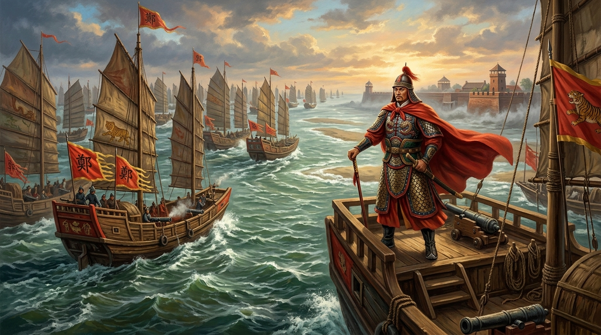

# 第 07 章：決戰大員九個月——鄭成功驅荷復臺與熱蘭遮城大圍城

> **時期分類**：第三時期：明鄭東寧與海上孤忠  
> **時代跨度**：西元 1661 年 4 月 – 1662 年 2 月（永曆十五年三月至十二月）  
> **關鍵人物**：延平王鄭成功（Koxinga / 國姓爺）、大員長官揆一（Frederick Coyett）、通事何斌、荷蘭拔隊長馬德夫（Thomas Pedel）、評議會員貓難實叮（Jacobus Valentyn）、明鄭侍衛鎮提督陳澤、宣毅前鎮提督馬信、援軍司令范德蘭（Dirk van der Laan）、荷蘭砲兵拉迪斯（Hans Jeuriaen Radis）  
> **歷史現場與坐標**：
> - 臺南安南區鹿耳門水道與潮水奇蹟（登陸突破點）：`23.0235° N, 120.1292° E`
> - 臺南安南區北線尾島與四草海戰戰場（首戰要塞）：`23.0185° N, 120.1380° E`
> - 臺南中西區普羅民遮城／赤崁樓（內陸投降據點）：`22.9978° N, 120.2026° E`
> - 臺南安平區熱蘭遮城／安平古堡（大圍城決戰現場）：`22.9997° N, 120.1605° E`
> - 臺南安平區烏特勒支碉堡高地（終局砲擊突破點）：`22.9982° N, 120.1585° E`  
> **核心突破與歷史轉折**：西元 1661 年春，明延平王鄭成功在南京戰役失利與清軍嚴厲海禁遷界令的生存絕境下，毅然採納通事何斌之策率大軍兩萬五千人東渡大洋，利用農曆初一朔日大潮自鹿耳門奇襲登陸，合圍荷蘭東印度公司在東亞的核心樞紐熱蘭遮城。歷經長達九個月的海陸血戰、熱病飢荒、援軍反攻與烏特勒支高地重砲對決，最終迫使荷蘭長官揆一開城締約撤離，徹底終結荷蘭在臺灣三十八年的殖民霸權，建立臺灣歷史上第一個漢人政權「東都明京」，宣告臺灣正式踏入東寧王國與明鄭治理的新紀元。  
> **影音連結**：[重點解說影片 (YouTube)](https://youtu.be/zzdTcyMWc0g) ｜ [雙人對談播客 (YouTube)](https://youtu.be/8pEU0k1p158) ｜ [NotebookLM 專案](https://notebook.google.com/notebook/c3127091-0bff-4fea-be05-93089cfaeeb1)  

---


*圖 1：西元 1661 年 4 月 30 日（農曆四月初一日）黎明，延平王鄭成功率領數百艘大鳥船與戰艦，乘著天助般的鹿耳門朔日大潮，破浪奇襲穿過險要淺灘，浩浩蕩蕩進入臺江內海。岸邊赤崁漢民與原住民扶老攜幼齊聲歡呼，龐大的明鄭水師直逼熱蘭遮城，拉開了震撼東亞的九個月圍城決戰序幕。*

---

## 【甲部：深度歷史專題長文】

### 壹、 歷史破曉：金陵城下的絕境與何斌的密圖——鄭成功為何不得不東征大員

西元 1659 年（明永曆十三年、清順治十六年）深秋，長江下游的風雲驟變，徹底改寫了明末清初抗清戰爭的宏觀格局。

在此之前，受封為「延平王」、被南明隆武帝賜國姓為「朱」的鄭成功（Koxinga），統率著東亞海域最強大的武裝海商集團與抗清主力。他率領十餘萬水陸大軍自舟山大舉北伐，勢如破竹連克鎮江、瓜洲，兵臨江寧（南京）城下。然而，由於戰術判斷失誤與清軍滿漢重騎兵的長途奔襲奔襲合圍，鄭軍在南京城郊的紫金山與雨花臺遭遇毀滅性潰敗，數百位身經百戰的猛將陣亡，精銳折損過半，被迫退回廈門與金門雙島。

#### 一、 清廷遷界令下的窒息絞殺
南京慘敗後，清廷攝政集團深刻意識到：若不徹底斬斷沿海民眾對鄭氏水師的物資供給，這支縱橫重洋的武裝艦隊將永遠無法撲滅。西元 1661 年初，清廷頒布了極其冷酷殘暴的**「遷界令」**：
- 強令山東至廣東沿海三十至五十里以內的所有城鎮、村落徹底拆毀；
- 居民悉數內遷，逾越官府畫界溝壑者一律立斬；
- 沿海船隻盡數焚毀，嚴禁片板入海。

這道絕戶之計，如同鐵箍般狠狠扼住了明鄭政權的咽喉。廈門、金門彈丸孤島，原本就糧米不產，過去完全仰賴內地走私網與沿海商貿維持軍餉。如今十萬軍民聚集島上，每天糧草消耗驚人，金門米價暴漲至每石數十兩白銀，底層士卒飢寒交迫，軍心震動。鄭成功深知，若僅僅在金廈坐以待斃，不用清軍跨海來攻，大軍自己便會在飢饉與絕望中分崩離析。

明鄭集團急需一片廣袤、豐饒、具備戰略縱深，且清軍騎兵絕對無法跨海奔襲的**「根本基地」**。

#### 二、 通事何斌的祕密地圖與海上獻策
正當鄭成功在廈門中軍行營中秉燭沉思、憂心如焚之際，一位關鍵人物的到來打破了死局。

這位人物，正是荷蘭東印度公司在臺灣的華人高級通事——**何斌**。何斌早年受雇於鄭成功之父鄭芝龍，熟悉海商往來；後在臺灣承攬荷蘭當局的贌稅與外貿中介，積累了巨額財富。然而，何斌在臺灣暗中替鄭成功向進出臺灣海峽的漢人商船徵收「海關引稅」，此事於 1659 年被荷蘭大員長官揆一（Frederick Coyett）察覺，欠下荷蘭東印度公司巨額稅款與債務的何斌面臨逮捕審判。

何斌當機立斷，於 1659 年底攜帶家人、資產，以及一張秘密繪製的**《臺灣海島輿圖與港道潮信冊》**，冒死偷渡逃至廈門，晉見鄭成功。

何斌展開精確的地圖，向鄭成功進獻了一篇震撼朝野的東征策論：
> 「臺灣沃野千里，為四夷不羈之國。橫絕大海，肆通外國，利盡南海；其田疇廣沃，土地豐饒，蔗糖、鹿皮、稻米歲出無算，可練兵數萬、聚糧百萬！且自赤崁外至大海，港道淺曲，紅夷所恃者僅熱蘭遮一座巨城，赤崁普羅民遮城土木疏闊，一攻即克。殿下若揮師東取臺灣，進可以戰，退可以守，雖遭天罰，亦足偏安，以圖中原！」

更為致命的是，何斌指出了荷蘭人防禦上的一個天大漏洞：荷蘭人一直深信，戰船要進入臺江內海，唯一的通道是位於熱蘭遮城大砲正下方的「南水道」（大員港道）；而北側的**「鹿耳門水道」**淤沙遍布、水淺莫測，荷蘭人認為吃水深重的大船絕對不可能通行，因而在此完全未設砲臺防備。何斌密告鄭成功：每逢農曆初一與十五大潮之日，鹿耳門海水將暴漲數尺，吃水丈餘之戰艦完全可以魚貫穿行！

這份軍事絕密情報，讓鄭成功眼中重新燃起了復興的烈火。

#### 三、 廷議激烈爭辯：金門出師的重大抉擇
然而，東征臺灣的構想在明鄭軍事會議中引發了激烈爭執。
- **反對派部將**（如馬信、黃廷等諸將）：認為大軍舍棄經營十餘年之金廈門戶，跨越兇險莫測的黑水溝風濤，遠征海外夷島，勝負難料；且紅毛番火器精利、巨艦如山，恐蹈南京之重轍。
- **鄭成功獨排眾議**：
  > 「先帝賜姓封王，寄予中興重托。今天下大半淪陷，沿海遷界，坐守絕島何異束手就擒？臺灣自我先王（鄭芝龍）開拓以來，本為我有，紅毛番借據多年，暴虐漢民。天奪其魂，地啟其祥，今取臺灣以為根本，生聚教訓，十年之後，方可圖恢復天下！」

西元 1661 年 4 月 21 日（明永曆十五年三月二十三日），料羅灣砲聲震天，祭旗出征。鄭成功親率第一梯隊官兵兩萬五千餘人、戰船數百艘，乘著西南季風破浪東指，直撲大員！

---

### 貳、 怒海驚濤：1661 年 4 月橫渡黑水溝與鹿耳門潮漲奇蹟

#### 一、 澎湖候風與糧盡危局
渡海航程遠比想像中更加兇險。大軍抵達澎湖群島時，突然遭遇春季暴風雨襲擊，陰雲蔽日，巨浪滔天，全軍被迫停泊於澎湖娘媽宮（今澎湖馬公）避風數日。

停泊數日，軍糧迅速告罄。部將請求折返金門運糧，但鄭成功深知軍機不可洩漏，若在澎湖遲延，一旦荷蘭人獲悉大軍出動的情報，加強防備並呼叫巴達維亞派遣大艦隊北上增援，登陸戰將淪為一場慘烈的消耗血戰。

四月二十九日深夜，風雨稍歇，鄭成功下令軍中僅留三日乾糧，全軍拔錨啟航，發動最後衝刺：「風順不順皆須發船！若畏風怯浪，坐困餓死澎湖，何面目見天下士？今日之事，有進無退！」

數百艘大鳥船、趕繒船在漆黑洶湧的臺灣海峽巨浪中破浪前行。黎明時分，海面大霧散去，遠方地平線上浮現出青翠起伏的中央山脈與金黃色的沙洲海岸——臺灣到了！

#### 二、 四月初一鹿耳門潮漲奇蹟
西元 1661 年 4 月 30 日（農曆四月初一日），清晨時分。

此時駐守熱蘭遮城上的荷蘭哨兵揉著惺忪睡眼，透過銅管望遠鏡望向海面，突然發出驚恐至極的尖叫警報。海天交界處，漫無邊際的白色風帆鋪天蓋地而來，數百艘插著明朝紅色戰旗與鄭軍日月虎頭旗的戰艦，如同密集的森林般壓向大員海面！

大員長官揆一立刻下令熱蘭遮城與普羅民遮城進入最高戰備狀態。熱蘭遮城二十餘門重型加農砲立刻搖動砲口，對準了南水道（大員水道）。

然而，令揆一與所有荷蘭軍官目瞪口呆的奇蹟發生了——龐大的明鄭水師根本沒有駛向重砲防守的大員水道，而是在旗艦引導下，齊刷刷右轉，直接駛向北側那片被荷蘭人判定為「絕不可行舟」的**鹿耳門水道**！

此日恰逢農曆四月初一，朔日引潮力達到巔峰。正如通事何斌所預言，正午時分，海潮奔騰如雷，鹿耳門外海浪濤翻滾，原本水深僅及膝蓋的淺灘暗礁，在短短一個時辰內潮水暴漲五六尺！
民間傳說鄭成功親自披掛蟒袍，於旗艦甲板設案焚香向天祈禱：「天若祚明，助我成功，即令潮水大漲，戰船無阻！」言畢，潮平如鏡，千帆競渡。

在何斌小艇的精準領航下，鄭軍龐大的鳥船與吃水三米以上的排船，一艘接著一艘從鹿耳門狹窄的水道中魚貫穿過，順利進入寬闊平靜的**臺江內海**！

#### 三、 禾寮港登陸與腰斬荷蘭防線
鄭軍主力大搖大擺穿過鹿耳門，在赤崁北面的**禾寮港（柴頭港）**全面搶灘登陸。

這是一記近乎完美的戰略奇襲：
1. **切斷互援**：鄭軍登陸點直接楔入荷蘭東印度公司在臺灣的兩大要塞——外海沙洲上的**熱蘭遮城**（Fort Zeelandia）與內陸市街上的**普羅民遮城**（Fort Provintia）之間，徹底腰斬了荷蘭防線！
2. **百姓簞食壺漿**：壓抑了九年郭懷一慘案深仇的赤崁漢人移民，見到明朝正規軍神兵天降，無不歡聲雷動。數千名漢人青壯男子自發攜帶竹排、牛車協助鄭軍搬運軍火糧秣，並主動為鄭軍指引荷蘭防禦虛實與水源分布。
3. **戰略合圍已成**：短短數小時之內，鄭成功在赤崁平原上紮下數十座連綿軍營，數萬大軍如鐵桶般將普羅民遮城包圍，同時隔著臺江內海虎視熱蘭遮城！

---

### 參、 決戰臺江與北線尾：巴達維亞蓋倫戰艦赫克托號之沉與排槍的破滅

面對突如其來的滅頂之災，大員長官揆一展現了一名職業軍官的冷靜與決斷。他判斷：鄭軍剛剛登陸，立足未穩，若能發動閃電反擊，重創其登陸部隊並切斷其補給，或能逼退對手。

揆一隨即下達了兩道致命的反擊命令：
1. 命令荷蘭步兵上尉**拔隊長馬德夫（Thomas Pedel）**率領 240 名荷蘭精銳火槍隊，渡海登上鹿耳門南側的**北線尾沙洲**，奪取鹿耳門控制權；
2. 命令大員港內的 4 艘武裝大型戰艦——主力蓋倫帆船**赫克托號（Hector）**、**格拉弗蘭號（Graveland）**、**白鷺號（Vink）**與長途通訊快船**瑪利亞號（Maria）**，全速駛入臺江內海，以重砲擊沉鄭軍船隊。

#### 一、 北線尾血戰：莫里斯排槍對決籐牌伏兵
1661 年 5 月 1 日（四月初二日），清晨。

馬德夫上尉是身經百戰的歐洲老兵，他對明朝軍隊充滿了傲慢與輕蔑。他曾對評議會宣稱：「一個荷蘭士兵足以對付二十五個中國農民，這些拿長矛的暴民聽到火槍齊射就會像羊群般潰逃。」

馬德夫帶領 240 名全副武裝的荷蘭步兵，在北線尾沙洲列成嚴整的歐洲**「莫里斯方陣（Maurice of Nassau Tactics）」**。士兵身披胸甲，手持口徑巨大的火繩槍與長矛，在沙洲上以鼓點節奏推進。

然而，迎戰他們的不是農民，而是明鄭集團最凶悍、經過嚴酷肉搏訓練的特種精銳——**侍衛鎮提督陳澤**所部的**「籐牌軍」**與弓弩隊。

當荷蘭火槍手進入射程，前排火槍隊蹲下進行第一輪排槍齊射時，彈丸呼嘯而過。然而，陳澤的部隊並未潰逃，籐牌兵手持由浸油老籐編織、刀槍不入的堅韌籐牌，迅速伏臥在沙丘與沿岸茂密的蘆葦海中，巧妙躲過了鉛彈的正面殺傷。

趁著荷蘭火槍手裝填彈藥、火繩冒煙的短暫間隙，陳澤親自揮舞令旗，下達了三面夾擊的命令！
- 鄭軍弓弩手自蘆葦叢中站起，暴雨般的重箭自高角度覆蓋射向缺乏防護的荷蘭後排隊形；
- 數百名赤膊、手持鋒利滾刀與籐牌的勇士，如猛虎下山般在泥濘沙灘上高速滾進，直接滾入荷軍佇列之中！

歐洲線列步兵最畏懼的貼身肉搏戰爆發了。籐牌兵用盾牌頂住長矛，滾刀專斬荷蘭士兵的小腿與腳踝。一旦荷軍倒地，短刀便刺入胸甲縫隙。
戰鬥僅僅持續了不到半小時，驕狂的馬德夫上尉被當場斬殺，118 名荷蘭火槍兵陳屍沙灘，其餘殘兵丟棄武器加農砲，狼狽跳入海中游回熱蘭遮城。

北線尾一役，打破了近代歐洲殖民者在亞洲無敵的軍事神話！

```
                     【北線尾海陸遭遇戰 戰術示意圖】
                     
              （鹿耳門水道 / 鄭軍戰船封鎖）
                           │
      [鄭軍伏兵：弓弩隊]   │   [陳澤中軍：籐牌兵]
      （隱蔽於茂密蘆葦）   │   （貼地滾進・專斷敵脛）
              ↘           │           ↙
        ─────────────────┴─────────────────
             【荷軍隊形：馬德夫 240 名火槍方陣】
             （裝填緩慢・兩翼缺乏騎兵掩護・陷入泥沼）
        ─────────────────┬─────────────────
                          │
                   （南水道方向退路）
                          ↓
                [殘兵跳海潰退熱蘭遮城]
```

#### 二、 臺江大海戰：赫克托號化為海天烈焰
與此同時，臺江內海的水面上展開了極其震撼的海權對決。

荷蘭主力蓋倫戰艦**「赫克托號」**是一座不折不扣的浮動海上堡壘。艦上配備 30 餘門重型青銅艦砲，兩舷側舷齊射時，砲彈在水面上激起滔天水柱，威力驚人。

面對巨艦，鄭成功展現了卓越的小艇狼群與火攻戰術。鄭軍深知在遠距離砲戰中木質鳥船難敵歐式重砲，於是出動了數十艘靈活機動的「火攻快艇」與接舷哨船。數十艘滿載硫磺、松脂、火藥的輕型木舟，在烈風中張滿風帆，以自殺式的速度從四面八方衝向赫克托號！

赫克托號重砲連連轟沉了數艘火船，但鄭軍水手前仆後繼。數艘快艇成功掛上了赫克托號高聳的船側纜繩，水手迅速引燃引信，大火順著乾枯的帆索狂暴地燒向甲板。更致命的是，鄭軍神射手攀上桅杆，將燃燒的火箭直接射入赫克托號開敞的砲門之中！

一聲地動山搖的恐怖巨響在臺江內海炸裂。大火引爆了赫克托號下層甲板的火藥庫，這艘象徵荷蘭東印度公司霸權的旗艦瞬間被炸成兩截，化為一團數十丈高的沖天蘑菇雲火球，緩緩沉入臺江海底！

艦長與全艦百餘名水手幾乎無一生還。見此慘烈景象，格拉弗蘭號與白鷺號戰艦受到重創，倉皇逃出大員港；而輕快的瑪利亞號則利用風向衝破重圍，逃往南洋爪哇島巴達維亞告急求援。

至此，大員的海上門戶被鄭成功徹底封鎖，戰局的主動權完全落入明鄭手中。

---

### 肆、 堅城如鐵：九個月熱蘭遮城大圍攻——飢饉、瘟疫與屯田開墾的持久消耗

#### 一、 普羅民遮城陷落與赤崁收復
登陸後的第四天——1661 年 5 月 4 日（四月初六日）。

被圍困在赤崁普羅民遮城內的荷蘭地方官**貓難實叮（Jacobus Valentyn）**，陷入了徹底的絕望。城內僅有 140 餘名荷蘭守軍與家眷，水源已被赤崁漢民協助鄭軍切斷，儲備糧食只夠維持數日；更讓荷蘭人膽寒的是，城外聚集了上萬名磨刀霍霍的漢人鄉親。

鄭成功派出何斌前往勸降，並承諾保證全體人員的生命與私人財產安全。貓難實叮衡量形勢，知道再抵抗只是無謂玉碎，遂正式簽署降書，大開城門向鄭軍投降。

赤崁的光復，讓鄭軍獲得了堅固的內陸後勤基地。鄭成功隨即將赤崁市街定名為**「東都承天府」**，象徵著明朝正朔正式在臺灣島生根立足。

#### 二、 五月二十五日：熱蘭遮內城強攻挫敗
攻克赤崁後，鄭成功將全部兵力集中指向最後也是最堅固的堡壘——**熱蘭遮城（Fort Zeelandia）**。

這座矗立在安平一鯤鯓沙嘴上的巨型要塞，是荷蘭人耗費三十餘年心血修築的十七世紀頂級軍事工程：
- **結構**：採用標準的**歐洲星形稜堡（Bastion Trace）**設計，以厚重的荷蘭紅磚與石灰、糯米汁混合砌成，城牆厚達數米，外壁平滑傾斜，足以抵禦當時任何加農砲的直射；
- **火力**：四座突出於城牆拐角的銳角稜堡上，架設了數十門重型青銅大砲，砲火完全交叉重疊，全無死角；
- **防禦優勢**：守軍約千餘人，城內挖有極深的淡水水井，儲備了可維持一年的乾酪、醃肉與彈藥。

五月二十五日（西元 1661 年 6 月 20 日）拂曉，鄭成功發動全線總攻擊。
鄭軍抬著竹梯、火藥包，在戰鼓號角聲中如潮水般衝向城牆。然而，近代防禦要塞的殘酷火力展露無遺——稜堡上的重砲發射出暴風雨般的葡萄彈與霰彈，在沙灘上撕扯開巨大的血肉通道；荷蘭步兵從胸牆後從容輪番射擊，城下的開闊沙地瞬間化為人間煉獄。

戰至正午，鄭軍始終無法越過深壕雷區一步，陣亡將士逾千人，驍將黃昭戰死。

鄭成功深通兵法，目睹強攻傷亡慘重，毅然下令撤兵，終止盲目強攻。他冷靜地對諸將指出：
> 「紅毛堅城未易猝拔。彼糧盡援絕，不攻自困。我師若徒事驅填，傷吾勇士，非上策也。宜劃地屯墾，嚴設長圍，坐待其斃！」

#### 三、 寓兵於農：全臺大屯墾與長期消耗戰
面對長期圍城戰，鄭成功面臨著兩萬五千大軍每天高達數百石糧草消耗的致命考驗。

鄭成功做出了臺灣歷史上最具決定性影響的重大決策：**「屯田制」**。
除留守包圍熱蘭遮城的精銳部隊外，其餘提督各鎮官兵全部派往臺灣西南部各地開荒屯墾：
- **前鋒營、後衝鎮**開赴嘉南平原；
- **左先鋒鎮、右武衛**開往高雄、屏東高屏溪流域；
- **中提督、侍衛鎮**開往彰化、臺中大肚溪流域。

軍隊到達開墾地後，「有事則戰，無事則耕」：
- 部隊駐紮的軍事據點，隨即演變為日後臺灣城鄉聚落的雛形——今日臺南與高雄無數名為**「左營」、「右昌」、「前鎮」、「後勁」、「新營」、「柳營」、「林鳳營」**的地名，全部誕生於 1661 年這場大圍城的屯田號令之中！

屯田政策不僅成功解決了明鄭大軍長期圍城的糧餉危機，更在短短幾個月內將漢人的農業技術、水利灌溉與社會組織徹底扎根於臺灣平原，在制度上為日後臺灣島的全面開發奠定了不可動搖的基石。

#### 四、 圍城中的人性悲歌：亨布魯克牧師的殉道
圍城長達數月，酷暑來臨，熱蘭遮城內爆發了嚴重的壞血病、痢疾與傷寒。城內飲水惡化，傷兵無藥可醫，死者日夜不斷。

五月間，鄭軍俘虜了在麻豆社傳教的荷蘭改革宗教會牧師**安東尼斯·亨布魯克（Antonius Hambroek）**及其家眷。鄭成功為促成和平解決，委託亨布魯克入城勸降揆一，並以其留在營中的妻子女兒為質。

然而，當亨布魯克走入熱蘭遮城時，他展現了令人肅然起敬的宗教信仰與個人節操。他不僅沒有勸降，反而當著長官揆一與全體評議會員的面，堅毅地鼓勵守軍：
> 「鄭軍在赤崁同樣遭遇糧荒與熱病，外圍防線絕非無懈可擊。巴達維亞的援軍終將到來，諸位千萬不可放棄希望，務必堅守到底！」

城內軍官與他的女兒痛哭流涕，苦苦哀求他留在城內保全性命。亨布魯克卻平靜地回答：「我已向鄭王立下信誓入城勸降，若我不歸，留在營中的同胞將遭屠戮。我不能用違背誓言的卑劣來偷生。」

言畢，亨布魯克在全城守軍肅然起敬的注視下，毅然走出城門返回鄭軍大營，隨後在鄭軍嚴酷的戰時法庭下慷慨殉道。這場跨越陣營的人性悲歌，成為十七世紀東西方海戰史上最震撼人心的歷史篇章。

---

### 伍、 破局一擊：烏特勒支高地砲戰與 1662 年揆一開城締約的文明風範

#### 一、 巴達維亞援軍的潰退
西元 1661 年 9 月，巴達維亞總督府派遣的救援艦隊終於抵達臺灣。

**司令范德蘭（Dirk van der Laan）**率領 10 艘戰艦與 700 名精銳士兵殺入大員海域。9 月 16 日，荷蘭艦隊在熱蘭遮城外海發動了大規模的海陸反撲，試圖以大口徑艦砲壓制北線尾與臺江水道。

然而，早已嚴陣以待的陳澤水師再次展現了高超的潮汐戰術。鄭軍利用暗礁與潮退時機，將荷蘭戰艦誘入淺灘。雙方展開長達數小時的近距砲戰，荷蘭戰艦「柯克肯號（Koukerke）」在密集的陸基重砲與火攻船夾擊下擱淺起火，另一艘戰艦重傷沉沒。范德蘭見大勢已去，自知無力回天，在幾度嘗試無果後，竟然率領主力艦隊揚帆棄城而去，徹底粉碎了揆一最後的翻盤希望！

#### 二、 日耳曼砲兵拉迪斯的致命密謀
時間推移至西元 1662 年 1 月（永曆十五年十二月）。

熱蘭遮城圍困已整整持續了九個月。城內守軍已餓死、病死過半，能拿槍戰鬥的士兵不足四百人，食物儲備瀕臨歸零，絕望的氣氛籠罩著每一個地道與壕溝。

就在此時，荷軍陣營內部出現了致命的叛變。一名來自日耳曼地區的荷軍砲兵中士**漢斯·拉迪斯（Hans Jeuriaen Radis）**，趁夜越過城牆壕溝，奔向鄭軍大營投誠。

拉迪斯向鄭成功呈獻了熱蘭遮城防禦體系中唯一的、致命的「阿基里斯之踵」：
在熱蘭遮城南側的沙丘制高點上，修築有一座圓形輔助碉堡——**「烏特勒支碉堡」（Fort Utrecht）**。由於沙丘地勢高於熱蘭遮內城，荷蘭人當初修築此碉堡是為了防止敵軍佔領高地俯射內城；但此時守軍兵力不足，烏特勒支碉堡僅有少數衛兵把守。
拉迪斯指出：「只要大王奪取烏特勒支沙丘，在該處架設二十門紅夷大砲，砲口便可居高臨下，直轟熱蘭遮內城最脆弱的總督官邸與中央蓄水池，熱蘭遮城將不攻自破！」

#### 三、 1662 年 1 月 25 日：烏特勒支碉堡大砲戰
得到拉迪斯的精準情報後，鄭成功於 1 月 25 日黎明發動了雷霆萬鈞的終局砲戰。

數千名鄭軍工兵在沙丘下連夜修築起 28 座木石砲臺。當晨曦初現，鄭軍集中了數十門重型紅夷大加農砲，對準烏特勒支碉堡發動了狂暴的毀滅性齊射！
在短短一天之內，鄭軍砲兵向這座孤立的圓堡傾瀉了超過 **2,500 發** 重型實心鐵彈。猛烈的爆炸將碉堡的磚石外壁炸得四分五裂，煙塵遮天蔽日。下午時分，烏特勒支碉堡外牆徹底崩塌，殘存的荷蘭守軍被迫點燃引信炸毀剩餘彈藥，狼狽退回內城。

鄭軍隨即佔領烏特勒支高地，將重砲推進至殘垣之上。黑洞洞的巨大砲口，在不足百米的距離內直接俯瞰著熱蘭遮內城的大理石官邸與議事廳！

城破，只在旦夕之間。

#### 四、 1662 年 2 月 1 日：文明受降與十八條締和條約
西元 1662 年 1 月 27 日，望著高地上密密麻麻的火砲與內城殘破的城垣，大員長官揆一召集了最後一次評議會。評議會員與市民代表全體痛哭，一致認定軍事抵抗已無任何可能，唯一的出路是談判開城。

當天上午，熱蘭遮城頭緩緩升起了一面白旗。

圍城九個月，死傷數千人，但鄭成功並未進行任何屠殺與報復。他展现了一名卓越軍事家與政治領袖的崇高文明風骨，欣然接受和平談判，雙方指派全權代表在熱蘭遮城外的平原大帳內，正式締結了具備近代國際法意義的**《鄭荷締和條約》（共十八款條文）**：

1. **和平撤離**：荷蘭東印度公司全體官員、軍人與平民，獲准攜帶全部私人財物、個人隨身武器（步槍與軍刀）及必備乾糧物資登船；
2. **軍人榮譽**：荷蘭守軍被允許保持完整的軍事尊嚴，**「揚旗、鳴鼓、荷槍、燃引信」**，列隊穿過鄭軍夾道防線，登上停泊在港外的荷蘭帆船；
3. **產權交割**：熱蘭遮城內所有要塞、防禦工事、官方檔案、東印度公司庫存之大砲、火藥彈藥、白銀物資與商品，完整移交明鄭政權；
4. **俘虜釋放**：雙方釋放所有戰俘與在押人員。

西元 1662 年 2 月 1 日（明永曆十五年十二月十三日），大員長官揆一在條約上莊嚴簽下自己的名字，並親手將熱蘭遮城的鑰匙移交給明鄭代表。

西元 1662 年 2 月 9 日，九百餘名劫後餘生的荷蘭軍民登上了八艘商船。在海風與浪濤聲中，荷蘭東印度公司的紅白藍三色旗在長達三十八年後，自熱蘭遮要塞緩緩降下；明朝朱紅色的軍旗與延平王的大纛，在南臺灣燦爛的陽光下冉冉升起！

臺灣的歷史，在這一刻翻開了翻天覆地的壯麗新頁。

---

### 陸、 核心史料與歷史指標對照表（標準 Markdown 表格規範）

#### 表一：1661 年鄭成功東征大軍 vs 荷蘭東印度公司大員守軍軍事實力全面對比

| 軍事維度／比對指標 | 明延平王鄭成功大軍（Koxinga Army） | 荷蘭東印度公司大員守軍（VOC Dutch Garrison） | 戰場勝負關鍵分析與戰術啟示 |
| :--- | :--- | :--- | :--- |
| **最高指揮官** | **延平王 鄭成功**（朱成功，37 歲）<br>副將：陳澤、馬信、甘輝、黃廷、何斌（領航） | **大員長官 揆一**（Frederick Coyett，46 歲）<br>副將：拔隊長馬德夫、地方官貓難實叮、司令范德蘭 | 鄭成功戰略意志如鋼鐵，海陸協同靈活；揆一防守堅韌但巴達維亞高層官僚延誤救援。 |
| **部隊總兵力** | 第一梯隊約 **25,000 人**<br>（水陸戰鬥部隊，包含鐵人軍、虎衛軍、籐牌兵、弓弩手） | 守軍常備兵力約 **1,100～1,500 人**<br>（包含荷蘭正規步兵、爪哇黑人士兵、市街武裝市民） | 鄭軍具備絕對兵力數量優勢（約 15:1），足以在圍城的同時實施全島屯墾。 |
| **海軍艦隊規模** | 戰船約 **300～400 艘**<br>（大鳥船、趕繒船、雙轤哨船、火攻快艇） | 武裝商船 **4 艘**（赫克托號、格拉弗蘭號、白鷺號、瑪利亞號）<br>後期援軍 10 艘 | 荷艦船體巨大、舷砲凶猛；鄭軍則善用潮汐淺灘與火攻小艇狼群圍攻，抵銷巨艦優勢。 |
| **主要武器裝備** | 紅夷大砲（生鐵與青銅重砲）、自製百子連珠砲、火繩鳥銃、狼銃、大砍刀、**特製浸油籐牌**、精鋼箭弩。 | **前裝滑膛重加農砲**（24 磅至 36 磅長砲）、歐洲燧發/火繩槍、加長騎兵長矛、手榴彈、防禦性葡萄彈。 | 荷軍稜堡砲火交叉射程極遠；鄭軍則在陸戰近身肉搏（籐牌破長矛）與攻城重砲轟擊上佔優。 |
| **補給與後勤體系** | 初期自帶三日乾糧，依賴赤崁漢民供應；中後期實施**全臺大屯田制度**，在地自給自足。 | 熱蘭遮城內儲存乾酪、醃肉、豆類與深水水井；但缺乏新鮮蔬果，長期圍困引發壞血病與痢疾。 | 鄭成功的屯田策略徹底瓦解了荷蘭「以守待斃」的消耗戰圖謀，將圍城變為長期立國基礎。 |

---

#### 表二：熱蘭遮城九個月大圍攻關鍵海陸戰役與戰術演變考證

| 戰役名稱／時間坐標 | 參戰雙方兵力規模 | 核心戰術交鋒與戰場動態 | 戰役傷亡與歷史關鍵轉折意義 |
| :--- | :--- | :--- | :--- |
| **鹿耳門奇襲與登陸戰**<br>1661 年 4 月 30 日（四月初一） | 鄭軍數百艘戰船<br>vs 荷蘭岸防瞭望哨 | 鄭軍利用農曆初一朔日大潮，避開大員水道重砲，冒險穿過淤淺的鹿耳門水道直插臺江內海。 | 鄭軍登陸禾寮港，零傷亡腰斬荷蘭防線，數千赤崁漢民簞食壺漿迎接，完成戰略包圍。 |
| **北線尾沙洲遭遇戰**<br>1661 年 5 月 1 日（四月初二） | 陳澤部隊 4,000 人<br>vs 馬德夫 240 名荷蘭火槍精銳 | 馬德夫展開莫里斯橫隊排槍齊射；陳澤以籐牌兵伏臥避其鋒芒，隨後貼地滾進肉搏，弓弩兩翼包抄。 | **荷軍拔隊長馬德夫陣亡，118 名荷兵戰死**。歐洲陸軍無敵神話破滅，鄭軍完全扼守沙洲。 |
| **臺江內海大海戰**<br>1661 年 5 月 1 日（四月初二） | 鄭軍數十艘火攻快艇<br>vs 荷蘭赫克托號等 4 艘戰艦 | 荷蘭旗艦赫克托號以重砲猛轟；鄭軍小艇冒彈接舷縱火，火箭引爆赫克托號火藥庫，巨艦化為火球。 | **赫克托號炸沉，百餘荷蘭水手全滅**；格拉弗蘭號重傷逃離。鄭軍奪得臺江內海制海權。 |
| **五月廿五熱蘭遮強攻戰**<br>1661 年 6 月 20 日（五月廿五） | 鄭軍主力 10,000 人登梯強攻<br>vs 荷軍內外城全體守軍 | 鄭軍抬竹梯發動蟻附攻城；荷軍稜堡交叉射擊，發射大量葡萄霰彈與手榴彈，在壕溝前形成火網。 | **鄭軍攻城受挫，陣亡逾千人，驍將黃昭殉國**。鄭成功毅然轉變戰略，改為長圍久困與寓兵於農。 |
| **九一六臺江援軍反擊戰**<br>1661 年 9 月 16 日（八月廿三） | 范德蘭援軍 10 艘戰艦<br>vs 陳澤水師與岸基砲臺 | 荷蘭巴達維亞援艦利用大潮突入臺江砲轟鄭營；鄭軍岸基重砲與火攻船反擊，荷艦柯克肯號擱淺自焚。 | 荷蘭反攻徹底失敗，援軍司令范德蘭棄城逃回爪哇，熱蘭遮城成為外無必救之絕境孤城。 |
| **烏特勒支高地總決戰**<br>1662 年 1 月 25 日（十二月初六） | 鄭軍 28 座攻城砲臺<br>vs 烏特勒支圓堡荷蘭守軍 | 依日耳曼降將拉迪斯指引，鄭軍一日之內向沙丘圓堡傾瀉 2,500 發重砲彈，將碉堡外牆完全轟碎。 | 鄭軍攻佔烏特勒支制高點，重砲直接俯瞰熱蘭遮內城心臟。**揆一於 1 月 27 日正式升起白旗開城**。 |

---

#### 表三：1662 年 2 月《鄭荷締和條約》（18 條款）核心條文與權利義務解析

| 條款項目與類別 | 《被遺誤的臺灣》所錄條文實質內容 | 鄭成功對荷方之承諾與處置 | 條約體現之國際法原則與文明風範 |
| :--- | :--- | :--- | :--- |
| **第一至三條：軍人榮譽與撤離** | 荷蘭東印度公司全體軍士、官員獲准揚旗、鳴鼓、荷槍、燃引信，保持軍隊建制與全副武裝離開城堡。 | 鄭成功提供充裕時間與運載駁船，派遣軍隊沿途戒備護送，嚴禁漢民騷擾或復仇。 | 賦予戰敗軍隊最高之軍人榮譽（Honours of War），彰顯明鄭政權遵循近代騎士交戰法則。 |
| **第四至六條：個人財產權保障** | 允許全體荷蘭官員、平民、士兵攜帶全部個人私有財產、薪資白銀、珠寶金飾及隨身行李安全登船。 | 明鄭軍隊一概不予搜查侵奪，保護私有產權；特許長官揆一保留個人私人帳冊與文獻。 | 嚴格區分「殖民公司公有財產」與「個人私有財產」，在十七世紀東亞戰事中極具現代法治精神。 |
| **第七至十條：公有資產與要塞移交** | 東印度公司所屬熱蘭遮城要塞、普羅民遮城要塞、所有大砲彈藥、庫存白銀、商品物資完整交割明鄭。 | 荷蘭官員編造物資清冊，由明鄭官員逐項驗收接收，作為東寧王國軍備與財政基底。 | 確立領土主權與公有要塞之合法移交程序，明鄭正式承接臺灣管轄全權。 |
| **第十一至十五條：平民與俘虜處置** | 雙方各自釋放所有在押俘虜；在臺灣之荷蘭婦孺、傳教士與未及撤離之平民，享有生命安全保護。 | 鄭成功信守承諾，無任何屠城或虐殺行為；同意租借四艘明鄭商船供荷方運送人員家眷。 | 展現高度人道主義寬容，徹底粉碎西方過去對明鄭海商為「野蠻海盜」之刻板偏見。 |
| **第十六至十八條：爭議仲裁與締約效力** | 條約一經雙方全權代表簽署並鈐蓋官印，即具備永久法律約束力，兩國互不尋仇追責。 | 1662 年 2 月 1 日，揆一與鄭成功各自簽字蓋印，雙方代表在大帳內舉杯完成歷史性和平締約。 | 近代亞洲非西方政權依據平等法權原則擊敗歐洲殖民帝國，並簽訂主權轉移條約之首例。 |

---

#### 表四：熱蘭遮城之戰對東亞海洋貿易格局與臺灣歷史命運的結構性轉變

| 歷史影響維度 | 戰前格局（1624 – 1661 荷西時期） | 戰後格局（1662 – 1683 明鄭時期） | 長期歷史轉折與文明里程碑意義 |
| :--- | :--- | :--- | :--- |
| **政權屬性與統治主體** | 荷蘭聯合東印度公司（VOC）商業殖民掠奪體制，以巴達維亞總督府為宗主，視臺灣為轉口金牛。 | **明鄭東寧王國**獨立海外政權，奉南明永曆正朔，建立承天府與天興、萬年二縣之郡縣體系。 | **臺灣歷史上第一個正式漢人儒家政權建立**，從純商業殖民地轉化為具備完整國家建制的政治實體。 |
| **土地制度與社會結構** | 全島推行「王田制」與嚴苛「人頭稅」，漢人皆為佃農，原住民部落實施「贌社制度」壟斷買賣。 | 廢除人頭稅，建立**「官田、私田、屯田」**三田並行制；官兵大舉屯墾，部落設立社學。 | 數萬精銳軍民深耕土地，奠定南臺灣水利、農耕與村落基礎（營盤聚落），漢人社會永久生根。 |
| **東亞國際貿易航線** | 荷蘭壟斷臺灣—日本長崎（鹿皮白銀）與臺灣—巴達維亞—歐洲（砂糖香料）之閉合商路。 | 鄭氏集團突破清廷遷界海禁，建立**臺灣—長崎—呂宋（馬尼拉）—東南亞**之自主走私貿易網絡。 | 臺灣躍升為東亞最具活力的自由貿易與軍事樞紐，展現強韌的海洋國家生命力。 |
| **文化與精神秩序** | 荷蘭長老教會以羅馬拼音推動新港文書聖經傳播，旨在輔助殖民統治與契約簽訂。 | 引進明朝典章制度，陳永華興築**臺南孔子廟（全臺首學）**，設立科舉制度，尊崇儒家禮教文風。 | 中華正統禮樂文明在臺灣確立制度根基，開啟「文教臺灣」的三百年文脈道統。 |

---

### 柒、 關鍵歷史大事記（Timeline 編年表格：1659 – 1662）

| 時間坐標（公曆／明曆） | 歷史戰略節點 | 關鍵歷史事件實質內容 | 歷史轉折意義與里程碑 |
| :--- | :--- | :--- | :--- |
| **1659 年深秋（永曆十三年）** | 南京戰役大潰退 | 鄭成功北伐南京受挫紫金山，損失精銳數萬，退守金門、廈門雙島。 | 明鄭軍事力量遭遇致命打擊，迫切尋求新戰略立足點。 |
| **1659 年冬（永曆十三年十一月）** | 通事何斌獻圖 | 荷蘭華人通事何斌逃抵廈門，向鄭成功呈獻臺灣輿圖、港道潮信冊與攻臺萬言書。 | 鄭成功正式獲悉鹿耳門大潮航道絕密，立定東征大計。 |
| **1661 年初（永曆十五年正月）** | 清廷發布遷界令 | 清廷強令沿海三十里居民內遷、焚毀舟船，對金廈實施全面海禁經濟絞殺。 | 明鄭陷入絕糧危局，「不克臺灣則全軍潰散」成為全軍共識。 |
| **1661 年 4 月 21 日（三月廿三）** | 金門料羅灣祭旗出師 | 鄭成功率兩萬五千水陸大軍、戰船數百艘，自金門料羅灣起錨出征。 | 東征大軍啟航橫渡臺灣海峽，開啟驅荷決戰序幕。 |
| **1661 年 4 月 30 日（四月初一）** | 鹿耳門潮漲登陸奇蹟 | 鄭軍船隊趁農曆初一大潮穿過鹿耳門淺灘，進入臺江內海，登陸禾寮港。 | 奇蹟般突破荷蘭防線，切斷赤崁與熱蘭遮城聯繫，數千漢民迎接。 |
| **1661 年 5 月 1 日（四月初二）** | 北線尾與臺江雙捷 | 陳澤籐牌兵全殲馬德夫 240 名荷軍火槍方陣；火攻船擊沉荷蘭旗艦赫克托號。 | 荷蘭海陸王牌全線崩潰，近代歐洲無敵神話破滅。 |
| **1661 年 5 月 4 日（四月初六）** | 普羅民遮城投降 | 赤崁普羅民遮城水源被斷，地方官貓難實叮開城投降；鄭成功設「東都承天府」。 | 鄭軍奪取內陸核心據點，臺灣正式納入明鄭統治版圖。 |
| **1661 年 6 月 20 日（五月廿五）** | 熱蘭遮城強攻受挫 | 鄭軍發動全線登梯強攻，遭稜堡重砲葡萄彈痛擊，陣亡千餘人，黃昭戰死。 | 鄭成功改變戰法，轉向長圍消耗，並下達**全臺大屯墾號令**。 |
| **1661 年 9 月 16 日（八月廿三）** | 范德蘭救援艦隊潰敗 | 巴達維亞 10 艘援艦強攻臺江，鄭軍誘敵於淺灘痛擊，柯克肯號自焚，荷援軍潰逃。 | 熱蘭遮城最後外部生機斷絕，徹底淪為海外孤島。 |
| **1662 年 1 月 25 日（十二月初六）** | 烏特勒支高地砲戰決戰 | 依日耳曼降將拉迪斯指引，鄭軍一日傾瀉 2,500 發重砲轟塌烏特勒支沙丘圓堡。 | 鄭軍佔領俯瞰內城之制高點，熱蘭遮城喪失全部防禦優勢。 |
| **1662 年 2 月 1 日（十二月十三）** | 《鄭荷締和條約》簽署 | 揆一率評議會正式開城受降，雙方在大帳簽訂具國際法效力之十八條和平交接協定。 | **熱蘭遮城九個月圍攻結束**，荷蘭守軍揚旗鳴鼓登船撤離。 |
| **1662 年 2 月 9 日（十二月廿一）** | 荷蘭人乘船全面離臺 | 揆一率領殘部登船離開大員港，荷蘭在臺三十八年殖民統治正式終結。 | 臺灣歷史正式邁入**明鄭東寧時期**，奠定現代漢人社會之基石。 |

---

### 捌、 參考文獻與權威史料清單

1. **揆一（Frederick Coyett）原著**，江日昇、程紹剛等譯，《被遺誤的臺灣》（'t Verwaerloosde Formosa, 1675），臺灣歷史文獻叢刊。
2. **江樹生譯註**，《熱蘭遮城日誌》（De Dagregisters van het Kasteel Zeelandia, Taiwan 1629-1662）第四冊，臺南市政府出版。
3. **楊英（明鄭戶官）著**，《從征實錄》（先王實錄），臺灣銀行經濟研究室臺灣文獻叢刊第 32 種。
4. **江日昇著**，《臺灣外記》，臺灣銀行經濟研究室臺灣文獻叢刊第 59 種。
5. **彭孫貽著**，《靖海志》，清康熙年間原刊本。
6. **曹永和著**，《臺灣早期歷史研究》、《臺灣早期歷史研究續集》，聯經出版公司。
7. **韓家寶（Pol Heyns）著**，《荷蘭時代臺灣的經濟·土地與稅務》，播種者文化出版。
8. **歐陽泰（Tonio Andrade）著**，鄭維中譯，《決戰熱蘭遮：歐洲與中國的第一場對決》（Lost Colony: The Untold Story of China's First Great Victory Over the West），時報出版。

---

## 【乙部：Google NotebookLM 影音提示詞、旁白腳本與字幕專用庫】

### 一、 Google NotebookLM 影片風格設定與生成提示詞（Prompt）

- **敘事風格定位**：史詩紀錄片風格（Epic Historical Documentary） / 深度軍事與文明對決敘事 / 雙人對談思辨
- **受眾定位**：大眾文史愛好者、大專院校歷史歷史系師生、全球海洋史探索者
- **NotebookLM 聚焦提示詞（Generation Prompt）**：
  > 「請依據本章所附的歷史資料與專題長文，聚焦於 1661 年延平王鄭成功率軍東征大員、鹿耳門大潮奇蹟、北線尾血戰與熱蘭遮城長達九個月的壯烈大圍攻。重點解析：第一，南京慘敗與清廷遷界令下，鄭成功退無可退的生死戰略決策；第二，何斌獻圖如何破解鹿耳門潮汐密碼，達成軍事奇襲；第三，北線尾戰役中，明鄭籐牌兵如何以近身肉搏打破歐洲莫里斯排槍神話；第四，面對熱蘭遮城十七世紀頂級稜堡防禦，鄭成功如何以全臺大屯墾建立長圍戰略；第五，烏特勒支高地砲戰的致命一擊與 1662 年揆一開城受降時雙方展現的軍人榮譽與文明風範。語言應飽含歷史滄桑感、磅礴雄渾且嚴謹考證，深入闡述此役如何徹底終結荷蘭在臺三十八年統治，奠定臺灣第一個漢人儒家政權與開發基石。」

---

### 二、 影視級口播旁白稿（搭配分鏡節奏）

#### 【場景一：破題懸念——橫渡黑水溝與鹿耳門的破曉奇蹟（00:00 - 01:45）】
- **【畫面視覺建議】**：
  - 空拍長鏡頭：十七世紀臺江內海古地圖與浩瀚澎湃的臺灣海峽巨浪交疊。
  - 特寫鏡頭：鄭成功在中軍大帳中凝視何斌進獻的臺灣海島全圖，燭火在甲胄上躍動。
  - 震撼轉場：1661 年 4 月 30 日拂曉，數百艘明鄭戰艦漫天紅帆穿破濃霧，鹿耳門潮水如怒濤暴漲，帆檣如林長驅直入。
- **【旁白解說詞】**：
  > 「西元 1661 年春天，臺灣海峽的驚濤駭浪中，一場決定東亞海洋命運的生死大決戰悄然揭幕。  
  > 
  > 此時的延平王鄭成功，剛剛經歷了金陵城下的慘痛潰敗。面對清帝國殘酷的遷界禁海令，聚集在金門廈門絕島上的十萬軍民，糧盡援絕，退無可退。  
  > 
  > 就在生死存亡之際，通事何斌攜帶著一張密圖偷渡而來——『臺灣沃野千里，可練兵數萬、聚糧百萬！』  
  > 
  > 鄭成功毅然拍板，率領兩萬五千名誓死抗清的鐵甲將士，乘著逆風橫渡黑水溝。  
  > 
  > 4 月 30 日清晨，不可思議的天文奇蹟降臨——農曆初一的朔日大潮奔騰狂湧，鹿耳門水深暴漲數尺！  
  > 
  > 數百艘明鄭戰艦如神兵天降，繞過了荷蘭人重砲防守的大員水道，長驅直入臺江內海！這場震撼世界的九個月大圍攻，就此撕裂了殖民帝國的平靜！」

---

#### 【場景二：風雲初交——赫克托號火海與北線尾血戰（01:45 - 03:45）】
- **【畫面視覺建議】**：
  - 歷史插圖特寫：《北線尾沙洲血戰》。荷蘭莫里斯排槍噴吐白煙，陳澤籐牌兵貼地滾進，滾刀與長矛在泥濘沙灘上激烈碰撞。
  - 海戰動畫：荷蘭主力蓋倫戰艦赫克托號被數十艘明鄭火攻快艇團團包圍，火箭射入砲門，彈藥庫引發驚天動地的大爆炸，烈焰吞噬海面。
- **【旁白解說詞】**：
  > 「荷蘭大員長官揆一絕未想到，對手竟會從不可能的水道登陸。他立刻派遣麾下最悍勇的上尉拔隊長馬德夫，率領 240 名荷蘭火槍精銳，渡海登上北線尾沙洲。  
  > 
  > 馬德夫傲慢地宣稱：『一個荷蘭火槍手能打跑二十五個中國兵！』  
  > 
  > 他們排開了稱霸歐洲戰場的莫里斯排槍方陣。然而，迎面撲來的卻是明鄭最令人膽寒的特種精銳——籐牌軍！  
  > 
  > 呼嘯的鉛彈擊中了沙灘，籐牌勇士伏臥避過彈雨；趁著荷軍裝填彈藥的瞬間，刀客手持浸油籐牌與鋒利滾刀，在蘆葦叢中貼地飛滾而來，專斬敵軍腳踝！  
  > 
  > 短短半小時，馬德夫與百餘名荷蘭火槍手陳屍沙洲，驕狂的方陣徹底瓦解！  
  > 
  > 與此同時，在臺江水面上，荷蘭主力巨艦赫克托號被數十艘鄭軍火攻快艇死死咬住。漫天火箭引爆了底層火藥庫，在一聲崩山裂地的巨響中，這艘海上巨無霸化為沖天火球，沉入海底！  
  > 
  > 近代西方殖民者在亞洲無敵的神話，在這一刻被明鄭將士徹底擊碎！」

---

#### 【場景三：九月孤城——熱蘭遮圍困、烏特勒支砲擊與英雄相惜（03:45 - 05:45）】
- **【畫面視覺建議】**：
  - 建築三維推演：熱蘭遮城宏偉的星形紅磚稜堡防線，交叉火網猛烈轟擊城下；鄭成功在中軍大營頒布屯田令，官兵於高雄、臺南平原開荒拓土。
  - 人性特寫：亨布魯克牧師毅然告別女兒與守軍，神情肅穆走出熱蘭遮城門回營赴難。
  - 砲戰高潮：1662 年 1 月 25 日，烏特勒支沙丘砲臺萬砲齊發，實心鐵彈狂暴砸碎荷蘭圓堡，砲煙籠罩海天。
- **【旁白解說詞】**：
  > 「然而，要真正攻陷熱蘭遮城，遠比想像中更為艱難。  
  > 
  > 這座全磚石修築的星形稜堡，配備了數十門重砲，全無死角。五月二十五日的登梯強攻，鄭軍在密集的葡萄彈下傷亡千餘人，驍將黃昭喋血沙場。  
  > 
  > 鄭成功沒有盲目硬拼，他做出了改寫臺灣歷史的偉大決策——『寓兵於農，全臺屯墾』！  
  > 
  > 數萬將士開赴嘉南與高屏平原，左營、新營、前鎮、柳營，一個個後世繁華的城鄉聚落在此刻誕生！這場圍城，被鄭成功轉化為文明扎根的土壤。  
  > 
  > 圍城長達九個月，飢餓、傷寒與壞血病折磨著孤城。亨布魯克牧師入城勸降卻鼓勵守軍堅守，最終慷慨殉道，寫下了超越敵我陣營的人性悲歌。  
  > 
  > 西元 1662 年 1 月，日耳曼砲兵拉迪斯投降獻策，點破了熱蘭遮城最後的死穴——烏特勒支高地！  
  > 
  > 1 月 25 日黎明，鄭軍二十八座砲臺發動毀滅性齊射，一天之內傾瀉 2,500 發重砲彈，將烏特勒支碉堡夷為平地！黑洞洞的砲口居高臨下，直指熱蘭遮城心臟！」

---

#### 【場景四：歷史終局——東都明京的破曉與近代海洋文明轉型（05:45 - 07:30）】
- **【畫面視覺建議】**：
  - 歷史油畫特寫：1662 年 2 月 1 日，大帳內鄭成功與揆一莊嚴簽署《鄭荷締和條約》，荷蘭守軍揚旗鳴鼓登船撤離。
  - 現代航拍與古蹟對照：臺南安平古堡的斑駁殘壁、赤崁樓飛簷、孔子廟「全臺首學」金字匾額在陽光下熠熠生輝。
  - 結尾升華：臺灣海峽日出萬道金光，波濤拍擊著歷史海岸。
- **【旁白解說詞】**：
  > 「西元 1662 年 1 月 27 日，熱蘭遮城頭緩緩升起了一面白旗。  
  > 
  > 歷經九個月的血戰，鄭成功展現了卓越軍事家的高尚風骨。他並未血洗城池，而是與大員長官揆一簽訂了具備現代國際法意義的十八條和平締和協定。  
  > 
  > 荷蘭軍民被允許保留全部私有財產，揚旗鳴鼓、全副武裝榮譽撤離。  
  > 
  > 2 月 9 日，荷蘭東印度公司的三色旗緩緩降下，結束了在臺灣三十八年的殖民統治。明朝朱紅色的軍旗，在南臺灣的晴空下迎風獵獵飄揚！  
  > 
  > 這場大圍攻，是近代歷史上非西方政權首次正面擊敗歐洲海上殖民帝國的偉大戰役！  
  > 
  > 鄭成功在這裡建立了『東都明京』，引進儒學文教，推行郡縣開墾。這座孤懸海外的島嶼，從此告別了單純的殖民商埠歲月，正式擁有了屬於自己的政治生命與文化血脈！  
  > 
  > 決戰大員九個月，不僅是一曲海上孤忠的悲壯史詩，更是臺灣這座島嶼昂然走向世界歷史舞台的破曉晨鐘！」

---

## 丙部：Faster-Whisper 語音辨識專用初始提示詞庫（Initial Prompt）

> **應用規範**：於調用 Faster-Whisper 模型轉錄口播音訊時，必須將下列專有名詞詞庫完整注入 `initial_prompt` 參數中，徹底杜絕因語音同音造成的歷史名詞與人名地名錯誤。

```text
臺灣史, 鄭成功, 國姓爺, Koxinga, 延平王, 朱成功, 揆一, Frederick Coyett, 荷蘭東印度公司, VOC, 熱蘭遮城, Fort Zeelandia, 普羅民遮城, Fort Provintia, 赤崁樓, 安平古堡, 鹿耳門, 臺江內海, 禾寮港, 柴頭港, 北線尾, 何斌, 馬德夫, Thomas Pedel, 貓難實叮, Jacobus Valentyn, 陳澤, 馬信, 甘輝, 黃廷, 范德蘭, Dirk van der Laan, 烏特勒支碉堡, Fort Utrecht, 拉迪斯, Hans Jeuriaen Radis, 亨布魯克, Antonius Hambroek, 赫克托號, Hector, 格拉弗蘭號, Graveland, 白鷺號, Vink, 瑪利亞號, Maria, 柯克肯號, Koukerke, 籐牌軍, 滾刀, 莫里斯方陣, 葡萄彈, 紅夷大砲, 遷界令, 東都承天府, 天興縣, 萬年縣, 屯田制, 左營, 前鎮, 新營, 柳營, 林鳳營
```
