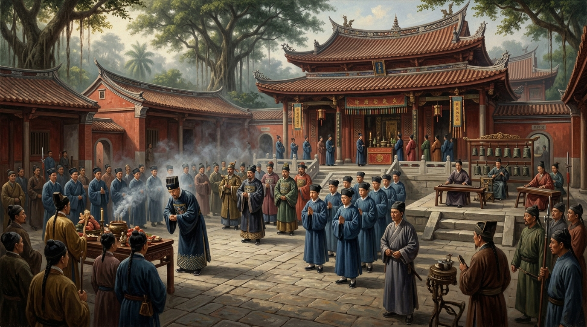
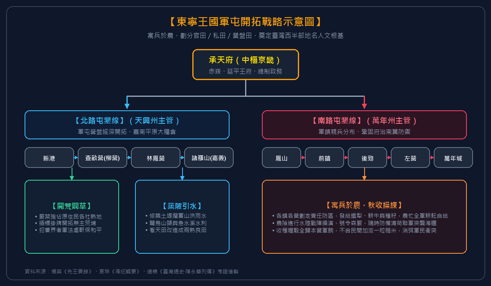
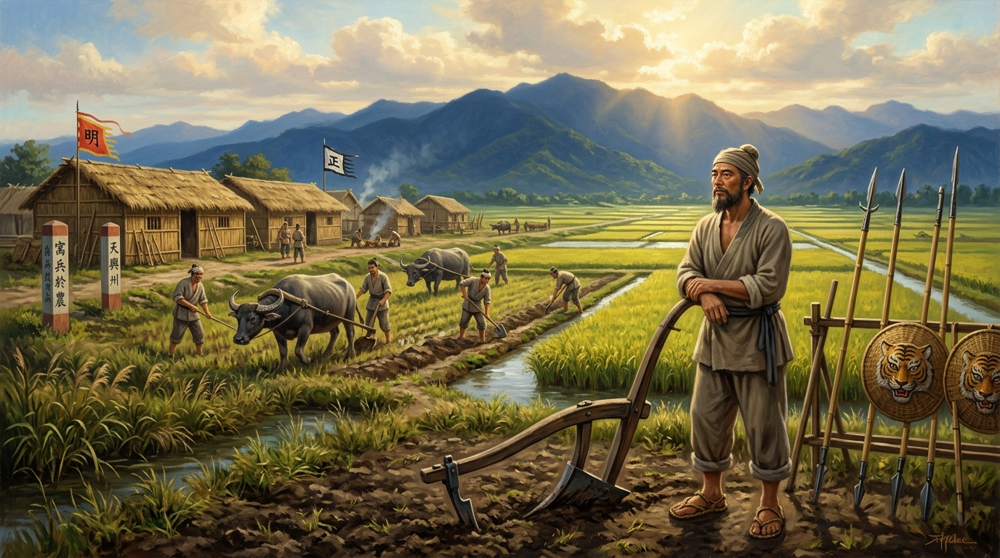
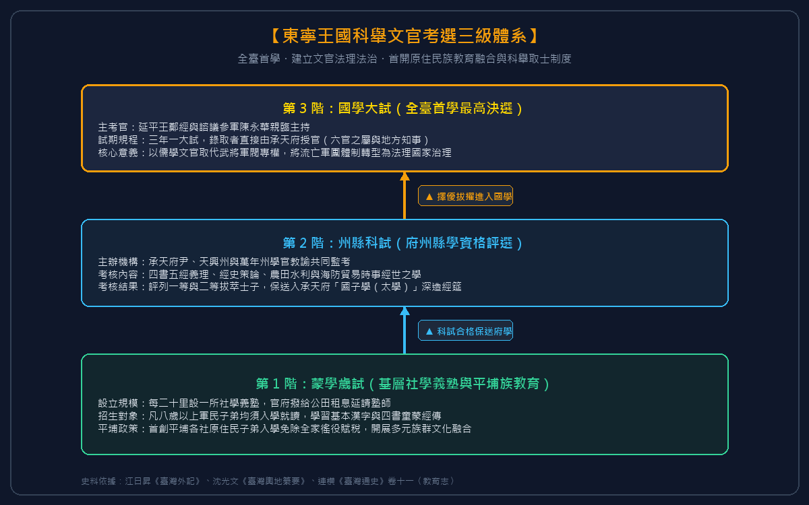
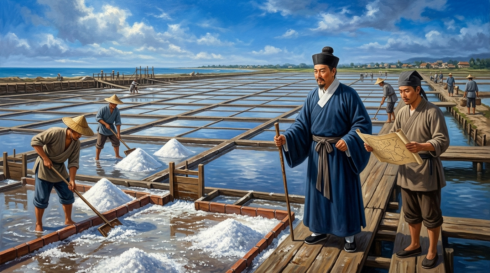
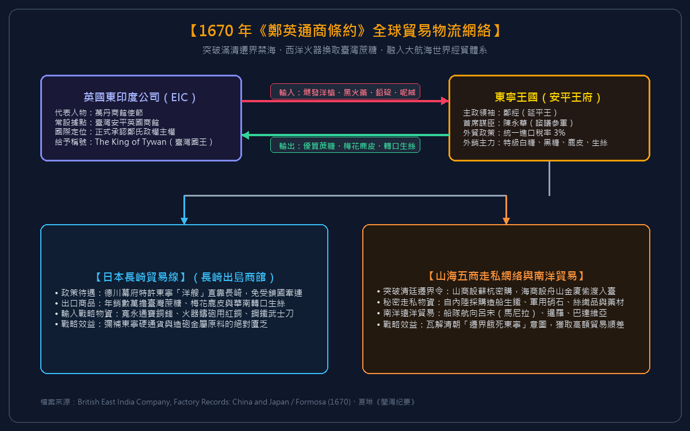
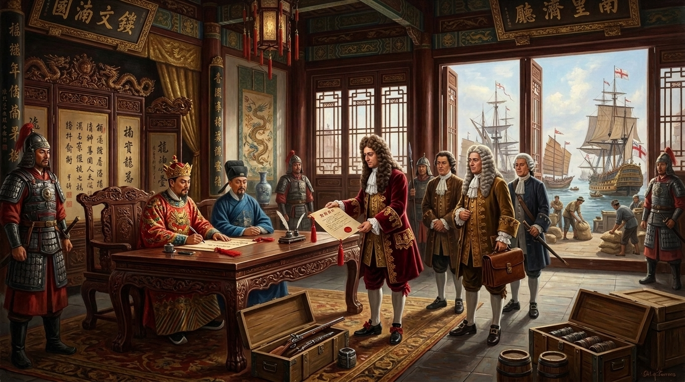

# 第 08 章 海外別立乾坤——陳永華的屯墾、孔廟儒學與東寧王國治理

> **所屬時期**：第三時期：明鄭東寧與海上孤忠（1661–1683）  
> **歷史斷代**：1664 – 1680（鄭經治臺與陳永華輔政期）  
> **核心歷史坐標**：臺南全臺首學孔廟（`22.9904, 120.2043`）  
> **關鍵歷史人物**：鄭經、陳永華、沈光文、馮錫範、鄭克臧  
> **多媒體影音連結**：
> - 🎬 **重點說明影片**：[YouTube 官方首播（2026-11-02 17:30 CST）](https://youtu.be/aO5qQbw6ehw)
> - 🎙️ **深度對談播客**：[YouTube 官方首播（2026-11-02 19:30 CST）](https://youtu.be/-N6tchcDyHU)
> - 🎵 **雲端串流音訊**：[GitHub Releases 官方音訊串流](https://github.com/clive520/taiwan-history/releases/download/v1.0.0/ch08_podcast_deepdive.m4a)
> - 🧠 **NotebookLM 專題**：[Google NotebookLM 專屬研究筆記本](https://notebook.google.com/notebook/63f06a2e-10ea-41f4-b39b-2deec72d9b87)

---

*圖 8-1：1666 年（永曆二十年），承天府寧南坊大成殿落成，諮議參軍陳永華率領文武百官與士子行釋奠古禮，弦歌不輟，標誌著儒學文教正式在臺灣生根，史稱「全臺首學」。*

---

## 【甲部：深度歷史專題長文】

### 第一節、 驚濤裂岸：從「東都明京」到「東寧王國」的政權嬗變

永曆十六年（1662）五月初八日，驅逐荷蘭東印度公司、收復大員僅僅三個月餘的延平王鄭成功，於熱蘭遮城改建的安平王府內暴卒逝世，年僅三十九歲。這位縱橫東亞海域、名震華夏的「國姓爺」驟然崩殂，給初創未穩的海外海上政權投下了一記毀滅性的震撼彈。

當時，鄭成功長子鄭經留守廈門，其叔父鄭襲在臺灣諸將擁戴下自立為「東都主」，企圖割據孤島。鄭經在謀士陳永華與大將周全斌輔佐下，毅然自廈門起兵渡海平定內訌，將鄭襲軟禁，穩固了嗣王之位。然而，大陸沿海的軍地形勢迅速急轉直下——清廷深知鄭氏水師強悍，正面交鋒難以取勝，遂於順治末期至康熙初年，由鰲拜等輔政大臣厲行雷霆手段，頒布了殘酷絕倫的「遷界禁海令」：從山東、江蘇、浙江、福建直達廣東，沿海三十里至五十里內的所有居民一律內遷，房屋田舍盡數焚毀，船隻不得下海，寸板不許入水，違者立斬。清廷築起綿延數千里的界壕墩堡，企圖以「堅壁清野、餓死鯨鯢」的焦土戰略，將偏居金門、廈門的明鄭殘部活活困死。

面對清廷大軍與降清降將的重重包圍，永曆十七年（1663），清荷聯軍大舉攻陷金門、廈門，鄭經主力戰艦受挫，大陸沿海最後的跳板徹底喪失。在此生死存亡之秋，陳永華挺身而出，向鄭經進言：

> 「金、廈彈丸之地，難以久抗清朝傾國之師；而臺灣沃野千里，山川險固，昔先王闢建基業，正為今日避秦之窟。退守東寧，休兵息民，海外別立乾坤，方為萬全之策。」

永曆十八年（1664）三月，鄭經率領殘餘軍民萬餘人，揚帆東渡，正式將整個政權中樞全盤移駐臺灣。抵臺後，鄭經與陳永華做出了重大制度變革：廢止鄭成功時期的「東都」之名，改稱為「東寧」（Tungning），升天興縣為「天興州」、萬年縣為「萬年州」，承天府依舊為行政京畿；並增設澎湖、南路、北路三處安撫司。

這項改名非同小可。在明鄭君臣的內心深處，「東都」寄託著「以臺灣為陪都、旦夕反攻南京」的軍事暫借意味；而「東寧」之定名，則標誌著政權戰略重心由「客居過渡」向「在地扎根、立國化民」的重大哲學轉型。對內，東寧依舊奉南明永曆帝正朔，禮遇寧靖王朱術桂等宗室，高懸大明孤忠之旗；對外，在與英國東印度公司簽約、與德川幕府通信時，鄭經自稱「東寧總制」或「臺灣國王」（King of Tywan），實質上已形成一個擁有獨立軍隊、外交體系、司法制度與對外關稅的海洋主權實體。

而在這場浩大的立國過程中，被譽為「東寧孔明」的諮議參軍——陳永華（字復甫，福建同安人），以其卓越的政治遠見、經世濟民的才幹與高風亮節，成為東寧王國走向繁榮強盛的真正總設計師。

---

### 第二節、 寓兵於農：營盤田屯墾體制與土地革命

明鄭政權渡臺初期，面臨最致命的生存危機並非清軍的跨海遠征，而是迫在眉睫的「糧食飢荒」。

當時隨同鄭成功、鄭經兩代入臺的軍民總數超過十萬人，而臺灣原先經過荷蘭東印度公司開拓之熟田不過數千甲，稻米產量遠遠不足以供養龐大的正規水陸軍隊。若依照傳統做法向民間漢人佃農與原住民部落強徵重稅與軍糧，勢必重演崇禎末年流寇蜂起、以及荷蘭殖民時期郭懷一起義的血腥覆轍。

面對「兵多糧少、坐吃山空」的死局，陳永華向鄭經提出了承襲自曹操三國屯田與明代衛所制的劃時代政策——**「寓兵於農、兵農合一」的軍屯營盤田制度**。

*圖 8-2：東寧王國軍屯開拓戰略示意圖（承天府京畿中樞指揮北路天興州與南路萬年州營盤田拓墾、築陂引水與秋收練兵總體戰略部署）。*

陳永華將東寧全島土地精準劃分為三大管理體系，建立了條理分明的土地所有權與賦稅結構：

1. **官田（承天官產）**：承襲自荷蘭東印度公司的「王田」（Crown Land），產權歸東寧公家所有。由承天府設專官招募無地流民承租耕作，耕牛、種籽由官府借貸，農民按年繳納官租（田租），成為國庫核心支柱。
2. **文武官田（私田墾照）**：准許隨軍文武百官依照品秩出資招佃，赴荒埔無主之地自主開墾。三年內免稅，期滿後按私田科則納稅，極大地激勵了明鄭士紳階層的投資開荒熱情。
3. **營盤田（軍屯主力）**：東寧軍隊除承天府京畿留守部隊外，其餘各鎮、各營精兵全數派往南北荒原。每一營劃撥指定防區與荒埔，兵士人人配發鐵犁、耕牛與刀槍。農忙之時「倒戈下田、引水闢荒」；農隙之時「操練水戰、結隊守禦」。營盤所收穫之稻穀，全數充作本營軍餉，官府不再自民間加派一粒糧食。

為杜絕軍士恃強奪民田或侵犯原住民獵場，陳永華親自頒布極其嚴格的《屯墾律令》：
> 「凡各鎮營開闢荒地，須先查明非屬土著各社獵場熟地，方准插標掛牌開墾；敢有豪強掠奪番社一寸土地、毀其禾稼者，軍法連坐處斬！」

這套軍屯制度展現了驚人的行政效率。短短數年間，自南投、彰化、嘉義至臺南、高雄、屏東，數萬甲莽草瘴癘之地迅速化為千頃良田。更深遠的是，明鄭軍屯深刻塑造了今日臺灣西半部的人文地理景觀。今日臺南與高雄的地名中，凡帶有「營」、「鎮」字樣者，幾乎全為當年陳永華麾下明鄭軍隊之營盤遺址：
- **查畝營（今臺南柳營）**：陳永華指派鄭軍親軍宿衛開闢之處；
- **林鳳營（今臺南六甲）**：鄭軍參軍林鳳屯軍拓墾之營寨；
- **新營、下營、中營**：明鄭前鎮、後鎮之屯墾駐地；
- **左鎮、前鎮、後勁、右昌、左營**：鄭家親軍各營之駐地代稱。

四百年後的今天，當人們搭乘高鐵飛馳過嘉南平原與高雄平原，窗外掠過的一座座繁榮市鎮，其血脈深處依然銘刻著陳永華當年「解甲屯田、化干戈為玉帛」的歷史足音。

---

| 土地分類 | 土地產權所屬 | 招佃與耕作主體 | 賦稅與糧餉歸屬 | 歷史前身與現代地名留存 |
| :--- | :--- | :--- | :--- | :--- |
| **官田（公田）** | 東寧王國國庫所有 | 招募無產流民與移民耕作，官借耕牛農具 | 繳納公租（通常為收成三至四成），充實國庫米倉 | 承襲荷蘭 VOC「王田」；今臺南市「官田區」即其遺存 |
| **私田（文武官田）** | 王室宗親、文武官員私人開墾所有 | 官紳自備工本，私自招募佃農開墾 | 開墾前三年免稅，三年後按民間私田科則起科 | 原野荒埔私產化；為臺灣漢人地主佃農制之濫觴 |
| **營盤田（軍屯田）** | 各軍鎮部隊公同共有 | 正規陸師、水師兵卒集體開墾（寓兵於農） | 全部產出歸該營部隊自給自足，不仰賴民間漕糧 | 新營、下營、柳營（查畝營）、林鳳營、左鎮、前鎮、左營 |

*表 8-1：東寧王國三大土地開墾制度比較分析表*

---

*圖 8-2：在陳永華「寓兵於農」政策下，明鄭將士於嘉南平原插標圍地、開渠灌溉。兵士農忙時持犁耕耘，農隙時操練武藝，徹底解決了十萬軍民的斷糧危機，開拓出如今柳營、林鳳營等現代市鎮的前身。*

---

### 第三節、 全臺首學：臺南孔廟與儒學教化的奠基

若陳永華的功績僅止於軍屯獲糧，他充其量不過是一名優秀的軍需參謀；真正讓他名垂青史、被尊為「開臺文化之祖」的，是他深謀遠慮地在海外海島上，移植並建立了一套完整的**儒學教育體系與科舉文官體制**。

永曆十九年（1665），在軍屯漸有成效、米價平抑之後，陳永華正式向鄭經上一道極具歷史分量的奏疏：

> 「昔先王承天奮勇，拓土開疆，草昧初開，人心浮動。夫國之興衰，在於人才；人才之出，基於教育。今東寧初定，若徒恃武備而不崇文治，雖富強一時，終非百年立國之計。臣請建孔廟、設國學、立府州縣學，科舉取士，明人倫以隆教化。」

鄭經閱後深以為然，全權委託陳永華督工籌建。永曆二十年（1666）春，承天府寧南坊一座宏偉典雅的儒家聖殿巍然拔地而起——這便是至今仍屹立於臺南的「全臺首學」臺南孔子廟。

*圖 8-4：東寧王國科舉文官考選三級體系（基層社學蒙養、州縣科試評選與全臺首學國學大試授官架構）。*

陳永華督建之孔廟，嚴格遵循周代古禮「左廟右學」規制：
- **左側（東側）為學**：建「明倫堂」，作為國子監祭酒、教諭講經授道，課督學子修身養性之講堂；
- **右側（西側）為廟**：建「大成殿」，正中奉祀至聖先師孔子神位，兩廡配享歷代先賢先哲。

孔廟落成之日，陳永華備三牢古禮，率東寧文武百官與數百名儒冠士子，於晨曦鐘鼓齊鳴中行釋奠大典。沈光文等明朝遺臣賦詩相慶，讚嘆在離鄉萬里的荒煙海外，竟能重睹衣冠禮樂之盛。

更具革命性的是陳永華推行的**文官選拔與平民教育體制**：
1. **設立階梯式學制**：由基層聚落設立「社學」（義塾），推行啟蒙識字；中央設「國子學」（太學），聘請江南碩儒名士傳授經史策論。
2. **開闢本土科舉試事**：定立三年一大試之科舉制度。不問門第閥閱，凡在州學、國學考核優秀者，皆得參加大試；中選及第者，由承天府直接拔擢任用為六官（吏、戶、禮、兵、刑、工）之屬官與地方知事。這一制度打破了武人軍官世襲弄權的弊端，使東寧政權迅速轉型為文官輔政的成熟法理國家。
3. **推動原住民族文教融合**：陳永華特別下令，鄰近漢人市鎮之平埔族各社（如新港、蕭壠、麻豆、目加溜灣），凡原住民子弟願入社學讀書識字者，全家免除其勞役賦稅。許多原住民部落開始學習漢字、朗誦詩書，為日後臺灣多元文化的深層融合作出了開拓性的歷史試驗。

全臺首學的建立，猶如在狂風巨浪的黑水溝東岸，點亮了一盞文明不滅的明燈。它宣告了臺灣正式脫離蠻荒與異族殖民拓殖地之地位，邁入禮義文治的文明社會。

---

| 制度環節 | 具體政策與施行措施 | 招生對象與選拔標準 | 歷史實踐成效與長遠意義 |
| :--- | :--- | :--- | :--- |
| **建築形制** | 左學右廟、明倫堂與大成殿並峙；嚴循周禮設泮池、櫺星門 | 文武百官、士紳名流歲時致祭 | 成為臺灣三百餘年儒學聖殿，尊為「全臺首學」 |
| **中央國子學** | 設國子學於明倫堂，聘請避秦名儒（如沈光文等）主講經筵 | 招募隨軍士族子弟與地方拔萃秀才入學 | 培養出本土第一代文官治理人才，擺脫武將專橫 |
| **科舉考選** | 設「科試」與「大試」，三年一科；考四書五經義理與時事策論 | 國子學生員與府州生員均得報考 | 建立公平選官渠道，使流寓士人深根臺灣，心向東寧 |
| **社學義塾** | 每二十里設一社學，官撥公田收益補貼塾師束脩 | 一般農民、軍屯子弟及原住民平埔社青年 | 普及基層文教；首創原民學子入學免全家徭役之先例 |

*表 8-2：東寧王國文教體系與科舉制度詳表*

---

### 第四節、 經世致用：天日曬鹽、磚瓦窯火與實業革命

陳永華治臺，絕非空談心性義理的迂腐冬烘，而是深諳「民不富則政不立，工不興則國不強」的經世致用實幹家。在安撫百姓、振興教育的同時，他親自擘畫推動了震撼全臺的四大民生實業革命：**天日曬鹽、磚瓦燒造、蔗糖改良與製鐵修械**。

#### 1. 瀨口鹽埕：終結苦澀的「天日曬鹽」技術革命
在明鄭以前，荷蘭人與早期原住民對食鹽需求依賴極度有限。漢人初期渡臺，多沿用原始的「煮海為鹽」（淋鹵煎鹽）法：將海水潑在草木灰上引濾出高濃度鹵水，再傾入大鐵鍋中砍伐薪柴晝夜熬煎。這種煎鹽法成本高昂，且出產之鹽結晶粗糲、色澤灰黑、口感苦澀，極易引起地方癭疾（甲狀腺腫大），百姓往往「以無鹽為苦」。

永曆十九年（1665），陳永華巡視承天府南郊之瀨口（今臺南市南區鹽埕），見該地地勢低平、潮汐落差明顯、且冬季降雨稀少而日照猛烈，乃拍案讚曰：「此乃造化所賜之天然鹽場也！」

陳永華隨即延聘泉州鹽工，在瀨口開闢大片方格狀鹽田。他引進先進的水利結構，將鹽池分為：
- **引潮溝與蓄水池**：利用潮汐漲退自然引進高鹽度海水；
- **蒸發池（大蒸、小蒸）**：分階曝曬，讓海水濃度逐級攀升，沉澱雜質與泥沙；
- **結晶池（瓦盤鹽田）**：鋪碎瓦片於池底，使陽光直射海水析出晶瑩潔白、鹹味純淨的上等海鹽。

這項「天日曬鹽法」不僅一舉將食鹽產量提高數十倍，大幅降低官鹽售價，更使食鹽成為東寧水師醃製乾糧、遠征捕魚與外銷日本的重要戰略物資。陳永華所開創的瀨口鹽田，成為臺灣鹽業長達三百四十餘年輝煌歷史的源頭。

#### 2. 紅磚黑瓦：告別草茅的建築革命
早期移臺漢人與明鄭軍民，多就地取材，以刺竹為樑柱、茅草鋪蓋屋頂。這種草茅竹寮不僅陰暗潮濕、蟲蟻叢生，且每年夏秋之際極易被強烈颱風連根拔起；更可怕的是，聚落一旦失火，動輒火燒連營，數千戶頃刻化為灰燼。

陳永華深感「居不安則民不著」，遂命工部自廈門招募燒磚名匠渡臺，於承天府郊外尋覓優質黏土，建起連綿不斷的磚瓦官窯。他傳授民眾取泥、澄泥、脫模、入窯燒製與悶窯淋水出青磚之法。
自此，堅固耐用、防火防風的「紅磚黑瓦」迅速取代了茅草竹屋。承天府赤崁街市、安平市街乃至南北各屯墾營寨，一幢幢具有閩南傳統飛簷翹脊的磚石大厝拔地而起。這場建築革命徹底穩固了移民的定居信心，形塑了臺灣鄉土聚落四百年來的經典建築面貌。

#### 3. 蔗糖出口與經濟命脈
承襲荷蘭時期的蔗作基礎，陳永華大舉引進水利灌溉，鼓勵屯墾軍民在嘉南平原擴大種植甘蔗。他革新傳統石磨壓蔗法，推行牛力雙輥糖廓，並利用石灰澄清過濾糖漿，精煉出高品質的「白糖」與「黑糖」。
砂糖體積小、價值高、耐長途航運，迅速躍升為東寧王國最頂級的硬通貨出口商品。每年有數萬擔砂糖自安平港起航，運往長崎、九州與東南亞，為王國換回堆積如山的白銀與戰略銅料。

---

| 實業領域 | 傳統舊法弊端 | 陳永華技術創新突破 | 經濟產值與民生效益 |
| :--- | :--- | :--- | :--- |
| **製鹽工藝** | 傳統淋灰煎鹽法：耗費巨量木柴，鹽粒粗黑苦澀，產量微薄 | 開闢瀨口鹽田，創立「天日曬鹽法」；引潮蒸發，瓦盤結晶 | 產量暴增數十倍，鹽白味純；奠定臺灣三百年鹽田產業基石 |
| **磚瓦建材** | 刺竹茅草搭建：易遭強颱摧毀、極易引發大火連營損毀家園 | 設立官民磚瓦窯，引進閩南窯燒技術，大量燒造紅磚赤瓦 | 改善全島居住衛生與防禦耐火能力，奠定閩南式紅磚建築風貌 |
| **製糖工業** | 傳統粗放石榨：出汁率低，糖質混濁，易發酸腐壞 | 改良牛拉石轆糖廓，以石灰澄清沉澱法精煉白糖、黑糖 | 年產數萬擔，外銷日本與南洋，成為東寧換取白銀火器的最大財源 |
| **水利屯耕** | 仰賴雨水看天田：冬春旱季荒蕪，夏秋雨季水澇成災 | 於官田、營盤廣修埤塘、築防洪土堤（如開闢烏山頭周邊水利） | 稻米由一年一熟增為兩熟，徹底消弭饑荒，糧儲足支三年以上 |

*表 8-3：陳永華四大民生實業技術革新對照表*

---

*圖 8-3：陳永華親自勘察承天府瀨口（今臺南鹽埕），引進「天日曬鹽法」，修築蒸發池與結晶池，讓潮水在南臺灣猛烈日光下析出雪白晶鹽，終結了民間食用苦澀煎鹽的歷史。*

---

### 第五節、 突破遷界禁海：東寧海洋王國與《鄭英通商條約》

當陳永華在島內厲行軍屯、文教與實業之際，海峽彼岸的大清帝國正收緊對東寧的致命絞索。

康熙初年，清廷戶部尚書蘇納海等厲行「遷海」，將東南沿海三十里劃為無人死地，立碑為界，越界者死。清廷嚴禁任何一粒米、一寸鐵、一塊木板出海，企圖自源頭掐斷東寧王國的生機。

然而，擁有悠久海洋基因的鄭氏集團與陳永華，非但沒有在封鎖中窒息，反而以浩瀚的大洋為舞臺，開創出一個靈活多變的跨國經貿帝國：
1. **山海五商秘密走私走廊**：陳永華暗中維持鄭成功創立的「山商」（設於杭州、蘇州等地採購生絲、茶葉、瓷器）與「海商」（設於廈門、舟山群島負責走私偷運），重金賄賂清軍邊防將領。滿清官兵往往私下與鄭氏商船互市，清廷的遷界禁海反倒使得走私貿易獲取暴利。
2. **對日長崎貿易**：東寧船隊每年派遣十數艘大型「洋艘」，滿載臺灣砂糖、鹿皮與轉口的生絲，直泊日本長崎港。德川幕府對奉明朝正朔的鄭氏深有好感，特准其在出島貿易，換回東寧極度匱乏的黃銅（鑄造銅錢與大砲）、日本武士刀與鋼鐵。
3. **1670 年《鄭英通商條約》——融入西方近代全球貿易網絡**：
   最重大的外交與經貿突破，發生在永曆二十四年（1670）。英國東印度公司（EIC）派遣「萬壽號」（Bantam）商船自萬丹啟航抵達臺灣安平，尋求與東寧王國建立正式貿易通商關係。

鄭經與陳永華敏銳地察覺到引入西方海洋勢力以平衡清荷同盟的戰略價值。1670 年 9 月 10 日，東寧王國與英國東印度公司全權代表正式簽署了歷史性的《鄭英通商條約》（英方檔案題為：*Articles of Agreement between the King of Tywan and the English East India Company*）。

*圖 8-5：1670 年《鄭英通商條約》全球貿易物流網絡（英國東印度公司軍火輸入、東寧蔗糖鹿皮外銷，以及日本長崎與南洋走私跨國航線）。*

條約重點包含：
- **互惠居留與設立商館**：准許英商在安平設立永久性商館，自由租賃房舍、招雇華人通事（翻譯）與僕役；
- **明確關稅原則**：凡英國商船入港，照船隻吃水深度丈量抽取固定船鈔，貨物交易抽稅百分之三，不得額外勒索；
- **軍火戰略物資交換特權**：英國商船每次抵臺，必須攜帶一定配額的火藥、鉛碇、燧發槍（Musket）與西式重砲，直接售予東寧官府，東寧則保障英商享有收購特級白糖、生絲與鹿皮的優先特權。

英國商館在安平的設立，具有雙重歷史震撼：
第一，在國際法維度上，西方強權英國正式承認了鄭氏政權為東亞具備獨立交涉主權之「臺灣國王」（The King of Tywan）；  
第二，在軍事科技維度上，東寧水師成功突破了清廷的鐵幕封鎖，從英國商人手中源源不絕地獲得歐洲最先進的燧發滑膛槍與純淨黑火藥，為日後鄭經西征參與三藩之役儲備了強大的火力後盾。

---

| 條約條款類別 | 《鄭英通商條約》（1670）具體條文內容 | 英國東印度公司（EIC）獲益 | 東寧王國（明鄭政權）獲益 |
| :--- | :--- | :--- | :--- |
| **通商駐節權** | 准許英商於大員安平鎮設立永久商館與貨棧，派駐商務監督 | 開闢亞洲對日、對華貿易轉口新基地，設立常駐辦事處 | 獲取西方國際外交承認，打破清廷外交孤立 |
| **戰略軍火採購** | 英方每艘商船必須配額運載火藥、鉛塊、洋槍與艦砲直銷官府 | 獲取高額軍火利潤，並可指定兌換東寧硬通貨 | 大量引進先進歐式燧發槍與優質火藥，武裝現代化水師 |
| **關稅與貿易保護** | 統一徵收進口稅百分之三，明定規費，官府保障英商私產安全 | 免遭官吏層層勒索，貿易營運成本透明化 | 增加承天府關稅國庫收入，健全外匯機制 |
| **外銷硬通貨壟斷** | 東寧保障英方優先收購特級臺灣蔗糖、梅花鹿皮與轉口生絲 | 獲得歐洲市場極為渴求之高利潤蔗糖與亞洲絲綢 | 扶植本土蔗糖農業，將臺灣產品直接送入歐美市場 |

*表 8-4：1670 年《鄭英通商條約》條款剖析與地緣戰略價值表*

---

*圖 8-4：1670 年秋，英國東印度公司商務代表於安平王府覲見鄭經與陳永華，雙方正式簽署《鄭英通商條約》。英商在安平設立商館，運來大批燧發槍與火藥，運走臺灣優質蔗糖與鹿皮，融入全球大航海經貿體系。*

---

### 第六節、 巨星隕落：東寧之變與孤忠的歷史悲歌

在陳永華殫精竭慮輔政十六年後，東寧王國府庫充盈，軍民安居，孔廟書聲朗朗，海外商船帆檣林立。然而，命運並未給予這個海外理想國足夠長久的太平歲月。

永曆二十八年（1674），清帝國爆發「三藩之亂」，吳三桂、耿精忠、尚可喜先後反清。鄭經視此為「反清復明、飲馬長江」的千載難逢良機，決意傾全島水陸主力大舉西征大陸。臨行前，鄭經將長子鄭克臧（陳永華的女婿）立為「監國」，並拜陳永華為「總制東寧軍國事情」，將臺灣全島政務、軍屯、防務全權託付給陳永華一人。

鄭經西征大陸長達六年（1674–1680），雖一度連克泉州、漳州、潮州等七府，但終因三藩各自為戰、軍事配合失調，加上清朝康熙皇帝調集八旗大軍合圍，鄭軍在前線耗盡精銳，連戰連敗。在長達六年的漫長苦戰中，臺灣島內若無陳永華日夜操勞籌集糧餉、源源不絕地自安平運往大陸前線，西征鄭軍早已在海疆潰滅。

永曆三十四年（1680），鄭經西征徹底潰敗，率殘部狼狽退回東寧。經此一役，東寧十餘年積蓄之國力折損大半，士氣低迷，人心浮動。更令人痛心的是，朝堂內部爆發了極其醜陋的權力鬥爭——侍衛鎮馮錫範與宗族諸將見鄭經心灰意冷，欲奪取朝中大權。馮錫範巧言誆騙陳永華，謂：「當今天下大勢不可為，吾等年邁，宜交出兵權，告老歸田以避禍。」

為人坦蕩無私、一生赤誠的陳永華不虞有詐，遂上表辭去「總制」與「諮議參軍」兵權，隱居於龍湖巖（今臺南六甲）。不料陳永華剛一交出兵權，馮錫範便自攬中樞，朝政頓時落入奸佞之手。陳永華憂憤交加，於同年七月染病逝世，年僅四十七歲。

陳永華逝世後未滿一年，永曆三十五年（1681）初，鄭經亦於安平王府病逝。馮錫範與鄭聰等人隨即發動宮廷政變（史稱「東寧之變」），勒死精明幹練的監國鄭克臧，改立年僅十二歲的鄭克塽為傀儡。

失去陳永華輔佐與鄭克臧領導的東寧王國，內部陷入殘酷的政治傾軋與猜忌，防務空虛。兩年後的永曆三十七年（1683），降清將領施琅率領清廷龐大水師在澎湖發動宿命決戰，東寧王國終告覆滅。

---

| 時間（公元） | 歲次干支 | 東寧王國核心歷史事件 | 陳永華之決策與歷史影響 |
| :--- | :--- | :--- | :--- |
| **1662 年** | 永曆十六年 | 鄭成功病逝安平，鄭襲自立為東都主，明鄭爆發嗣位內訌 | 輔佐鄭經自廈門起兵渡海平定內訌，穩定嗣統正當性 |
| **1664 年** | 永曆十八年 | 金門、廈門失守，清廷厲行遷界禁海，鄭經率萬餘軍民退守臺灣 | 主張退守臺灣，改東都為「東寧」，正式奠定海外建國方針 |
| **1665 年** | 永曆十九年 | 實施「寓兵於農」軍屯營盤田制度；開闢瀨口鹽田 | 分配官田、私田與營盤田；開創「天日曬鹽法」，繁榮民生實業 |
| **1666 年** | 永曆二十年 | 承天府寧南坊孔廟與明倫堂落成；推行三級科舉考選制度 | 督建「全臺首學」，首開臺灣儒學文教先河，建立文官選拔法理 |
| **1670 年** | 永曆二十四年 | 英國東印度公司萬壽號商船抵臺，簽署《鄭英通商條約》 | 在安平設立英國商館，引進歐式洋槍火藥，輸出臺灣蔗糖鹿皮 |
| **1674 年** | 永曆二十八年 | 三藩之亂爆發，鄭經率水陸主力大舉西征大陸 | 鄭經命陳永華輔佐監國鄭克臧，「總制東寧軍國事情」留守後方 |
| **1680 年** | 永曆三十四年 | 鄭經西征潰敗返臺；遭馮錫範排擠交出兵權，七月憂憤辭世 | 隱居六甲龍湖巖，享年47歲；東寧棟樑折損，王國加速走向末路 |

*表 8-5：東寧王國（1662–1680）重大興衰里程碑編年時間表*

---

### 第七節、 歷史定論：臺灣儒學文治與海洋精神的永恆火種

陳永華逝世後，歸葬於天興州果毅後（今臺南市柳營區）。清朝收復臺灣後，清廷感佩其忠義高節，特准其後人將其靈柩遷葬回故里福建泉州同安，於原塋留碑紀念。至今，臺南市府城中西區仍設有供奉其神像之「陳德聚堂」與「陳永華將軍祠」，香火綿延不絕。

連橫在《臺灣通史》中評價陳永華：
> 「陳永華，閩之奇士也！鄭氏以海島一隅，抗衡大清傾國之師，連年征戰而民不怨者，永華輔之也。建孔廟、立學校、興實業、通遠夷，雖諸葛孔明復生，何以加焉！」

陳永華對臺灣的歷史貢獻，絕不僅僅是一位客死異鄉的明朝忠臣。在那個充滿血腥開拓、族群碰撞與海權擴張的十七世紀，他展現了罕見的全面治理智慧：
- **在政治上**，他將一個隨時可能土崩瓦解的流亡海寇軍團，制度化為井然有序的文官法理國家；
- **在民生上**，他開創的營盤軍屯留下了臺南、高雄的地名印記；他傳授的天日曬鹽與紅磚燒造，奠定了臺灣數百年的聚落文化與實業根基；
- **在教育上**，他督建的臺南孔廟，讓儒家文明的仁愛禮義與求知種子，首次超越海峽天塹，在臺灣泥土中生根發芽；
- **在海洋維度上**，他主導簽署的《鄭英通商條約》，讓臺灣以「東寧王國」之尊嚴姿態，深植於近代全球大航海自由貿易的璀璨星圖中。

這座四面環海的島嶼，從此不再只是海盜停泊的荒礁，抑或殖民帝國掠奪鹿皮的驛站，而是擁有了自身的禮樂教化、市井繁榮與立國尊嚴。

---

## 【乙部：影視級口播分鏡腳本】

### 專題標題：【臺灣史 EP08】海外別立乾坤：陳永華的屯墾、孔廟儒學與東寧王國治理

- **影片時長預估**：7 分鐘 45 秒
- **整體情緒基調**：恢弘大器、經世致用、文質彬彬、宿命豪邁
- **主要配樂建議**：
  - 前段：深沈悲壯的古箏與弦樂交織，表現金廈撤退時的蒼涼絕壁；
  - 中段：節奏明快、昂揚有力的編鐘與大提琴，展現營盤屯墾、孔廟祭典與商貿繁盛的欣欣向榮；
  - 後段：低沉婉轉的長笛與交響慢板，烘托陳永華憂憤辭世與孤忠長眠的千古長嘆。

---

#### 【場景一：破題懸念——金色大成殿前的海外儒學奇蹟】（00:00 - 01:50）
- **【畫面視覺】**：
  - 鏡頭由航拍俯瞰臺南孔廟那座掩映在茂密老榕樹下的紅瓦殿堂（全臺首學），朱紅斑駁的宮牆、泮池水波在晨光下泛著金色微光；
  - 鏡頭下推特寫大成殿正上方高懸的匾額，隨後淡入 1666 年第一代儒生身著明式青衿深衣、在鐘鼓悠揚中向孔子神位行釋奠禮的歷史重現油畫；
  - 畫面切入歷史地圖動畫：滿清帝國頒布「遷界禁海令」，東南沿海三十里被一道血紅色警戒線徹底封鎖，千里沿海化為廢墟焦土；而海峽東側的臺灣島，卻閃耀著獨特的海藍色與文教光芒。
- **【旁白解說】**：
  「你可能去過臺南孔廟，抬頭仰望過那塊沉甸甸的『全臺首學』匾額。但在三百六十年前，當清帝國下達了殘酷至極的『遷界禁海令』，將東南沿海數千里房屋燒光、百姓驅逐，企圖把臺灣活活餓死在大海之中時——
  這座孤懸海外的島嶼上，究竟是誰，在十萬飢餓軍民的絕望廢墟上，一手建起了這座海外最早的儒學聖殿？
  又是誰，留下了今天我們每天聽到的地名：柳營、林鳳營、左鎮、前鎮？
  甚至在康熙九年，親手代表『臺灣國王』，與英國東印度公司簽訂了臺灣歷史上第一份國際通商條約？
  他，就是被連橫譽為『東寧孔明』的傳奇參軍——陳永華。
  今天，就讓我們翻開這頁塵封的海上風雲，重回十七世紀的東寧王國，看一場『海外別立乾坤』的文明奇蹟！」

---

#### 【場景二：核心現場——營盤屯田與天日曬鹽的實業革命】（01:50 - 03:45）
- **【畫面視覺】**：
  - 狂風呼嘯的海浪拍打著安平海岸，十萬隨軍軍民扶老攜幼登陸，岸邊只有幾處荷蘭人留下的破舊磚堡與荒草；
  - 鏡頭切換至陳永華佩劍視察嘉南平原的特寫：烈日下，官兵將長槍插在泥土邊，挽起褲管驅趕水牛開溝引水；
  - 動畫圖解三類土地：『官田』、『私田』與『營盤田』；一張動態地圖展示柳營、新營、左鎮如棋盤般迅速鋪展；
  - 鏡頭推進至臺南瀨口海灘：工匠將海水注入一格格如同鏡面般的大型鹽池，烈日暴曬下，閃爍著雪白光芒的鹽粒在瓦盤上層層析出，老鹽工捧起白鹽露出激動笑容。
- **【旁白解說】**：
  「1664 年，鄭成功逝世後的第二年，長子鄭經與陳永華率領殘軍萬餘人退守臺灣。這是一場沒有退路的豪賭。當時島內糧食極度短缺，如果向百姓強徵軍糧，必然重演動亂；如果坐吃山空，軍隊立刻就會潰散。
  在生死關頭，陳永華提出了一個大膽的決策：『寓兵於農』！
  除了京畿衛隊，全島所有軍隊一律派往荒原。兵士們平時放下刀槍、拿起鐵犁，在嘉南平原上開荒屯田；農隙時結隊操練。軍隊吃自己種出來的糧食，不向老百姓抽一粒米！
  今天臺南的高雄的柳營、林鳳營、新營、前鎮、左營，全都是當年鄭軍各營屯田的駐地！
  陳永華不僅解決了吃飯問題，更發動了一場民生實業革命：
  他發現早期臺灣人只能喝又苦又黑的煎鹽，便在臺南瀨口修築鹽池，引進了『天日曬鹽法』，利用南臺灣猛烈的日光自然結晶，曬出了第一批潔白純淨的天然海鹽；
  他嫌草茅竹屋容易失火被颱風吹毀，就開窯燒磚，讓臺灣第一次普及了閩南紅磚黑瓦厝；
  他更鼓勵全島廣種甘蔗，改進糖廓，讓晶瑩的砂糖成為東寧王國換取白銀與外匯的王牌硬通貨！」

---

#### 【場景三：轉折高潮——全臺首學與《鄭英通商條約》的外交突圍】（03:45 - 05:40）
- **【畫面視覺】**：
  - 晨光照耀下，巍峨的大成殿前，數百名文武百官與身穿明朝長袍的士子整齊列隊，鐘磬齊鳴；
  - 明倫堂內，案几陳列，桌上鋪展著《論語》、《孟子》與科舉試卷；窗外，幾名穿著平埔族傳統織布短袍的青年與漢人同窗並肩誦讀；
  - 畫面陡然切換至安平海港：一艘巨大的英國三桅武裝商船（萬壽號）鳴響禮砲緩緩入港；
  - 王府大殿內，身穿十七世紀英國斯圖亞特王朝宮廷呢絨服的商務代表，向端坐於太師椅上的鄭經與陳永華遞交蓋著火漆印章的《鄭英通商條約》；特寫羊皮紙上的字樣：『Between the King of Tywan and the English East India Company』。
- **【旁白解說】**：
  「有了糧食，有了實業，陳永華轉身向鄭經上疏：『國之興衰，在於人才；人才之出，在於教育。海外開荒，若不興文治，富強終難持久！』
  1666 年，承天府寧南坊，全臺第一座孔廟正式落成！
  陳永華創立了國子學與地方義塾，推行三年一試的科舉制度，讓平民與移民子弟能夠透過讀書科考直接進入朝廷做官；他更下令：凡是平埔原住民子弟願意進學堂讀書的，全家免除勞役！這座『全臺首學』，在狂濤駭浪的黑水溝邊，點亮了臺灣最早的文教薪火。
  與此同時，海峽對岸的清朝以為，只要嚴格海禁，東寧王國就會不攻自破。
  但他們徹底低估了海洋的力量。
  1670 年，英國東印度公司的商船開進了安平港。陳永華與鄭經代表東寧王國，與英國簽署了正式的通商條約。在英國官方檔案裡，鄭經被正式尊稱為『臺灣國王』！
  英國在安平設立商館，運來了歐洲最先進的燧發洋槍與黑火藥；而東寧則將臺灣的砂糖、鹿皮源源不絕銷往歐洲與日本。滿清的鐵幕封鎖，在浩瀚的大洋面前，被這支海上王國撕開了一個巨大的缺口！」

---

#### 【場景四：終局迴響——孤忠大木的歷史回聲】（05:40 - 07:45）
- **【畫面視覺】**：
  - 畫面重現 1674 年三藩之亂，鄭經率艦隊遠征大陸的滔天水戰，以及六年後殘破艦隊退回安平的落寞黃昏；
  - 陳永華在六甲龍湖巖隱居的靜謐山寺，手中撫摸著隨身的一卷經書，目光凝視著承天府的方向；
  - 現代空拍蒙太奇：高鐵飛越嘉南平原綠油油的稻田與蔗田；七股鹽山在陽光下閃爍如雪；臺南孔廟古木參天，無數遊客與學子在祈願牌前駐足；
  - 鏡頭最後定格於陳永華墓碑紀念亭，落日餘暉染紅了整片南臺灣的天際線。
- **【旁白解說】**：
  「然而，歷史的鐘擺總是充滿了悲涼。
  1674 年，三藩之亂爆發，鄭經率全島主力西征大陸。陳永華留守臺灣，獨自挑起十萬後方軍需與民政重擔。西征六年，無奈大勢已去，鄭軍精銳盡失狼狽返臺。
  在權臣馮錫範的猜忌與排擠下，一生清廉正直的陳永華主動交出兵權，退隱六甲山中。幾個月後，這位殫精竭慮輔政十六年的奇才，憂憤病逝，年僅四十七歲。
  陳永華死後僅僅三年，東寧王國在一場慘烈的澎湖海戰後降清，明鄭王朝的大旗在臺灣落下了帷幕。
  但是，陳永華留給臺灣的一切，卻從未隨風而逝。
  今天，當你開車經過嘉南平原的柳營與林鳳營；
  當你品嚐著甘醇純淨的臺灣蔗糖與海鹽；
  當你走進全臺首學紅牆綠樹下，聽見朗朗書聲——
  請記住三百多年前那位孤忠耿耿的儒者。他用十六年的光陰證明：臺灣絕非海外荒島，只要立下制度、深耕文教、面向海洋，這片土地，便能立起一番屬於自己的燦爛乾坤！」

---

## 【丙部：Faster-Whisper / NotebookLM 專用詞庫（Initial Prompt）】

為確保語音識別模型（Faster-Whisper）與多媒體生成模型（Google NotebookLM）能以 100% 準確率辨識本章所有人名、地名、文官官制與歷史術語，特備以下標準提示詞庫：

> 陳永華, 鄭經, 鄭成功, 鄭襲, 鄭克臧, 鄭克塽, 馮錫範, 沈光文, 施琅, 東寧王國, 承天府, 天興州, 萬年州, 諮議參軍, 總制, 東寧總制, 臺灣國王, 永曆, 全臺首學, 臺南孔廟, 明倫堂, 大成殿, 國子學, 泮池, 營盤田, 官田, 文武官田, 寓兵於農, 柳營, 查畝營, 林鳳營, 新營, 下營, 左鎮, 前鎮, 後勁, 右昌, 左營, 瀨口, 天日曬鹽, 瓦盤鹽田, 糖廓, 燒磚瓦, 遷界令, 遷海令, 英國東印度公司, 鄭英通商條約, 萬壽號, Bantam, King of Tywan, 山海五商, 龍湖巖, 三藩之亂, 東寧之變, 果毅後
