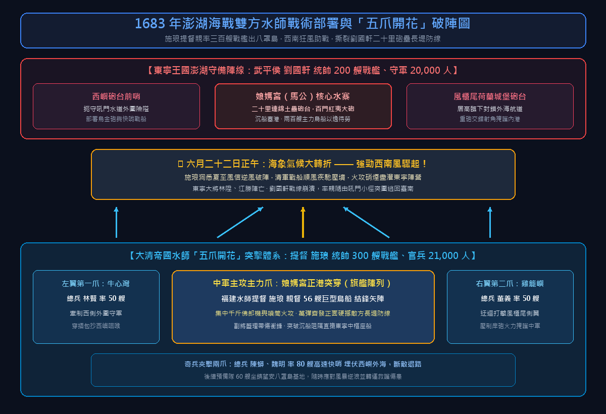
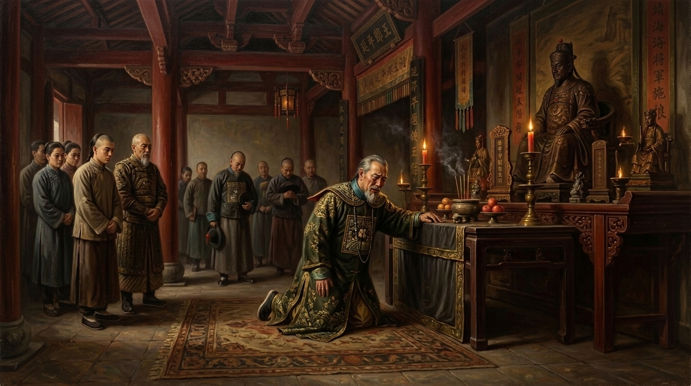
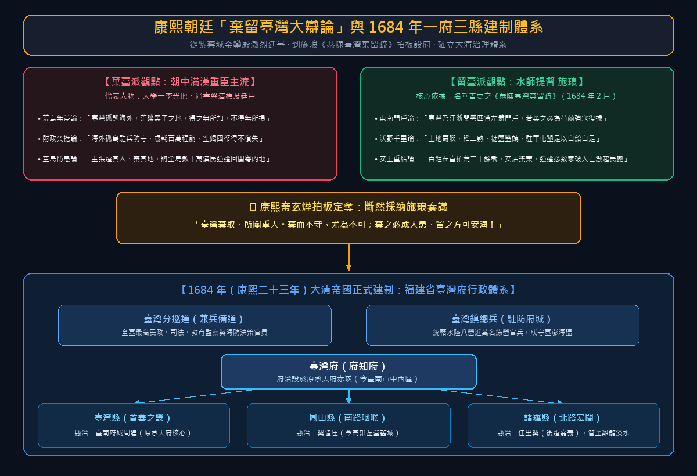

# 第 09 章 澎湖海戰與帝國落幕——施琅水師破浪與東寧王國降清

> **歷史時期**：第三時期：明鄭東寧與海上孤忠（1661 – 1683）  
> **核心歷史坐標**：澎湖媽宮水域（23.5658, 119.5632）、望安八罩島（23.3638, 119.5025）、臺南安平鎮（22.9998, 120.1605）  
> **關鍵歷史人物**：施琅、劉國軒、鄭克塽、鄭克𡒉、馮錫範、姚啟聖、李光地、康熙帝玄燁  
> **一手核心史料**：江日昇《臺灣外記》、施琅《靖海紀事》、夏琳《海紀輯要》、李光地《榕村語錄》、連橫《臺灣通史》  
> **多媒體影音連結**：
> - 🎬 **重點說明影片**：[YouTube 官方首播（2026-11-03 17:30 CST）](https://youtu.be/MFRHdUPsYao)
> - 🎙️ **深度對談播客**：[YouTube 官方首播（2026-11-03 19:30 CST）](https://youtu.be/cMvQqIYZCvE)
> - 🎵 **雲端串流音訊**：[GitHub Releases 官方音訊串流](https://github.com/clive520/taiwan-history/releases/download/v1.0.0/ch09_podcast_deepdive.m4a)
> - 🧠 **NotebookLM 專題**：[Google NotebookLM 專屬研究筆記本](https://notebook.google.com/notebook/384ad7a6-8b75-43c6-be97-4407e005ffc1)

---

## 【甲部：深度歷史專題長文】

### 壹、 歷史破曉：三藩敗局與「東寧之變」——一個海洋王國的政治自殺

永曆三十五年（西元 1681 年）春，承天府寧南坊的暮色格外沈重。年僅三十九歲的潮王鄭經躺在寢宮中，氣若游絲。十年跨海西征三藩的狂飆歲月，消耗了東寧王國數十萬石糧餉與無數精兵血肉，最終卻在清廷八旗綠營的反撲與耿精忠的背信夾擊下，化為金門、廈門撤退時蒼茫海面上的滾滾白浪。

鄭經之死，本已令這個孤懸海外的海上政權風雨飄搖；然而，一場緊隨其後的宮廷喋血政變，更是徹底抽乾了東寧王國最後的政治生機與道德法統。


*▲ 歷史概念復原圖：1683 年 7 月澎湖海戰決戰現場，福建水師提督施琅率巨型鳥船水師突入八罩島與娘媽宮海域，在猛烈砲火硝煙中撕裂東寧水師防線。*

#### 一、 賢相凋零與監國蒙難
早在一年前（1680 年），一手開闢東寧文治實業的總制陳永華，遭侍衛鎮馮錫範巧言構陷、逼奪兵權，憂憤成疾辭世。陳永華一死，朝中再無任何大臣有威望能壓制各路軍閥的私心與派系內鬥。

鄭經臨終前，將象徵政權傳承的監國之印交付予長子**鄭克𡒉**。鄭克𡒉是陳永華的女婿，為人剛毅嚴正、辦事幹練，深得鄭經器重與全臺兵民愛戴。他在鄭經西征期間留守東寧監國，執法無私，嚴懲宗室不法行徑，卻因此得罪了鄭氏諸叔父（鄭聰、鄭明等人）與軍頭馮錫範。

#### 二、 北園別館的黑夜縊殺
鄭經逝世當夜，侍衛鎮馮錫範與宗室諸弟秘密串謀，偽造董太妃手諭，誣指鄭克𡒉非鄭經親生骨肉，而是「螟蛉乞養之子」，無權繼承王位。次日，政變者將鄭克𡒉誘至北園別館（今臺南開元寺前身），由蔡添等人將其活活縊殺。年僅十八歲、身懷六甲的陳夫人（陳永華之女）痛不欲生，自縊殉夫。

政變集團隨後扶立年僅十二歲、易於操控的鄭經次子**鄭克塽**為延平王，軍政大權悉數落入馮錫範與劉國軒之手。這場史稱「**東寧之變**」的血腥政變，不僅摧毀了鄭克𡒉這位最具中興之相的年輕英主，更徹底動搖了明鄭政權苦心經營二十餘年的倫理合法性與軍民向心力。正如江日昇在《臺灣外記》中沉痛記載：「自此文武解體，兵無鬥志，民不聊生，東寧氣數盡矣。」

---

### 貳、 宿命恩仇：施琅十三年沉潛與康熙帝的專征決策

東寧王國走向自我解體的同時，海峽西岸的大清帝國，卻迎來了平定三藩、國力蒸蒸日上的上升軌道。清聖祖康熙帝將目光投向了東南海疆，而擔綱推動歷史車輪的大將，正是與鄭氏家族有著徹骨血仇的一代水師梟雄——**施琅**。

#### 一、 殺父屠弟的滔天宿怨
施琅，字尊侯，號琢公，晉江潯海人。他青年時期曾追隨鄭芝龍，後為鄭成功麾下最精銳之水師前鋒，屢立戰功。施琅深諳閩粵水文風候，驍勇絕倫，然而其性格傲岸不馴，與同樣剛毅自信的國姓爺鄭成功屢生摩擦。

順治九年（1652 年），施琅因處死麾下犯法部將曾德，徹底觸怒鄭成功。鄭成功下令逮捕施琅及其家眷，施琅僥倖逃脫，但其父施大宣與親弟施顯卻遭鄭成功收捕斬首。滿門血仇，使施琅徹底與鄭氏決裂，轉投大清，誓言「跨海覆鄭以報私仇」。

然而，施琅的復仇之路無比坎坷。康熙三年（1664）與康熙七年（1668），施琅兩度統帥水師渡海攻臺，皆在澎湖海域遭遇突發颶風，戰船傾覆漂散，無功而返。清廷內部保守派大臣紛紛彈劾其勞師動眾，施琅的水師提督軍職遭裁撤，被調入京城擔任毫無實權的「內大臣」，在紫禁城腳下一坐便是整整十三年。

#### 二、 李光地密薦與康熙帝乾綱獨斷
十三年間，施琅每日研讀海防兵書與星象水文，心心念念不忘經略臺灣。他在北京寓所繪製巨大的臺灣海圖與航海針路簿，每當有閩海商旅進京，必招致深談潮汐與臺海防禦虛實。

康熙二十年（1681 年），鄭經逝世與東寧之變的情報傳至京師。翰林學士李光地敏銳察覺戰機已至，向康熙帝秘密奏請：「施琅諳熟海島，勇略過人，雖年已老，海上事非其不可。若令施琅專任，臺灣可一鼓而下！」


*▲ 歷史概念復原圖：東寧名將劉國軒總督澎湖防務，自風櫃尾至娘媽宮構築二十里岸防砲台與沉船封港木柵，嚴陣以待清軍水師。*

此時，福建總督姚啟聖與施琅在作戰指揮權上產生激烈分歧。姚啟聖主張由總督自領水陸大軍分道合剿，施琅則堅持「兵無二帥，專征方能克敵」。面對廷議紛紜，二十八歲的康熙帝展現了千古一帝的卓越政治魄力，乾綱獨斷下詔：**命施琅專領福建水師提督，總綰前線戰事，節制舟師；總督姚啟聖專司後方糧餉轉運**。

至此，施琅終於獲得了夢寐以求的最高軍權，一場決定臺灣未來命運的驚天大海戰即將在黑水溝澎湖海域猛烈爆發。

---

### 參、 狂濤驚雷：1683 年 7 月澎湖大海戰——「五爪開花」破陣與西南風奇蹟

#### 一、 澎湖要塞化：劉國軒的二十里防線
東寧軍方亦深知澎湖乃臺灣門戶，「無澎湖則無臺灣」。馮錫範命東寧頭號名將、武平侯**劉國軒**統帥精兵兩萬、戰船兩百餘艘，傾全國精銳駐防澎湖。

劉國軒深具防守造詣，抵達澎湖後採取了極其完備的陣地戰術：
1. **岸海聯防**：沿娘媽宮（今馬公港）至風櫃尾二十餘里海岸線，修築長堤砲壘，安設紅夷大砲、烏金大砲等百餘門重砲；
2. **沉船鎖海**：在各大深水航道鑿沉巨舟、密佈銳利木樁與防禦鐵鍊，封鎖清軍戰艦進港路徑；
3. **艦隊犄角**：將兩百艘精銳鳥船、紅頭船停泊於娘媽宮內港，以逸待勞，依託岸砲支援。

#### 二、 六月十六日：八罩初戰與施琅中箭
康熙二十二年（1683 年 7 月 8 日，農曆六月十四日），施琅率大型鳥船、趕繒船約 300 艘、水陸官兵 21,000 餘人，由東山島銅山港出發，破浪東征。六月十五日，清軍前鋒抵達澎湖外圍的八罩島（今望安）。

六月十六日，施琅親率前鋒巨艦試探性進攻娘媽宮。劉國軒早已嚴陣以待，東寧水師自東西兩翼包抄合圍，岸上百門巨砲齊射。施琅座船深入重圍，陷入險境，施琅右眼遭鄭軍流矢射傷，血流披面。危急關頭，副將藍理帶傷死戰，總兵曾成率舟衝入敵陣死拼，方將施琅座船護送脫險。

初戰受挫，清軍士氣浮動。施琅卻在八罩島帥帳中沉著冷靜。他一面療傷，一面召集諸將勘驗水文氣象。施琅敏銳指出：夏至前後數日，臺灣海峽多颳西南風；而劉國軒水師背靠娘媽宮坐北朝南，清軍若居西南上風，便可順風順流以火攻破其長堤！


*圖 9-1：1683 年澎湖海戰雙方戰術部署與施琅「五爪開花」合圍穿插示意圖。*

#### 三、 六月二十二日：西嶼海域總決戰與五爪開花
六月二十二日黎明，決定性的總攻開始。施琅將水師劃分為五大突擊編隊，部署了名震中外的「**五爪開花**」夾擊戰術：
- **主攻中軍**：施琅親督巨型鳥船 56 艘，組成錐形鋒矢陣，正面強攻娘媽宮正港；
- **左右翼夾攻**：總兵董義率左翼 50 艘攻打雞籠嶼，總兵林賢率右翼 50 艘攻打牛心灣，迂迴包抄敵軍兩側；
- **奇兵與策應**：總兵陳蟒、魏明率奇兵 80 艘，埋伏於西嶼背後海域，待敵混亂時截斷退路；另留後備預備隊防範生變。

正午時分，海上突然暴發強勁的西南風，海浪洶湧，天地變色！清軍戰船順風疾馳，艦頭紅夷大砲、千斤佛郎機與噴筒火櫃萬彈齊發。東寧戰船本處下風，煙焰反捲自身，陣形頓時大亂。

清軍水兵身披藤甲，冒著烈火彈雨勇猛接舷肉搏。澎湖海面上烈焰蔽空，海水盡赤。東寧大將林陞中砲陣亡，江勝戰死。劉國軒眼見全線崩潰，急率親隨衛隊跳上小哨船，由東北方風櫃尾外側險要的「吼門」水道冒險突圍，狼狽逃回承天府。

澎湖一役，東寧水師近 200 艘主力戰艦或被焚毀或遭擊沉，死傷萬餘人，被俘將士近五千人。東寧王國經營二十餘年的海上長城，在澎湖這場世紀大海戰中灰飛煙滅。

---

### 肆、 帝國落幕：東寧開城降清與施琅「斷不報私仇」的歷史和解

澎湖全軍覆沒的消息傳回承天府，全島震駭，商賈罷市，士民惶惶不可終日。

#### 一、 承天府廷議：亡國邊緣的生死抉擇
在東寧最後的廷議上，文武官員悲泣無策。侍衛鎮馮錫範提議「焚毀承天府庫，浮海逃往南洋呂宋（菲律賓）重新立國」；然而劉國軒斷然反對：「今日兵疲將寡，糧餉告罄，人心瓦解。大洋驚濤萬里，我等安能渡海？若遇風暴必全軍葬身魚腹。不如舉土歸命，以保全十萬生靈！」

年僅十四歲的幼主鄭克塽在馮錫範、劉國軒主導下，決定放棄抵抗。永曆三十七年（1683 年 8 月，農曆七月），東寧王國正式派遣中書舍人鄭德瀟、馮錫圭攜帶降表、戶口冊籍與軍民名冊，渡海抵達澎湖向施琅投降納款。


*▲ 歷史概念復原圖：施琅入臺後率諸將親臨鄭成功廟肅穆祭奠，撫棺泣拜，誓言「忠孝各為其主，施琅斷不報私仇」，撫平全臺十餘萬降民軍心。*

#### 二、 施琅入臺與延平廟的英雄之淚
1683 年 10 月 3 日（農曆八月十三日），施琅率大軍在臺南鹿耳門順流登陸，兵不血刃進駐安平與承天府。

入城當日，全臺漢民與鄭氏遺部閉門懸恐，深懼清軍屠城報復。然而，施琅展現了一代統帥極高明的政治胸襟：
1. **嚴肅軍紀**：下達嚴令「敢妄取民間一草一木、擅殺一人者，立斬以徇」，市井商舖次日即開市如常；
2. **免役撫民**：下令寬免臺灣全島百姓三年的田賦徭役，開倉賑濟貧苦兵民；
3. **鄭廟祭奠與世仇和解**：施琅率全體將領親赴承天府延平王廟祭拜鄭成功。

在香煙裊裊的大殿前，面對奪去其父親與弟弟生命的昔日君主靈位，施琅肅容恭立，撫棺痛哭失聲。施琅宣讀祭文，深情盛讚國姓爺驅荷復臺、拓殖海疆的千秋偉業，並朗聲宣告：**「忠孝各為其主。今日功過自有人論，施琅斷不報私仇！」**

這一場震撼人心的祭拜，融化了長達三十一年的深仇血恨，不僅使鄭克塽、劉國軒等降官降卒卸下心頭重石，更迅速安撫了全臺二十餘萬軍民的人心。明鄭東寧王國歷經鄭成功、鄭經、鄭克塽三代二十二年的統治，至此正式和平降下帷幕。

---

### 伍、 乾坤定位：康熙朝廷「棄留臺灣大辯論」與一府三縣建置

然而，東寧降清之後，臺灣的命運並未真正尘埃落定。遠在數千里外的北京紫禁城金鑾殿內，隨即爆發了一場關乎臺灣命運的生死大辯論——「**棄留臺灣廷議**」。


*▲ 歷史概念復原圖：北京紫禁城金鑾殿廷議現場，康熙帝親覽施琅《恭陳臺灣棄留疏》，朝廷力排「棄臺」眾議，最終拍板將臺灣永久納入大清帝國版圖。*

#### 一、 棄臺派的短視：海外荒礫，得之無益
朝中以大學士李光地、尚書梁清標等為首的許多滿漢重臣，皆強烈主張「**棄臺論**」。甚至康熙帝本人起初亦傾向於放棄臺灣。其核心論點包括：
- **地理荒遠**：「臺灣孤懸海外，波濤阻隔，乃荒蠻海島，向非中國版圖」；
- **財政負擔**：「得其地不足以廣國，得其民不足以使令；若留兵駐守，歲費百萬糧餉，得不償失」；
- **防禦風險**：「莫若遷其人、棄其地，將全臺漢民盡數遷回內地，空其海島，以絕海外之亂源。」

#### 二、 施琅一疏定乾坤：《恭陳臺灣棄留疏》
面對朝中洶湧的「棄臺」浪潮，正駐節臺灣的施琅拍案而起。他深刻洞悉近代海洋地緣戰略，於康熙二十三年（1684 年 2 月）向康熙帝上呈了千古名篇——《**恭陳臺灣棄留疏**》。

施琅在疏中高瞻遠矚地提出了三大無法反駁的核心理由：
1. **國防與東南門戶之咽喉**：「臺灣地方千餘里，南連呂宋，北接琉球，乃江、浙、閩、粵四省之左臂與東南門戶。江浙之貨自內而外，無不經此咽喉；若棄而不顧，必為紅毛荷蘭或其他西方海寇所據。一旦強虜盤踞臺灣，窺伺閩粵，東南四省海防將無寧日，必釀邊疆無窮大患！」
2. **沃野千里足以自給自足**：「臺灣土地肥沃，沃野千里，野竹叢生，稻麥一年二熟，糖糖魚鹽之利甲於東南。官兵駐屯此地，就地墾植，足以自給自足，何須內地歲輸巨餉？」
3. **民心與宗族不可輕動**：「全臺數十萬生靈在臺數十年，生聚繁衍，廬舍墳墓皆在此。若強令內遷，棄田產、拆室廬，必致民心憤怨，復生揭竿之患！」


*圖 9-2：康熙朝廷棄留臺灣大辯論觀點交鋒與 1684 年臺灣府「一府三縣」行政建制架構圖。*

#### 三、 設府置縣：臺灣正式納入大清帝國版圖
施琅的奏疏如暮鼓晨鐘，徹底警醒了年輕的康熙帝。康熙帝力排眾議，慨然定論：「臺灣棄取，所關重大。棄而不守，尤為不可；棄之必成大患，留之方可安海！」

康熙二十三年四月十四日（西元 1684 年 5 月 27 日），清廷正式下詔：**將臺灣納入大清帝國正式行政版圖，設立「臺灣府」，隸屬福建省**。
- 派駐**臺灣分巡道**（兼理察臺兵備道）為全臺最高民政與治安長官；
- 設立**臺灣府**，設知府一人；
- 府下分設三縣：
  - **臺灣縣**（縣治設於原赤崁承天府，今臺南市區）；
  - **鳳山縣**（縣治設於左營興隆庄，今高雄左營）；
  - **諸羅縣**（縣治設於佳里興，後遷嘉義，管轄嘉義以北至雞籠、淡水廣袤土地）。
- 設臺灣總兵一人，統轄水陸八營兵力，駐防臺澎要塞。

至此，臺灣結束了長達二十二年的海上孤忠抗清基地角色，正式納入大清帝國的疆域版圖，開啟了長達兩百一十一年的「清領時期」。這座歷經史前南島遷徙、荷西競逐、明鄭屯墾的璀璨海島，迎來了嶄新的歷史篇章。

---

## 【專業對照表格專區】

### 表格一：1683 年澎湖海戰雙方水師實力與戰略部署全維度對照表

| 分析維度 | 大清帝國東征水師（施琅） | 東寧王國澎湖守軍（劉國軒） | 戰略差異與勝負關鍵分析 |
| :--- | :--- | :--- | :--- |
| **最高統帥** | 福建水師提督 **施琅**（副將藍理、林賢、董義） | 東寧侍衛軍武平侯 **劉國軒**（大將林陞、江勝） | 施琅久歷風海、老謀深算；劉國軒擅陸戰但水師調度稍顯僵化 |
| **主力兵力** | 精選水陸戰兵約 **21,000 ~ 23,000 人** | 陸師、水軍、民勇約 **20,000 人** | 雙方兵力旗鼓相當，清軍士氣因志在必得與賞罰嚴明更為高昂 |
| **戰船規模** | 大型鳥船、趕繒船、雙帆艍船約 **300 艘** | 大型鳥船、廣船、紅頭船約 **200 艘** | 清軍巨艦噸位佔優，且備有充足火攻快哨戰艇 |
| **火砲裝備** | 紅夷大砲、千斤佛郎機、滅虜砲、大噴筒 | 紅夷大砲百餘門、烏金砲、岸防砲台陣列 | 東寧軍佔據岸砲射角優勢，但清軍艦砲機動性與射速壓制力強 |
| **作戰基地** | 福建銅山出海，中繼進佔 **澎湖八罩島（望安）** | 依託 **澎湖娘媽宮（馬公港）** 與西嶼 | 八罩島為天然錨泊港，使清軍能安全休整並觀測風信 |
| **戰術部署** | **「五爪開花」**：中軍突破，兩翼包抄，奇兵斷後 | **「連環鎖海」**：築堤二十里，沉船沉石堵港，陣地決戰 | 劉國軒死守內港喪失機動性；施琅善用風向與包夾戰術一舉破防 |
| **氣象利用** | 敏銳洞悉夏至後 **西南強風** 爆發規律，搶佔上風 | 依託傳統東北季風思維，未防範逆風轉向受困 | 正午風向突變使東寧軍硝煙回嗆自身，成為戰役絕對轉折點 |

---

### 表格二：澎湖海戰七日決戰關鍵作戰進程表（1683 年 7 月 10 日 – 7 月 16 日）

| 日期（農曆） | 作戰階段 | 戰場具體行動與交鋒細節 | 歷史影響與戰略轉折 |
| :--- | :--- | :--- | :--- |
| **六月十四日** | 大軍啟航 | 施琅率 300 艘戰艦自福建銅山港拔錨啟航，橫渡黑水溝。 | 清軍以破釜沉舟之勢出擊，全軍誓師復臺。 |
| **六月十五日** | 前哨佔領 | 清軍水師前鋒順風抵達澎湖外圍，順利佔據八罩島（望安）。 | 掌握外圍基地與避風港，取得戰略進攻發起點。 |
| **六月十六日** | 首戰試探 | 施琅親率前鋒巨艦突入娘媽宮海口試探，遭劉國軒水陸圍攻；施琅右眼中箭，藍理死戰救駕。 | 首戰清軍受挫退回八罩，施琅探明鄭軍岸砲虛實與水道深淺。 |
| **六月十七至二十一日** | 養精蓄銳與心理戰 | 施琅休整艦隊、治癒戰俘並予酒食釋放；傳令「赦罪安民」；連續數日勘驗風向潮流。 | 瓦解澎湖守軍死戰之志；掌握西南季風即將發動的自然氣象密碼。 |
| **六月二十二日黎明** | 總攻發起 | 施琅排定「五爪開花」陣形：中軍 56 艦正面強攻，董義、林賢各率 50 艦包抄兩翼。 | 清軍全面合圍，娘媽宮外海展開人類海戰史罕見的百艦大對撞。 |
| **六月二十二日正午** | 西南風驟起 | 正午激戰之際，西南風驟起，風勢狂飆，清軍居上風萬彈齊發，火攻硝煙盡灌東寧陣營。 | 東寧戰船紛紛起火沉沒，大將林陞重傷殞命，全線徹底崩潰。 |
| **六月二十二日傍晚** | 終局突圍 | 劉國軒見大勢已去，帶領殘部換乘小艇，由吼門水道狼狽逃回臺灣承天府。 | 澎湖守軍萬餘人陣亡被俘，東寧海上門戶徹底失守，宣告王國覆亡。 |

---

### 表格三：康熙朝廷「棄留臺灣廷議大辯論」各派立場與地緣戰略論述表

| 核心論辯面向 | 「棄臺派」（以李光地、梁清標及滿漢朝臣為代表） | 「留臺派」（以福建水師提督施琅《恭陳臺灣棄留疏》為代表） | 歷史印證與現代地緣評述 |
| :--- | :--- | :--- | :--- |
| **領土主權觀** | 認為臺灣自古荒服，孤懸海外，「非中國版圖，得之無所加，不得無所損」。 | 臺灣南連呂宋、北控琉球，「乃江、浙、閩、粵四省之左臂與東南門戶」。 | 施琅首次從第一島鏈戰略防禦角度精準定義臺灣國防價值。 |
| **財政與邊防成本** | 海外荒島駐兵耗餉，歲費百萬銀兩，極易成為國庫無底黑洞。 | 土地極其肥沃，稻二熟、糖鹽豐饒，駐軍屯墾「足以自養自足，無須內地餉運」。 | 臺灣後來迅速成為清代東南米倉與糖庫，甚至常年反哺海防。 |
| **潛在敵國威脅** | 認為鄭氏既降，海外無敵，只要將漢民遷回內地，空其海島即可高枕無憂。 | 若空其地，「紅毛荷蘭或海外強盜必趁虛復踞，釀成東南邊疆無窮之禍」。 | 預見了西方列強必然重返臺灣擴張殖民的海洋歷史規律。 |
| **移民宗族安定** | 主張「遷其人、棄其地」，將全島二十餘萬漢人全數強遷回閩粵沿海。 | 百姓在臺拓荒二十餘載，安土重遷；強遷必致家破人亡、民心激變、聚眾再叛。 | 體現施琅深知民心向背乃長治久安之根本的人道與政治智慧。 |
| **皇帝最終裁決** | 康熙帝初聞臣議亦深以為然，幾乎拍板遷民棄島。 | 讀施琅疏後幡然省悟，慨然拍板：「臺灣棄留關係重大，留之方可永靖海疆！」 | 奠定臺灣自 1684 年起納入大清正式版圖兩百餘年歷史格局。 |

---

### 表格四：東寧王國二十二年興衰歷程與瓦解關鍵因素矩陣表

| 關鍵維度 | 制度優勢與歷史貢獻（興盛之因） | 致命結構性弱點（敗亡之源） | 對臺灣歷史進程的終極啟示 |
| :--- | :--- | :--- | :--- |
| **政治與領導權** | 鄭成功開拓、陳永華文教儒學，奠定漢文化典章制度與官制基礎。 | 宗室與軍閥私心難遏；「東寧之變」弒殺賢明監國鄭克𡒉，自毀法統與人心。 | 政治內耗與骨肉相殘往往是抵禦外患時最致命的自潰毒藥。 |
| **軍事與地緣防禦** | 承襲明代水師戰法，精銳籐牌兵與火器鐵騎曾名震東亞。 | 長期維持十萬龐大軍力，超越島嶼承載極限；三藩之亂冒進消耗精銳殆盡。 | 海島防衛必須與本島資源取得動態平衡，盲目西征內地必遭反噬。 |
| **經濟與實業生產** | 推行軍屯營盤田、瀨口天日曬鹽、磚瓦窯業與砂糖外銷，自給自足。 | 清廷遷界禁海封鎖嚴密，加之連年出征軍費浩繁，晚期財政枯竭、濫發鐵錢。 | 對外貿易是島嶼經濟命脈，一旦航路遭全面絞殺，政權難以為繼。 |
| **族群與社會關係** | 引進科舉蒙學，原漢同受儒學教化，設立社學開創文風。 | 屯墾難免壓縮原住民族獵場空間，高壓人頭稅與統治體制埋下族群隱患。 | 族群和解與權益平衡，永遠是這座島嶼永續治理的根本基石。 |

---

### 表格五：關鍵歷史大事記（Timeline 編年表格，1680 – 1684）

| 年代（西元） | 歲次／朝代 | 關鍵歷史事件與核心里程碑記載 |
| :--- | :--- | :--- |
| **1680 年 3 月** | 永曆三十四年 / 康熙十九年 | 鄭經西征三藩全線潰敗，自廈門率殘部退回臺灣承天府；清廷恢復東南沿海展界。 |
| **1680 年 7 月** | 永曆三十四年 / 康熙十九年 | 東寧總制陳永華遭馮錫範排擠奪權，鬱鬱而終，東寧王國失去軍政定海神針。 |
| **1681 年 3 月** | 永曆三十五年 / 康熙二十年 | 潮王鄭經病逝承天府，年 39 歲；爆發「東寧之變」，馮錫範弒殺監國鄭克𡒉，立 12 歲鄭克塽。 |
| **1681 年 8 月** | 永曆三十五年 / 康熙二十年 | 翰林學士李光地密薦施琅；康熙帝任命施琅為福建水師提督，賦予專征大權。 |
| **1683 年 7 月 8 日** | 永曆三十七年 / 康熙二十二年 | 施琅統率 300 艘戰艦、兩萬餘水陸官兵自福建東山島銅山港出發，發動澎湖戰役。 |
| **1683 年 7 月 10 日** | 永曆三十七年 / 康熙二十二年 | 施琅水師攻佔澎湖外圍八罩島（望安）；六月十六日首戰受挫，施琅右眼中箭。 |
| **1683 年 7 月 16 日** | 永曆三十七年 / 康熙二十二年 | 澎湖海戰大決戰，正午西南風驟起，施琅以「五爪開花」大破劉國軒水師，攻陷澎湖。 |
| **1683 年 8 月** | 永曆三十七年 / 康熙二十二年 | 劉國軒逃回承天府；幼主鄭克塽在馮錫範、劉國軒主導下遞交降表納款，明鄭政權告終。 |
| **1683 年 10 月 3 日** | 永曆三十七年 / 康熙二十二年 | 施琅水師登陸臺南鹿耳門，宣撫全島免役三年，親祭鄭成功廟撫棺誓言「斷不報私仇」。 |
| **1684 年 2 月** | 康熙二十三年 | 北京朝廷爆發棄留臺灣大辯論；施琅上呈名篇《恭陳臺灣棄留疏》，力陳不可棄臺。 |
| **1684 年 5 月 27 日** | 康熙二十三年 | 康熙帝下詔設立「臺灣府」（隸屬福建省），下一府設臺灣、鳳山、諸羅三縣，正式納入大清版圖。 |

---

## 【乙部：影視級口播分鏡腳本】

### 專題標題：【臺灣史 EP09】澎湖海戰與帝國落幕：施琅水師破浪與東寧王國降清

#### 【場景一：破題懸念——黑夜裡的縊殺與風暴前夕】（00:00 - 01:45）
- **【畫面視覺建議】**：
  - 鏡頭特寫：承天府陰暗燭光下，鄭經榻前那枚冰冷微顫的監國金印；
  - 緊接著快剪：北園別館暗夜中緊勒的白綾，十八歲英武剛烈的監國鄭克𡒉窒息倒下；
  - 轉場：北京紫禁城乾清宮內，二十八歲康熙帝目光如炬，將一面刻有「福建水師提督」的金字令箭，重重交到白髮老將施琅佈滿老繭的手中。
- **【旁白解說詞】**：
  「永曆三十五年初春，澎湖的海風送來了濃烈的不祥氣息。
  三十九歲的延平王鄭經在承天府病逝，屍骨未寒，一場駭人聽聞的宗室政變在黑夜中爆發。侍衛鎮馮錫範勾結諸叔，將深得軍民愛戴的十九歲監國鄭克𡒉活活勒死在別館，扶立了十二歲的幼主鄭克塽。
  這場慘絕人寰的政治內耗，親手為東寧王國敲響了喪鐘。
  海峽西岸，康熙帝玄燁敏銳抓住了這千載難逢的戰機。他力排眾議，起用了在北京冷板凳上苦熬了十三年的降將施琅！
  施琅與鄭家有著殺父誅弟的滔天血仇。一邊是骨肉相殘、人心瓦解的孤島政權；一邊是磨劍十三年、誓死一戰的水師老將。
  決定臺灣命運的世紀大風暴，在澎湖這片驚濤駭浪中，驟然爆發！」

---

#### 【場景二：核心現場——八罩島破浪與五爪開花大決戰】（01:45 - 03:45）
- **【畫面視覺建議】**：
  - 畫面宏大開闊：澎湖娘媽宮至風櫃尾二十里海岸線上，百門紅夷大砲與沉船木柵如鋼鐵堡壘；
  - 戰鬥特寫：施琅旗艦突入火網，箭矢橫飛，施琅右眼中箭濺血，揮刀厲聲呼喝「退後者斬」；
  - 戰局轉折：正午烈日下，海面上波濤逆卷，西南大狂風驟起，清軍三百艘鳥船順風齊射，大噴筒與火藥櫃將海面燃成一片滔天火海。
- **【旁白解說詞】**：
  「1683 年 7 月 8 日，施琅統率三百艘巨艦、兩萬餘虎賁之師，拔錨東征！
  守衛臺灣門戶的，是東寧第一名將劉國軒。劉國軒在澎湖構築了綿延二十里的鋼鐵砲台防線，以沉船封鎖港灣，誓死一搏。
  七月十六日，決戰打響！
  初戰時，施琅右眼中箭，血流如注，座船險些被東寧水師生擒。然而在八罩島上，這位老練的水師統帥看透了風雲變幻的天機。
  七月二十二日，決定性的總攻開始！施琅祭出『五爪開花』陣形，五路大軍分進合擊。
  激戰正酣之際，海上奇蹟般掀起了狂暴的西南大風！風向驟轉，居於上風的清軍艦砲齊發，火海硝煙逆卷衝入東寧陣營。
  兩百艘東寧戰艦在烈火中解體沉沒，兩萬守軍死傷殆盡。
  劉國軒換乘小舟狼狽逃離，澎湖——這座東寧最後的護城河，徹底淪陷！」

---

#### 【場景三：轉折高潮——承天府降表與延平王廟的男兒之淚】（03:45 - 05:40）
- **【畫面視覺建議】**：
  - 畫面肅穆深沈：十四歲的鄭克塽手捧降表金印，跪在安平港碼頭，滿朝文武失聲痛哭；
  - 核心特寫：施琅身披提督重鎧，走入臺南孔廟身旁的延平王祠。他推開重門，在鄭成功的牌位前雙膝跪地，撫棺痛哭，香爐青煙繚繞在二人如宿命般的雕像之間。
- **【旁白解說詞】**：
  「澎湖慘敗傳回臺南，全島震恐。
  馮錫範曾妄想燒毀府庫、逃往菲律賓呂宋島；劉國軒卻痛苦地搖頭：『大洋驚濤，去必葬身魚腹，何忍令十萬生靈塗炭？』
  1683 年 8 月，十四歲的鄭克塽正式遞交降表。明鄭東寧三代二十二年的海外孤忠，迎來了無奈的終局。
  十月三日，施琅大軍登陸承天府。全城百姓閉門懸心，深懼屠戮；然而施琅下令免除全島三年徭役，秋毫無犯。
  最令人動容的一幕發生在延平王祠。
  施琅手捧清香，緩步走入祠堂。面對奪去自己父親與弟弟生命的昔日君王靈位，這位叱吒風雲的鐵血將軍，竟撫棺長號、泣不成聲！
  他仰天長嘆：『忠孝各為其主！昔日私仇，斷不報於今日百姓！』
  這一拜，化解了長達三十一年的深仇宿怨，也讓飽經離亂的臺灣百姓，放下了最後的恐懼。」

---

#### 【場景四：終局迴響——紫禁城金鑾殿的棄留大爭辯】（05:40 - 07:30）
- **【畫面視覺建議】**：
  - 金鑾殿文武群臣激烈爭吵，李光地等人揮舞奏摺力陳「棄臺」；
  - 鏡頭推向御座上的康熙帝，手持施琅《恭陳臺灣棄留疏》，定格在「臺灣乃江浙閩粵四省之左臂與東南門戶」硃批之上；
  - 宏觀大地圖展開：臺灣府、臺灣縣、鳳山縣、諸羅縣四座新城在地圖上綻放光芒，伴隨著現代臺南孔廟與安平古堡的夕陽餘暉。
- **【旁白解說詞】**：
  「然而，明鄭落幕之後，臺灣竟險些再次淪為歷史棄兒！
  紫禁城內，多數朝臣主張『遷民棄島』，認為臺灣孤懸海外、耗費巨餉，不如將百姓遷回內地，把這座海島徹底放棄。
  就在命運懸於一線之際，施琅上呈了名垂青史的《恭陳臺灣棄留疏》！
  他厲聲疾呼：『臺灣乃東南四省之門戶！沃野千里，足以自給；若棄而不顧，必為紅毛荷蘭與海外強寇所據，後患無窮！』
  這番振聾發聵的海洋洞見，徹底打動了康熙皇帝。
  1684 年，清廷正式頒詔設立『臺灣府』，下一府三縣，臺灣從此正式編入大清帝國版圖！
  從史前南島先民的獨木舟破浪，到大航海時代熱蘭遮城的紅毛旗幟；從鄭成功驅荷復臺的驚天圍攻，到施琅水師定海降清。
  東寧王國的悲歌遠去了，但它在泥土中澆灌的儒學火種、軍屯聚落與海洋魂魄，早已化作臺灣人不可磨滅的文明基因，在海峽的風浪中，生生不息！」

---

## 【丙部：Faster-Whisper / NotebookLM 專用詞庫（Initial Prompt）】

```text
臺灣史, 澎湖海戰, 施琅, 劉國軒, 鄭克塽, 鄭克𡒉, 鄭經, 馮錫範, 姚啟聖, 李光地, 康熙帝, 恭陳臺灣棄留疏, 東寧之變, 北園別館, 延平王廟, 八罩島, 望安, 娘媽宮, 馬公港, 風櫃尾砲台, 雞籠嶼, 牛心灣, 西嶼, 吼門水道, 五爪開花, 鳥船, 趕繒船, 雙帆艍船, 紅夷大砲, 佛郎機, 噴筒, 藍理, 曾成, 林賢, 董義, 陳蟒, 魏明, 林陞, 江勝, 承天府, 安平鎮, 鹿耳門, 臺灣府, 臺灣縣, 鳳山縣, 諸羅縣, 臺灣分巡道, 臺灣總兵, 遷界令, 展界復界, 棄留臺灣廷議, 一府三縣
```
