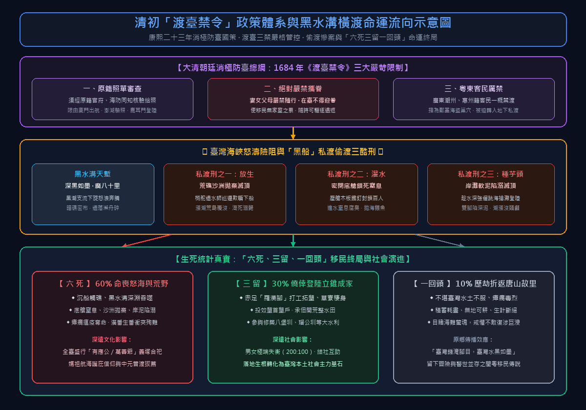
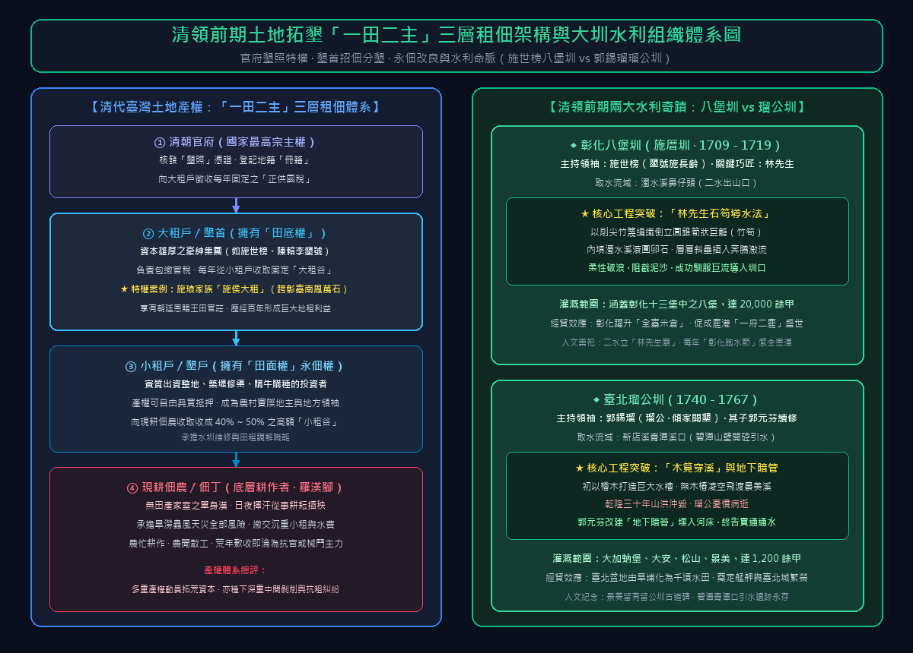
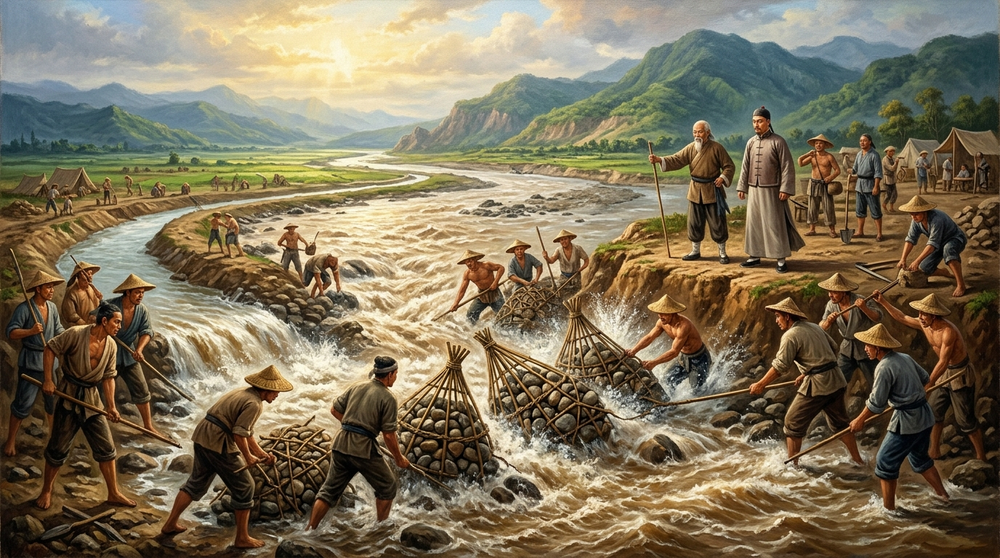

# 第 10 章：唐山過臺灣的黑水溝血淚——渡臺禁令、六死三留一回頭與開拓墾號

> **時期**：第四時期：清領時代的拓墾烽火與變革（1684 – 1860）  
> **核心歷史坐標**：彰化鹿港水門（`24.0560, 120.4326`）／彰化二水鼻仔頭八堡圳源頭（`23.8052, 120.6278`）／新店碧潭青潭口（`24.9542, 121.5385`）  
> **關鍵歷史人物**：施世榜（施長齡墾號）、郭錫瑠（瑠公）、郁永河、藍鼎元、林先生、渡臺漢人先民群像  
> **多媒體資源**：
> - 🎬 **章節重點解說影片**：[YouTube 觀看連結](https://youtu.be/Rd45_RsE5DU) *(預定 2026-11-04 17:30 首播)*
> - 🎙️ **播客深度對談音訊**：[YouTube 專題觀看](https://youtu.be/VPPLQWHw1Bc) *(預定 2026-11-04 19:30 首播)* ｜ [GitHub Release 雲端串流無損音訊](https://github.com/clive520/taiwan-history/releases/download/v1.0.0/ch10_podcast_deepdive.m4a)
> - 🧠 **Google NotebookLM 專屬研究筆記本**：[前往探索核心知識庫](https://notebook.google.com/notebook/2e42523c-3cd8-4b77-9db8-471e84baee53)

---


*▲ 清代先民搭乘木造紅頭船冒死橫渡險惡「黑水溝」，在驚濤駭浪與雷電交加中緊握索具，持香向媽祖神龕虔誠祈求平安。*

## 導讀前言：波濤吞吐的黑水之塹，開啟孤身拓荒的世紀序幕

康熙二十二年（1683 年）澎湖海戰的硝煙散盡，延平王府的孤忠旗幟自承天府緩緩落下。清帝國將這座懸於海外千里之外的孤島納入版圖，然而在紫禁城金鑾殿深處，統治者眼中映照出的臺灣，從未是一塊豐饒待拓的樂土，而是一處充滿叛亂幽靈、隨時可能再度吞噬大清海疆的「海外化外之地」。

為了防微杜漸，康熙朝廷定下了長達百年的「防臺」基本國策：頒布殘酷的「渡臺禁令三原則」，封鎖臺灣海峽，嚴禁攜眷渡海，試圖將移民拘束為無根漂泊的流動寄居客。然而，福建沿海「人稠地狹、米穀騰貴、無地可耕」的生存絕境，逼使無數閩粵底層男丁押上身家性命，投奔黑水溝的萬頃狂濤。

民間俗諺云：「唐山過臺灣，心肝結歸丸；神明保庇過海關，六死三留一回頭。」這是一部由驚濤駭浪、偷渡底艙的窒息慘劇、荒野市街單身男性的「羅漢腳」生存地下秩序，以及耗盡數代家產血汗修築的八堡圳與瑠公圳引水奇蹟所共同交織而成的生命史詩。從無寸土立錐之地的流民，到劈山引水灌溉千頃良田的開拓先驅，臺灣這座島嶼在無數亡魂枯骨的灌溉下，終於從帝國邊陲的流寓之地，逐漸凝聚出落地生根的本土力量。

---

## 甲部：深度歷史專題長文

### 第一節：天朝的孤島防線——渡臺禁令三原則與消極治臺國策

1684 年（康熙二十三年），在福建水師提督施琅力陳《恭陳臺灣棄留疏》之後，康熙皇帝終於下旨設立「臺灣府」，下設臺灣、鳳山、諸羅三縣，隸屬福建省臺廈道管轄。然而，大清帝國的治臺戰略從一開始就定調為**「防臺為先，不求富庶；消極控管，限制流民」**。

為防範明鄭殘餘勢力死灰復燃，並杜絕臺灣再度成為海盜聚集的逋逃淵藪，首任福建巡撫王新命奉旨頒布了著名的**《渡臺禁令》**，確立了貫穿清領前期的「三禁原則」：

1. **嚴查通行牌照（原籍核驗）**：渡海前往臺灣者，必須在原籍地的府、縣衙門申請官方發給的「照單」（通行憑證），經過海防同知盤查蓋印，且必須自廈門出航、在澎湖驗照後，由指定口岸臺南鹿耳門登陸。未領官照者一律視為「私渡偷渡」，依保甲窩藏反叛律問罪。
2. **絕對嚴禁攜帶家眷（婦女幼童禁絕）**：凡獲准渡臺者，一律嚴禁攜帶妻子、父母與子女；已在臺灣者，亦不得回鄉迎接家眷來臺。這項禁令的政治算計極其陰冷——清廷欲使在臺漢人「男子單身無嗣、視臺灣為暫時打工寄食之所、心時刻繫於故土祖塋」，一旦臺灣生亂，清軍即可迅速斷絕糧道、輕易平定遣返。
3. **粵東潮州、惠州籍客民全面禁渡**：清廷指責「潮惠二府盜賊淵藪，鄭逆餘黨多產其間」，全面禁止廣東籍（尤其是客家人）渡臺。客籍先民因而受到嚴重的制度性排擠，難以取得合法照單，只能冒更大風險搭乘非法黑船，登陸後亦無法落腳於南部精華平原，被迫轉進南北邊陲山腳丘陵，埋下日後閩粵械鬥的地緣火種。

此項禁令長年僵化實施，雖曾在雍正十年（1732 年）短暫因官員奏請而鬆綁，但旋即因民變再起而重啟厲禁，直至乾隆二十五年（1760 年）藍鼎元等人極力呼籲後，方才逐步放寬攜眷。長達近百年的禁渡政策，深刻重塑了臺灣社會的性別結構與人口生態。

#### 表 1：清初渡臺禁令演進與政策三原則剖析表

| 政策規範項目 | 條例核心要求與官府法規依據 | 統治者的政治算計與戰略目的 | 對臺灣社會結構造成的實際衝擊 |
| :--- | :--- | :--- | :--- |
| **原籍照單審查** | 必須先在原籍縣衙申請給照，經海防同知核驗，僅限由廈門航向鹿耳門 | 防止內地通緝犯、海盜、白蓮教天地會分子混入海外孤島 | 合法照單官僚層層勒索代價極高，迫使九成移民鋌而走險尋求非法偷渡 |
| **嚴格禁止攜眷** | 渡臺男子嚴禁攜帶妻女父母，在臺者不得接眷，抓獲者枷示遣返原籍 | 使移民「無家室之累」，隨時可驅逐遣返，避免人口繁衍形成本土聚落宗族 | 造成極端男女比例失衡（男多女少達200:100），催生龐大單身「羅漢腳」階層 |
| **粵東客民厲禁** | 廣東潮州、惠州二府居民一概不得給照渡臺，沿海守軍嚴加巡緝 | 視客籍民風彪悍、多參加反清軍隊，防範三藩餘孽藉海島聚眾反叛 | 客家先民被迫走私偷渡，抵臺後缺乏合法土地，轉往南北山麓隘墾，引發族群摩擦 |
| **班兵三年輪戍** | 駐臺一萬綠營兵丁全自福建內地班調，三年一換，嚴禁在臺安家娶妻 | 防範軍隊地方化、本土化與抗清民軍合流變節 | 兵丁無心守土，軍紀極度敗壞，欺凌百姓，兵餉被剋扣，成為社會動盪亂源 |
| **劃界封山隔離** | 沿中央山脈西麓豎石立界、挖溝堆土（土牛紅線），嚴禁漢人入番地採拓 | 隔離漢番，避免漢民奪地激發原住民反抗，維持邊疆被動相安無事 | 限制拓墾腹地，導致平原地帶人口過剩與土地搶奪，推升漢番衝突與地下越界盜墾 |

---

### 第二節：黑水溝怒海驚魂——「六死三留一回頭」與偷渡血淚

當合法申請成為官僚吸血的專利，閩粵沿海飢腸轆轆的貧苦農民，唯一的生路就只剩下**「坐黑船，偷渡臺灣」**。

臺灣海峽自古被航海者稱為險惡之淵。康熙三十六年（1697 年），福州典試官**郁永河**自告奮勇赴臺採硫，在其經典著作《裨海紀遊》中，生動記錄了橫渡這片神秘海域時的震懾景象：

> 「臺灣海峽有二大險，曰紅水溝、曰黑水溝。紅水溝水色赤如丹砂，廣三十里；黑水溝其水深黑如墨，廣八十里。海水皆綠，此獨深黑，天陰或風急，波濤奔騰，如深淵萬仞，深不可測。」

*▲ 康熙三十六年（1697）郁永河乘船渡海，目睹臺灣海峽由碧綠驟變為「深黑如墨」的黑水溝湍急漩渦與暗礁，於船舷手持日記記錄天地險阻。*


黑水溝並非普通的深水區，而是黑潮支流在海峽深溝中奔流產生的巨大洋流切變區。洋流自南向北狂奔，海底暗礁密布，遇上東北季風或突發颱風，兩側海流交匯激盪，漩渦怒吼，巨浪高逾數丈，帆船在其中如同枯葉漂蕩。

#### 圖 1：黑水溝海峽橫渡險阻與渡臺禁令移民路線體系示意圖


*▲ 圖 1：清初「渡臺禁令」三原則政策體系、黑水溝橫渡險阻與「六死三留一回頭」移民終局流向圖（高解析度資訊圖表）。*

民間所說的**「六死三留一回頭」**，絕非文人墨客的修辭誇張，而是冰冷殘酷的人口統計現實：
- **「六死」**：六成偷渡客命喪於途。死因包括海難翻覆、黑水溝漩渦吞噬、船艙窒息、水土惡疾與登陸後的械鬥殺戮；
- **「三留」**：僅有三成人能僥倖穿越暗礁波濤，在臺灣滿是瘴癘的荒埔上苟延殘喘、立足開墾；
- **「一回頭」**：還有一成人，在經歷了九死一生的航程後，目睹臺灣險惡殘酷的現實，或是積蓄耗盡、水土不服，最終狼狽折返唐山故里。

比大自然怒海更殘忍的，是專營人口販運的**「客頭」（偷渡掮客）與「梢舵」（黑船船長）**。黃叔璥《臺海使槎錄》與藍鼎元《東征集》揭露了當時駭人聽聞的私渡三大慘劇：

1. **「放生」之刑**：船主為逃避水師巡哨，或不願駛入危險港道，往往在深夜將數百名偷渡客驅趕至澎湖外圍的無人沙汕荒礁，謊稱「臺灣水沙連到了」，隨後揚帆遁去。潮水一漲，荒島滅頂，無數移民在絕望中被怒濤吞噬，或在烈日下焦渴暴斃。
2. **「灌水」之酷**：私渡船隻為掩人耳目，將數百人硬塞進極度狹小、空氣不流通的壓艙木板底艙中，並用巨石鐵釘鎖死。一旦遭遇海面巡邏或暴風雨，船艙進水，船家根本不管底艙死活，任由數百人如牲口般被活活溺斃、窒息而死，死者隨手拋入大海餵鯊。
3. **「種芋頭」之慘**：黑船抵達臺灣西海岸（如彰化、鹿港、笨港、七股一帶泥灘）時，梢舵為求自保，在海水尚深、潮水未退之際，便揮舞刀械逼迫不諳水性的移民跳水涉水登陸。許多人一躍而下，雙足深陷於軟爛黏稠的海底黑泥之中，動彈不得。漲潮瞬息而至，海水沒過頭頂，只留頭顱露於泥淖呼號，形同田間「種芋頭」，最終全數滅頂溺斃。

#### 表 2：「六死三留一回頭」黑水溝偷渡命運與沉船慘案對照表

| 命運類別與遭遇 | 歷史發生情境與文獻考證 | 典型歷史代表案例與史料記載 | 對移民家族與後世文化的深遠影響 |
| :--- | :--- | :--- | :--- |
| **海峽怒濤吞噬（海難）** | 帆船駛入黑水溝或遇「落漈」，遭狂風巨浪打斷龍骨桅杆，全船沉沒 | 郁永河《裨海紀遊》載：「水性下旋，風逆則怒浪滔天，立成齏粉」 | 奠定全臺極盛之媽祖（天上聖母）、玄天上帝、王爺等海神信仰 |
| **黑船「放生」沙洲** | 梢舵欺瞞乘客，將人拋棄於澎湖外八罩或外傘頂洲等無水潮汐孤礁 | 藍鼎元《東征集》痛陳：「名曰放生，實則坑殺，枯骨滿洲，冤魂號夜」 | 沿海聚落建立無數萬善爺廟、百姓公廟收斂浮屍孤骨 |
| **密閉底艙「灌水」** | 數百人鎖入底艙壓艙，風浪灌水或缺氧窒息，死者直接拋海 | 黃叔璥《臺海使槎錄》：「閉置底艙，枵腹委頓，十死其五」 | 閩南家族族譜中留下無數「渡臺不知所終」、「歿於黑水」之空白悲歌 |
| **岸灘陷溺「種芋頭」** | 偷渡船搶灘不顧水深，逼客民躍入深泥軟灘，潮漲滅頂成泥中冤魂 | 臺灣府志載：「逼民涉泥，身陷泥中不能拔，潮至滅頂，俗呼種芋頭」 | 催生臺灣沿海特有的「牽水（車藏）」拔度溺死亡魂民俗祭典 |
| **孤身立足「三留」者** | 幸存登陸，寄寓草寮，替墾首墾荒、租田、做苦力，僥倖存活 | 施世榜、郭錫瑠招募之流民墾丁，於荒野中闢草萊、鑿水圳 | 奠定臺灣西南部與北部農業拓墾的主力人口，成為臺灣漢人社會始祖 |
| **折返唐山「一回頭」** | 不堪臺灣瘴癘疾疫、水土不服、或資產耗盡無以謀生，落魄還鄉 | 《裨海紀遊》記病役慘況：「居人十病八九，瘴癘熏灼，還者相戒不復往」 | 在閩粵原鄉流傳「臺灣雖好，生還者希」之警世戒條 |

---

### 第三節：赤足天涯的孤魂——「羅漢腳」的生存地下秩序與有應公信仰

歷經千難萬險踏上臺灣紅土地的幸運兒，迎面而來的並非黃金沃野，而是一幅冰冷孤絕的生存圖景。

由於「嚴禁攜眷」禁令的長年壓制，清初臺灣社會的人口金字塔呈現出極度扭曲的畸形狀態：男女比例長期維持在 **200 比 100**，在邊陲拓墾區甚至飆升至 **400 比 100**。也就是說，每一到三名漢人男子中，就只有一人可能娶妻生子。

在這樣的性別荒漠中，誕生了臺灣歷史上最特殊的邊陲底層群體——**「羅漢腳」**。

*▲ 清代臺灣單身無產先民「羅漢腳」於黃昏暮色中聚集於有應公陰廟石階旁烤火憩息，手握農具、分食稀糜，展現拓荒底層孤絕而頑強的生命力。*


#### 一、 「羅漢腳」的社會構造與生存常態
「羅漢腳」一詞，本是閩南民諺中對赤足遊蕩之浪人的謔稱。因其居無定所、赤腳蓬頭，身披襤褸粗布，宛如佛寺羅漢堂中赤腳散坐的十八羅漢，故得其名。清代官方奏摺中則往往以「光棍」、「遊民」、「奸民」斥之。

羅漢腳具有典型的**「三無」特徵**：
1. **無家室**：無妻無子，舉目無親，孤身一人渡臺；
2. **無產業**：無寸土田產，無固定屋舍，農忙時為墾首充當短工雇農（長工、散工），農閒時流浪於府城、鹿港、笨港街頭，宿於廟角、屋簷或蔗園草棚；
3. **無祖塋宗族**：遠離內地宗族祠堂的庇護與禮教約束，生活朝不保夕，「今日有酒今日醉，明日挨餓睡街頭」。

#### 二、 地下結社與暴力邊緣的生存秩序
在官府權力難以觸及的草莽荒原中，脆弱無依的羅漢腳必須抱團求生。他們以同鄉（漳州、泉州、客家）、同姓，或是天地會等秘密結社為紐帶，歃血結盟、互稱兄弟。

這種基層互助組織具有極其強烈的雙重性：在平日，它是底層勞工抵禦官府剝削、互助療疾的生命線；但在生存資源（水源、土地、租額）極端匱乏的環境下，這股龐大的年輕無產單身男性群體，極易淪為豪強地主械鬥的打手與衝鋒死士。每逢荒年歉收或官吏橫徵暴斂，只要有人振臂一呼，成千上萬的羅漢腳便蜂擁而起，「三年一反，五年一亂」的野火隨之燃遍全島。

#### 三、 魂歸荒塚：有應公、萬善爺與集善義塚
羅漢腳在荒野中染上瘴癘或死於械鬥後，往往暴屍荒野，無人收葬。出於對荒野冤魂的恐懼與同為天涯淪落人的悲憫，臺灣各地聚落自發形成了獨特的**「陰廟信仰」與「義塚制度」**：
- **有應公、百姓公、萬善爺**：鄉民將荒野暴露的無主枯骨集中拾收，合葬於一塚，建小廟奉祀，稱之為「有求必應」的「有應公」或「萬善爺」。
- **普渡祭祀**：每逢中元孟秋，各地村庄必定設壇舉行盛大的「施食普渡」，甚至發展出宜蘭頭城搶孤、屏東恆春搶孤，以及彰化八卦山萬善堂合祀等文化盛事。這座島嶼在尚未建立起正統宗廟祠堂之前，早已在遍地的萬善義塚中，刻下了先民撫慰孤魂、祈求土地平安的悲憫印記。

---

### 第四節：一田二主的荒土契約——墾首、墾照與施侯大租的經濟博弈

要讓數十萬流民在臺灣轉化為穩定的農業生產力，關鍵在於「如何將無主荒埔轉化為水田」。然而，清廷對臺灣土地的法規充滿矛盾：名義上承認平埔熟番與高山生番的土地所有權，實質上又鼓勵漢人出資納稅開墾。在這種法制真空與資本競逐下，臺灣孕育出了一套獨步東亞的土地制度——**「墾首招佃制」與「一田二主」產權體系**。

#### 一、 墾首與墾照：資本集團的拓殖特權
清代土地拓墾絕非單純農民「自力開荒」那麼簡單。開闢一塊數百甲的荒地，需要伐木、除草、築堤、防範生番出草襲擊，更需要投入巨資修築長達數十里的引水水圳。普通貧民根本無力承擔。

於是，擁有雄厚資本的豪紳、商賈或官宦世家（如施世榜、郭錫瑠、林成祖、吳沙），紛紛向臺灣府或各縣衙門申請**「墾照」**：
1. **認明四至**：指明開墾範圍的東南西北界限；
2. **繳納規費**：向官府繳交押租，並向番社取得承租「番契」；
3. **確立墾號**：獲准發給官方墾照的資本投資者，稱為**「墾首」**（其組織常稱為「某某墾號」，如「施長齡」、「陳賴李」）。

#### 二、 「一田二主」三層租佃體系之運作
墾首取得墾照後，擁有這片土地的法定管轄權，但其本身並不親自下田耕作，而是透過「招佃分墾」將土地層層批租出去，最終形成了**「大租戶—小租戶—現耕佃農」**的三層產權結構：

1. **大租戶（墾首／土地業主）**：擁有**「田底權」**。負責向朝廷完納「正供糧稅」，並向小租戶收取固定的「大租谷」（通常每甲地約數石稻穀）。
2. **小租戶（墾戶／實質改良者）**：擁有**「田面權」**。他們承攬大租戶的土地，親自投入資本平整土地、修築毛渠、圍築土埂，實質上完成了土地的「熟田化」。田面權可以自由買賣、典押或出租，成為小租戶永續擁有的實質產權。小租戶每年向底層佃農收取高昂的「小租谷」。
3. **現耕佃農（底層羅漢腳與貧農）**：實際在泥淖中揮汗耕作的農民。他們無田無地，承租小租戶的田面，每年需繳納高達收成 **40% 至 50%** 的沉重租穀，生活極度艱辛。

這種「一田二主」甚至「一田三主」的複雜制度，雖然成功動員了民間資本完成了全島拓墾，但也造成了多重中間剝削與複雜產權糾紛，成為日後清代抗租民變與日治初期土地改革（清查大租權）的核心癥結。

#### 圖 2：清領前期土地拓墾「一田二主」三層租佃架構與大圳水利組織體系圖


*▲ 圖 2：清領前期土地拓墾「一田二主」（大租戶田底權、小租戶田面權、現耕佃農）產權體系與八堡圳、瑠公圳水利組織架構圖（高解析度資訊圖表）。*

#### 三、 施琅家族與全臺特權大租：「施侯租」
在全臺所有大租戶中，勢力最龐大、特權最顯赫的，莫過於靖海侯**施琅家族**。

康熙皇帝為酬賞施琅攻臺之功，將前明鄭時期的王田、官莊（承天府、鳳山、諸羅三縣精華農地）大量賞賜給施琅家族作為「勳業恩賜田」。施家設立管事機構，向全臺各縣開墾農民普遍徵收**「施侯大租」**（每甲地徵稻穀三石至八石不等）。

施侯租的收租範圍縱橫彰化、臺中、臺南與鳳山，每年獲取糧租高達數萬石，形成盤踞臺灣百年的龐大特權利益。民間農民雖痛恨「一地兩租、供奉侯門」，但施家憑藉朝廷封爵與軍政特權，歷任地方官皆不敢攖其鋒芒，成為清領前期地緣政治與經濟體系的龐然巨物。

#### 表 3：清代臺灣土地開墾組織與「一田二主」三層租佃體系表

| 產權層級與角色 | 法律地位與產權性質 | 核心職能與資本投入 | 收入來源與負擔義務 | 歷史影響與社會爭端 |
| :--- | :--- | :--- | :--- | :--- |
| **清朝官府** | 國家最高宗主權 | 核發「墾照」、登記「冊籍」、維護邊疆秩序 | 徵收「正供國稅」與雜餉徭役 | 官府權力不下鄉，依賴墾首包繳糧稅，形成統治真空 |
| **大租戶（墾首／業主）** | 擁有**「田底權」**（名義業主） | 向官府領照、包繳正供、協調地方治安、引導大資本 | 向小租戶收取固定的**「大租谷」**，完納官稅後賺取差額 | 形成地主特權階級（如施琅家族施侯租），長期引發佃租抗爭 |
| **小租戶（墾戶／承墾人）** | 擁有**「田面權」**（實質永佃權） | 實際出資開墾、平整土地、構築水渠、購置耕牛農具 | 向底層佃農收取浮動的**「小租谷」**（收成之40%~50%） | 成為臺灣農村實質的地方豪強（地方領導階層與械鬥發動者） |
| **現耕佃農（佃丁／流民）** | 僅有**「耕作權」**（租約勞動者） | 日夜在田間耕耘、除草、收割，承擔水旱災害與風損風險 | 繳納沉重小租與水費，剩餘微薄口糧糊口度日 | 地位極度脆弱，荒年無以為繼時即淪為流民或加入民變械鬥 |

---

### 第五節：導水撼地的生存史詩——八堡圳、瑠公圳與臺灣農業奇蹟的誕生

土地有了，人手齊了，但要讓荒埔化為千頃良田，最致命的缺口在於**「水」**。

臺灣中央山脈縱貫全島，降雨多集中於夏季颱風與梅雨季。由於地勢陡峭，雨水「落雨成災、雨過立乾」，溪流大多短促湍急。若無人工水利網絡引水灌田，農田全屬靠天吃飯的「看天田」，一年僅得一熟，遇乾旱則赤地千里。

在清領前期的拓墾歷史中，彰化的**「八堡圳」**與臺北的**「瑠公圳」**，堪稱臺灣農業水利史上最為悲壯宏偉的兩座奇蹟豐碑。

#### 一、 彰化八堡圳（施厝圳）：濁水溪分流的大平原水利
康熙四十八年（1709 年），施琅之子**施世榜**（以墾號「施長齡」行世）來到彰化平原。眼見廣袤沃野因缺乏水源而淪為荒榛，他毅然投下數十萬兩白銀的家族巨資，決定在彰化二水鼻仔頭開鑿引水道，引導臺灣最長河流——**濁水溪**的奔騰巨流，灌溉整個彰化大平原。

這是一場與大自然狂暴水勢的十年死鬥。濁水溪含沙量極高、水流湍急如雷，每逢雨季山洪暴發，新挖的土渠堤防立成齏粉，進水口屢屢被泥沙淤塞。施世榜耗盡心血財力，工程陷於徹底停滯。

就在全盤即將崩潰之際，歷史在此留下了傳奇一幕：一位隱士**「林先生」**得知此事，主動傳授了奪天地造化的**「石笱導水法」**：
- **石笱工法（竹編筍籠）**：林先生指導工匠，以削尖的翠竹編織成如倒立圓錐般的巨大竹籠（形如竹筍，長約數丈，俗稱「石筍」或「竹笱」）。竹籠內部填滿重達數百斤的濁水溪渾圓巨石，層層堆疊斜插入激流之中。
- **排流破浪**：這種石笱結構具備極佳的柔韌性與透水性，既能承受山洪巨力的正面衝擊而不潰散，又能阻截泥沙、調節水流方向，成功將奔騰澎湖海灣的濁水溪激流，平穩導入二水鼻仔頭的進水口！

康熙五十八年（1719 年），歷時十年的八堡圳全線貫通！這座偉大的水利網絡涵蓋了彰化縣全境十三個堡中的八個堡（包括東螺、西螺、武東、武西、燕霧、線東、線西、馬芝等堡），灌溉良田廣達 **20,000 餘甲**。

八堡圳的通水，直接將彰化平原轉化為全臺灣最重要的「穀倉」，米糧不僅供應全島，更源源不絕透過鹿港外銷福建與江南，奠定了**「一府二鹿」**的北方經貿傳奇。水圳大成之日，施世榜欲以千金相謝，林先生卻笑而不受，飄然遁入二水莽莽林海不知所終。彰化後人感念其恩德，特建「林先生廟」於二水圳頭，萬代馨香不絕。

*▲ 康熙五十八年（1719）彰化二水鼻仔頭八堡圳工程現場，工匠先民合力將裝滿濁水溪卵石的巨大竹篾「石笱」推入奔騰激流，墾首施世榜與白髮林先生於堤岸督工，成功分流巨浪破水入圳。*


#### 二、 臺北瑠公圳：郭錫瑠破產死節的拓荒史詩
當八堡圳在彰化平原造就豐收之際，北臺灣的臺北盆地依然處於原始蠻荒與零星乾涸之中。

乾隆五年（1740 年），原居彰化的漳州籍移民**郭錫瑠**（字洪鼎，人稱「瑠公」），見臺北盆地（大加蚋堡、大安、松山一帶）土壤肥沃卻苦於水源匱乏，毅然變賣彰化全部祖產，率領全家與鄉親北上拓荒。

郭錫瑠將目光投向了奔騰的新店溪。他選定新店青潭溪口，決心劈開萬仞懸崖，開鑿石硿（山壁隧道）引水入圳。這項工程的殘酷程度，超越了常人的想像：
1. **地質堅硬如鐵**：工匠在青潭峭壁上僅憑鐵鍬鐵鎚，一寸一寸手工鑿打堅硬岩壁，耗時數年僅推進數十丈；
2. **生番出草襲殺**：青潭地處泰雅族獵場邊緣，築圳工人與泰雅勇士衝突不斷，工寮屢遭焚毀，工匠死傷枕藉；
3. **景美溪橫阻天塹**：乾隆十八年（1753 年），圳道終於推進至景美溪畔。然而景美溪水深流急，如何將南岸新店之水引渡至北岸臺北盆地？

郭錫瑠展現了驚人的工程智慧——他創造了**「木筧穿溪」**（巨型引水天橋）：
- 用巨大檜木打造如船槽般的長形水槽，底部架設密集的高聳木樁，將整條木筧如空中長橋般凌空架設於景美溪之上，使新店溪之水「凌空飛度」景美溪，直注入臺北盆地！

然而，命運對先驅者的考驗無比殘酷。乾隆三十年（1765 年）八月，一場特大狂風暴雨席捲臺北，山洪暴發將青潭進水口徹底沖毀，空中的木筧亦被怒濤無情砸得粉碎。二十五年心血與全副家產一夕化為烏有，郭錫瑠憂憤成疾，於同年十一月嘔血病逝，享年六十一歲。

父歿子繼，其子**郭元芬**繼承父志。他改將木筧技術改良為埋入溪底的「暗渠水管」（用瀝青與石灰密封堅固大木管，埋於河床砂礫之下），歷經千辛萬苦，終於在乾隆三十二年（1767 年）全面修復通水！

這條長達數十里的**「瑠公圳」**，灌溉了臺北盆地一千二百餘甲田園，昔日寸草不生的乾旱荒埔，瞬間化為稻浪翻滾的綠野，直接催生了艋舺、古亭、大安、錫口（松山）等城鎮的繁榮崛起，為一百多年後臺北超越臺南成為臺灣全島政經樞紐，埋下了最深厚豐沃的農業地基。

#### 表 4：清領前期兩大水利灌溉奇蹟（八堡圳 vs 瑠公圳）工程對比表

| 比較項目 | 彰化八堡圳（施厝圳） | 臺北瑠公圳 |
| :--- | :--- | :--- |
| **開鑿年代** | 康熙四十八年（1709）至康熙五十八年（1719） | 乾隆五年（1740）至乾隆三十二年（1767） |
| **核心主持領袖** | **施世榜**（墾號施長齡）、高人「林先生」 | **郭錫瑠**（瑠公）、其子郭元芬 |
| **水源流域與渠口** | 引**濁水溪**之水，於彰化二水鼻仔頭開進水口 | 引**新店溪**之水，於新店碧潭青潭口開石硿 |
| **重大工程突破** | 發明**「石笱導水法」**（竹篾筍籠填卵石破浪分流） | 發明**「木筧飛渡景美溪」**與地下暗管穿河技術 |
| **灌溉範圍與規模** | 涵蓋彰化十三堡中之八個堡，灌溉達 **20,000 餘甲** | 貫穿大加蚋堡、大安、松山、景美，灌溉 **1,200 餘甲** |
| **歷史經貿戰略價值** | 造就彰化平原為全臺米倉，帶動「一府二鹿」之鹿港崛起 | 奠定臺北盆地農業生產基石，促成艋舺開港與臺北城崛起 |
| **人文紀念與祠祀** | 二水設有「林先生廟」，每年舉辦彰化跑水節敬天祭祖 | 景美留有「留公圳引水紀念碑」，碧潭瑠公引水古道供後人憑弔 |

---

### 結語：在白骨與圳道交織中，臺灣本土社會的頑強扎根

清帝國在 1684 年所設下的「渡臺禁令」，本意是一堵將臺灣凍結為帝國冷清邊陲的制度高牆。然而，地峽人稠的生存壓迫、黑水溝中六死三留的狂濤淘洗、荒郊市街中羅漢腳的抱團掙扎，以及施世榜、郭錫瑠等人逆天改地的水利史詩，卻如同一股不可阻擋的生命洪流，將這堵防堵之牆徹底衝決。

每一株在彰化平原金黃稻浪中搖曳的稻穗，根部都汲取著濁水溪的石笱甘泉；每一條穿過臺北舊市街的石砌水溝，深處都流淌著郭錫瑠父子破產瀝血的決心；每一座座落於鄉間田野的有應公陰廟，地下都埋葬著一位未曾留下姓名的赤足羅漢腳。

正是這些被天朝視為「無籍奸民」的底層偷渡客，用白骨奠基了海峽的航路，用汗水潤澤了乾涸的荒埔，用鮮血捍衛了立足的寸土。在 1684 年至 1860 年這近兩百年的歲月裡，臺灣不再只是唐山客暫時寄居謀食的流寓之島，而是無數移民在歷經九死一生後，將生命與宗脈深深烙印的——**真正家園**。

#### 表 5：清初移墾拓荒與邊陲社會結構演進編年時間表

| 歷史年代 | 重要歷史事件與政策里程碑 | 歷史意義與深遠影響 |
| :--- | :--- | :--- |
| **1683 年** | 施琅攻佔澎湖，鄭克塽降清，明鄭東寧政權落幕 | 臺灣正式納入大清帝國版圖，結束反清海上軍事對峙 |
| **1684 年** | 康熙設臺灣府，頒布《渡臺禁令三原則》與劃界封山令 | 確立大清長達百年的「消極防臺、嚴禁攜眷」基本國策 |
| **1696 年** | 高拱乾修成首部《臺灣府志》，記錄黑水溝險阻與鹿耳門海防 | 留下清初最權威之地方地理志與官制稅賦記錄 |
| **1697 年** | 郁永河渡海來臺採硫，撰寫《裨海紀遊》 | 詳實記載黑水溝墨黑怒濤、番社風俗與平原拓荒初期實態 |
| **1709 年** | 施世榜取得彰化開墾墾照，動工開鑿「八堡圳」 | 開啟臺灣中部大規模官民水利拓墾時代，濁水溪引水大工程啟動 |
| **1719 年** | 「林先生」傳授石笱導水法，八堡圳耗時十年全線通水 | 灌溉彰化平原兩萬甲良田，造就臺灣最大米倉，奠定鹿港繁榮基礎 |
| **1721 年** | 朱一貴鴨母王於高雄岡山起事，全臺震動（清代首度大規模民變） | 羅漢腳與底層流民武裝反抗官府剝削，「三年一反」魔咒初現 |
| **1732 年** | 雍正十年，短暫放寬漢人攜眷渡臺禁令 | 移民家庭化趨勢微露曙光，但旋因民變收緊，偷渡依然頻繁 |
| **1740 年** | 郭錫瑠變賣彰化田產北上，於新店碧潭動工開鑿「瑠公圳」 | 開啟臺北盆地最大水利拓墾工程，劈山開硿，遭遇泰雅族衝突 |
| **1760 年** | 乾隆二十五年，清廷在藍鼎元等人長年呼籲下，正式解除攜眷渡臺禁令 | 臺灣男女人口比例逐步趨向平衡，社會由「流民移墾」轉向「定居繁衍」 |
| **1767 年** | 郭元芬修復木筧並改良為暗渠通水，瑠公圳全線大成 | 臺北盆地水網大成，灌溉千頃水田，直接催生艋舺與臺北城繁榮 |

---

## 乙部：影音多媒體分鏡旁白腳本（8 個完整場景）

### 腳本概覽
- **總片長預估**：約 6 分 45 秒
- **配音風格**：沉穩深邃、蒼涼悲壯、充滿歷史厚重感與生命力，語速適中（約 240 字/分）。
- **主要音效庫**：澎湃浪濤、狂風呼嘯、木質船體吱嘎聲、水流奔騰聲、竹編石笱落水聲、鑿石鐵鎚敲擊聲、廟宇線香鐘鳴。

---

### 場景 1：渡臺悲歌起，怒濤墨黑深（0:00 – 0:50）
- **畫面鏡頭**：
  - 【特寫】一幅泛黃斑駁的清代閩南海圖，鏡頭順著筆墨緩緩推向波濤洶湧的臺灣海峽。
  - 【全景・暗黑】暴風雨下的臺灣海峽，海水不是蔚藍，而是如濃墨般的幽深漆黑。巨浪如萬丈深淵般翻滾咆哮。
  - 【中景】一艘孤單殘破的三桅紅頭木帆船，在墨黑的巨浪頂端劇烈搖晃，船板發出痛苦的嘎吱呻吟。
- **旁白文本**：
  「『唐山過臺灣，心肝結歸丸；神明保庇過海關，六死三留一回頭。』在十七世紀末的福建沿海，這是一首用鮮血與眼淚譜寫的生死民諺。當紫禁城的天子將臺灣收入版圖，他所看見的不是希望，而是一座充滿叛亂幽靈的海外孤島。為了封鎖大海，朝廷定下了殘酷的禁令。但家鄉枯竭的泥土與飢餓的哭聲，卻逼著成千上萬的年輕男子，將性命押給了這條深黑如墨的絕命天塹——黑水溝。」
- **音效與音樂**：低沉厚重的弦樂緩緩奏起，伴隨狂風呼嘯與巨浪拍擊木船的沉重低音。

---

### 場景 2：禁門深鎖：照單、無眷與粵民歧視（0:50 – 1:40）
- **畫面鏡頭**：
  - 【特寫】清廷官印重重蓋在「渡臺照單」上，官員面色冰冷，案前排滿衣衫襤褸的求渡貧民。
  - 【中景】碼頭上海防同知嚴密搜查，粗暴地將抱著幼童的年輕母親拖下跳板，船頭的丈夫隔著木欄絕望哭喊。
  - 【特寫】岸邊告示牌嚴厲張貼：「粵東潮惠人等一概不准給照，擅渡者處斬」。
- **旁白文本**：
  「1684年，清廷頒布《渡臺禁令》，築起三堵冰冷的高牆：第一，渡海必須領有官方發給的照單，但層層官僚的勒索，讓貧民望而卻步；第二，嚴格禁止攜帶家眷，妻子與孩子被死死釘在唐山故里，朝廷要讓渡臺者成為無根的漂鳥，隨時可以驅逐遣返；第三，客家人群聚的潮州、惠州被視為海盜窩巢，全面禁絕渡海。官道封死了生路，逼得走投無路的貧民，只能跌入非法偷渡的無間地獄。」
- **音效與音樂**：官府衙門水火棍頓地聲、木板門沉重關閉聲，淒涼的笛聲響起。

---

### 場景 3：黑水溝驚濤：放生、灌水與種芋頭（1:40 – 2:35）
- **畫面鏡頭**：
  - 【特寫】黑船底艙內，密不透風的壓艙板下，數百名面色慘白的移民擠壓在一起，汗水與海水交織，木縫中漏下微弱的光線。
  - 【遠景・空拍】烈日下的無人荒礁沙洲，數十名被拋棄的偷渡客跪在漸漸漲潮的礁石上，絕望地向遠去的黑船帆影呼號。
  - 【特寫】近岸淺灘，凶神惡煞的梢舵揮舞大刀，逼迫移民跳海，移民深陷軟爛黑泥，潮水無情淹沒頭頂。
- **旁白文本**：
  「大自然的黑水溝吞噬了無數舟楫，但更令人膽寒的，是人性的貪婪。黑船船長為了躲避水師巡查，發明了駭人聽聞的私渡三酷刑：把數百人鎖死在悶熱的底艙，任由污水溺斃，稱為『灌水』；將移民騙上外海的無水荒礁任其渴死滅頂，稱為『放生』；在潮水未退時逼客民跳入爛泥，雙足深陷無法拔出、眼睜睜看著潮水沒過頭頂，稱為『種芋頭』。六成的人命喪怒海，只有三成活著看見了臺灣的陸地。」
- **音效與音樂**：木板被鐵釘封死的沉悶敲擊聲、海水窒息聲、急促令人窒息的打擊樂。

---

### 場景 4：岸上浮萍：三無羅漢腳與萬善荒塚（2:35 – 3:25）
- **畫面鏡頭**：
  - 【中景】清代臺灣府城邊陲市街，一群赤著雙足、身著破爛粗布短褂的青壯漢子，席地露宿在廟門石階旁。
  - 【特寫】一位年輕羅漢腳的眼神，從迷茫、孤絕到警惕，手裡緊緊攥著一張從故鄉帶來的平安符。
  - 【全景・黃昏】荒野草莽之中，一座低矮斑駁的小石廟，石碑上刻著「萬善同歸」、「有應公」，案前插著三炷裊裊青煙。
- **旁白文本**：
  「九死一生登陸的倖存者，迎來的卻是另一場漫長的煎熬。因為嚴禁攜眷，臺灣島上的男女比例一度懸殊到二比一甚至四比一。無妻子、無田產、無祖塋的單身男子遍布全島，人們稱他們為『羅漢腳』。他們農忙時賣命充當短工，農閒時流浪街頭。倒斃在草莽中的無名荒骨，被同鄉聚攏合葬，建起了遍布全臺的『有應公』與『萬善爺』。這座島嶼在立起宗祠之前，早已在萬善陰廟中，刻下了天涯孤魂的悲憫印記。」
- **音效與音樂**：蕭瑟的晚風聲、蟋蟀哀鳴，古琴與二胡拉出孤寂蒼涼的旋律。

---

### 場景 5：丈量荒埔：墾首墾戶與一田二主（3:25 – 4:15）
- **畫面鏡頭**：
  - 【中景】戴著官帽的官府差役與身著長袍的富商（墾首），在地圖前簽署蓋有紅印的「開墾執照」。
  - 【全景】廣袤的平原上，耕牛拉著鐵犁翻開黑土，墾丁們在水田裡彎腰插秧，遠處水渠縱橫。
  - 【示意動畫】產權層級圖解：官府（國稅）➔ 大租戶（田底權）➔ 小租戶（田面權）➔ 現耕佃農（出賣勞力）。
- **旁白文本**：
  「要把滿目荊棘的蠻荒化作沃野，需要龐大的資本。清代臺灣演變出一套獨特的『墾首制度』。施世榜、郭錫瑠等資本領袖向官府請領墾照，成為擁有『田底權』的大租戶；隨後招攬小租戶出資闢田，再由最底層的羅漢腳擔任佃農實際耕作。這就是著名的『一田二主』。從施琅家族權傾一時的『施侯大租』，到層層轉包的租佃契約，土地的開墾在官民博弈中急速擴張，但一切的繁榮，都卡在最後一個致命缺口——水。」
- **音效與音樂**：算盤撥動聲、鋤頭破土聲、節奏轉為昂揚有力的勞動號子。

---

### 場景 6：濁水破浪：施世榜八堡圳與林先生石笱奇蹟（4:15 – 5:05）
- **畫面鏡頭**：
  - 【全景】濁水溪奔騰暴怒的黃濁泥流，洪水無情沖垮剛剛修築好的土堤。施世榜站在岸邊，面色凝重，眉頭深鎖。
  - 【特寫】一位白髮布衣的高人（林先生），手持竹篾，向工匠比劃如倒圓錐般的竹籠構造。
  - 【動態追蹤】成千上萬的「石笱」（竹筍形填石巨籠）被壯漢們合力推進湍急河水，層層交錯，奔騰的濁水溪巨流終於被馴服，平穩流入渠道。
- **旁白文本**：
  「康熙四十八年，施琅之子施世榜來到彰化，傾盡全家身家，引濁水溪開鑿八堡圳。然而濁水溪水勢狂暴，堤壩屢築屢垮，十年心血幾近破產。就在絕望之際，一位神秘的『林先生』現身，傳授了奪天地造化的『石笱導水法』。工匠用竹篾編出如倒立筍狀的巨型竹籠，填入渾圓巨石，層層堆疊插入激流。狂暴的濁水溪終於被制伏！八堡圳一舉灌溉兩萬甲良田，造就了臺灣米倉，更催生了『一府二鹿』的鹿港盛世。」
- **音效與音樂**：山洪奔騰怒吼聲、巨石入水轟鳴、管弦樂轉入恢弘震撼的交響高潮。

---

### 場景 7：飛架懸溪：郭錫瑠破產死節與木筧跨景美（5:05 – 5:55）
- **畫面鏡頭**：
  - 【特寫】新店碧潭青潭口，郭錫瑠滿臉塵土，手握鋼鑿，在刀削般的堅硬絕壁上一鎚一鎚鑿出引水岩洞。
  - 【仰角・壯觀】景美溪上方，一座巨大的木製長橋天橋（木筧）凌空橫架於兩岸波濤之上，清澈的水流在木槽中凌空飛渡奔流！
  - 【中景】白髮蒼蒼的郭錫瑠撫摸著被洪水砸斷的木筧，悲愴倒下；隨後其子郭元芬帶領工匠將暗渠埋入河床，圳水重新噴湧而出。
- **旁白文本**：
  「在北方的臺北盆地，另一場更為悲壯的史詩正在上演。乾隆五年，郭錫瑠變賣彰化全部祖產，北上引新店溪之水開鑿瑠公圳。他鑿穿碧潭堅硬岩壁，更發明『木筧飛渡』，讓水流凌空飛架跨越景美溪。二十五年的血汗，卻在乾隆三十年被一場山洪無情砸碎。郭錫瑠嘔血病逝，其子郭元芬子承父志，改埋地下暗管，終於讓活水貫通臺北城鄉。一千二百甲旱田化為千頃稻浪，為臺北未來的崛起，奠定了最豐沃的農業骨架。」
- **音效與音樂**：鐵鎚鑿石的清脆回音、木樁斷裂巨響、深情悲壯的弦樂與號角齊鳴。

---

### 場景 8：滄海桑田：從寄籍過客到落地生根的臺灣人（5:55 – 6:45）
- **畫面鏡頭**：
  - 【全景・航拍】從碧綠的濁水溪八堡圳道，拉升至彰化平原與臺北盆地無邊無際的金黃稻浪，夕陽灑滿大地。
  - 【中景】一位年老的農夫牽著孫兒的手，站在綠油油的水田邊，向遠方的廟宇虔誠合十。
  - 【文字淡入】「唐山過臺灣，白骨化甘霖。水圳奔流處，荒島成家園。」
- **旁白文本**：
  「清廷的渡臺禁令，本想將臺灣冰封為一座冰冷孤立的帝國前哨；但這群赤足的渡海先民，卻用骸骨鋪平了黑水溝的航路，用鮮血澆灌了乾涸的荒土，用竹笱與木筧馴服了狂暴的江河。從六死三留的偷渡客，到引水造田的開拓者，他們終於不再是客死異鄉的孤魂。黑水溝上的波濤依舊翻滾，但這座島嶼，已在白骨與水圳的交織中，深深扎下了屬於臺灣人的根。」
- **音效與音樂**：悠揚深遠的交響樂漸漸推向最輝煌的高潮，最後在平靜深邃的海浪聲與遠寺鐘聲中收尾。

---

## 丙部：影音專用提示詞庫（Faster-Whisper 自然斷句與 NotebookLM 提示詞）

### 一、 Faster-Whisper 專用自定義專有名詞與斷句引導詞庫
在進行語音轉錄（ASR）時，將以下專有名詞注入 Whisper `initial_prompt`，以確保人名、地名、工法與特有語彙完全精準識別：

```text
唐山過臺灣, 黑水溝, 六死三留一回頭, 渡臺禁令, 渡臺三禁, 照單審查, 不得攜眷, 粵東客民, 
裨海紀遊, 郁永河, 臺海使槎錄, 黃叔璥, 東征集, 藍鼎元, 諸羅縣志, 周鍾瑄, 
羅漢腳, 放生, 灌水, 種芋頭, 壓艙底, 落漈, 牽水藏, 
墾首, 墾號, 墾照, 田底權, 田面權, 一田二主, 大租戶, 小租戶, 現耕佃農, 施侯大租, 靖海侯施琅, 
八堡圳, 施厝圳, 施世榜, 施長齡, 林先生, 石笱導水法, 竹篾筍籠, 濁水溪, 鼻仔頭, 二水, 彰化平原, 林先生廟, 
瑠公圳, 郭錫瑠, 瑠公, 郭元芬, 新店溪, 碧潭, 青潭口, 開硿, 木筧, 景美溪, 大加蚋堡, 大安, 艋舺, 錫口, 
有應公, 萬善爺, 百姓公, 義塚, 普渡祭典
```

### 二、 Google NotebookLM 雙軌影音生成專用提示詞

#### 1. 說明影片生成提示詞（Video Overview Prompt）
```text
請根據這篇深度歷史長文，製作一部節奏明快、敘事磅礴、情感深刻的歷史專題解說影片。
核心要求：
1. 主題聚焦：圍繞「渡臺禁令的消極防臺國策」、「黑水溝六死三留一回頭的偷渡血淚」、「羅漢腳的孤身生存與有應公信仰」，以及「八堡圳林先生石笱工法」與「郭錫瑠瑠公圳木筧引水」兩大水利史詩。
2. 敘事結構：遵循「海峽封鎖 ➔ 偷渡怒海 ➔ 羅漢漂泊 ➔ 土地租佃 ➔ 導水成田 ➔ 落地生根」六大歷史階段遞進。
3. 語氣風格：歷史紀錄片旁白風格，厚重、沉穩、具備強烈的人文悲憫與歷史史詩感，絕不流於枯燥說教。
4. 語言：繁體中文（台灣標準語音與名詞規範，如：黑水溝、羅漢腳、石笱、木筧、一田二主）。
```

#### 2. 雙人深度對談音訊提示詞（Deep Dive Audio Prompt）
```text
請以兩位專業歷史學者兼播客名嘴（一位善於剖析制度政治與社會結構，一位精於講述人文悲歡與工程奇蹟）展開一場約 20 分鐘的深度歷史對談。
對談亮點引導：
- 開局爆點：為什麼清廷收復臺灣後，第一件事不是大力開墾，反而頒布長達近百年的「渡臺禁令」？這種「防臺防民」的封閉心態如何塑造了清代前期的臺灣？
- 歷史揭秘：解析民間「六死三留一回頭」背後的殘酷真實。揭露私渡船主「放生、灌水、種芋頭」的犯罪惡行，並引用郁永河《裨海紀遊》中的親歷場景。
- 社會現象剖析：深度討論「羅漢腳」的歷史定位。他們真的只是官府口中的「無籍奸民」嗎？極端的性別失衡如何催生出天地會結社、械鬥與遍布全臺的「有應公／萬善爺」信仰？
- 經濟與工程博弈：揭開「一田二主」和施琅家族「施侯租」的利益鏈條；詳細剖析彰化八堡圳的「林先生石笱導水法」，以及郭錫瑠傾家蕩產開鑿瑠公圳、木筧飛架景美溪的工程壯舉。
- 昇華結論：從無根漂流的孤魂，到落地生根的墾民，先民如何在白骨與水圳的交織中，頑強打造出今日臺灣的生命根基？
對談風格：生動幽默中帶有嚴肅史實考證，語言親和自然，富有深度思考與情感共鳴，使用繁體中文。
```
