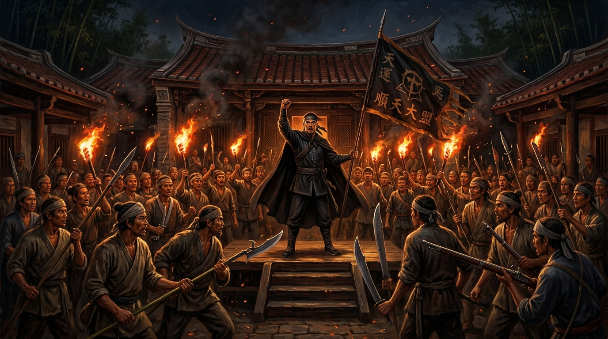
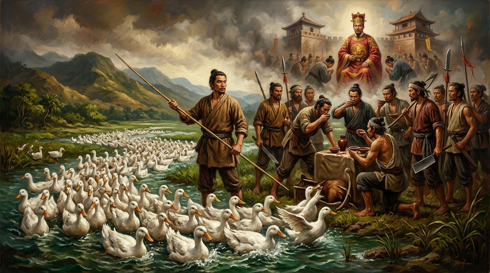
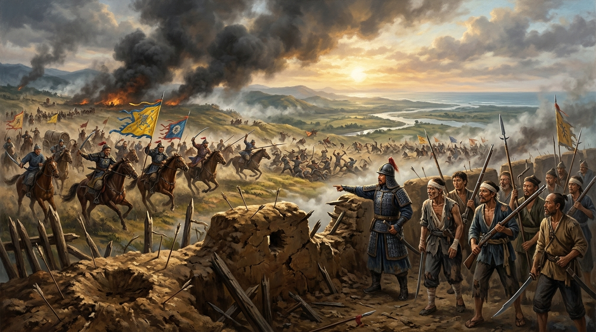
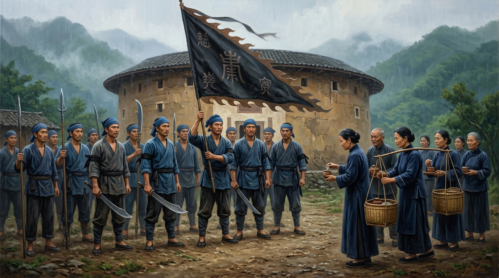

# 第 11 章：三年一反，五年一亂？——朱一貴、林爽文與全島械鬥的生存博弈

> **時期**：第四時期：清領時代的拓墾烽火與變革（1721 – 1788）  
> **核心歷史坐標**：臺中大里杙林爽文故居（`24.0998, 120.6792`）／高雄內門鴨母寮（`22.9450, 120.4620`）／嘉義公園福康安紀功碑（`23.4815, 120.4682`）／屏東竹田六堆忠義亭（`22.6152, 120.5310`）／新竹新埔褒忠義民廟（`24.8290, 121.0340`）  
> **關鍵歷史人物**：朱一貴（鴨母王）、杜君英、林爽文、莊大田、柴大紀、福康安、海蘭察、藍鼎元  
> **多媒體資源**：
> - 🎬 **章節重點解說影片**：[YouTube 觀看連結](https://youtu.be/eQgzt1vCRws) *(預定 2026-11-05 17:30 首播)*
> - 🎙️ **播客深度對談音訊**：[YouTube 專題觀看](https://youtu.be/agIBuot_bTI) *(預定 2026-11-05 19:30 首播)* ｜ [GitHub Release 雲端串流無損音訊](https://github.com/clive520/taiwan-history/releases/download/v1.0.0/ch11_podcast_deepdive.m4a)
> - 🧠 **Google NotebookLM 專屬研究筆記本**：[前往探索核心知識庫](https://notebook.google.com/notebook/a6d753c5-2e9a-4918-83a1-dea997b31992)

---


*▲ 乾隆五十一年（1786）大里杙天地會林爽文起兵揭竿，農民、羅漢腳與墾戶在黑夜火把映照下歃血結盟，吹響了撼動紫禁城的反抗號角。*

## 導讀前言：官逼民反的生存擂台，被誤讀的「三年一反，五年一亂」

在清代臺灣的歷史記憶中，流傳著一句令人心驚膽戰的民諺：「三年一反，五年一亂。」從北京紫禁城的皇帝大臣、福建督撫，到後世的史書敘事，這句話往往被簡化為臺灣移民「民風悍勇、好亂樂禍、刁頑難治」的本性標籤。

然而，當我們撥開官方奏摺的粉飾與偏見，深入清代移墾社會的底層田野，展現眼前的卻是一幅全然不同的悲劇圖景：這絕非一群天生嗜血的叛民，而是一群在天高皇帝遠的極端體制下，為了爭奪最後一滴灌溉水、寸步不讓的田界，或是抵禦貪官污吏敲骨吸髓的苛捐雜稅，被迫拿著鋤頭、竹篙、鳥銃踏上生死博弈的邊陲墾民。

清廷治臺「防民甚於治民」的消極戰略，派駐貪酷流官「三年任滿、囊橐已盈」，軍紀蕩然的綠營班兵與橫行敲詐的衙門差役，加上數以十萬計無家、無地、無偶的「羅漢腳」青壯遊民，構成了一座隨時可能引爆的巨大社會火藥庫。

1721 年，高雄內門養鴨農夫朱一貴因不滿知府王珍橫徵暴斂，立旗反清，短短七日全島響應攻陷府城；1786 年，臺中大里杙天地會首領林爽文率眾夜襲，烽火燎原南北兩路，清廷震恐，乾隆皇帝動用萬里調兵、派出滿洲精銳八旗與大學士福康安，傾全國之力方才艱難平定，並為死守不降的諸羅城賜名「嘉義」。

與此同時，漳泉械鬥、閩粵械鬥在島上遍地開花。為了自保家園，民間自立團練，客家先民以黑色令旗凝聚「六堆」鄉勇與「義民爺」信仰，從流亡孤魂轉化為護佑桑梓的永恆神祗。這是一部在制度真空與生存擠壓下，臺灣先民用血淚在泥淖中摸索秩序與認同的悲壯史詩。

---

## 甲部：深度歷史專題長文

### 第一節：天高皇帝遠的統治死結——流官貪酷、班兵敗壞與制度性危機

清領前期的臺灣，在清朝版圖上處於一種極度尷尬的「準殖民邊陲」地位。康熙二十三年（1684 年）施琅攻克明鄭後，清廷在「棄臺」與「留臺」的廷爭中雖然選擇了設府管轄，但朝廷決策的核心心態是「防臺為先，不求繁榮」。為了防止這座海外孤島再度成為反叛基地，清廷設計了一整套自我癱瘓、相互制衡的官僚與軍事體系。

地方行政長官如臺灣知府、臺灣兵備道、知縣等，皆從內地選派，任期三年。這些文官視臺灣為瘴癘毒地，視赴任為仕途苦差。官員薪俸微薄，卻要負擔龐大的隨從幕僚支出與京官打點費用。文官們普遍抱持「三年任滿、囊橐已盈」的心態，赴任之後第一要務不是興修水利、安撫民心，而是巧立名目敲詐勒索。

軍事防務更是形同虛設。清廷嚴格實行**「班兵輪戍制」**，駐臺一萬餘名綠營官兵不就地徵兵，全數由福建、廣東內地各營抽調，每三年一換，嚴禁攜眷。班兵隻身在臺，心態如同羈旅，餉銀又長期遭到將領剋扣「吃空餉」，士卒為了糊口，聚賭、勒索商民、兼差走私無所不為。巡洋水師多不識水性，砲台槍砲生鏽無彈。藍鼎元在《東征集》中痛斥：「兵民相仇如寇讎，將領視營伍如市肆，文武互不相睦，遇有變故，望風披靡。」

更嚴峻的是社會基層結構的扭曲。由於「渡臺禁令」嚴格禁止攜眷，島上積聚了數十萬無妻室、無固定田產的單身青壯年「羅漢腳」。在官府司法鞭長莫及的拓墾前線，官逼則民反，民弱則受欺。清廷既無力提供公正的法律裁決，又無力保護百姓生命財產，民間社會只能透過血緣、同鄉地緣以及地下結社（天地會），武裝自衛，填補殘酷的秩序真空。

#### 表 1：清廷治臺三大制度性病灶與民變爆發因果鏈剖析表

| 制度層面 | 制度原初設計規範與政策構想 | 實際運行之腐化與結構性扭曲 | 激化民變與械鬥之直接因果機制 |
| :--- | :--- | :--- | :--- |
| **流官輪調制** | 文官任期三年一調，嚴禁本土化，防止地方勢力盤根錯節 | 官員視臺灣為仕途暫借之所，離任即走，極力在三年內搜刮暴斂 | 地方官吏敲骨吸髓，王珍橫徵暴斂直接引爆 1721 朱一貴起義 |
| **班兵輪戍制** | 駐臺綠營兵由閩粵內地調派，三年輪換，嚴禁攜眷通婚以防兵變 | 兵丁離鄉思歸，將領剋扣軍餉，士兵賭博、勒索百姓、荒廢操練 | 毫無戰鬥力，民變甫起即棄城潰逃，朝廷被迫耗巨資自內地跨海派兵 |
| **渡臺攜眷厲禁** | 限制漢人繁衍聚眾，使移民視臺灣為暫棲之地，隨時可遣返 | 造成極端性別比失衡，全臺積累數十萬無產漂泊、亡命之徒「羅漢腳」 | 為天地會起義與大規模分類械鬥提供源源不絕的基層武裝兵源 |
| **劃界封山政策** | 豎立土牛紅線隔離漢番，劃定界限禁止越界採拓，避免激惹原住民 | 平原開墾飽和而人口激增，移民被迫鋌而走險盜墾番地，黑道豪強割據 | 催生地方豪強（如林爽文大里杙庄大老）形成民間武裝獨立王國 |
| **分而治之權術** | 遇亂挑撥閩粵、漳泉矛盾，以客制閩、以泉制漳，防止漢民團結 | 官府退化為械鬥仲裁者與挑唆者，摧毀基層族群互信，加劇血腥仇殺 | 將單純的資源利益爭奪，制度化升級為世代不解的族群仇恨與全島割喉 |

---

### 第二節：鴨母王揭竿與閩粵裂痕——康熙六十年（1721）朱一貴事件


*▲ 康熙六十年（1721）鴨母王朱一貴於高雄內門大岡山殺牛飲血盟誓，在成群白鴨奔湧與萬民歡呼中揭竿反清，進駐府城登基稱「中興王」。*

康熙六十年（1721 年）春天，南臺灣爆發了震撼清帝國的大風暴。導火線正是典型的「官逼民反」。

時任臺灣知府**王珍**攝理鳳山縣知事，此人貪婪成性，指派其子與衙役四出搜刮。王珍假借籌備大興土木之名，強行徵收無名私稅；更派兵封鎖大岡山，將數百年來鄉民賴以採樵伐竹的山林圈禁，凡入山採竹木者一律指控為「盜伐天朝軍工木料」，借機捕押貧民數百人，勒索巨額贖金；繳不出者則慘遭皮鞭酷刑，甚至斃命獄中。一時民間怨聲載道，民怨沸騰如釜中之水。

居住於鳳山縣鴨母寮（今高雄內門區）的**朱一貴**，原籍福建漳州長泰，以養鴨為業。朱一貴為人豪爽仗義，長年出資接濟各方流亡之羅漢腳，善於馴鴨，據說竹竿一揮群鴨進退有律，地方鄉鄰戲稱其為「鴨母王」。朱一貴目睹官吏殘暴，遂與黃殿、李勇、吳外、鄭妹等好友密謀起事。

眾人商議，朱一貴同姓明朝國姓朱氏，若打出「反清復明」旗號，最能號召人心。1721 年四月十九日，朱一貴在大岡山盟誓立旗，殺耕牛、飲血酒，揭竿起義。

起義軍勢如破竹。朱一貴軍進攻崗山營，擊潰清軍守兵；與此同時，廣東潮州客家人**杜君英**亦在檳榔林（今屏東內埔）聚眾千人起兵響應，揮軍北上。朱一貴與杜君英部隊合流，數日內聚集數萬之眾。四月三十日，義軍直逼臺灣府城（今臺南），臺灣鎮總兵歐陽凱戰死，知府王珍等文武官員棄城狼狽逃往澎湖。朱一貴入居府署，頭戴玉冠、身著黃袍，開倉賑濟貧民，正式建國號**「永和」**，自稱「中興王」。

然而，這場迅猛的勝利旋即在權力爭奪與族群偏見中四分五裂。杜君英驍勇善戰，率先破府城北門，其部眾自認功高，要求封杜君英為王，遭到朱一貴漳州籍部將反對。更嚴重的是，杜君英軍紀不嚴，部將強納原清廷官員侍姬，朱一貴嚴厲下令懲處嚴禁姦掠。雙方爆發流血火併，杜君英憤而率領數千名廣東客籍部隊撤出府城，北退至貓兒干（今雲林崙背）。閩籍與粵籍的抗清統一戰線在短短一個月內徹底瓦解。

當朱一貴派兵南下屏東平原招降徵糧時，高屏溪東岸的客家十三大莊、六十四小莊為防劫掠，推舉李直三等仕紳統籌自衛，按地理方位編組為「前堆、後堆、左堆、右堆、中堆、先鋒堆」，結成**「六堆」**鄉勇陣線，誓死保鄉，並在下淡水溪重創朱一貴部隊。

閏六月，清廷派遣福建水師提督**施世驃**（施琅之子）、南澳總兵**藍廷珍**率領近兩萬大軍，跨海登陸鹿耳門。隨軍參謀**藍鼎元**深諳臺灣民情，獻出「招撫客民、以粵制閩」之計，成功聯絡六堆鄉勇與官軍夾擊。朱一貴軍隊節節敗退，六月下旬，朱一貴退至諸羅溝尾莊（今嘉義新港），遭被官府利誘的莊民灌醉捆綁擒獲，解送北京遭凌遲處死。這場席捲全臺的起義，從爆發到平定僅僅維持了兩個月。

#### 表 2：朱一貴起義攻防進程與內部閩粵聯盟瓦解剖析表

| 時間階段 | 戰役與歷史關鍵節點 | 雙方軍事部署與行動特色 | 政治象徵與族群陣營演變 | 歷史啟示與後續衝擊 |
| :--- | :--- | :--- | :--- | :--- |
| **起事破曉**<br>*(1721.04.19)* | 大岡山歃血誓師，攻克崗山營 | 朱一貴、黃殿率數百貧民農民突襲官軍哨所，奪取鳥銃火藥 | 打出「大明重興」旗號，建國號「永和」，尊崇明朝正統 | 點燃全島積壓數十年之官逼民反怒火，數日內聚集數萬人 |
| **會師克府**<br>*(1721.04.30)* | 杜君英客家部隊響應，攻陷府城 | 朱、杜南北兩軍合圍，臺灣鎮總兵歐陽凱戰死，官軍潰逃澎湖 | 朱一貴進駐行署稱「中興王」，開倉分糧，廢除清廷苛稅 | 達成臺灣歷史上首次全島規模攻佔府城之民間武裝勝利 |
| **陣線瓦解**<br>*(1721.05 中旬)* | 府城火併，杜君英北撤貓兒干 | 杜部不滿封賞且觸犯軍紀，與朱一貴漳籍部將爆發市街巷戰 | 閩粵兩大族群決裂，抗清反體制鬥爭退化為族群互疑 | 暴露缺乏現代革命組織與跨族群共同政治藍圖之致命弱點 |
| **六堆誓師**<br>*(1721.05 下旬)* | 高屏客家莊成立「六堆」自衛軍 | 李直三統率七營鄉勇，於下淡水溪築壘固守，重創朱一貴部隊 | 確立客家「保鄉衛土、不仕偽朝」立場，與起義軍為敵 | 催生臺灣南部最重要之客家軍事地域組織「六堆」 |
| **清軍渡海**<br>*(1721.06 閏月)* | 施世驃、藍廷珍大軍登陸鹿耳門 | 清軍水陸並進，藍鼎元實施「分化招撫」，獲六堆鄉勇接應 | 清軍官府成功將「抗官民變」轉化為「客助官剿閩」之族群矛盾 | 朱一貴退走溝尾莊被擒，清廷加強防臺軍備，設立彰化縣與淡水廳 |

---

### 第三節：天地會誓師與乾隆十全武功——乾隆五十一年至五十三年（1786–1788）林爽文事件


*▲ 乾隆五十二年（1787）柴大紀率軍民死守諸羅孤城六個月，晨曦破曉時分，福康安大將軍與海蘭察巴圖魯精騎大破八卦山解圍，乾隆帝特賜名「嘉義」。*

朱一貴事件平定六十五年後，一場規模更宏大、戰火燃燒全臺達一年三個月的巨變，在臺灣中部大平原轟然爆發——這就是清代臺灣歷史上規模最大的農民起義：**林爽文事件**。

起義的搖籃在大里杙（今臺中大里）。乾隆中葉的大里杙，得益於貓羅溪與大里溪交會的水運之利，成為臺中盆地南來北往的稻米物產集散重鎮，富商巨賈雲集。原籍福建漳州平和縣的**林爽文**隨父渡臺定居於此。林爽文家資殷實，身材魁梧，為人任俠好義，被地方推舉為「大里杙庄大老」，掌管地方調解與防衛。

乾隆四十七年（1782 年）前後，廣東饒平人**嚴煙**渡臺傳播**「天地會」**（洪門三合會分支）。天地會以「順天行道、反清復明、患難相扶、生死與共」為宗旨，對於長年飽受官府欺凌、缺乏家族網絡依靠的異鄉拓墾者與羅漢腳極具吸引力。林爽文與南部鳳山地方豪強**莊大田**先後入會，在短短數年間，天地會組織像野火般在彰化、諸羅、鳳山、淡水等基層墾區迅速蔓延。

乾隆五十一年（1786 年）秋，臺灣知府孫景燧獲悉天地會活動猖獗，派臺灣水師協副將與理番同知長勝率領清軍進駐大里杙附近的柳樹湳，展開殘酷搜捕。清軍兵丁沿途藉搜查之名焚燒民舍、姦淫擄掠，拘捕無辜村民數十人。十一月二十七日夜，群情激憤的村民湧向林爽文宅邸請求起事。林爽文痛下決心，率領天地會眾數百人夜襲柳樹湳營盤，全殲清軍哨兵，陣斬知府長勝。

隨後，林爽文大軍直撲彰化縣城，知府孫景燧、理番同知長勝等清朝命官全數陣亡。林爽文在彰化設行署，大開府庫救濟貧民，正式建年號**「順天」**，立盟反清。

戰火迅速蔓延全島。在北部，林爽文部將王作攻佔竹塹（新竹）、逼近淡水；在南部，鳳山天地會領袖莊大田率領數萬會眾起兵響應，陷鳳山縣城，並進逼臺灣府城。全島除了府城、鹿港及諸羅城之外，各級清廷州縣衙門全數瓦解。

在這場風暴中，諸羅縣（今嘉義）成為扭轉戰局的關鍵核心。福建水師提督**柴大紀**率領少數正規軍與諸羅知縣董啟埏退守城池。林爽文大軍數萬人合圍諸羅城，長達數月之久。諸羅城內糧草斷絕，官兵與百姓捕麻雀、熬煮馬鞍皮帶、食榨油之豆粕度日，城中死者枕藉，但居民感念官民共患難，誓死守城不降。

全臺失陷的警報傳抵紫禁城，乾隆皇帝震怒異常。乾隆先後撤換兩任指揮不力的總督將軍，最終派出其最倚重之親信、滿洲正白旗猛將、協辦大學士**福康安**為大將軍，海蘭察為參贊大臣，調集滿洲八旗巴圖魯精兵、四川屯練藏族金川兵、廣西藤牌兵等精銳部隊兩萬人，於乾隆五十二年（1787 年）十月自福建出發，浩浩蕩蕩自鹿港登陸。

福康安抵臺後，展現了高超的野戰兵法。海蘭察率領滿蒙騎兵以「連環鹿角陣」硬破八卦山林爽文阻截主力；福康安大軍馬不停蹄，直搗諸羅城下，內外夾擊大破起義軍，諸羅之圍遂解。乾隆皇帝對諸羅軍民孤軍死守數月深為嘉許，特地下詔曰：**「諸羅軍民困守數月，死守待援，同心協力，嘉其忠義，特賜改名為嘉義。」**——這便是今日「嘉義」地名的歷史由來。

福康安解圍後，揮軍北攻大里杙，將林爽文經營多年的大莊夷為平地。林爽文率殘部退入內山（南投集集埔與水里小半天），在缺糧無彈的絕境中苦戰。乾隆五十三年（1788 年）正月初四，林爽文在老衢崎（今苗栗竹南）遭伏擊被俘，解送北京午門受審，壯烈就義。南路莊大田亦在瑯嶠（今恆春）被俘處決。乾隆皇帝為此戰役深感自豪，將其列入個人軍事生涯的「十全武功」之一，親自撰寫碑文，御賜十座巨型石龜馱碑（贔屓碑）運抵臺灣立廟。

#### 表 3：林爽文事件全島南北兩線戰役與福康安平臺戰術表

| 戰役階段 | 攻防戰場與地緣走勢 | 戰事核心細節與交戰態勢 | 清廷與起義軍策略分析 | 戰後深遠影響與遺存 |
| :--- | :--- | :--- | :--- | :--- |
| **起兵破府**<br>*(1786.11)* | 大里杙出發，破彰化、竹塹，席捲全臺中北部 | 林爽文率天地會眾夜破柳樹湳，克彰化城，斬知府孫景燧 | 順天建號，官逼民反，全島貧民及羅漢腳揭竿全面響應 | 清廷在臺統治神話徹底粉碎，全臺官署僅存府城與鹿港 |
| **南路策應**<br>*(1786.12)* | 鳳山起兵，莊大田陷縣城，進逼臺灣府城 | 莊大田聚眾數萬攻破鳳山，南北兩路形成合圍府城之勢 | 起義軍戰線過長，缺乏現代後勤供應，攻城重砲武器不足 | 迫使清軍退守府城核心，形成長期相持拉鋸戰 |
| **諸羅圍城**<br>*(1787.03–10)* | 諸羅城（嘉義）數萬人重重圍攻六個月 | 柴大紀與諸羅軍民死守孤城，糧盡食皮靴馬鞍，捕雀果腹 | 林爽文部久攻不下消耗主力，諸羅城成為牽制義軍之釘子 | 乾隆帝敕改諸羅縣為「嘉義縣」，褒揚孤忠抗敵 |
| **福軍登陸**<br>*(1787.10)* | 福康安、海蘭察率精銳兩萬登陸鹿耳門與鹿港 | 滿洲八旗、四川屯練兵抵臺，鹿角陣強襲破八卦山解圍 | 清軍集結優勢兵力與火砲，以快速機動作戰撕裂義軍防線 | 戰局瞬間逆轉，起義軍主力被擊潰，轉入山區游擊抵抗 |
| **集集終局**<br>*(1788.01–03)* | 追擊大里杙，合圍集集埔、小半天，老衢崎擒林 | 林爽文率部入山阻險，在苗栗竹南遭官兵與鄉勇伏擊就擒 | 清軍全面搜山，斷絕糧道，林爽文、莊大田先後解京受戮 | 乾隆列入「十全武功」，頒御製贔屓碑；清廷開始築嘉義磚石城 |

---

### 第四節：血濺水圳與莊落割喉——漳泉械鬥、閩粵械鬥與生存資源爭奪戰

在朱一貴與林爽文兩大民變的背後，橫亙於清代臺灣社會常態生活之中的，是一場更為漫長、更為血腥、也更具毀滅性的內耗——**分類械鬥**。

「械鬥」一詞，意指民間群體持兵械作有組織的武裝集團廝殺。在清領二百餘年間，全臺有案可查的重大械鬥超過 60 起，幾乎年年有小鬥，數年有大鬥。歷史學者曾深刻指出：臺灣的械鬥絕不是單純的民風刁悍或迷信好鬥，其深層核心本質是**在制度保障缺席的拓墾邊陲，圍繞稀缺生存資源（水權、土地、商業壟斷）展開的達爾文式割喉生存戰**。

#### 一、 水利地緣爭奪戰：一滴濁水引發的千人死鬥
農業社會的命脈在於灌溉。臺灣河流多為荒溪型河川，枯水期滴水成金。
以彰化八堡圳為例，濁水溪引進的水流流經十餘個鄉莊，上游與下游、漳州莊與泉州莊之間，每逢春耕大旱，截水搶水便成為生死攸關的戰爭。只要上游築壩截斷水流，下游數千畝稻田便面臨枯死絕收、全家餓死的命運。農民敲響莊廟鐘鼓，持鋤頭、火銃、竹矛直奔水閘，械鬥一觸即發。往往一人之爭奪，瞬間演變成兩個莊頭、數千名同鄉的大火拼，村莊焚毀、屍橫遍野。

#### 二、 田產界址與墾照衝突
清代土地「一田二主」制度錯綜複雜，大租戶、小租戶、佃農產權糾纏不清。客籍移民往往向平埔族承租界線模糊之山腳荒地，辛苦開墾數年後，閩籍墾首持官府蓋印之「墾照」前來強索大租，甚至指控其侵佔越界。在官府差役受賄包庇之下，弱勢佃農無處申冤，只能訴諸宗族鄉黨武力反抗，引發大規模閩粵械鬥。

#### 三、 商業港口霸權壟斷：1853 艋舺「頂下郊拚」
械鬥不僅發生於農村田野，更在繁華市鎮上演。最具代表性者即咸豐三年（1853 年）臺北艋舺爆發的**「頂下郊拚」**。
在淡水河航運樞紐艋舺，祖籍泉州晉江、南安、惠安的三邑人組成「頂郊」，佔據臨河最優質之碼頭行商，財力雄厚；而同屬泉州籍但較晚抵達之同安人則組成「下郊」（廈郊），落腳於邊緣之八甲莊。三邑人為了壟斷淡水河碼頭商業利益，欲消滅同安人勢力。然而兩者之間隔著安溪人聚居之艋舺祖師廟。三邑人竟暗中焚燒安溪人祖師廟，借道突襲八甲莊，將同安人聚落付之一炬。同安人死傷慘重，在烈火中護著開漳聖王神像與城隍爺金身，落荒逃往大稻埕，因禍得福在淡水河下游開拓出大稻埕的百年繁華。

#### 四、 官府的極限操盤：「以漢制漢」之分而治之
面對綿延不絕的械鬥，清廷地方官員非但無力彈壓制止，反而視族群矛盾為鞏固統治的政治槓桿。官府深知漢人若團結必生反叛，因此在政策上巧妙利用漳、泉、客各籍貫的互疑，甚至故意縱容私鬥。正如福建巡撫在密摺中所坦白：「臺民習於械鬥，漳與泉仇，閩與粵仇，分則力微易制，合則勢重難圖。故制臺之策，在使之各守其界，互為防備，官得從中駕馭，此亦因勢利導之巧術也。」

#### 表 4：清代全臺代表性分類械鬥類型、爭端核心與衝擊比較表

| 械鬥類型名稱 | 主要衝突群體與祖籍淵源 | 衝突引爆核心爭端本質 | 信仰神明地緣象徵 | 空間格局衝擊與深遠歷史後果 |
| :--- | :--- | :--- | :--- | :--- |
| **漳泉械鬥**<br>*(遍及全臺平原)* | 泉州人（三邑、同安、安溪）<br>vs 福建漳州人 | 爭奪平原精華水利水源（八堡圳、瑠公圳）與商業地盤 | 廣澤尊王／開漳聖王<br>（神明繞境常演變為火拼） | 造成移民空間壁壘分明，如臺北板橋漳州林本源建防禦堡壘 |
| **閩粵械鬥**<br>*(中南部山腳隘墾區)* | 福建閩南人（漳泉為主）<br>vs 廣東客家人（潮州、嘉應州） | 田界糾紛、官府墾照特權爭議、邊陲山林山產拓殖資源 | 開漳聖王／保生大帝<br>vs 三山國王／三界爺 | 迫使客家聚落往內山丘陵退縮，促成「六堆」與客家防衛聯盟 |
| **頂下郊拚**<br>*(1853 臺北艋舺)* | 泉州三邑人（頂郊商賈）<br>vs 泉州同安人（下郊商賈） | 淡水河航運碼頭起卸貨物特權、商業貿易航道壟斷 | 艋舺龍山寺觀音<br>vs 八甲莊城隍爺、祖師公 | 八甲莊化為灰燼，同安人林右藻等移居大稻埕，開拓淡水開港商機 |
| **異姓械鬥**<br>*(宜蘭、臺南各莊)* | 同一籍貫內部不同血緣宗族<br>（如宜蘭林姓 vs 陳姓） | 宗族祖產爭奪、公共埤塘管理權、莊廟主導權衝突 | 宗族開基祖先宗祠與家廟 | 強化單一姓氏封閉式宗族村莊（如屏東宗族聚落）防禦性建築 |

---

### 第五節：從邊陲反叛到桑梓守護——「義民爺」信仰與島嶼認同的重構


*▲ 清代客家青壯鄉勇於傳統圍屋前臂纏黑布、高舉火焰鑲邊黑色「義民旗」歃血誓盟，婦孺挑擔奉飯相送，開展了守護桑梓、合葬忠骸的義民爺信仰篇章。*

在長達兩百年的動盪烽火中，臺灣社會底層在毀滅與撕裂的泥淖裡，逐漸長出了一種屬於這片土地獨有的信仰力量——**「義民爺」信仰**。

清代官方文獻中的「義民」，表面上是清廷為了褒揚協助官府彈壓民變、守護城池莊落而陣亡的民間鄉勇所頒發的榮譽稱號。乾隆皇帝曾親筆御賜「褒忠」匾額予新竹枋寮義民廟，賜「旌義」匾額予六堆客家忠義祠。在官方的政治話語中，義民被塑造成天朝大清的「忠臣義士」。

然而，當我們站在臺灣本土歷史的視角下凝視，民間百姓心中祭祀的「義民爺」，其精神本質早已超越了對遙遠紫禁城大清皇帝的效忠。

在朱一貴事件、林爽文事件以及無數次慘烈的分類械鬥中，客家先民與泉漳各籍百姓，面對的是官軍崩潰、家園殘破、田廬遭焚、父母妻兒危在旦夕的絕境。在沒有政府提供任何保護的生死關頭，鄉民自發編組鄉勇，青年男子拿起大刀長矛，在黑布纏臂的**黑色「義民旗」**下歃血盟誓，用血肉之軀抵禦外敵入侵。

新竹枋寮客家仕紳林先坤等人在林爽文事件平定後，沿著戰場道路收殮了兩百餘具為保衛鄉土而犧牲的鄉勇遺骸，合葬於新埔枋寮，建立**「新埔褒忠義民廟」**。這些陣亡的先驅，許多是無名無姓的年輕羅漢腳，在唐山沒有宗廟供奉，在臺灣沒有子嗣祭祀。然而，臺灣的土地與人民沒有忘記他們。民間將他們集體奉為「義民爺」，視為護佑整座莊落、庇佑世代子孫開疆拓土的鄉土守護神。

每逢農曆七月二十日義民節，十五大莊輪值祭典，先民挑起沈甸甸的竹籮飯擔（「挑擔奉飯」），齊聚義民廟前。那迎風招展的黑色令旗，不再僅僅是軍事的標記，而是凝聚群體團結、跨越生死界線的圖騰。

從「三年一反」的官逼民反，到「五載一亂」的生存械鬥，清代臺灣的血淚博弈，最終以一種悲壯而深刻的方式，推動著這座島嶼上的流寓者，逐漸褪去「唐山客」的漂泊過客心態。在共同灑下鮮血的土地上，先民學會了守護桑梓、紮根立足，一步步在傷痕中凝結出這座島嶼最早的本土認同。

#### 表 5：1721–1788 臺灣重大民變、械鬥與義民信仰確立編年大事記

| 年份（公曆／清代年號） | 歷史重大事件 | 關鍵領袖與核心地點 | 事件性質與歷史轉折 |
| :---: | :--- | :--- | :--- |
| **1721**<br>*(康熙六十年)* | **朱一貴起義爆發** | 朱一貴、杜君英<br>高雄內門大岡山、臺南府城 | 臺灣清領時期首次大規模民變，攻克府城建號「永和」，後因閩粵內鬨潰敗 |
| **1721**<br>*(康熙六十年)* | **屏東客家成立「六堆」自衛軍** | 李直三、侯心榮<br>高屏溪東岸（竹田忠義亭） | 客家聚落為保鄉自衛編組「六堆」，確立南部客家軍事與自治防衛網絡 |
| **1723**<br>*(雍正元年)* | **增設彰化縣與淡水廳** | 清廷戶部、閩浙總督<br>半線（彰化）、竹塹（新竹） | 朱一貴事件後清廷體認虎尾溪以北統治真空，向北延伸中臺灣行政管理架構 |
| **1732**<br>*(雍正十年)* | **大安溪大甲西社原住民抗清** | 林武力、大甲西社平埔族<br>臺中大甲、清水 | 官府勞役苛重引發平埔族大反抗，漢人官軍動用數省兵力血腥彈壓 |
| **1782**<br>*(乾隆四十七年)* | **彰化、諸羅全島分類大械鬥** | 漳泉移民領袖、天地會嚴煙<br>彰化平原、諸羅各莊 | 嚴重乾旱引發搶水爭田，械鬥死傷數千人，天地會藉秩序真空迅速擴散基層 |
| **1786**<br>*(乾隆五十一年)* | **林爽文天地會起事** | 林爽文、莊大田<br>臺中大里杙、柳樹湳、彰化城 | 臺灣歷史上規模最大之天地會農民起義，席捲全島，建號「順天」圍攻諸羅 |
| **1787**<br>*(乾隆五十二年)* | **柴大紀守孤城，福康安登陸** | 柴大紀、福康安、海蘭察<br>諸羅城、鹿港、八卦山 | 諸羅城軍民糧盡堅守六個月；福康安大軍自鹿港登陸解圍，改諸羅為「嘉義」 |
| **1788**<br>*(乾隆五十三年)* | **林爽文兵敗被俘，起義平定** | 林爽文、福康安<br>南投集集埔、苗栗老衢崎 | 林爽文於老衢崎被俘就義，乾隆帝列為「十全武功」親撰御碑，下令築嘉義磚城 |
| **1788**<br>*(乾隆五十三年)* | **新竹新埔褒忠義民廟落成** | 林先坤、王廷昌<br>新竹新埔枋寮 | 收集防守鄉土犧牲之 200 餘義勇忠骸合葬，乾隆賜「褒忠」匾，義民爺信仰確立 |

---

## 乙部：影視級口播分鏡腳本

### 【影片主題】：三年一反，五年一亂？——朱一貴、林爽文與全島械鬥的生存博弈
- **時長目標**：約 7 分 30 秒（影視級紀錄片節奏，每分鐘語速約 210 字）
- **核心敘事基調**：沉穩厚重、洗練悲壯、深層剖析歷史機制、直指制度病灶

---

#### 場景一：【破題懸念】黑夜中的血酒與鴨母王的皇冠（0:00 - 1:45）
- **【畫面視覺建議】**：
  - 鏡頭在漆黑中緩緩推進，大岡山山崖上火把在狂風中獵獵作響。
  - 刀光閃過，鮮血滴入陶碗中的濁酒，十幾隻粗糙、佈滿厚繭與傷疤的農民手掌緊緊扣在一起。
  - 畫面切入高雄內門荒野中成千上萬隻白鴨在泥塘間奔湧，一位身著粗布短褐、手持竹竿的青年漢子佇立在南臺灣炙熱的陽光下；隨後畫面快切至府城巍峨的行署大堂，身著黃袍、頭戴明朝冕冠的「中興王」朱一貴，在大殿中央接受各路綠林與農民的震天歡呼。
- **【旁白解說詞】**：
  > 「三年一反，五年一亂。在兩百年的清領臺灣史上，這八個字就像是一道甩不掉的魔咒。
  > 朝廷的官員在奏摺裡憤怒地寫道：『臺民刁頑，好亂樂禍。』但是，真的有一群人生來就喜歡押上身家性命去反抗朝廷嗎？
  > 
  > 時間回到 1721 年的四月。在高雄內門的大岡山深處，十幾位走投無路的漢子正殺牛盟誓。為首的，是一位以養鴨為業的三十歲青年——朱一貴。
  > 官府譏諷他是個卑微的『鴨母王』，但就是這個鴨母王，竹竿一揮，點燃了席捲全臺灣的沖天烈火。
  > 
  > 為什麼？因為清朝派到臺灣的知府王珍，搜刮勒索已經到了瘋狂的地步。老百姓進山砍根竹子，就要被誣陷為盜伐官木、拷打勒索。
  > 官逼，民不得不反！
  > 短短七天之內，朱一貴的大軍如狂潮般撕裂了綠營防線，攻陷臺灣府城。
  > 他穿起黃袍，建國號『永和』。然而，這場轟轟烈烈的反抗，卻在短短一個月內，撞上了一堵更殘酷的族群高牆……」

---

#### 場景二：【核心風暴】大里杙天地會誓師與全島大圍城（1:45 - 3:30）
- **【畫面視覺建議】**：
  - 地圖推演：臺中盆地大里杙庄的古地圖亮起，貓羅溪上的木造帆船往來穿梭。
  - 暗室油燈之下，天地會的青布令旗緩緩展開，嚴煙與林爽文手指沾血在布帛上簽名畫押。
  - 戰火蔓延：彰化縣城在暗夜中被烈火包圍，官員大印在混亂中被踩碎；南北兩條紅色箭頭如巨浪般向臺南府城與諸羅城鉗形推進。
  - 諸羅城下，殘破的土城牆滿是彈痕箭孔，城內婦女拆毀房梁熬煮樹皮，士兵飢腸轆轆地趴在垛口旁緊盯著無邊無際的義軍營帳。
- **【旁白解說詞】**：
  > 「朱一貴失敗了，但滋生反抗的制度爛疽，一天也沒有消除。
  > 流官三年一換，滿載金銀回籍；綠營班兵不通操練，欺壓良善；而在荒野農村裡，是幾十萬沒有妻室、沒有田產、被稱為『羅漢腳』的年輕單身漂泊者。
  > 
  > 六十五年後，在臺中盆地最繁華的大里杙庄，一個更大的風暴正在成形。
  > 這裡的庄大老林爽文，加入了反清復密的『天地會』。
  > 當官府的兵丁再度藉查抄之名，在大里杙周圍燒殺擄掠時，林爽文不再忍耐。
  > 1786 年十一月，夜襲柳樹湳！彰化縣城一夜陷落！
  > 林爽文建元『順天』，南路的莊大田起兵響應，南北夾擊，臺灣全島各州縣官署瞬間土崩瓦解。
  > 
  > 全臺灣，只剩下了一座孤島般的城池——諸羅。
  > 提督柴大紀率領軍民，在林爽文數萬大軍的重重圍困下，死守了整整六個月。
  > 城裡糧食吃光了，百姓煮皮帶、吃豆粕、捕麻雀充飢。
  > 這是臺灣歷史上最慘烈的一場圍城戰，它即將迎來大清帝國最精銳的皇家軍團。」

---

#### 場景三：【轉折高潮】福康安十萬大軍平臺與「嘉義」之名（3:30 - 5:45）
- **【畫面視覺建議】**：
  - 臺灣海峽上風雲變色，上百艘巨型戰船遮天蔽日。
  - 滿洲正白旗猛將福康安披甲拔刀，巴圖魯精騎以排山倒海之勢涉水衝鋒，廣西藤牌兵手持滾刀在八卦山灌木叢中短兵相接。
  - 煙硝散去，諸羅城門大開，骨瘦如柴的守城軍民熱淚盈眶迎接援軍。
  - 鏡頭特寫：嘉義公園內十座巨大的青石贔屓馱碑，碑文上滿漢雙語深刻著乾隆皇帝的御筆；石碑上的浮雕在斑駁歲月中靜靜訴說滄桑。
- **【旁白解說詞】**：
  > 「紫禁城裡的乾隆皇帝坐不住了。他撤換了兩任總督，派出了他最器重的心腹統帥——陝甘總督福康安。
  > 兩萬名八旗精兵、四川金川藏兵、廣西藤牌軍跨越海峽，自鹿港登陸。
  > 這是一場純粹的帝國正規軍與民間草莽武裝的正面對決。
  > 
  > 福康安手下的猛將海蘭察，以連環鹿角陣硬生生砸碎了林爽文在八卦山的防線。
  > 諸羅之圍，終於解開！
  > 乾隆皇帝為了嘉許這座孤城裡的百姓在絕境中『同心協力、嘉其忠義』，特地下詔，將這座縣城賜名為——『嘉義』。
  > 
  > 林爽文退入南投集集與小半天險隘山區，在彈盡援絕的暴風雪與泥淖中，戰至最後一人。
  > 乾隆五十三年正月，林爽文被俘，押往北京受戮。
  > 乾隆帝將平定臺灣列入他引以為傲的『十全武功』，十座巨大的石龜馱碑運到了臺灣。
  > 但紫禁城裡的勝利狂歡，永遠無法撫平這座島嶼上平民百姓深可見骨的血淚創傷。」

---

#### 場景四：【終局迴響】械鬥血淚、黑色義民旗與島嶼深沉記憶（5:45 - 7:30）
- **【畫面視覺建議】**：
  - 畫面轉向鄉野間乾涸龜裂的農田水圳，兩群手持竹矛與農具的莊民為了一條水溝互相對峙呼喊。
  - 鏡頭掃過新竹新埔枋寮義民廟，黑底紅邊的「黑色義民旗」在大雨中飄揚；老農婦挑著沉重的竹籮，將熱騰騰的飯菜奉獻在神龕前。
  - 鏡頭拉升至高空，俯瞰整座臺灣西海岸肥沃的大平原，夕陽將水稻田染成一片耀眼的金黃，終局字幕緩緩浮現。
- **【旁白解說詞】**：
  > 「比官逼民反更令人心痛的，是民間底層的自相殘殺。
  > 漳泉械鬥、閩粵械鬥、頂下郊拚。
  > 為了搶奪枯水期的一滴灌溉水，為了一塊寸步不讓的田界，同一片土地上的移民，彼此揮刀相向。
  > 而朝廷的官員，甚至在奏摺裡冷酷地寫著：『使漳泉互仇、閩粵互制，此防臺之妙策也。』
  > 
  > 但也正是在這樣沒有任何公義與保護的殘酷世道裡，民間長出了自己的脊樑。
  > 當官兵逃跑、家園面臨焚毀時，客家先民拿起大刀，在黑色義民旗下誓死保鄉。
  > 那些在戰火中倒下的無名青年，沒有子嗣，沒有家譜，
  > 但地方百姓把他們的忠骸合葬在一起，尊奉為神——『義民爺』。
  > 
  > 挑擔奉飯兩百年，那不是對遙遠皇帝的效忠，那是對自己腳下這片土地、對身旁相依為命的家人最深沉的承諾。
  > 
  > 『三年一反，五年一亂』，從來不是臺灣人的劣根性。
  > 它是一部在體制壓迫與生存絕境中，先民用鮮血在泥濘裡摸索秩序、摸索尊嚴，
  > 最終從流亡唐山的漂泊過客，淬鍊為守護桑梓的臺灣人的悲壯史詩。」

---

## 丙部：Faster-Whisper 與 NotebookLM 專用提示詞庫

```text
臺灣史, 清領時代, 官逼民反, 三年一反五年一亂, 班兵制度, 綠營標營, 輪戍制, 流官制, 羅漢腳, 渡臺禁令, 
朱一貴, 鴨母王, 鴨母寮, 內門, 大岡山, 中興王, 永和, 王珍, 杜君英, 檳榔林, 施世驃, 藍廷珍, 藍鼎元, 平臺紀略, 東征集, 貓兒干, 
林爽文, 天地會, 洪門, 嚴煙, 大里杙, 順天, 莊大田, 鳳山縣, 諸羅城, 柴大紀, 董啟埏, 諸羅縣志, 
福康安, 海蘭察, 巴圖魯, 欽定平定臺灣紀略, 嘉義, 嘉義縣, 嘉義公園, 贔屓馱碑, 十全武功, 老衢崎, 集集埔, 小半天, 
分類械鬥, 漳泉械鬥, 閩粵械鬥, 頂下郊拚, 艋舺, 大稻埕, 三邑人, 同安人, 祖師廟, 龍山寺, 開漳聖王, 三山國王, 保生大帝, 廣澤尊王, 
以漢制漢, 義民, 義民爺, 褒忠, 新埔褒忠義民廟, 林先坤, 六堆, 六堆忠義亭, 李直三, 黑色義民旗, 挑擔奉飯, 桑梓認同
```
