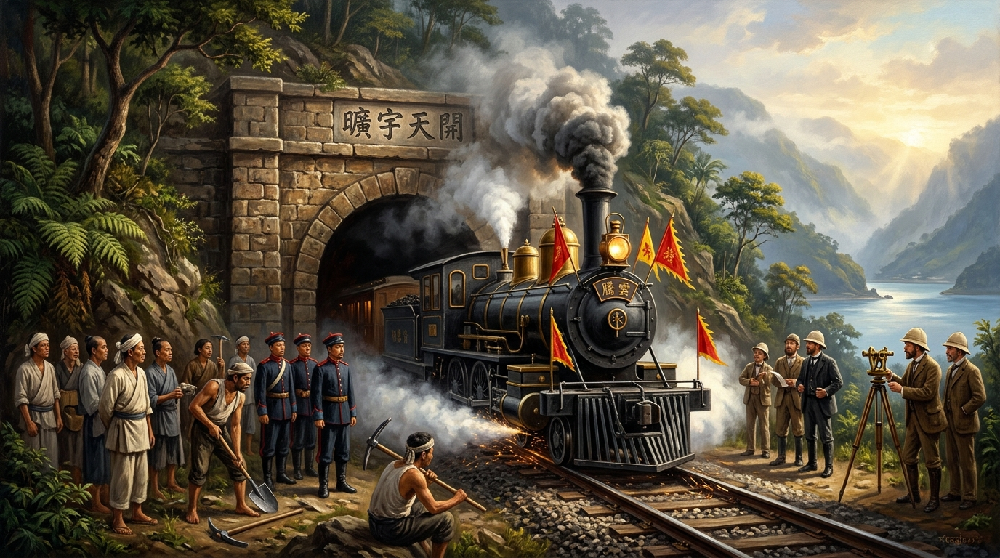
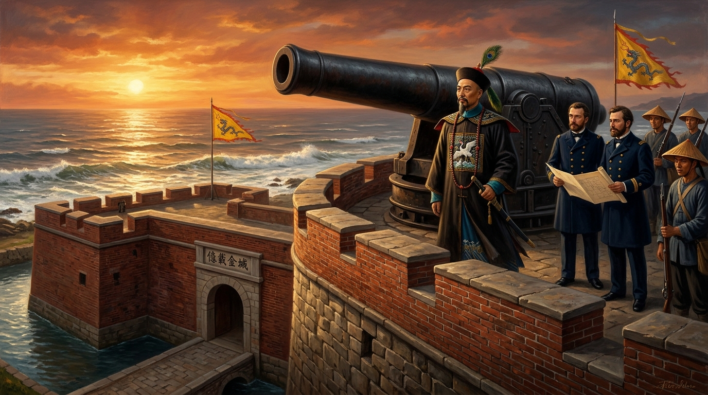
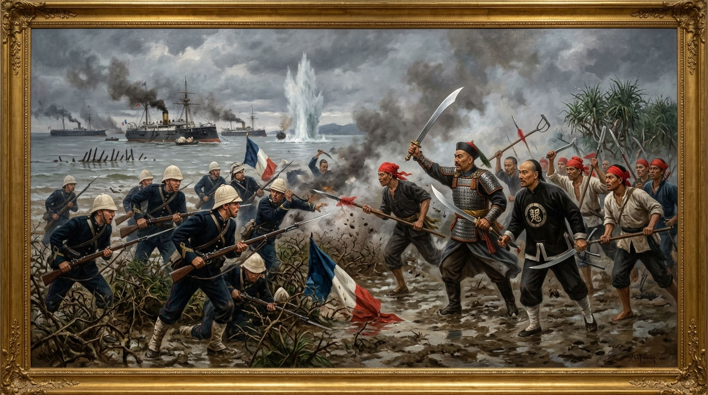

# 第 12 章：開港通商與現代化急先鋒——沈葆楨開山撫番到劉銘傳建省新政

> **時期**：第四時期：清領時代的拓墾烽火與變革（1860 – 1895）  
> **核心歷史坐標**：基隆獅球嶺鐵路隧道（`25.1165, 121.7332`）／臺北承恩門北門（`25.0478, 121.5115`）／淡水滬尾礮臺（`25.1788, 121.4298`）／臺南安平二鯤鯓砲臺億載金城（`22.9892, 120.1585`）／屏東車城牡丹社事件登陸地（`22.0722, 120.7088`）／大稻埕千秋街李春生故居（`25.0538, 121.5088`）  
> **關鍵歷史人物**：沈葆楨、劉銘傳、丁日昌、李春生、約翰·陶德（John Dodd）、馬偕（George Leslie Mackay）、孫開華、林朝棟、西鄉從道、孤拔（Amédée Courbet）  
> **多媒體資源**：
> - 🎬 **章節重點解說影片**：[YouTube 觀看連結](https://youtu.be/rMa854Dcga0) *(預定 2026-11-06 17:30 首播)*
> - 🎙️ **播客深度對談音訊**：[YouTube 專題觀看](https://youtu.be/0p5jfL8fNmo) *(預定 2026-11-06 19:30 首播)* ｜ [GitHub Release 雲端串流無損音訊](https://github.com/clive520/taiwan-history/releases/download/v1.0.0/ch12_podcast_deepdive.m4a)
> - 🧠 **Google NotebookLM 專屬研究筆記本**：[前往探索核心知識庫](https://notebook.google.com/notebook/ee220930-b26c-412d-8939-29b55f50a41f)

---


*▲ 光緒十七年（1891）基隆獅球嶺隧道前，「騰雲號」蒸汽火車頭噴吐著白色蒸汽轟鳴穿越崇山峻嶺，車前紅旗獵獵，象徵著古老的臺灣在列強砲艦與洋務革新交織中，邁入現代化技術文明的破曉時分。*

## 導讀前言：海權浪潮衝擊下的邊陲蛻變

1860 年，英法聯軍的砲火撕開了北京紫禁城的威嚴，也隨之震開了臺灣封閉近兩百年的海疆門戶。《天津條約》與《北京條約》簽訂後，淡水、安平、雞籠、打狗四口相繼開港，外商洋行蜂擁而入，五星紅毛旗、米字旗與三色旗在安平古堡與淡水河口飄揚。原本作為清帝國東南米糧補給與軍事防範之孤島，一夕之間被推上了全球資本主義貿易的最前線。

這是一場全島生態、經濟與政治格局的翻天覆地大變革。茶葉、砂糖、樟腦「臺灣三寶」的瘋狂外銷，讓常年處於貿易逆差的大清帝國在臺灣迎來了鉅額外匯出超；淡水河畔的大稻埕迅速取代臺南府城與鹿港，書寫了「政治在南、經濟在北」的歷史逆轉神話。

然而，繁榮背後伴隨而來的是致命的帝國主義覬覦。1874 年，日本藉口琉球船民遇害悍然發動「牡丹社事件」，公然宣稱臺灣後山為「無主番地」，打破了清廷「不生事、不出界」的鴕鳥心態；1884 年中法戰爭戰火蔓延，法國遠東艦隊司令孤拔率鐵甲戰艦猛轟基隆、封鎖海峽，滬尾淡水河口泥濘的紅樹林與林投樹叢中，爆發了清代罕見的抗法白刃肉搏戰。

外部列強的步步緊逼，逼出了晚清帝國最耀眼的兩位洋務重臣——沈葆楨與劉銘傳。沈葆楨以欽差大臣之姿修築西式星形砲台「億載金城」、劈開中央山脈開闢三路古道、廢除渡臺攜眷厲禁；劉銘傳則在抗法勝利後晉封首任臺灣巡撫，大刀闊斧推動全中國第一條客貨官辦鐵路、開鑿獅球嶺隧道、鋪設跨海電報電纜、創設獨立郵政、架設電燈、清查全島田賦。

短短三十年間，臺灣從一個被視為瘴癘毒地的海外封禁荒島，華麗蛻變為大清帝國防務最堅強、基礎設施最前衛的「現代化第一模範省」。這段歷史，不僅是一首技術引進與鐵血捍衛的慷慨長歌，更是臺灣先民在國際地緣夾縫中重新定位自我的血淚晨曦。

---

## 甲部：深度歷史專題長文

### 第一節：開港通商與臺灣三寶——大稻埕崛起與全島經濟重心北移

1858 年簽署的《天津條約》與 1860 年的《北京條約》，將臺灣正式捲入西方資本主義的世界市場體系。1862 年淡水海關正式開徵、1864 年安平海關設立，隨後雞籠（基隆）與打狗（高雄）作為副港對外開放，「四口通商」的黃金架構全面成型。大清總稅務司署派遣外籍稅務司進駐各口，近代氣象觀測站、航海燈塔（如屏東鵝鑾鼻燈塔、澎湖漁翁島燈塔）陸續拔地而起，臺灣的海運與國際接軌的速度超越了內陸大部分行省。

伴隨口岸開放而來的，是西方資本的大舉登陸。英商德記洋行（Tait & Co.）、怡記洋行（Elles & Co.）、和記洋行（Boyd & Co.）、美商東興洋行（Julius Mannich & Co.）與德商唻記洋行（Wright & Co.）被稱為「五大洋行」，依仗領事裁判權與協定關稅，在安平、打狗與淡水租界設立大型棧房與碼頭。洋行不僅進口鴉片、紡織品、煤油與鐘錶，更竭力收購島上的高經濟價值農林產物，催生了舉世聞名的「臺灣三寶」：

1. **茶（Tea）——北臺灣的綠色黃金**：
   原產於桃竹苗丘陵與臺北盆地周邊的茶葉，原本僅為內銷粗茶。英商**約翰·陶德（John Dodd）**於 1865 年來臺考察，敏銳察覺北臺灣氣候與土壤極利優良茶樹生長。陶德結識了精通英語、富有遠見的廈門商人**李春生**，聘其為寶順洋行（Dodd & Co.）總買辦。李春生自福建安溪大量引進優良烏龍茶苗，貸款資助淡水河上游（深坑、坪林、石碇、大溪）農民種植，並在艋舺與大稻埕引進近代烘焙精製技術。1869 年，陶德租用兩艘美籍飛剪帆船，滿載 2,131 擔精緻「福爾摩沙烏龍茶（Formosa Oolong）」直航美國紐約，甘醇香氣轟動北美，被紐約上流社會譽為「香檳烏龍」，引爆搶購狂潮。茶葉外銷在 1870 年代迅速飆升，佔全島出口總值一半以上。
2. **糖（Sugar）——南臺灣的歷史底蘊**：
   南臺灣嘉南平原與高屏溪流域的甘蔗種植延續明鄭以來的糖廍傳統，白糖與黑糖經打狗港與安平港源源外銷日本、澳洲、香港與英國，成為南部農村的經濟動脈。
3. **樟腦（Camphor）——全球爭奪的軍工與石化原料**：
   臺灣中北部中央山脈原始林孕育了龐大的樟樹群。樟腦為十九世紀末製造無煙火藥、賽璐珞（早期人造塑膠原料）與醫藥之不可或缺戰略物資。臺灣樟腦產量一度高達全球總供應量的 70% 以上，引發英商等洋行與清朝官府的「樟腦專賣爭議」（甚至引發 1868 年英艦砲轟安平的樟腦戰爭）。採樟腦必須深入深山生番領域，不僅引爆極端嚴重的原漢流血衝突，亦促使官府不得不正視內山後山的治理問題。

三寶外銷徹底顛覆了臺灣兩百年來的經濟地緣結構。在 1860 年之前，全島維持「一府二鹿三艋舺」的格局，經濟重心牢牢鎖定在南部稻作與對渡貿易；然而茶葉與樟腦產地全集中於北部，外銷所得均為西方真金白銀（墨西哥銀元）。淡水海關稅收節節超越安平，茶行、洋行、精製茶廠、殷實買辦與碼頭苦力齊聚淡水河下游的大稻埕。大稻埕迅速褪去昔日曬穀場的鄉村外貌，興建起洋樓林立的迪化街與千秋街，成為全島財富密度最高的商業核心。臺灣經濟自此完成了不可逆轉的「南北逆轉」。

#### 表 1：1860 年開港前後臺灣經貿格局與社會生態全景對照表

| 評比維度 | 1860 年開港通商前（鎖國內渡期） | 1860 年開港通商後（全球貿易期） | 歷史變革與制度性影響 |
| :--- | :--- | :--- | :--- |
| **貿易範疇** | 兩岸單向對渡（臺南鹿耳門對渡廈門、鹿港對渡蚶江） | 納入全球資本市場（直航紐約、倫敦、橫濱、香港） | 脫離單一內地糧食依附，成為國際自由貿易重要節點 |
| **出口主力產品** | 稻米（白米、糙米）、粗製砂糖（出口福建、浙江） | 茶葉（烏龍茶、包種茶）、砂糖、樟腦（「臺灣三寶」） | 農產品轉向高附加價值經濟作物，外匯存底鉅額出超 |
| **經濟重心** | 政治與財富均在南部（「一府二鹿三艋舺」） | 經濟重心全面北移（大稻埕、淡水、基隆迅速躍起） | 催生北部巨商買辦，促使政治中心日後隨之北遷臺北府 |
| **主要貿易中介** | 傳統行郊組織（郊商、三郊、泉郊、廈郊） | 西方五大洋行（德記、怡記、和記、東興、唻記）＋洋行買辦 | 行郊體系逐漸沒落，買辦階級（如李春生）崛起成為社會菁英 |
| **貨幣與海關** | 清朝制錢、紋銀、內地笨港銀元；內陸釐金卡 | 墨西哥銀元、西班牙雙柱銀幣；外籍稅務司近代海關體系 | 貨幣流通高度國際化，海關成為大清最具財政現代化官署 |
| **社會衝擊** | 羅漢腳遊民械鬥、移墾家族水利封閉爭奪 | 茶葉採摘創造龐大女性與女工就業；勞動僱傭市場成型 | 傳統性別封禁瓦解，女性自立採茶焙茶，資本工資階級成型 |

---

### 第二節：涉外危機與國防大轉向——牡丹社事件與沈葆楨開山撫番

經濟的急遽升溫，讓毫無現代國防體系的臺灣成為列強眼中的肥肉。1871 年（同治十年），一艘琉球宮古島朝貢船遭遇颱風，漂流至恆春半島東南岸八瑤灣觸礁。船上 66 名船員登陸後誤入排灣族高士佛社與牡丹社領域，雙方語言不通且引發猜忌，54 名琉球船民遭排灣族勇士出草殺害，其餘 12 人在漢人保力客家墾民楊友旺等人庇護下經府城遣送回國。這起單純的海難涉外事件，卻被剛剛完成明治維新的日本視為對外擴張的絕佳契機。

1874 年，日本政府內閣藉口「替琉球藩民復仇、懲辦生番」，派遣陸軍中將**西鄉從道**（西鄉隆盛之弟）率領 3,600 名日軍與 3 艘軍艦進犯恆春半島，於射寮（今屏東車城）強行登陸，史稱**「牡丹社事件」（日本稱「臺灣出兵」）**。清廷總理衙門在外交談判中原先搬出傳統天下秩序觀念，稱「番地為生番所居，化外之民，政教不及」。老謀深算的日本副島種臣與外務官員藉此大做文章，詭辯「化外之地即無主之野，主權未及，日本出兵合乎萬國公法」，暴露出併吞臺灣東部與琉球的軍事野心。

在恆春半島山林中，日軍遭遇牡丹社頭目阿祿古父子率領的原住民勇士在「石門古戰場」頑強抵抗。排灣族利用險峻隘口射擊滾石，重創日軍先鋒；然而在日軍現代化步槍火力壓制下，阿祿古父子英勇戰死，牡丹社、高士佛社遭焚毀。日軍雖奪得戰術控制權，卻立刻陷入南臺灣熱帶烈日、叢林毒蚊與惡性瘧疾（黑水熱）的致命折磨。日軍實戰陣亡僅二十餘人，病死者卻高達 561 人，全軍陷入瀕臨覆滅的絕境。

此時北京朝廷大為震驚，猛然驚覺臺灣一旦淪陷，東南七省海防將全面癱瘓。清廷急派林則徐之婿、福州船政大臣**沈葆楨（1820–1879）**以欽差大臣身分督辦臺灣海防兼理各國事務，並調派淮軍精銳武毅銘軍一萬餘人隨同赴臺。沈葆楨一到府城，展現雷厲風行的洋務實務作風：

1. **修築西式星形海防砲台**：
   沈葆楨深感安平港口沙灘平坦、舊式砲台無險可守，聘請法國海軍工程師**白乃爾（Jerome M. Roux）**與**日意格（Prosper Giquel）**實地測量設計，於安平二鯤鯓修築全臺第一座近代星形稜堡要塞——**「億載金城」（二鯤鯓砲臺）**。城內四角突出稜堡，配備英國阿姆斯特朗（Armstrong）前膛裝巨砲，引海水為護城河，中央操場可容納千人操演，沈葆楨親自題寫「億載金城」與「萬流砥柱」石額，成為南臺灣捍衛海疆的第一道現代鐵壁。同時，沈葆楨於旗後、基隆修築西式砲台，全島防禦體系面目一新。
2. **外交撤軍與《中日北京專約》之教訓**：
   在清軍大兵壓境與日軍疫病交加下，經英美公使調停，中日簽訂《北京專約》，清廷支付賠償撫卹銀五十萬兩，日軍全數撤回。然而清廷在條約中不智地載入「日本出兵為保民義舉」，給予日本日後合法吞併琉球國並改設沖繩縣的歷史藉口。
3. **戰略思想百年大翻轉：「開山撫番」**：
   沈葆楨深感牡丹社事件根源在於「清廷劃界封山、棄絕後山為化外」。他痛陳：「欲固海防，非開山撫番不可；欲實後山，非移民拓墾不可！」光緒元年（1875），沈葆楨上奏朝廷獲准，**正式廢除實施近兩百年的「渡臺禁令」（准許內地民眾攜眷渡臺）與「開山封禁令」**。
   沈葆楨指派三路大軍劈開中央山脈：
   - **北路**：福建陸路提督羅大春率軍開鑿蘇澳至奇萊（花蓮）道路，全長 205 里（今蘇花公路之鼻祖）。
   - **中路**：總兵吳光亮率飛虎左營開闢林圯埔（南投竹山）經東埔、越過海拔近三千公尺之八通關，直達璞石閣（花蓮玉里），全長 265 里，這就是名震後世的「八通關古道」。
   - **南路**：總兵張其光修築赤山（屏東萬巒）橫貫大武山至卑南（臺東）道路。
4. **設官分治與臺北府確立**：
   沈葆楨在牡丹社現場增設「恆春縣」（取其常春之意並建築石磚縣城），並因應北部茶糖經濟激增，正式上奏奏設「臺北府」（管轄淡水、新竹、宜蘭三縣與基隆廳），全島確立南北並立的近代行政架構。


*▲ 同治十三年（1874）臺南安平二鯤鯓海岸，欽差大臣沈葆楨身著一品文官補服，與法國技師及淮軍將領屹立於西式星形稜堡要塞上，身旁阿姆斯特朗巨砲威嚴直指大洋，城門楷書「億載金城」石額在夕陽下氣勢磅礡。*

#### 表 2：沈葆楨開山撫番三路古道與防務革新對照表

| 工程／政策項目 | 主事將領與技術顧問 | 路線規劃與具體施工內容 | 地理里程與克服難關 | 當代歷史遺址與遺緒 |
| :--- | :--- | :--- | :--- | :--- |
| **開山北路（蘇花古道）** | 福建陸路提督 **羅大春** | 自蘇澳出發，沿太平洋峭壁崖壁向南，經東澳、南澳、太魯閣至花蓮奇萊 | 全長約 205 里；克服蘇花清水斷崖險阻與泰雅族太魯閣族強悍阻擊 | 奠定日後蘇花公路與北迴鐵路之路基雛形 |
| **開山中路（八通關古道）** | 總兵 **吳光亮**（飛虎軍） | 自南投竹山（林圯埔）出發，沿陳有蘭溪越過中央山脈八通關至花蓮玉里（璞石閣） | 全長 265 里；橫越中央山脈三千公尺崇山峻嶺，地勢險絕，鑿石架木 | 沿線留存「開闢鴻荒」、「萬年亨衢」摩崖石刻，現列國定古蹟 |
| **開山南路（崑崙坳古道）** | 總兵 **張其光**、提督 **唐敏川** | 自屏東萬巒赤山村出發，越過崑崙坳與中央山脈分水嶺，直通臺東卑南 | 全長約 175 里；攀越排灣族與魯凱族核心領域，熱帶瘴癘毒蛇出沒 | 南臺灣第一條東西橫貫步道，為南迴交通拓荒之濫觴 |
| **海防二鯤鯓砲臺（億載金城）** | 法籍技師 **白乃爾**、**日意格** | 引進十九世紀歐式星形稜堡要塞，四角突起，外設護城壕溝，中設萬人操場 | 安裝 5 門英國阿姆斯特朗 18 噸前膛巨砲、40 磅重砲數門 | 臺灣第一座全西式近代海防砲臺，現存安平億載金城 |
| **政策解禁：廢止渡臺禁令** | 欽差大臣 **沈葆楨** 主奏 | 奏准全面廢除封禁山海法令，內地民眾可自由渡臺、合法攜眷、准入番界墾殖 | 徹底打破康熙二十三年以來近兩百年的消極防民鎖國法規 | 臺灣人口結構加速正常化，漢人勢力全面越過中央山脈移殖東部 |

---

### 第三節：海疆烽火與滬尾大捷——中法戰爭中的臺灣保衛戰

沈葆楨的軍事防務改革尚未全面落實，一場更大規模的帝國主義海戰狂潮已逼近臺灣海岸。1883 年，中法在越南爆發宗主權衝突；1884 年戰火擴大，法國政府派遣遠東艦隊司令、海軍中將**孤拔（Amédée Courbet）**揮師東來。法軍高層深知直攻北京成本過高，遂制定了「佔領基隆煤礦作為艦隊燃料補給站、封鎖臺灣海峽扼殺清廷東南經貿、奪取滬尾作為談判抵押人質」的侵臺總體戰略。

1884 年夏，清廷任命淮軍名將、歷任直隸提督與安徽巡撫的**劉銘傳（1836–1896）**為巡撫銜督辦臺灣事務大臣，星夜渡臺備戰。劉銘傳登陸基隆時，眼前是一幅令人心驚的景象：基隆砲台老舊生鏽，駐軍軍紀渙散，法軍鐵甲巨艦已游弋於外海。

1884 年 8 月 5 日，法軍副司令利士比（Sébastien Lespès）率軍艦砲轟基隆，摧毀大沙灣砲台並派陸戰隊登陸基隆市街。劉銘傳親率淮軍登高迎敵，於基隆獅球嶺構築堅固泥木戰壕與防線，法軍攻勢受阻。隨後，中法在福州馬尾爆發海戰，福建水師慘遭全殲；孤拔親率主力鐵甲艦群封鎖臺灣全島海口，並於十月初集結重兵，發動對基隆與淡水的大規模同步登陸強攻。

此時劉銘傳做出了軍事生涯中最具爭議但也最關鍵的戰略抉擇——**「棄基隆孤城，全力保衛滬尾」**。劉銘傳深知法軍兵力雄厚、火砲精準，基隆腹地狹隘且背山面海，若兵力分散兩處，必遭法軍各個擊破；而淡水滬尾乃臺北府城的咽喉大門，淡水若失，法軍順淡水河乘輕舟直入大稻埕與艋舺，臺北府城一日不保，全島即刻淪陷。因此，劉銘傳不顧地方士紳非議與朝臣反對，毅然下令撤出基隆守軍，全數增援滬尾，僅留林朝棟率少數鄉勇在獅球嶺牽制法軍。

1884 年 10 月 8 日清晨，震撼中外的**「滬尾之役」（淡水大捷）**正式引爆：
- **水陸伏擊體系**：守將淮軍記名提督**孫開華**、記名提督**章高元**與臺灣在地的霧峰林家少主**林朝棟**在淡水河口嚴陣以待。戰前，守軍已徵用數十艘滿載石塊的舊帆船鑿沉於淡水河主航道，沉石封江；並自德國洋行引進最新式觸發水雷，密布於河面下，徹底粉碎法艦直接開入淡水河的企圖。
- **白沙灣林投樹叢肉搏**：法艦連續五日發射砲彈逾千發，將淡水海口沙灘夷為平地後，派出海軍陸戰隊精銳 600 餘人，分乘武裝登陸艇強行於白沙灣搶灘。登陸法軍頭戴白色鋼盔、手持連發步槍，以散兵線向前推進。
- **設伏包圍與血肉之戰**：孫開華將淮軍伏於油車口與沙崙樹林深處。淡水河岸遍布泥濘水澤、防風林投樹與長滿倒刺的野黃槿。法軍陷足於爛泥之中，軍靴深陷，連發步槍在刺叢中難以施展。孫開華拔刀大呼「殺賊保臺！」伏兵四起，章高元率部截斷法軍退路，林朝棟率臺灣棟軍勇士執鳥銃與大刀自側翼包抄。
- **潰敗逃亡**：雙方在荊棘中展開殊死白刃肉搏，法軍陣腳大亂，指揮官馮丹（Deshayes）重傷倒地，法軍軍旗被奪。殘存法軍一路狂奔逃回海灘救生艇，狼狽撤回艦隊。此役清軍斬首法軍數十人，法軍死傷溺斃近百人，而清軍陣亡僅數十人。

滬尾大捷粉碎了孤拔長驅直入臺北府城的狂妄企圖，法國遠東艦隊自此再也不敢發動地面搶灘，只能對臺灣實施長達數月的被動海上封鎖。法軍雖在基隆維持對峙，但深陷基隆多雨泥濘的山區戰壕，霍亂、傷寒蔓延，連主帥孤拔亦於 1885 年 6 月在佔領澎湖期間病歿於馬公風櫃尾。清法戰爭以滬尾保衛戰的勝利宣告臺灣本土防禦的成功，更直接促成了清廷對臺灣地位的終極翻轉。


*▲ 光緒十年（1884）十月八日淡水沙崙灘頭，淮軍提督孫開華手持大刀率軍衝鋒，與林朝棟棟軍勇士自林投樹刺叢中突襲合圍，與深陷泥淖的法國海軍陸戰隊爆發白刃肉搏，遠景水雷引爆激起滔天巨浪，締造震撼中外的滬尾大捷。*

#### 表 3：中法戰爭（清法戰爭）基隆與滬尾兩大戰役攻守戰略剖析表

| 戰役面向 | 基隆防衛戰（1884.08 – 1885.06） | 滬尾保衛戰（淡水之役，1884.10.08） | 綜合戰略效益與歷史轉折點 |
| :--- | :--- | :--- | :--- |
| **地理地形特性** | 天然深水良港、三面環山；大沙灣平坦易遭艦砲摧毀，獅球嶺為咽喉制高點 | 寬闊淡水河口，沙崙白沙灣為灘頭；內陸有泥濘沼澤與密布之刺性林投防風林 | 滬尾地形極具縱深防禦優勢，基隆易攻難守，促成劉銘傳「棄基保滬」決策 |
| **法軍戰略意圖** | 奪取基隆官辦煤礦作為加煤基地，逼迫清廷以煤換和，建立永久租界據點 | 直搗臺北府城門戶，佔領大稻埕經濟命脈，生擒清廷高級官員迫使全臺降服 | 法軍戰略重心在滬尾，滬尾一破臺北必亡；基隆實為牽制誘餌戰場 |
| **防禦將領與兵力** | 劉銘傳督師、蘇得勝、提督曹志忠；後期留林朝棟鄉勇與少數淮軍 | 淮軍提督 **孫開華**、記名提督 **章高元**、霧峰林家 **林朝棟**（棟軍 500 人） | 地方鄉勇（霧峰林家）與淮軍精銳緊密協同，展現臺灣民間與官軍同仇敵愾 |
| **防禦戰術與工事** | 獅球嶺高地修築泥土戰壕，以步槍冷脆射擊遏止法軍推進；以空間換取時間 | 沉石封江塞河口、布設德國觸發水雷阻艦；於沙崙林投樹叢設伏，實施近距白刃肉搏 | 結合非對稱水下防禦與地形伏擊戰術，徹底抵消法軍現代化艦砲之絕對優勢 |
| **戰役戰果與傷亡** | 法軍佔領市街但始終無法突破獅球嶺；法軍深陷霍亂與戰壕戰，傷亡數百人 | 法軍登陸部隊遭合圍潰滅，法軍陣亡近百人、軍旗遭奪；法軍徹底放棄登陸奪臺 | 為十九世紀清帝國對西方列強戰爭中，少數純靠戰術伏擊取得全勝之陸戰典範 |
| **歷史政治後續** | 戰後劉銘傳在獅球嶺隧道與基隆砲台大加擴建，開採新煤礦，基隆納入現代海關 | 慈禧太后與光緒帝深受震動，意識到「無臺灣則南洋門戶洞開」，促成正式建省 | 臺灣海防戰略價值由「海外防叛」正式躍升為「海疆第一藩籬」，建省序幕揭開 |

---

### 第四節：帝國最先進的省份——劉銘傳建省新政與現代化骨架

中法戰爭的硝煙，徹底驚醒了北京紫禁城的統治中樞。1885 年 10 月 12 日（光緒十一年九月初五），慈禧太后頒布上諭：「臺灣為南洋門戶，關係緊要，自應因時變通，設巡撫大臣，著改設臺灣巡撫，臺灣改為行省。」1887 年（光緒十三年），臺灣正式獨立建省運作，告別長達兩百年附屬於福建省「福建臺灣道」的次級地位，直轄於清廷中央。劉銘傳眾望所歸，被任命為**首任臺灣巡撫**。

劉銘傳深知，面對列強環伺的兇險國際情勢，僅靠土石要塞與勇營刀槍絕不足以守護海疆；唯有全盤移植近代西方技術文明、建立自立自足的現代化物質基礎，臺灣方能立於不敗之地。在短短六年的巡撫任期內（1885–1891），劉銘傳以驚人的膽魄與執行力，在臺灣推動了六大現代化洋務新政：

#### 一、 全臺首條官辦鐵路：開鑿獅球嶺與引進「騰雲號」
- **現代交通大動脈規劃**：1887 年劉銘傳上奏清廷《擬興修臺灣鐵路摺》，規劃興建自基隆港經臺北府城直達臺南府城、貫通全島南北的現代鐵道。
- **艱苦開鑿「獅球嶺隧道」**：
  基隆至臺北段於 1887 年率先動工。由基隆向南必須穿越崎嶇難行的獅球嶺。這座全長 **573 公尺**的隧道地質極度複雜，包含鬆軟砂岩、黏土與大量斷層湧水，施工期間崩塌不斷。劉銘傳聘請英國工程師馬修（Mathieson）與莫里生（Morrison）現場督工，動用淮軍精銳與本地民工數千人，採南、北兩端同時開挖對接的先進工法。歷經 30 個月的日夜浴血奮戰，終於在 1890 年（光緒十六年）春全線貫通！劉銘傳欣喜若狂，親自於隧道南口石壁題寫**「曠宇天開」**四個蒼勁大字，並落款「光緒歲次庚寅孟夏巡撫劉銘傳題」。這是全中國第一座官辦鐵路隧道，亦為近代東亞交通史上的宏偉豐碑。
- **蒸氣機車引進**：劉銘傳自德國霍恩索倫機車製造廠（Hohenzollern）引進兩部近代蒸汽火車頭，分別命名為**「騰雲號」**與**「御風號」**。1891 年基隆至臺北（大稻埕火車站）路段完工通車，全線長 28.6 公里；隨後臺北經桃仔園（桃園）至新竹段亦相繼鋪設。當騰雲號黑煙滾滾、汽笛鳴響奔馳於淡水河畔與獅球嶺山間時，臺灣先民第一次親眼見證了工業革命的無窮偉力。

#### 二、 跨海電報電纜與現代通訊網
- **海底電纜接通世界**：為了打破海島孤懸、軍令與商情傳遞遲緩的致命劣勢，劉銘傳在怡和洋行協助下，於 1886 年至 1888 年間斥鉅資鋪設了兩條國際級海底電報電纜：
  1. **淡水至福州川石島海纜**：長 117 海浬，使臺灣首次直接與北京朝廷及歐美全球電報網絡連線。
  2. **安平至澎湖海纜**：長 53 海浬，強化外島前線軍事預警。
- **全島陸上電報線**：架設從基隆、臺北、新竹、彰化、嘉義、臺南至安平的陸路電報幹線，全島公文與商業報價在數分鐘內即可互通，行政指揮效能發生質的飛躍。

#### 三、 領先全清帝國的官辦獨立郵政
- 1888 年 2 月（光緒十四年），劉銘傳在臺北創立**「臺灣郵政總局」**，頒布《臺灣郵政章程十六條》。
- 這一制度早於大清帝國中央在 1896 年設立「大清郵政」整整八年！劉銘傳發行了中國第一套正式郵票——**「臺灣郵票」**與「郵政商票」，推行定期郵班、按站遞送與計重收費，民間商民皆可購票寄信，徹底終結了官府公文只依賴傳統驛站「綠營兵遞」、民間私信只能託付商船順帶的落後混亂狀態。

#### 四、 臺北近代化首府市政建設
- 奠定近代臺北城市雛形：鋪設全島第一條石板馬路、推動街道自來水管線籌建、引進煤氣路燈。
- **全中國最早點亮電燈之都市**：1888 年，劉銘傳在臺北城內裝設小型發電機，大南門內總辦公署、洋務局與繁華街衢率先點亮電弧燈，臺北成為十九世紀末全大清帝國最早擁有電燈照明的城市之一。
- **近代專業人才培育學堂**：
  - **西學堂**：創設於大稻埕六館街，聘請英籍教師，專門講授英語、法語、地理、世界歷史、算術、理化與測量學，招收臺灣士紳子弟入學。
  - **洋務學堂**：設立於大天后宮附近，培育鐵路運轉、電報維護、火砲測繪與機械修理之專門工程技術官員。

#### 五、 奠定財政基石之「清賦事業」
- **「一田兩主」產權死結**：清代臺灣土地制度存在嚴重的畸形結構。墾首取得官府開墾執照成為「大租戶」，轉租給實質招佃開拓的「小租戶」，小租戶再租給真正耕作的「現耕佃農」。大租戶往往坐收大租卻隱匿田畝逃避官稅；朝廷田賦稅基嚴重萎縮，每年全省田賦僅收 18 萬兩銀，根本無法負擔現代化鐵路與防務之龐大開支。
- **「減四留六」土地稅改**：
  劉銘傳設立「清賦總局」，動用現代測量儀器展開全臺土地丈量與產權清查。他強勢推行**「減四留六」**政策：規定小租戶為實質繳納田賦之義務人，小租戶所收租金中，四成繳交官府田賦、六成給付大租戶作為業主權益补偿。
- **驚人成效**：至 1889 年清查完竣，全臺登錄田園面積從原先的 **36 萬甲暴增至 67 萬甲**，全省田賦年收入由 **18 萬兩猛增至 67 萬餘兩**，暴增近四倍！這筆龐大的常態性財政收益，直接支撐了鐵路、郵政、電報與西學堂的自籌運轉，擺脫了伸手向內地財政求援的窘境。

#### 表 4：劉銘傳六大現代化洋務新政措施與具體歷史成效表

| 現代化領域 | 關鍵新政機構與主管 | 引進之近代西方技術與設施 | 具體歷史工程與政策成果 | 對後世臺灣之深遠遺緒 |
| :--- | :--- | :--- | :--- | :--- |
| **鐵路交通** | 臺灣全路商務總局<br>英籍工程師 **馬修**、**莫里生** | 引進德國 Hohenzollern 蒸汽機車、英國鋼軌、氣壓鑿岩機 | 興築基隆至新竹鐵路；克服極度鬆軟砂岩貫通 **獅球嶺隧道（573米）** | 奠定全島縱貫鐵路路線基礎；騰雲號現列為國寶級鐵道文物 |
| **電報通訊** | 臺灣電報總局<br>丹麥大北電報公司協助 | 鋪設海底電報電纜（海底絕緣銅線、鍍鋅鐵線外被鎧裝保護） | 1887 完工 **淡水至福州（117浬）**、**安平至澎湖（53浬）** 雙海纜；架設南北陸纜 | 臺灣歷史上首次達成與全球電報資訊即時互聯，海島孤懸防禦終結 |
| **現代郵政** | 臺灣郵政總局<br>巡撫 **劉銘傳** 親督 | 推行計重收費、統一郵資標籤、分段投遞郵差制度 | 1888 成立郵政總局，印製發行 **「臺灣郵票」**（早於大清國家郵政八年） | 開創全中國第一套官辦商業郵政制度，平民商旅均得自由投遞 |
| **城市市政** | 洋務局、機器局<br>聘英德工程師顧問 | 蒸汽動力發電機、西式電弧路燈、石板道路、自來水管網 | 臺北街道鋪設碎石板路；**臺北城率先點亮電燈**；設立官辦商輪巡航南洋 | 確立臺北作為全省首善之區地位，城市近代化水準領先內陸各大都市 |
| **近代教育** | **西學堂**（大稻埕）<br>**洋務學堂**（臺北府） | 聘外籍教習講授外語、高等算術、自然科學、測量地圖學 | 招收本省士紳子弟（包括板橋林家子弟等），培育電報、鐵路與測繪專才 | 突破傳統科舉四書五經束縛，播下臺灣近代自然科學與外語教育種子 |
| **土地財政** | 清賦總局<br>布政使 **邵友濂** 襄辦 | 全島精準田畝丈量工具（弓尺、測繩、經緯儀）、重造魚鱗圖冊 | 推行 **「減四留六」** 確定小租戶納稅人；全島田賦由 18 萬兩飆至 67 萬兩 | 奠定近代單一產權制度基礎，日治初期土地調查事業直接以此為藍本 |

---

### 第五節：轉型的陣痛與宿命——清賦風暴、番漢流血衝突與現代化遺緒

然而，歷史的演進從非一帆風順的田園牧歌。劉銘傳在臺灣大刀闊斧的激進現代化，本質上是一場由少數洋務精英在強大外力逼迫下推動的「自上而下」改革。在璀璨的鐵路汽笛與電燈光芒背後，潛伏著難以調和的深層社會矛盾、財政重壓與殘酷的族群流血代價。

#### 一、 清賦風暴與豪紳反撲：1888 彰化施九緞事件
「清賦事業」將全島隱匿近兩百年的私墾田地清查見光，直接割裂了地方豪強地主的命脈。部分貪婪胥吏在田畝丈量中假公濟私、索賄勒索，引爆基層墾民恐慌。光緒十四年（1888）十月，彰化縣二林鹿港一帶士紳**施九緞**，藉口反對丈量田畝，率領數千名農民圍攻彰化縣城，焚燒縣署。雖然劉銘傳調派淮軍與棟軍迅速將暴動平定，但這場民變讓內地保守派官僚抓到了攻訐劉銘傳「苛斂虐民、激生事端」的絕佳藉口，嚴重動搖了劉銘傳在中樞的政治威望。

#### 二、 「開山撫番」的血淚輓歌：大嵙崁戰役與原漢衝突
劉銘傳為了修建鐵路獲取枕木、開採煤礦、提煉樟腦以充實財源，進一步強化了沈葆楨開創的「開山撫番」政策。他設立「撫墾總局」，親自兼任督辦撫墾大臣，口號是「撫綏生番、廣設番學」，但在實務推行中，面對誓死捍衛祖靈獵場的原住民族，政策迅速滑向「以剿為主、武力推進」的血腥深淵。

光緒十二年至十六年（1886–1890），劉銘傳數度調集淮軍開花砲隊與林朝棟棟軍深入北部山區，向大嵙崁（今桃園大溪、角板山）、烏來、南澳一帶泰雅族原住民部落推進。崇山峻嶺中，泰雅族勇士利用熟悉的地形設伏反擊，淮軍不諳山林游擊，死傷慘重。在大嵙崁戰役中，清軍甚至出動加特林機槍與野砲轟擊部落，造成部落重大傷亡、山林焚毀；但清軍士兵因水土不服、疫病感染與中伏，陣亡染疫者亦達千餘人。這場以近代化資源掠奪為動力的「開山撫番」，成為晚清臺灣現代化進程中最為血腥沉痛的歷史陰影。

#### 三、 孤臣去國與現代化驟歇
劉銘傳推動的新政靡費巨萬，鐵路每公里造價高達數萬兩銀。清廷中樞分文不撥，閩浙總督卞寶第等保守派政敵更連年上摺彈劾劉銘傳「耗費帑銀、信用洋人、變亂成法、無益海防」。1891 年（光緒十七年），劉銘傳因眼疾惡化、常年征戰傷病復發，心力交瘁之下上摺告退，黯然離開了他傾注六年心血的臺灣。

接任臺灣巡撫的**邵友濂**抱持傳統守舊思維，極力主張「節省開支、因循自守」。他立刻撤銷西學堂、停辦洋務局與輪船公司、取消基隆八堵鐵路支線興建，更停止將鐵路向南部彰化臺南延伸的宏偉計畫，僅勉強將鐵路修築至新竹即草草收工。晚清臺灣這場短暫而絢麗的現代化狂飆，在守舊官僚的妥協中戛然而止。

然而，歷史不會磨滅開拓者的足跡。沈葆楨破除封疆的遠見，使臺灣由內向外迎向海洋；劉銘傳奠定的鐵道、海纜、郵政與市政骨架，使臺灣在十九世紀末成為全東亞最具現代化雛形的島嶼之一。四年之後的 1895 年，甲午戰敗、馬關割臺，日本接收臺灣時驚訝地發現，這個邊陲島嶼竟然已經具備了全中國其他行省難以企及的近代化基礎設施。劉銘傳在新政中留下的鐵軌與電線，如同鋼鐵鑄造的歷史血脈，深深烙印在臺灣邁向近代文明的土地記憶之中。

#### 表 5：晚清臺灣現代化改革成就、局限性與歷史遺緒多維評估表

| 評估維度 | 具體改革成就與突破 | 內在矛盾、局限性與歷史代價 | 長遠歷史遺緒與當代評價 |
| :--- | :--- | :--- | :--- |
| **國家戰略層面** | 臺灣由海外棄留孤島升格為行省，確立「海疆第一門戶」國防重鎮地位 | 清廷「防民防外」本質未變，中央財政分文不給，全靠臺灣自籌苦撐 | 確立臺灣作為不可分割的地緣安全屏障，提升全島政治自主位階 |
| **交通通訊層面** | 建成獅球嶺鐵路隧道、基隆新竹鐵路、跨海海纜與全臺首創獨立郵政局 | 邵友濂接任後因循苟且，鐵路南部延伸停擺，基隆新竹段未盡全功 | 為日治初期全島縱貫鐵路（1908貫通）與現代郵電體系奠定實質物理基礎 |
| **土地財政層面** | 清賦事業清查 67 萬甲田畝，田賦收益暴增四倍，建立財政自立基礎 | 「減四留六」引爆大租戶地主與地方豪紳激烈反撲（施九緞事件） | 打破畸形封建一田兩主，為近代資本主義單一地權制度奠定先河 |
| **族群與人權層面** | 廢除渡臺攜眷禁令，促進移民家庭化與社會穩定，漢番界線法律解禁 | 「開山撫番」採取殘酷武力圍剿（大嵙崁戰役），原住民生存獵場遭極端侵奪 | 帶來深刻的原漢歷史創傷，彰顯出近代國家機器擴張下弱勢族群的血淚代價 |
| **人才教育層面** | 創設西學堂與洋務學堂，引進英法語、數理化與測繪專業技術教育 | 保守派士紳視為異端奇技淫巧，缺乏廣泛基礎國民教育之長期深耕 | 啟發臺灣本土知識份子（如大稻埕新興買辦）開闊之近代世界觀 |

---

## 乙部：影視旁白錄音腳本與 NotebookLM 提示詞庫

### 一、 影視解說影片四幕分鏡腳本（8～12 字黃金視線帶對齊）

#### 【第一幕：四口開港與大稻埕的茶香傳奇】
- **畫面視覺**：1860 年代淡水河口與大稻埕碼頭。晨曦中，掛著米字旗與星條旗的外國飛剪帆船緩緩靠岸，碼頭邊排滿了貼有「Formosa Oolong Tea」標籤的精緻木茶箱。買辦李春生身著長袍馬褂，正與英商約翰·陶德在洋行陽台上檢視茶葉樣品，千秋街兩旁紅磚洋樓林立，挑著茶簍的農民穿梭不息。
- **色彩基調**：溫暖的晨光金黃色與淡水河口的蔚藍相映，洋行紅磚色與茶葉墨綠色交織。
- **鏡頭運鏡**：廣角鏡頭俯瞰淡水河帆影，隨後推鏡特寫茶箱上的英文烙印，最後搖鏡至李春生與陶德握手的堅定神情。
- **音效旁白**：海鷗鳴叫聲、汽笛長鳴、算盤撥動聲與碼頭苦力號子聲。
  > **旁白腳本**：
  > 1860 年條約簽訂，臺灣四口大開。
  > 烏龍茶直銷紐約，引爆全球狂潮。
  > 陶德攜手李春生，開創綠色奇蹟。
  > 財富匯聚大稻埕，全島重心北移。

#### 【第二幕：石門血戰與沈葆楨億載金城】
- **畫面視覺**：1874 年牡丹社事件石門古戰場之險峻峽谷。排灣族阿祿古父子率領原住民勇士居高臨下伏擊日軍；畫面轉場至臺南安平二鯤鯓海岸，欽差大臣沈葆楨迎風挺立於新建成的星形稜堡要塞上，身旁是巨大的阿姆斯特朗前膛火砲，石壁上「億載金城」四字在夕陽下金光耀眼。
- **色彩基調**：肅穆的深林墨綠與戰火黑煙，轉入安平海風中的夕陽鐵鏽紅與砲台深灰石色。
- **鏡頭運鏡**：手持震動鏡頭捕捉山谷滾石與火槍射擊；緩慢橫搖鏡頭展現億載金城護城河水面倒影與沈葆楨深沉凝視的特寫。
- **音效旁白**：獵槍轟鳴、叢林怒吼、海浪拍擊岩石聲與沈重的鐵砲安放聲。
  > **旁白腳本**：
  > 八瑤灣船難風雲，日軍借故侵臺。
  > 石門隘口血戰起，原民英勇抗敵。
  > 沈葆楨臨危受命，億載金城拔地。
  > 劈開中央山脈路，開山撫番大變。

#### 【第三幕：滬尾泥濘大捷與臺灣正式建省】
- **畫面視覺**：1884 年中法戰爭滬尾（淡水）沙崙海灘。淡水河上沉船密布、水雷引爆激起滔天水柱；岸邊泥濘的林投樹刺叢中，淮軍提督孫開華手持戰刀率領清軍與林朝棟鄉勇伏兵衝殺而出，與驚慌失措的法國海軍陸戰隊展開慘烈白刃戰，法軍狼狽逃回登陸艇。
- **色彩基調**：戰火硝煙的灰白、泥濘水澤的暗褐、刺木林投的陰暗深綠，伴隨刀光閃爍。
- **鏡頭運鏡**：法艦砲火齊射的震撼全景，快速切換至刺刀相接的近身特寫，最後定格於沉入海底的法國軍旗。
- **音效旁白**：震耳欲聾的艦砲轟擊、水雷爆炸悶響、白刃撞擊與淮軍震天動地的喊殺聲。
  > **旁白腳本**：
  > 孤拔艦隊封鎖海，直指臺北咽喉。
  > 劉銘傳棄基保滬，沉石布雷設伏。
  > 林投樹叢白刃戰，滬尾大捷揚威。
  > 慈禧太后頒懿旨，臺灣正式建省。

#### 【第四幕：獅球嶺隧道轟鳴與近代破曉】
- **畫面視覺**：1891 年基隆獅球嶺隧道口。洞門上方「曠宇天開」石匾莊嚴矗立。黑色鋼鐵身軀的「騰雲號」蒸汽火車噴吐著濃烈白煙，汽笛長鳴，車輪在鐵軌上轉動前行，兩側百姓驚奇歡呼。臺北城內承恩門（北門）旁，現代化電報線密密麻麻延伸向遠方，電燈在夜幕初垂時驟然亮起。
- **色彩基調**：工業時代金屬的深灰鐵黑、白熾蒸汽與夜空中電燈初亮的奪目暖光。
- **鏡頭運鏡**：特寫火車輪軸活塞運轉與火星迸射，鏡頭由獅球嶺隧道內部穿越而出迎向燦爛陽光，俯瞰臺北盆地萬家燈火。
- **音效旁白**：高亢的火車汽笛聲、鋼軌規律撞擊聲、電報機「滴答」發報聲與群眾驚嘆聲。
  > **旁白腳本**：
  > 獅球嶺隧道貫通，曠宇天開傳奇。
  > 騰雲號汽笛長鳴，鐵道串聯山海。
  > 電報海纜連全球，臺北點亮電燈。
  > 晚清洋務急先鋒，臺灣破曉啟航。

---

### 二、 Google NotebookLM 影音生成提示詞庫（System Prompts）

#### 1. 深度重點解說影片（Video Overview Prompt）
```text
【角色與情境設定】
你是一位專精於東亞近代史、臺灣洋務運動與海防戰略的權威歷史教授與文庫紀錄片主持人。請以沉穩大器、層次分明、史觀宏闊且充滿感染力的繁體中文語氣，為《臺灣史》第12章《開港通商與現代化急先鋒——沈葆楨開山撫番到劉銘傳建省新政》錄製一份 7 至 8 分鐘的 1080p 歷史專題解說旁白。

【核心教學與敘事目標】
1. 深入剖析 1860 年天津北京條約後臺灣安平、淡水、雞籠、打狗四口通商之國際背景，論證茶葉、砂糖、樟腦「臺灣三寶」外銷如何使全島取得鉅額貿易出超，並徹底扭轉「一府二鹿三艋舺」之舊格局，促成「大稻埕崛起」與「經濟重心全面北移」。特別強調約翰·陶德與買辦李春生引進烏龍茶的歷史功績。
2. 詳解 1874 年琉球宮古島民遇害與日本藉故出兵之「牡丹社事件」，揭露日本侵略野心與清廷「番地為化外之民」的荒謬藉口；評價沈葆楨督辦海防、興建西式星形稜堡「億載金城」、奏請廢除渡臺禁令與開山禁令，以及北中南三路劈開中央山脈（八通關古道、蘇花古道、崑崙坳古道）之「開山撫番」大轉向。
3. 還原 1884–1885 中法戰爭（清法戰爭）波及臺灣之海陸鏖戰，闡明劉銘傳「棄基隆孤城、保滬尾要塞」之高超戰略抉擇，生動重現孫開華、章高元與林朝棟鄉勇在滬尾沙崙泥濘與林投樹叢中大破法國海軍陸戰隊的「滬尾大捷」。
4. 系統性歸納 1885 慈禧太后批准臺灣建省、1887 正式建省與首任巡撫劉銘傳推動之六大洋務新政：全臺首條官辦鐵路（艱苦開鑿 573 公尺獅球嶺隧道、題寫「曠宇天開」、騰雲號奔馳）、鋪設福州川石島與澎湖兩條跨海海底電報電纜、創設早於大清中央八年的「臺灣郵政總局」、臺北城率先點亮電燈與市政建設、推行「減四留六」清賦事業使田賦收入翻四倍。
5. 客觀評析劉銘傳新政的內在局限與歷史代價：包括彰化施九緞清賦民變、大嵙崁戰役武力剿番對原住民族造成的沉痛流血創傷、守舊派官僚彈劾與邵友濂接任後的政策緊縮；最後總結臺灣如何以「帝國最先進的省份」之姿，昂然邁入現代技術文明的破曉。

【語氣風格要求】
- 嚴格遵守臺灣正體中文（繁體中文），名詞精準嚴謹。
- 嚴格杜絕簡化說教，將制度變革、經濟數據與戰場熱血肉搏完美揉合。
- 講述生動具畫面感，語速沉著有致，自然流露對先民在海權巨浪下求生存、求革新的敬意與深思。
```

#### 2. 雙人對談播客音訊（Podcast Deep-Dive Audio Prompt）
```text
【節目定位】
這是一檔名為《臺灣史·時空迴廊》的高知識密度雙人歷史對話節目。由兩位深具學術涵養、幽默風趣且觀點犀利的資深學者主持：
- 男主持人（張教授）：歷史軍事與制度考證學者，長於分析海防戰略、地緣政治、軍事戰役與條約法規。
- 女主持人（林博士）：社會經濟與文化人類學者，長於挖掘洋行買辦秘辛、常民生活變遷、原漢互動視角與都市現代化風貌。

【對話綱要與互動邏輯】
1. 開場破題：以臺北二二八和平公園裡靜靜陳列的「騰雲號」蒸汽火車頭為引子，打破大眾「臺灣現代化全由日本人奠定」的刻板迷思，探討早在 1880 年代晚清，臺灣就已經是全清帝國最前衛的現代化試驗場。
2. 聊聊茶香與白銀：林博士生動揭秘十九世紀的「大稻埕傳奇」——約翰·陶德這個熱愛冒險的蘇格蘭商人，如何與精通外語的廈門基督教買辦李春生聯手，在淡水河畔締造「Formosa Oolong」外銷紐約的商業神話。張教授補充茶葉與樟腦帶來的鉅額出超，如何讓北部財政壓倒南部，促成全島權力板塊由臺南移向臺北。
3. 牡丹社事件的警鐘：張教授深度解析 1874 年日本西鄉從道侵臺的背後地緣野心，點出清朝「化外之民」鴕鳥外交如何被萬國公法反咬一口。林博士補充石門戰場上排灣族阿祿古父子的悲壯抵抗，以及沈葆楨來臺後「億載金城」的西式火砲防務，與開闢八通關古道等「開山撫番」的戰略急轉彎。
4. 滬尾海戰的血與泥：張教授繪聲繪色還原中法戰爭孤拔艦隊的致命威脅，為劉銘傳「棄基保滬」的艱難抉擇平反。生動描述淮軍孫開華與霧峰林家林朝棟如何利用淡水沙崙的林投樹倒刺、沉船與觸發水雷，將高傲的法國陸戰隊打得落花流水，成就晚清罕見的軍事奇蹟。
5. 劉銘傳的鋼鐵夢想與血淚代價：
   - 聚焦獅球嶺隧道的 30 個月艱苦開鑿、「曠宇天開」石匾的歷史溫度，以及全中國最早的跨海電報電纜與自辦郵票。
   - 批判性反思：林博士嚴厲指出新政背後的殘酷代價——為了樟腦與木材推進內山，劉銘傳發動大嵙崁戰役武力圍剿泰雅族部落，造成原漢血淚仇恨；「清賦事業」引發施九緞民變，最終在守舊官僚彈劾下抱病去職、新政被迫半途而廢。
6. 結尾總結：兩人感嘆臺灣歷史的奇特宿命——在短短三十年間，列強砲火逼出了一個現代化行省，而這份珍貴的洋務遺產，又在幾年後的甲午戰敗中被推向未知的乙未割臺命運。全片在厚重的人文關懷中留下深刻餘韻。

【互動風格】
- 語氣自然流暢、互有拋接，嚴禁念稿感。
- 適度穿插生動的比喻、一手文獻引述與深刻的哲理反思。
- 全程使用地道臺灣繁體中文。
```
