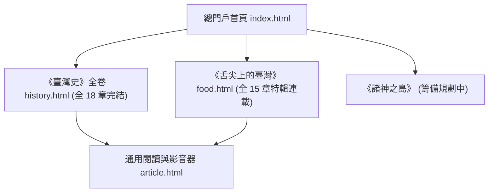

# 臺灣數位文庫總門戶 (Formosa Cultural Archives)

[](https://clive520.github.io/taiwan-history/)
[](LICENSE)

專為大眾與文史愛好者打造的新一代臺灣文史與風土數位典藏總門戶。融會嚴謹的第一手史料考證、高畫質油畫視覺、4K 深度影音說明短片與 NotebookLM 雙人播客對談，以現代網頁技術提供沉浸式探索體驗。

---

## 🏛️ 文庫專題大系 (Curated Series)



### 1. 📜《臺灣史》全卷（FormosaChronicles）—— 全 18 章完結典藏
橫跨史前長濱文化、荷西大員、鄭氏東寧、清領渡海、日治現代化血淚、戰後二二八與民主浪潮，直至新竹科學園區與台積電半導體矽島傳奇。
- **網頁入口**：[`history.html`](https://clive520.github.io/taiwan-history/history.html)
- **規格標準**：18 篇長卷、18 份史料考證專卷、18 支 4K 影片、18 集雙人播客、Leaflet 時空地理地圖。

### 2. 🍲《舌尖上的臺灣》（FormosaGastronomy）—— 全 15 章飲食特輯連載
以食物為密碼，解構四百年文化融合。從部落小米馬告、大航海蔗糖鹽田，到鹿港百年黑豬肉臊、善化溫體牛、眷村牛肉麵、珍珠奶茶傳奇，直至米其林新臺菜復興。
- **網頁入口**：[`food.html`](https://clive520.github.io/taiwan-history/food.html)
- **規格標準**：15 道經典風土料理、5 大歷史演進篇章、20+ 核心原生食材、全臺風土食材起源地圖、影音說明片與深度對談播客。

---

## 🌟 數位文庫核心特色

1. **多維互動探索**：
   - **目錄網格模式（Catalog Grid）**：精緻卡片呈現各篇章專題、核心食材與時代摘要。
   - **時間流變軸模式（Timeline）**：視覺化臺灣四百年文明與飲食習慣的時間縱深。
   - **空間地圖模式（Leaflet Interactive Map）**：以 WGS84 經緯度標記全臺歷史現場與風土發源地。
2. **多媒體影音雙規格全對應**：
   - **4K 重點精華解說影片**：結合史料考證與流暢旁白，搭配字詞級繁體中文字幕與 YouTube 排程。
   - **NotebookLM 深度雙人對談播客**：兩位主持人從考古、文獻、民俗與全球視角深度剖析。
3. **學術嚴謹考證與開放文庫**：
   - 完整收錄一手檔案、總督府文獻、專有名詞考證表與學術論文引用。

---

## 🗺️ 專題章節總覽

### 《臺灣史》18 章全集

| 時期 | 章節 | 名稱 | 時代背景 | 核心地點 (WGS84) |
| :--- | :--- | :--- | :--- | :--- |
| **第一時期：史前文明與南島之源** | 第 01 章 | [黑潮上的遠古足跡](article.html?series=history&id=ch01) | 舊石器時代晚期 | 臺東長濱八仙洞 |
| | 第 02 章 | [大海是唯一的路徑](article.html?series=history&id=ch02) | 新石器至鐵器時代 | 新北八里十三行 |
| | 第 03 章 | [部落聯盟與土地精靈](article.html?series=history&id=ch03) | 早期接觸至17世紀 | 臺中大肚山大肚王國 |
| **第二時期：大航海時代與荷西競逐** | 第 04 章 | [巨艦、紅毛與交會之島](article.html?series=history&id=ch04) | 1624–1662 年 | 臺南熱蘭遮城 |
| | 第 05 章 | [西班牙的聖多明哥與硫磺之道](article.html?series=history&id=ch05) | 1626–1642 年 | 基隆和平島聖薩爾瓦多 |
| | 第 06 章 | [鹿皮、轉口港與宣教十字架](article.html?series=history&id=ch06) | 1630–1660 年代 | 臺南普羅民遮城 |
| **第三時期：明鄭東寧與海上孤忠** | 第 07 章 | [旌旗渡海赤崁降](article.html?series=history&id=ch07) | 1661–1662 年 | 臺南鹿耳門 |
| | 第 08 章 | [寓兵於農與全臺首學](article.html?series=history&id=ch08) | 1662–1683 年 | 臺南孔廟 |
| | 第 09 章 | [澎湖海戰與孤島落日](article.html?series=history&id=ch09) | 1683 年 | 澎湖馬公風櫃尾 |
| **第四時期：清領時代的拓墾烽火與變革** | 第 10 章 | [渡臺悲歌與黑水溝](article.html?series=history&id=ch10) | 1684–1780 年代 | 彰化鹿港水門港 |
| | 第 11 章 | [開圳引水沃野千里](article.html?series=history&id=ch11) | 1709–1850 年代 | 彰化八堡圳與瑠公圳 |
| | 第 12 章 | [械鬥、民變與義民旗](article.html?series=history&id=ch12) | 1720–1860 年代 | 新竹新埔枋寮義民廟 |
| | 第 13 章 | [開港通商與茶糖金磚](article.html?series=history&id=ch13) | 1860–1890 年代 | 臺北淡水大稻埕 |
| | 第 14 章 | [牡丹社事件與洋務建省](article.html?series=history&id=ch14) | 1874–1895 年 | 屏東石門古戰場與臺北府城 |
| **第五時期：日治時期的統治轉型與抗爭** | 第 15 章 | [乙未抗日與殖民體制](article.html?series=history&id=ch15) | 1895–1915 年 | 彰化八卦山與苗栗銅鑼 |
| | 第 16 章 | [糖廠煙囪、縱貫鐵道與嘉南大圳](article.html?series=history&id=ch16) | 1908–1930 年代 | 臺南烏山頭水庫 |
| | 第 17 章 | [自治呼聲、文化協會與啟蒙巨浪](article.html?series=history&id=ch17) | 1920–1937 年 | 臺北靜修女中與大安醫院 |
| **第六時期：戰後重構、民主浪潮與矽島傳奇**| 第 18 章 | [矽島崛起與世界舞台](article.html?series=history&id=ch18) | 1945 年迄今 | 新竹科學園區與二二八公園 |

### 《舌尖上的臺灣》15 章特輯

| 篇章 | 章節 | 專題名稱 | 核心食材與標籤 | 核心坐標 |
| :--- | :--- | :--- | :--- | :--- |
| **第一篇：山海風土與島嶼原味** | 第 01 章 | [粟米、野豬與香料火種](article.html?series=food&id=ch01) | 小米、Cinavu、馬告、刺蔥 | 屏東三地門排灣部落 |
| | 第 02 章 | [大航海的蔗香與鹿皮](article.html?series=food&id=ch02) | 甘蔗、黑糖、鹿肉乾、荷蘭豆 | 臺南安平熱蘭遮城周邊 |
| | 第 03 章 | [黑水溝的鹹香與烏金](article.html?series=food&id=ch03) | 烏魚子、七股鹽田、柴魚乾 | 臺南七股瓦盤鹽田 |
| **第二篇：唐山渡海與閩粵交融** | 第 04 章 | [一碗肉臊的百年身世](article.html?series=food&id=ch04) | 肉燥飯、黑豬肉、紅蔥頭、黑豆蔭油 | 彰化鹿港舊街市 |
| | 第 05 章 | [水牛禁忌與清晨的甘甜](article.html?series=food&id=ch05) | 善化溫體牛、牛墟、大骨清湯 | 臺南善化牛墟 |
| | 第 06 章 | [芥菜、米粄與乾坤日曬](article.html?series=food&id=ch06) | 福菜、梅干扣肉、粄條、擂茶 | 苗栗公館客家聚落 |
| **第三篇：東洋折衷與現代摩登** | 第 07 章 | [一碗拉麵與洋食風潮](article.html?series=food&id=ch07) | 咖哩、炸豬排、天婦羅、和洋折衷 | 臺北榮町衡陽路 |
| | 第 08 章 | [糖鐵悠悠與蓬萊香氣](article.html?series=food&id=ch08) | 蓬萊米、磯永吉、白糖糖廠 | 臺中霧峰農試所 |
| | 第 09 章 | [洋樓裡的福爾摩沙香氣](article.html?series=food&id=ch09) | Formosa Oolong、文山包種、茶郊 | 臺北大稻埕貴德街 |
| **第四篇：眷村融匯與夜市繁花** | 第 10 章 | [烽火漂泊與竹籬笆香](article.html?series=food&id=ch10) | 眷村燒餅、豆腐乳、臘肉、合菜 | 高雄左營海軍眷村 |
| | 第 11 章 | [川味紅燒的臺灣身世](article.html?series=food&id=ch11) | 岡山辣豆瓣醬、川味紅燒牛肉麵 | 高雄岡山眷村與臺北桃源街 |
| | 第 12 章 | [野台鑼鼓與澎湃盛宴](article.html?series=food&id=ch12) | 總舖師、紅蟳米糕、封肉、辦桌 | 臺南內門總舖師聚落 |
| | 第 13 章 | [小吃攤裡的島嶼經濟奇蹟](article.html?series=food&id=ch13) | 蚵仔煎、地瓜粉、生炒花枝、夜市 | 臺北士林夜市與基隆廟口 |
| **第五篇：島嶼綻放與世界舞台** | 第 14 章 | [黑色珍珠的全球狂潮](article.html?series=food&id=ch14) | 珍珠奶茶、粉圓、手搖飲、茶飲冷鏈 | 臺中春水堂與臺南翰林茶館 |
| | 第 15 章 | [當代風土的米其林交響](article.html?series=food&id=ch15) | 新臺菜、在地風土、發酵食材、RAW | 臺北市大安區新臺菜旗艦 |

---

## 💻 本地端運行

本專案採現代 Vanilla Web 技術開發，無需複雜 Node.js 編譯流程，純靜態即可秒級運行：

```bash
# 複製專案
git clone https://github.com/clive520/taiwan-history.git
cd taiwan-history

# 啟動本地端靜態伺服器 (範例以 Python)
python -m http.server 8000
```
開啟瀏覽器訪問 `http://localhost:8000` 即可探索全臺灣數位文庫總門戶。

---

## 📜 專案版權
- **文字與歷史考證內容**：採用 [CC BY-NC-SA 4.0](https://creativecommons.org/licenses/by-nc-sa/4.0/deed.zh-tw) 創用 CC 姓名標示-非商業性-相同方式分享 4.0 國際授權條款。
- **原始碼**：採用 MIT 授權條款。
