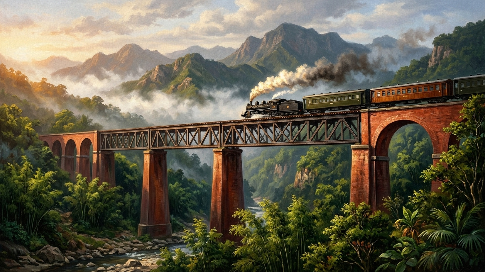

# 第 02 章 南北貫通的一日革命——長谷川謹介、后里斷崖與縱貫線全通

> **時代座標**：明治二十八年（1895）至明治四十一年（1908）  
> **地理定位**：苗栗三義魚藤坪鐵橋（WGS84: 24.3583°N, 120.7722°E）、勝興車站（十六份標高 402.326m）、大安溪鐵橋、大甲溪鐵橋、臺中公園湖心亭  
> **核心圖騰**：長谷川謹介「速成延長主義」、無鋼筋紅磚拱券魚藤坪橋、十孔華倫式鋼桁梁大安溪橋、1908 年 10 月 24 日全通式紀念  
> **影視規格**：4K 劇院級分鏡腳本 &bull; 雙人對談學術播客 &bull; 4 大技術史深度對照表

---

## 導言：將破碎島嶼焊鑄成一條鋼鐵脊柱

明治四十一年（1908）十月二十四日清晨，秋高氣爽的臺中大墩公園（今臺中公園）四周萬人空巷。日月湖清澈的湖面上倒映著一座剛剛落成、融合歐洲維多利亞雙尖頂與日本和式簷廊的水上涼亭——「**湖心亭**」。來自東京的日本皇室閒院宮載仁親王端坐御席，身旁站著臺灣總督佐久間左馬太、遞信大臣後藤新平，以及鬢髮斑白卻眼神炯炯有神的鐵道部長**長谷川謹介**。

上午九時正，伴隨著禮砲與數千名穿戴大禮服的日臺紳商如雷般的歡呼聲，兩列披掛紅白綢緞與萬國旗幟的特別奉祝列車，分別自基隆港與打狗港（高雄）鳴笛相向貫通會師，停靠在臺中街頭的紅磚站台。



這不只是一條 404.2 公里鐵路完工的剪綵典禮，而是臺灣歷史上第一次實質意義的**「空間統一」與「時間革命」**。

在長谷川謹介接掌這項大工程之前的數百年裡，臺灣是一座「被大河與斷崖切成數十塊」的破碎之島：從臺北盆地前往臺南府城，商旅與軍隊得在泥濘古道上徒步跋涉半個月，遇見大安溪或濁水溪夏秋山洪暴發，動輒滯留溪畔半月、甚至溺斃激流。南部府城與北部大稻埕各自面向福州與廈門通商，彼此竟像兩個互不相屬的孤島。

然而，就在這短短九年之間，日本鐵道技術官僚與數萬名臺灣本地土工，用鋼釬鑿穿了苗栗關刀山脈的破碎岩盤，用糯米石灰砌出了五十公尺高的紅磚天橋，更以鐵籠巨石鎖住了大安溪、大甲溪的狂暴山洪。從 1908 年這一天起，「早上在臺北吃早茶、晚上在高雄港看夕陽」的**十四小時一日生活圈**正式誕生。這是一部以血肉、力學與實用主義寫成的空間征服史詩。

---

## 第一節 乙未狼狽與「速成延長主義」的哲學

### 一、 臨時臺灣鐵道隊接手的「半身不遂」清代舊線
1895 年五月，日軍隨《馬關條約》登陸澳底展開乙未征臺戰事。隨行渡海的「**臨時臺灣鐵道隊**」在陸軍工兵大佐山根武亮率領下，接管了劉銘傳與邵友濂時期遺留的基隆—臺北—新竹路段（總長 106.7 公里）。

然而，當這批受過德國近代鐵道系統訓練的日本軍事工程師實地踏勘後，卻大吃一驚。根據《臺灣鐵道史》（上卷）檔案記載，清代舊線面臨極端致命的工程缺陷：
1. **坡度與彎道的極限壓迫**：基隆獅球嶺隧道區段坡度高達千分之三十三（33‰），且因當年穿鑿軸線偏差四公尺而在山心形成急彎；龜崙嶺路段（新莊—桃園間）曲率半徑過窄，導致日軍調來的日本國鐵 18 型蒸機屢屢爬坡無力或輪緣脫軌。
2. **脆弱路基與腐朽便橋**：桃園台地與大漢溪畔的木造橋梁經長年颱風雨水浸蝕，早已腐朽傾斜；1896 年一場夏秋強颱更徹底沖斷大漢溪橋與多處路堤，北部鐵路一度淪為「靠工人人力推著木板台車（手押車）過橋接駁」的半癱瘓窘境。
3. **軍事輕便鐵道的應急**：由於南進討伐軍情急迫，日軍只得在臺南與打狗（高雄）、新竹至彰化之間急就章鋪設 495mm / 762mm 窄軌「軍用輕便軌」，形成全島南北軌道各自孤立的局面。

### 二、 二千八百八十萬圓豪賭與「鐵道部長」長谷川謹介
轉捩點發生於 1898 年。第四任臺灣總督兒玉源太郎與民政長官後藤新平走馬上任。這位擁有醫學博士背景的政治策略家深知，臺灣這塊「殖民地新領土」若無法在十年內實現財政自主，東京帝國議會必將因不堪每年數百萬日圓的鉅額補貼而醞釀「賣掉臺灣（臺灣賣卻論）」。

「要讓砂糖、稻米、樟腦與煤炭變成滾滾黃金，就必須先打通全島的鋼鐵血管！」

1899 年，後藤新平成功說服東京國會通過《臺灣事業公債法》，豪氣舉債 **3,500 萬日圓**，其中竟將高達 **2,880 萬日圓**（佔公債總額逾 82%）全數砸向「縱貫鐵道建設費」與基隆築港工程，並正式裁撤軍方的臨時鐵道隊，成立權力直屬總督府的**「臺灣總督府鐵道部」**。

後藤新平親自從日本本土重金延攬了當時日本土木界最具傳奇色彩的實戰派總工——**長谷川謹介**（Hasegawa Kinsuke，1855–1921），出任鐵道部首任技師長兼部長。

長谷川謹介曾主持日本山陽鐵道與東海道線最艱險的逢坂山開鑿，深諳歐美與明治工程實務。面對臺灣「預算看緊、地質脆弱、河川如猛獸、瘴癘肆虐」的四重絕境，長谷川謹介拋開歐美工程教科書的學院派潔癖，提出了一個寫入臺灣科技史的務實戰略——**「速成延長主義」**。

### 三、 何謂「速成延長主義」？（以戰養戰的工程博弈）
傳統「完美主義」鐵道建設，主張每一公里路基、每一座大跨距鋼橋、每一條磚石隧道皆須一步到位建成永久構造後才准通車；但長谷川謹介清楚，若照此標準等待十年未見一毛錢營收，日本議會早就凍結預算！

因此，「速成延長主義」祭出三大狠招：
1. **先改線、搶通平原段**：果斷放棄劉銘傳的獅球嶺隧道（改鑿坡度僅 10‰ 的**竹仔嶺隧道**）與龜崙嶺急彎（改經 **鶯歌—桃園—中壢** 路線），迅速提升北部運輸效率。同時採取「**南北對進**」策略：北線自臺北向南延伸至苗栗，南線自高雄打狗港向北狂推（1900 年抵臺南、1904 年抵彰化、1905 年抵葫蘆墩／豐原），利用南臺灣平坦嘉南平原「月鋪數十公里」的神速，把全臺最肥沃的糖米產區立刻接入鐵道網！
2. **「先假橋、後永久橋」的滾動造血**：遇到大安溪、大甲溪、濁水溪等暴漲巨川，長谷川不等耗時三年的大型鋼鐵沉箱完工，直接在河床上打入原木樁架設「**臨時木造便橋**」（若遇洪水沖毀就先用鐵道部汽船擺渡，水退三天內搶修重通），確保列車當月就能售票運貨、賺取現金流！
3. **「伯公坑斜坡索道」的奇兵應急**：面對最後一塊硬骨頭——苗栗三義至大安溪之間的陡峭山區，在九座永久隧道尚需四年才能鑿穿的情況下，長谷川下令在 1904 年直接建造長達 1.6 公里的**「伯公坑斜坡索道（Incline）」**：利用山頂兩部大型蒸汽絞盤機拖曳鋼索，讓整節貨車廂直接沿著超過千分之百的峭壁斜坡「一升一降」，硬生生在隧道未通前就把南北鐵路接上了臨時輸血線！

這套「邊蓋邊賺、邊賺邊換永久設施」的戰略，不僅穩住了龐大的資本支出，更讓縱貫線奇蹟般地提前兩年完成全線串聯。

---

## 第二節 穿入地心與雲端：舊山線魔鬼路段與十六份極限

到 1905 年為止，縱貫線北起基隆、南抵高雄，幾乎已全線通車——唯一斷裂在中部的二十餘公里荒山峽谷之間：**北至苗栗三叉河（今三義），南抵臺中葫蘆墩（今豐原）**。這正是後世鐵道迷口中流傳百年的神聖殿堂——**「舊山線」**。

### 一、 歷史抉擇：為何不走平坦海線，偏要死磕苗栗山線？
當時鐵道部內部曾激辯：苗栗以南究竟應該沿著大甲、沙鹿沿海平原推進（海線），還是強行切入關刀山脈、跨越大安溪與大甲溪上游深谷（山線）？
後藤新平與長谷川謹介最終拍板「**先山後海**」，背後隱藏著精準的地緣政治與工程計算：
- **經濟腹地與政治核心**：清代以來臺灣中部最富庶的稻米、樟腦、絲茶產地盡在苗栗、豐原（葫蘆墩）、臺中（大墩）與彰化內陸盆地。後藤新平更計畫將地理居中的臺中打造成「中臺灣近代首都」，鐵路絕不能過門不入。
- **海岸飛沙與防務脆弱**：20 世紀初西部海岸線缺乏防風林保護，冬季強勁的東北季風捲起海沙，極易掩埋軌道與輪軸；此外沿海暴露於海上艦砲射程之內，國防風險過高。

於是，人類與臺灣山川地質最慘烈的一次交鋒，在苗栗三義至臺中后里之間全面引爆。

### 二、 十六份（勝興）：402 公尺高空分水嶺與九座隧道群
為了從海平面高度一路爬上關刀山脈與大安溪之間的嶺線，工程隊從苗栗銅鑼開始即連續採用千分之二十五至二十六（25‰～26‰）的極限爬坡。列車一路嘶吼攀升，最終抵達縱貫線的最高點——**十六份車站（今苗栗勝興車站），標高 402.326 公尺**。

在接下來的十餘公里下坡與斷崖路線中，地形急轉直下，兩旁盡是脆弱的第三紀泥岩、頁岩與礫岩層，中間還夾雜著景山溪、鯉魚潭與大安溪切出的深邃峽谷。工程師沒有退路，只能在短短 15 公里內，連續開鑿了 **九座隧道**（一號至九號隧道，總長度達 4.4 公里以上）：
- **二號隧道（開天隧道）**：長 726 公尺，貫穿十六份南端分水嶺，洞內湧水如注、毒氣瀰漫。
- **九號隧道（今三義—后里間，1,269 公尺）**：舊山線最長隧道，穿越脆弱礫岩與湧水砂岩交界帶。由於工期緊迫，工程隊引進當年最新式的空氣壓縮鑿岩機與高威力硝化甘油炸藥（Dynamite），配合人工日夜三班輪換掘進。
- **血肉代價**：隧道開鑿期間，礫岩塌方與瓦斯爆炸頻繁發生，加之苗栗山谷惡性瘧疾橫行，日本技師與臺灣本地土工死傷逾數百人。在今日勝興至泰安的山嶺草叢間，仍長眠著無數默默無聞的築路魂靈。

---

## 第三節 鋼鐵與紅磚的力學奇觀：魚藤坪與三大暴川巨構

當火車衝出黑暗潮濕的隧道群，迎接它的，是深達數十公尺的百尺斷崖與巨石奔流的狂暴溪谷。在這片大地上，長谷川謹介團隊留下了臺灣近代工程史上最震撼的結構力學藝術品。

### 一、 魚藤坪鐵橋（龍騰斷橋）：不用鋼筋水泥的紅磚拱穹
跨越三義魚藤坪溪深谷的**魚藤坪鐵橋**（1906 年 2 月動工、1907 年 5 月竣工），全長約 200 公尺，橋面距溪谷高達 **50 公尺**（相當於十六層樓高！）。它的建築結構是當年東亞土木界極少見的「**磚拱與鋼桁梁混成高架橋**」：

```text
                    魚藤坪鐵橋（1907 年原貌）工程結構立面示意圖

       [北端：6 座紅磚實心拱券]     [中央谷心：鋼鐵桁梁跨越]     [南端：4 座紅磚實心拱券]
  ────┬───┬───┬───┬───┬───┬───┬═══════════════════════┬───┬───┬───┬───┬────
      │ ∩ │ ∩ │ ∩ │ ∩ │ ∩ │ ∩ │   鐵製上承式鋼鈑/桁梁跨距   │ ∩ │ ∩ │ ∩ │ ∩ │
      │   │   │   │   │   │   │   ╱╲╱╲╱╲╱╲╱╲╱╲╱╲╱╲╱╲╱╲╱╲╱   │   │   │   │   │
      │   │   │   │   │   │   │  │石│               │石│  │   │   │   │   │
      │磚 │磚 │磚 │磚 │磚 │磚 │  │砌│    魚藤坪     │砌│  │磚 │磚 │磚 │磚 │
  ────┴───┴───┴───┴───┴───┴──┴──┴──  深  谷  ──┴──┴──┴───┴───┴───┴───┴────
  * 粘著劑：糯米汁 + 紅糖漿 + 熟石灰（無任何一根鋼筋與水泥）
  * 承重架構：紅磚拱券承接垂直壓應力，花崗石條作為基座與拱頂鎖石
```

這座大橋的建造工藝令現代工程師亦嘆為觀止：
1. **傳統智慧的極致轉化**：全橋南北兩端高達十座高聳橋墩與連續圓拱，完全**沒有使用一根鋼筋與一滴水泥**！總督府技師向參與施工的廣東籍與臺灣漢人傳統大木、泥水匠師取經，研發出極高韌性的「**糯米石灰紅糖漿**」（將糯米蒸熟搗爛取汁，混合紅糖漿與熟石灰、砂土製成三合土砂漿）。這種有機高分子多醣體在硬化後形成緻密結晶，不僅抗壓強度驚人，更擁有優良的抗滲透防潮力。
2. **精準的拱券壓應力分配**：每一座磚拱皆經過精密幾何放樣，由關刀山開採的堅硬花崗岩雕鑿成楔形「拱頂鎖石」（Keystone）嵌於頂端，將數百公噸重的蒸汽機車向下壓應力，完美傳導至兩側巨大的石砌柱礎與山岩之中。
3. **跨谷鋼鐵飛虹**：中央地勢最險峻、水深流急無法立柱之處，則直接架設英國與美國進口的高強度鋼鈑梁（Deck Plate Girder）與桁梁，宛如紅磚古城與西方鋼鐵文明的世紀握手。
4. **震後斷橋的永恆悲歌**：1935 年 4 月 21 日清晨，中部關刀山發生規模 7.1 級毀滅性強震（新竹—臺中州大震災）。由於這種剛性磚砌拱橋極耐「垂直壓力」卻無法承受劇烈的「水平剪力震盪」，魚藤坪鐵橋中段上層鋼梁與磚拱應聲齊腰斷裂墜入谷底，唯有最底部的巨大花崗岩柱礎與斷折紅磚弧線奇蹟般留存下來。1938 年日方於西側另建鋼骨水泥新橋，舊橋遺址則化身為今日名聞遐邇的「**龍騰斷橋**」，成為時間與地震刻在山谷裡的不朽紀念碑。

### 二、 降伏三大「暴川」：大安溪、大甲溪與濁水溪的抗洪工程
穿過魚藤坪後，火車緊接著必須連續橫越臺灣西岸坡度最陡、洪水最猛的三條惡名昭彰河川——大安溪、大甲溪與濁水溪。日本水文專家當年視察後，驚駭地發明了一個詞來形容臺灣溪流：**「暴川（Abare-kawa）」**——平時乾涸見底、滿布人頭大小卵石，一旦颱風豪雨降臨，數小時內水位即可暴漲十公尺，洪水挾帶千斤巨石如千軍萬馬衝撞橋墩，傳統木橋或單柱鐵橋往往在一夜間消失無蹤！

面對大自然最狂暴的挑戰，長谷川謹介團隊交出了三份世界級的結構工程答卷：

1. **大安溪鐵橋（1908 年 2 月竣工，全長 637.39 公尺）**：
   - **架構**：採 **10 孔下承式華倫式鋼桁梁（Through Warren Truss）**，每孔跨距高達 62.4 公尺，如十座巨大的鋼鐵鳥籠相接橫跨於火炎山南麓的寬闊礫石河床上。
   - **深層沉箱（Caisson）工法**：工人以鋼鐵或磚砌圓筒沉箱（井筒），從中不斷挖出卵石與泥沙使箱體依靠自重下沉，直抵河床下十餘公尺堅硬的第三紀岩盤後再灌注混凝土封底。橋墩上方迎水面更以厚重花崗岩砌出「船首形尖端破水角」，能硬生生剖開衝擊而來的山洪與巨木。
2. **大甲溪鐵橋（1908 年 2 月竣工，全長 382 公尺）**：
   - **架構**：6 孔下承式花梁鋼橋，造型優雅剛健，如今依然作為「后豐鐵馬道」的核心地標屹立溪畔。
   - **蛇籠（石籠 Gabion）治水奇術**：為了防止河道隨洪水左右改道沖毀橋台，工程師採取在地材料哲學——將數千噸河床圓形卵石裝填進編織緊密的粗竹籠與鐵絲網籠內，層層堆疊成具有高度透水性與柔韌變形能力的「防洪護岸石籠堤防」。當洪水掏刷河底時，石籠能順應地形下沉貼合，死死咬住橋基不致崩潰。
3. **濁水溪鐵橋（1905 假橋、1911 年永久鋼橋竣工，全長 916 公尺）**：
   - 濁水溪是全臺最長且含沙量最高的巨川，河床寬達數公里且辮狀流路終年游移。1908 年全通之初，鐵道部依循長谷川「速成延長主義」，在枯水期先架設綿延兩公里的木造便橋通車；夏秋汛期洪水沖斷木橋時，則調派鐵道部專屬蒸氣渡船在南北兩端河岸接駁旅客！直到全通後三年（1911 年），長達 916 公尺、計 14 孔（後擴建）的永久性鋼桁梁大鐵橋才終於完全竣工，徹底根絕「黑水濁水阻斷南北」的千年困境。

---

## 第四節 1908 年的偉大時刻：南北會師與空間一體化革命

### 一、 四月二十日，最後一顆道釘的敲響
明治四十一年（1908）**4 月 20 日**，是一個銘刻在臺灣文明肌理上的關鍵日期。
隨著最後一段極艱難的「三叉河（三義）—后里—葫蘆墩（豐原）」區間軌條鋪設完畢並鎖緊魚尾板螺栓，北起基隆港、南迄打狗港（高雄），全長 **404.2 公里**（247.1 英里）的臺灣縱貫線鐵道正式宣告全線實質貫通！

整個建設歷時整整九年（1899–1908），總工程決算出人意料地低於原本編列的 2,880 萬預算，實支約 **2,764 萬日圓**——這在近代殖民地大型土木工程史上極為罕見，堪稱長谷川謹介務實工程管理學的巔峰典範。

### 二、 十月二十四日：臺中公園全通式與「湖心亭」的歷史見證
半年後的明治四十一年（1908）**10 月 24 日**，臺灣總督府在全島幾何與地理心臟地帶——「**臺中公園**」，隆重舉行了震動東亞的**「臺灣縱貫鐵道全通式」**。

為了迎接遠道而來主持大典的日本皇室成員——**閒院宮載仁親王**（時任日本帝國鐵道協會總裁），臺中廳與鐵道部特別在公園日月湖上興建了一座精緻絕倫的雙併式涼亭作為親王休憩觀禮的「御休憩所」，這便是今日臺中市的百年核心精神地標——**「湖心亭」**。

典禮當日盛況空前：
- **三巨頭會首**：佐久間左馬太總督、已高升日本遞信大臣（交通大臣）但仍專程回臺見證夢想成真的後藤新平，以及鐵道部長長谷川謹介並肩站在台前。後藤新平看著縱貫線的貫通報告，據傳感嘆道：「這條鐵道不僅連接了基隆與打狗，更將臺灣人的時間觀念與世界連在了一起。」
- **特設紀念郵戳與高價便當**：各地士紳名流（林獻堂、辜顯榮、李春生等）身穿禮服從全臺各地搭乘專車湧入臺中街頭。當日全臺發行了史上首套「縱貫鐵道全通紀念明信片」，火車月台上出現了包裝精緻的日式木片便當，汽笛鳴響與萬歲歡呼震徹中部平原。

### 三、 「一日革命」如何永久改寫臺灣的空間、時間與政治基因？
縱貫線的貫通，究竟在物理與社會層面上改變了什麼？我們可以從三個維度來解剖這場「一日革命」：

1. **時空縮尺的暴烈壓縮（15 天 $\rightarrow$ 14 小時）**：
   在 1895 年以前，清代官方文書紀錄臺北往返臺南需「八日至十五日」，而且夏秋遇洪水動輒中斷；清末劉銘傳修到新竹後仍須靠轎夫與輕便車翻山越嶺。1908 年全通後，鐵道部立即開行「**晝夜直通急行列車**」：早晨五點半自基隆出發，傍晚七點五十分即抵達高雄打狗，全島縱走從半個月濃縮為短短 **14 小時 20 分鐘**！過去「天涯海角」的北港媽祖進香團、南部糖商赴大稻埕洽談洋行貿易，第一次變成「一日來回或隔日返家」的常態生活。
2. **「中部大都會臺中」的橫空出世**：
   清代的臺灣政治商業核心在南端的「一府（臺南）」、中部的「二鹿（鹿港）」與北端的「三艋舺／大稻埕」。鹿港因海岸淤積而沒落，但內陸的「臺中大墩」原是清末劉銘傳想建省城卻半途而廢的荒蕪村落。1908 年縱貫線選擇走山線穿過臺中，並於此舉行全通式，徹底確立了臺中市成為**中臺灣近代工商業與交通樞紐**的歷史地位。
3. **「全島共同體」意識的催生器**：
   這或許是殖民統治者始料未及的歷史副產品。縱貫鐵道原本是為了方便日本軍警鎮壓與榨取米糖資源而修築的帝國血管；然而，當鋼軌將散落全島的閩南、客家、平埔與各地知識青年連成一體後，一種超越地域、方言與族群藩籬的「**全臺灣人整體感（Pan-Taiwan Identity）**」開始在車廂裡發酵！
   十多年後的 1920 年代，林獻堂、蔣渭水發起「臺灣文化協會」與「臺灣議會設置請願運動」，全島巡迴演講團成員正是提著皮箱搭上縱貫線火車，上午在臺北大稻埕發表演說，下午兩點準時在臺中醉月樓聚會，傍晚七點已在臺南公會堂面對數千名聽眾演講。鋼軌不僅運送了糖與米，更運送了近代民主、自由與自主思想的火種。

---

## 結語：鋼鐵龍骨上的百年凝望

今日，當你站在苗栗三義山谷中，仰望經歷 1935 年關刀山地震後依然巍然聳立的龍騰斷橋紅磚拱墩；或乘著後豐鐵馬道的微風騎過百年大甲溪花梁鋼橋；亦或坐在臺中公園湖心亭旁看著波光瀲灩——請試著側耳傾聽一百一十八年前那聲劃破全島的蒸汽鳴響。

那是劉銘傳遺留的火種，在長谷川謹介務實而剛毅的手中，歷經無數工匠在黑暗隧道與暴漲溪谷間用命搏殺，終於為臺灣鍛造出一副不可撼動的鋼鐵龍骨。這副龍骨將原本支離破碎的海洋村落與流域盆地緊密焊死在一起，從此讓「臺灣」成為一個休戚與共、命運相連的現代時空共同體。

然而，鐵道不僅連接了南北大都會，它接下來還必須把帝國的現代性，刻進每一座城鎮日常生活的視覺中心——一場關於車站建築美學與都市空間秩序馴化的新篇章，正準備在新竹與臺中車站的巴洛克鐘樓下，緩緩拉開序幕。

---

## 附錄一：第 02 章四大技術史與社會經濟深度對照表

### 表 1：清代官鐵與日治縱貫線工程規格與戰略對比表
| 比較維度 | 清代臺灣官鐵（劉銘傳—邵友濂） | 日治縱貫鐵道（臺灣總督府鐵道部） | 歷史演進與技術意涵 |
| :--- | :--- | :--- | :--- |
| **興建年代** | 1887 – 1893（歷時 6 年半） | 1899 – 1908（歷時 9 年全通） | 從海防應急轉向全島產業殖民與國家系統整合 |
| **實際通車長度** | 106.7 km（基隆 — 新竹） | **404.2 km**（基隆 — 打狗高雄） | 正式完成全島南北空間物理連接 |
| **標準軌距** | 1,067 mm（3 呎 6 吋窄軌） | **1,067 mm**（承襲統一規格） | 確保百年臺鐵環島路網免於雙軌距換軌困擾 |
| **最大坡度控制** | 高達 33‰（獅球嶺急坡） | 嚴格控制於 **25‰～26‰（舊山線）**<br>北部改良線降至 10‰ | 透過開鑿長大隧道與改線大幅提升牽引噸數 |
| **工程哲學** | 受限財政枯竭、技術依賴外籍技師 | **長谷川謹介「速成延長主義」** | 「先假橋/索道搶通營利，後換永久構造」實現財政自足 |
| **建設總經費** | 約銀 129 萬兩 | 決算 **2,764 萬日圓**（低於預算 2,880 萬） | 近代科學化預算管理與大規模公債融資之勝利 |

### 表 2：舊山線暨中臺灣四大艱險工程數據全覽表
| 工程名稱 | 地理座標與區間 | 核心結構與規模 | 工程最大難題 | 解題關鍵技術 |
| :--- | :--- | :--- | :--- | :--- |
| **十六份（勝興站）及九座隧道群** | 苗栗三義 — 泰安<br>海拔 **402.326 m** | 縱貫線最高點<br>9 座隧道（九號隧道長 1,269 m） | 第三紀破碎頁岩與泥岩、高地溫與湧水塌方 | 分層多段進洞、硝化甘油高能炸藥與壓縮空氣鑿岩機 |
| **伯公坑斜坡索道（Incline）** | 苗栗三叉河 — 大安溪北岸 | 全長約 **1.6 km**<br>最大坡度 > 100‰ | 山線隧道未通前的南北物資大斷層 | 固定式雙鼓蒸汽絞盤機搭配高強度鋼索雙向對拉吊掛 |
| **魚藤坪鐵橋（龍騰斷橋）** | 苗栗三義鄉魚藤坪溪谷 | 長約 200 m，高 **50 m**<br>10 座紅磚拱 + 4 座鋼鈑梁 | 高聳深谷施工，缺乏足量水泥與鋼筋運補 | **糯米汁 + 紅糖漿 + 熟石灰**三合土砂漿精砌關刀山石條與紅磚 |
| **大安溪 & 大甲溪鐵橋** | 后里台地南北兩端溪谷 | 大安溪：637.39 m（10 孔桁梁）<br>大甲溪：382 m（6 孔桁梁） | 「暴川」夏秋猛烈山洪與千斤巨石衝擊 | 深層沉箱（Caisson）直抵岩盤、尖端破水花崗岩墩與**蛇籠防洪堤** |

### 表 3：1908 年縱貫線代表性新式蒸汽機車規格表
| 車型代號（鐵道部） | 製造廠與年份 | 軸式輪配置 | 整備重量 | 動輪直徑 | 在縱貫線擔任的歷史任務 |
| :--- | :--- | :---: | :---: | :---: | :--- |
| **18 形（後臺鐵 BK10）** | 英國 Nasmyth Wilson / 美國 Baldwin（1895–1904） | 2-4-2T 水櫃式 | 32.5 噸 | 1,245 mm | 乙未接收後北部與南部早期主力客貨牽引機車 |
| **50 形（後臺鐵 CK50）** | 美國 Schenectady / 英國 Dübs（1901–1908） | **2-6-2T** 水櫃式 | **42.7 噸** | 1,245 mm | 六顆動輪高牽引力，專為征服 **25‰ 舊山線極限爬坡**而生 |
| **80 形（後臺鐵 CK80）** | 英國 North British（1908） | 2-6-2T 水櫃式 | 48.2 噸 | 1,245 mm | 1908 全通初期強化版本，可重聯牽引行駛南北貫通幹線 |
| **100 形（後臺鐵 EC40 前身預備期）/ 200 形煤水車型** | 美國 Alco / 德國 Borsig | 4-6-0 煤水車式 | 60+ 噸 | 1,370 mm | 負責全通後臺北—臺中—高雄「晝夜直通急行列車」長距離高速巡航 |

### 表 4：縱貫線全通前後「全島時空縮尺與經濟旅運」變革表
| 起訖區間 | 清末傳統陸路 / 海路耗時 | 1908 縱貫線全通後列車耗時 | 壓縮倍數 | 社會經濟與文化結構衝擊 |
| :--- | :---: | :---: | :---: | :--- |
| **基隆 $\leftrightarrow$ 打狗（高雄）** | 徒步 15–20 日<br>帆船 5–10 日（視風向季風） | **14 小時 20 分**（急行列車） | **約 25 倍** | 終結南北隔絕，形成「一日生活圈」與全島共同體意識 |
| **臺北 $\leftrightarrow$ 臺中（大墩）** | 徒步 4–5 日（須渡大甲、大安溪） | **4 小時 50 分** | **約 20 倍** | 臺中取代鹿港躍升中臺灣首府，米糖物資當日直達基隆港 |
| **臺北 $\leftrightarrow$ 新竹** | 清代火車 5 小時 15 分（獅球嶺舊線） | **2 小時 10 分**（桃園改良新線） | **約 2.4 倍** | 消除龜崙嶺脫軌危險，北部客運量五年內激增四倍 |
| **嘉義／彰化 $\leftrightarrow$ 高雄港** | 牛車陸運 4–7 日（常遭搶劫或溺水） | **3 至 5 小時** | **約 30 倍** | 促成嘉南平原新式製糖廠爆發式設立與糖業黃金時代 |

---

## 附錄二：4K 影視級微距分鏡腳本（8 大鏡頭設計）

### 【場景 1】 腐朽舊線與斷裂的帝國地圖（1895–1896・大漢溪畔）
- **景別**：俯拍廣角（Overhead Wide Shot） &rarr; 特寫（Close-up）
- **鏡頭運動**：俯瞰暴雨過後滾滾泥黃的大漢溪洪水，一根被沖垮的清代腐朽木橋樑殘骸懸在半空；鏡頭推近，幾名日本工兵與臺灣土工正吃力地在歪斜的鐵軌上推進木板手押台車。
- **畫面焦點**：白蟻蛀空的木質枕木在台車鐵輪滾過時發出碎裂呻吟，一旁的清代火車頭被遺棄在長滿雜草的側線裡生鏽。
- **光影色調**：陰鬱濕冷的青灰雨霧色調，雨水打在鐵軌上閃爍冷冽的金屬反光。
- **環境音效**：暴雨傾盆聲、濁流拍岸巨響、手押台車木輪擠壓生鏽鋼軌的刺耳「嘎吱、嘎吱」聲。
- **旁白台詞**：
  > 「1895 年日軍接收清代舊線時，面對的是一條暴雨一沖就斷、坡度陡到讓火車倒退嚕的半癱瘓鐵路。要治理這座四分五裂的島嶼，他們必須在一張白紙與爛泥之上，重新焊接鋼鐵骨幹。」

---

### 【場景 2】 實用主義者的筆鋒：速成延長主義藍圖（1899・鐵道部長室）
- **景別**：中景（Medium Shot） &rarr; 微距（Macro Shot）
- **鏡頭運動**：鏡頭繞過攤滿整個長桌的臺灣縱貫線大比例尺等高線地圖，停在鐵道部長長谷川謹介剛毅的雙手——他沒有猶豫，用紅藍鉛筆在中段空白山地與溪谷位置畫出兩道大叉與虛線。
- **畫面焦點**：筆尖重重圈住「伯公坑斜坡」與「濁水溪假橋」四字；一旁的後藤新平看著公債帳冊「2,880 萬圓」數字，緩緩點頭。
- **光影色調**：古典木質辦公室的沉穩暖褐色調，窗外灑入斜陽，照亮地圖上宛如血管般的紅色路線圖。
- **環境音效**：木製地圖捲軸攤開的沙沙聲、鉛筆用力在紙上劃過「唰！」的果決摩擦聲、懷錶滴答聲。
- **旁白台詞**：
  > 「長谷川謹介提出『速成延長主義』：不等完美橋樑，先搭木橋與斜坡索道立刻賺錢！用火車票的現金流來養大工程——這是一場與帝國預算和自然災害賽跑的極限工程賭局。」

---

### 【場景 3】 伯公坑峭壁上的鋼索拉鋸（1904・三義山壁索道）
- **景別**：大遠景（Extreme Wide Shot） &rarr; 跟拍（Tracking Shot）
- **鏡頭運動**：從高空仰望近乎垂直（100‰）的山腰軌道，一組滿載鐵軌與建材的重型無蓋貨車正沿著陡坡向上爬升；鏡頭貼著地面緊繃顫抖的粗大鋼索高速移動。
- **畫面焦點**：山頂絞盤機房的巨型鑄鐵齒輪在濃白蒸汽中轟鳴狂轉，鋼纜塗滿厚重黑色潤滑油，在陽光下繃緊如一根隨時會斷裂的弓弦。
- **光影色調**：強烈的正午高對比日光與深谷陰影，蒸汽白煙與鐵鏽紅泥土形成強烈質感衝擊。
- **環境音效**：蒸汽絞盤機震耳欲聾的齒輪咬合「轟隆、喀嚓」聲、高張力鋼索發出的金屬「嗡嗡」哀鳴。
- **旁白台詞**：
  > 「隧道還沒挖通，但物資不能等！1904 年這條掛在峭壁上的伯公坑斜坡索道，硬生生用蒸汽絞盤把整節車廂吊上山嶺，接起了縱貫線通車前最後的黑暗斷層。」

---

### 【場景 4】 黑暗地心的硝化甘油怒吼（1906・舊山線九號隧道深處）
- **景別**：極暗微距（Dark Macro） &rarr; 慢動作（Slow Motion）
- **鏡頭運動**：鏡頭穿越伸手不見五指的隧道坑道，只見幾盞乙炔礦燈微弱閃動。空氣壓縮鑿岩機瘋狂撞擊濕滑砂岩，火花與冷水四處飛濺；突然，一聲沉悶地底巨響，畫面陷入漫天煙塵慢動作。
- **畫面焦點**：工匠們滿臉泥漿、裸露肩頭上的勒痕、不斷從拱頂裂縫滴落到肩膀上的冰冷湧水。
- **光影色調**：壓抑、窒息的炭黑與礦燈冷白光斑，偶爾因炸藥閃光出現刺眼橘紅爆發。
- **環境音效**：氣動鑿岩機高頻連續敲擊「噠噠噠噠」、引爆時的沉悶低頻重擊「轟——！」與洞頂落石噼啪滾落聲。
- **旁白台詞**：
  > 「從十六份標高四百零二公尺衝向大安溪，工程隊得在短短十幾公里內連打九座隧道。碎裂的頁岩與無止盡的湧水，讓每一公尺的推進都寫滿了工匠的血淚。」

---

### 【場景 5】 糯米、紅糖與彩虹拱門：魚藤坪的誕生（1907・苗栗魚藤坪）
- **景別**：特寫（Close-up） &rarr; 升降攝影機俯仰大景（Crane Shot）
- **鏡頭運動**：鏡頭先特寫一位臺灣老泥水匠粗糙的雙手，正將摻雜糯米汁、紅糖與熟石灰的米白色三合土砂漿，厚實均勻地抹在深紅高壓磚塊上；隨後攝影機以磅礴的俯仰視角，沿著五十公尺高的巨型紅磚橋墩緩緩升上天空！
- **畫面焦點**：一塊楔形關刀山花崗岩鎖石被木槌重重敲入拱頂中央；遠處十座高聳紅磚圓拱與黑色中央鋼梁完美合龍，晨霧從圓拱下方緩緩穿越。
- **光影色調**：油畫般厚重的暖紅磚色、潔白三合土、翠綠山林與晨曦金霧，展現宛如羅馬古水道般的古典神聖感。
- **環境音效**：泥水鏝刀刮過磚面的細膩「沙沙」聲、木槌定石的清脆「叩！叩！」聲、溪谷遠處傳來的潺潺水聲與鳥鳴。
- **旁白台詞**：
  > 「沒有一滴水泥、沒有一根鋼筋！這座高達十六層樓的魚藤坪紅磚拱橋，用糯米與紅糖的東方傳統黏著智慧，撐起了西洋蒸汽列車的鋼鐵重量，成為東亞力學史上永恆的奇蹟。」

---

### 【場景 6】 鋼鐵馴服暴川：大安溪與蛇籠護岸（1908・大安溪河床）
- **景別**：低角度仰拍（Low Angle） &rarr; 橫搖大景（Panning Wide Shot）
- **鏡頭運動**：攝影機貼在布滿大大小小卵石的溪床邊，仰望如巨大鋼鐵巨龍般橫亙天際的十孔大安溪華倫式鋼桁梁；隨後一輛 CK50 蒸汽火車頭拉著客車廂呼嘯衝入鋼橋鐵籠結構，鏡頭高速橫移跟隨！
- **畫面焦點**：岸邊工人將大石塊填入長條形編織竹籠（蛇籠）築堤；鋼桁梁上密集的圓頭鉚釘與花崗岩船首破水尖墩在陽光下顯得無堅不摧。
- **光影色調**：午後大安溪畔火炎山映照下的壯麗金紅與深鐵灰鋼骨對比，水流呈現冷冽青藍色。
- **環境音效**：蒸汽列車駛入鋼橋時瞬間放大的共振金屬轟鳴「框當、框當、框當！」、湍急溪水撞擊巨石與蛇籠的怒濤聲。
- **旁白台詞**：
  > 「面對雨季夾帶千斤巨石的『暴川』大安溪，深層沉箱貫穿十餘公尺河床岩盤，竹編蛇籠死死鎖住急流。十孔華倫式鋼桁梁像一道鋼鐵脊椎，徹底征服了中臺灣的地理天險。」

---

### 【場景 7】 湖心亭的皇室鐘聲：全通式狂歡（1908.10.24・臺中公園）
- **景別**：遠景（Wide Shot） &rarr; 中景人物表情群像（Group Medium Shots）
- **鏡頭運動**：畫面從臺中公園日月湖優雅的雙併式湖心亭水面波光推進，穿梭過揮舞著紙旗的萬千人群，定格於站台旁並肩微笑的後藤新平與長谷川謹介，以及身著長衫馬褂、神情激動撫摸車廂漆面的臺灣仕紳。
- **畫面焦點**：全通記念列車車頭掛滿紅白菊花飾徽與交叉旗幟，車身上閃亮的黃銅銘牌反射著耀眼的秋日晨光。
- **光影色調**：輝煌慶典的暖金與朱紅主調，旗海飄揚，充滿時代大轉換的興奮張力。
- **環境音效**：銅管軍樂隊演奏的進行曲、萬千群眾齊聲歡呼、高亢綿長的蒸汽長笛雙重奏、禮砲震天「咚！咚！」聲。
- **旁白台詞**：
  > 「1908 年 10 月 24 日，臺中公園湖心亭鐘聲敲響！北起基隆、南迄打狗，全長四百零四點二公里的縱貫線宣告全通。從半個月苦旅到十四小時一日可達，這座島嶼正式步入近代生活圈。」

---

### 【場景 8】 鐵軌上的共同體（1920s 蒙太奇 &rarr; 當代舊山線）
- **景別**：時空疊影蒙太奇（Match Cut Montage） &rarr; 空拍遠景（Drone Pull-out）
- **鏡頭運動**：1908 年的黑色蒸汽火車穿過魚藤坪紅磚橋洞，車窗內閃過 1920 年代提著皮箱準備去全島演講的臺灣知識分子青年側影；畫面無縫融接為當代（百年後）歷經 1935 年地震遺留的「龍騰斷橋」蒼涼壯麗紅磚斷垣，以及一旁高鐵與臺鐵現代電車並肩飛馳的壯闊空拍！
- **畫面焦點**：斷橋紅磚拱頂上生機盎然的翠綠老榕氣根，與遠處山巒雲海形成百年守望。
- **光影色調**：從歷史古銅色漸層昇華為壯闊明亮的現代青綠與天藍。
- **環境音效**：百年前厚重的蒸汽機喘息節奏「嚓——嚓——嚓——」，逐漸融合為悠遠深沉的大提琴絃樂與微風穿過斷橋磚拱的低吟。
- **旁白台詞**：
  > 「帝國原本想用這條鐵路來加速收割稻米與蔗糖，卻在無意間用鋼軌焊鑄出了臺灣人的『全島共同體』。一百多年後的今天，龍騰斷橋依然矗立在山谷間，提醒著我們那場翻山越嶺、改寫島嶼命運的一日革命。」
