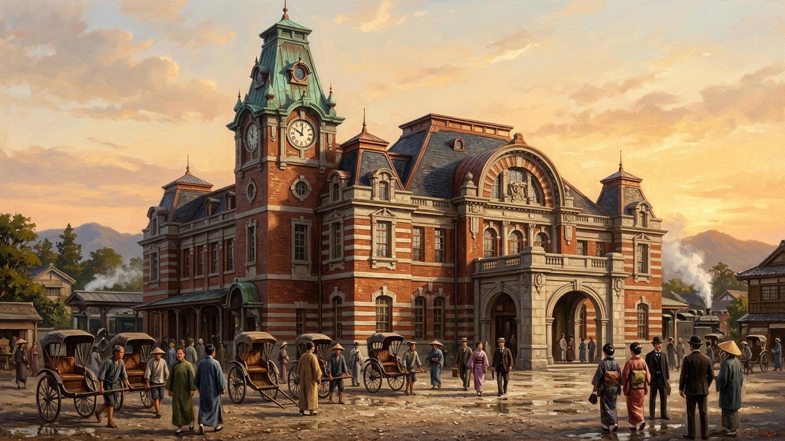

# 第 03 章 驛站的帝國容顏——新竹、臺中與二萬平的近代建築語彙

> **時代座標**：明治三十四年（1901）至昭和十六年（1941）  
> **地理定位**：新竹火車站（WGS84: 24.8016°N, 120.9715°E）、臺中舊火車站、臺南火車站、阿里山二萬平驛、海線五寶木造驛站群  
> **核心圖騰**：松崎萬長「德國哥德鐘樓 × 辰野式紅磚」、臺中驛八角銅瓦鐘塔、宇敷赳夫「鋼筋混凝土現代與帝冠折衷」、阿里山檜木雨淋板與 Y 型木柱、改札口檢票秩序  
> **影視規格**：4K 劇院級分鏡腳本 &bull; 雙人對談學術播客 &bull; 4 大建築與都市史深度對照表

---

## 導言：走進帝國的紅磚教堂與機械時間廣場

大正二年（1913）春末的清晨，一位身著長衫、手提藤製皮箱的竹塹仕紳，踩著新鋪設的碎石馬路，穿過熱鬧卻條理井然的「站前通」，緩緩步入一座才剛剪綵啟用的宏偉建築。

在他眼前的，不是漢人城池裡熟悉的燕尾飛簷、龍柱石獅或紅瓦廟埕，而是一座令人屏息的奇異殿堂——深沉高壓的清水紅磚牆面上，嵌著一條條宛如絲緞般潔白的水平石帶；左側高高聳起一座尖銳陡峭的德國哥德式盔甲鐘樓，鐘樓正面鑲嵌著直徑超過一公尺的巨大白色機械時鐘，滴答聲在清晨空氣裡格外清脆；鐘樓上方還開著幾扇猶如巨人眼睛般的圓形「牛眼窗」，正靜靜俯瞰著廣場上整齊排班等待載客的人力車伕。



這就是剛落成的**新竹火車站**。當這位仕紳踏過半圓拱門雨庇、走進挑高通風的木桁架售票大廳，在貼著磁磚與木柵欄的售票窗前排隊買下一張厚硬紙板車票，並聽見「嗒！」一聲清脆的金屬剪票聲通過「改札口」踏上月台的那一瞬間——他不只搭上了一班開往臺北的火車，更是在無形之中，走進了一個由**西方近代建築美學、工業計時紀律與現代公共空間秩序**共同構築的文明劇場。

在 1908 年縱貫鐵道全線貫通之後，鐵道已經解決了「能不能動」的物理難題；緊接著登場的，是一場歷時三十餘年、席捲全島都市與偏鄉的空間美學大改造。每一座火車站，既是殖民帝國宣示治績的門面櫥窗，也是無數臺灣鄉鎮徹底告別傳統廟埕、邁向近代都會文明的空間起點。

---

## 第一節 建築即政治：從草創木屋到辰野式紅磚全盛期

### 一、 為什麼鐵道部要在殖民地蓋「宮殿級」火車站？
1908 年以前，全臺多數車站只是臨時搭建的簡陋木造「票房」或軍用棚廠。然而隨著縱貫鐵道全通、米糖與樟腦貿易帶來源源不絕的財政盈餘，臺灣總督府開始深刻體認到後藤新平所揭櫫的「**文裝的武備**」真諦——也就是用宏偉壯麗的西方近代科學建築來展現統治者壓倒性的現代文明優勢。

在當時日本明治與大正建築官僚眼中，火車站是一座城市最重要的「**現代神殿**」：
1. **視覺震撼與統治合法性**：過去人們進城先看見高聳的城樓或香火鼎盛的媽祖廟；如今旅客走出火車月台，第一眼看見的是巴洛克圓頂、銅瓦鐘塔與紅磚拱廊，城市的精神視覺中心被強行從傳統神廟轉移到了國家交通機構手中。
2. **都市計畫的幾何核心**：總督府透過「市區改正」計畫，以新落成的火車站為軸心，在站前強制開闢寬闊的幾何圓環「站前廣場」，再從廣場向外筆直放射出寬十餘公尺的「站前通（停車場通）」，徹底打破清代城鎮狹窄曲折的街巷格局。

### 二、 三個建築世代：寫在磚石與鋼筋上的時代斷層
如果我們把 1901 年至 1941 年這四十年間的臺灣火車站排成一列，就會看見一部令人驚嘆的東亞近代建築演化史：

- **第一代｜草創洋風木骨磚造期（1900–1908）**：代表作為 1901 年第二代臺北驛（德國風格，具備雙尖塔與拱門）與 1908 年基隆舊驛（法式馬薩爾屋頂與紅磚鐘樓）。當時兼具實用與展示性格，唯構造尺度較小，後多因城市膨脹而拆除改建。
- **第二代｜辰野式紅磚巴洛克黃金期（1910–1925）**：縱貫線獲利豐碩，鐵道部工務課豪擲重金，打造出一系列融合日本明治建築之父「辰野金吾」特色的紅磚洋樓——紅磚底牆鑲嵌白色花崗岩或洗石子水平飾帶（被後世戲稱為「紅白五花肉條紋」）、搭配繁複的山牆泥塑與鐘樓。現存國定古蹟**新竹驛（1913）**與**臺中驛（1917）**正是這一世代最璀璨的遺珠！
- **第三代｜抗震鋼混、現代主義與帝冠折衷期（1930–1941）**：歷經 1923 年日本關東大地震與 1935 年臺灣中部關刀山大地震的慘痛教訓後，建築界意識到「無鋼筋紅磚牆」在強震面前的脆弱性。鐵道部技師**宇敷赳夫**順勢全面導入鋼筋混凝土（RC）構造，一方面孕育出線條簡潔的現代主義風格（如 **1933 嘉義驛**、**1936 臺南驛**），另一方面也在太平洋戰爭前夕催生出充滿大和帝國意識形態的「**帝冠式建築**」（如 **1941 高雄舊驛**）。

---

## 第二節 雙城記的帝國絕唱：松崎萬長的新竹驛 vs 臺中大都會驛

在現存的日治火車站建築中，新竹與臺中（第二代）猶如北中兩座性格截然不同的紅磚建築史詩，各自演繹著留德貴族建築師的孤高浪漫，與總督府工務課的帝國排場。

### 一、 新竹火車站（1913）：留德貴族建築師「松崎萬長」的混血傑作
落成於大正二年（1913）3 月 31 日的**新竹火車站**，不僅是全臺現存最古老的現役大型火車站，其設計者背後的身世更充滿戲劇色彩。

**松崎萬長（Matsuzaki Tsumunaga，1858–1921）**絕非尋常工匠：他生於日本京都古老公卿名門「甘露寺家」並承襲男爵爵位，青年時期卻未入東京帝大跟隨英國建築師康德（Josiah Conder）學藝，而是遠渡重洋留學**德國柏林工業大學建築科**，在柏林吸納了最純正的普魯士新古典、巴洛克與「德國哥德復興（German Gothic Revival）」養分。1907 年他應聘來臺出任臺灣總督府鐵道部技師，先後規劃設計了基隆舊驛、新竹驛與臺北鐵道飯店（後皆損毀，唯獨新竹驛奇蹟保存至今！）。

松崎萬長在新竹車站中，玩轉了一場大膽的「**德日建築語彙混血實驗**」：
1. **打破對稱的「偏心高聳鐘樓」**：一般古典巴洛克建築講究嚴格的左右軸線對稱；但松崎萬長刻意將最搶眼的四方形高聳鐘塔偏置於建築物左側主玄關旁，形成極富戲劇張力的不對稱平衡！鐘樓頂端披覆著厚重陡峭的德國「盔甲式雙折急斜屋頂（Steep Hip/Mansard Roof）」與金屬避雷針，正面嵌著大型機械圓鐘，側面點綴四面「牛眼窗（Oeil-de-boeuf）」與四方形老虎窗（Dormer Window），透出一股莊嚴神聖的北歐中世紀修道院氣息。
2. **辰野式紅磚白帶的交會**：儘管鐘樓骨子裡是德國哥德式，牆體表面卻巧妙融入了日本大正時期最流行的「辰野式」語法——精選高品質高壓紅磚砌牆，每隔數層便鑲嵌一道潔白的洗石子或石材水平帶飾，與玄關門廊厚實的多邊形石柱、半圓拱雨庇形成極為優雅的色澤對比。
3. **為風城量身定做的厚實感**：新竹九降風強勁猛烈，松崎萬長刻意收斂了容易被強風掀翻的輕巧木作挑簷，轉而強調磚石壁體的厚重與深凹窗洞的陰影感，使整座車站在百年風霜中宛如城堡般屹立不搖。

### 二、 臺中火車站（第二代，1917）：中臺灣首都的中央鐘塔交響曲
如果說新竹車站是一位內斂矜貴的德意志貴族，那麼四年後於大正六年（1917）3 月 31 日落成的**臺中火車站第二代站體**，就是一位盛裝出席交響樂慶典的皇家紳士。

隨著 1908 年縱貫線全通式在臺中公園盛大舉辦，臺中市街人口以驚人的速度膨脹，原本 1905 年蓋的木造簡易停車場早已不敷使用。總督府鐵道部遂斥資興建這座氣派非凡的紅磚新驛站：
1. **絕對對稱的中央八角鐘塔**：臺中車站採用經典的文藝復興左右對稱配置，正立面中軸線高高聳立起一座華麗的**八角形青銅瓦圓頂鐘塔**。塔身四面設有羅馬圓拱百葉窗，圓頂下方則是四面精緻的牛眼小窗。鐘塔下方的入口破風山牆（Pediment）上，覆滿了如牡丹、捲草葉片般華麗繁複的巴洛克浮雕泥塑，正中央鑲嵌著與新竹車站一樣宣告標準時間的車站大鐘。
2. **熱帶氣候的「高架氣窗」巧思**：雖然外觀穿上了歐洲紅磚與白色石帶（辰野式），內部構造卻完全為了臺灣亞熱帶氣候進行精準物理調節——車站中央購票大廳特別設計了**雙層高挑屋頂與連續「高側氣窗（Clerestory Windows）」**，當夏日熱氣上升時，可迅速透過屋頂側面高窗對流排出，讓沒裝設冷氣的候車大廳依然微風徐徐。
3. **繁華的站前幾何輻射**：臺中驛的寬廣正立面面向筆直的櫻橋通（今中正路／臺灣大道一段）與綠川水岸，結合附近的臺中州廳（森山松之助設計）、臺中公會堂與臺中公園，構成了日治時期全臺灣最完整、最浪漫的「紅磚巴洛克近代都市軸線」。

### 三、 宇敷赳夫的轉身：臺南「鐵道飯店車站」與高雄「帝冠式」
進入 1930 年代，隨著總督府鐵道部改良課主任技師**宇敷赳夫（Ushiki Takeo）**接棒主導設計，臺灣驛站正式告別紅磚時代，邁入鋼筋混凝土的現代轉向：
- **1936 年臺南火車站**：全臺唯一結合「交通車站」與「高級旅宿」的雙層鋼混建築！一樓是簡潔明快的幾何現代主義售票廳，二樓竟然直接設置了擁有西餐廳、宴會廳與套房的「**臺南鐵道飯店**」（戰後亦運作至 1986 年），讓南來北往的富商與官員「走上樓梯就能在車站裡吃牛排、住套房」，展現了 1930 年代臺灣鐵道文化摩登到極致的奢華想像。
- **1941 年高雄舊驛**：宇敷赳夫生涯的終極折衷代表作。為了配合高雄港南進軍需基地大擴建，他以西方剛健的鋼筋混凝土量體承托起一座氣宇軒昂的日本傳統神社「唐破風／歇山大屋頂」（即「帝冠式」），將鋼鐵速度感與昭和帝國威儀推向頂峰。

---

## 第三節 木構與微風的詩學：二萬平、海線五寶與熱帶物理學

然而，一座島嶼的記憶並不只存在於大城市的紅磚殿堂裡。在山林雲霧的深處、在海風鹹澀的西海岸小村、在嘉南平原的蔗田邊，數十座以**臺灣檜木與日式工藝**打造的木造小車站，用另一種低調溫潤的建築語彙，承載了島嶼九成以上常民的離別與歸鄉。

```text
                日治木造地方與高山車站標準建築物理構造剖析圖

                         /\  切妻頂（陡斜雙坡屋頂，迅速排水防雪）
                        /  \
                       / ◯  \  ◄─ 牛眼窗（山牆屋頂夾層熱對流排氣孔）
                      /______\
             ┌────────┴──────┴────────┐
             │  ▓▓▓  雨淋板（魚鱗板）  │  ◄─ 層層疊壓防狂風暴雨滲水
             │  ▓▓▓  (Yoroi-ita)     │
         ┌───┴────────────────────────┴───┐
        /│╲     Y 型木柱深出簷迴廊         ╱│\ ◄─ 遮蔽亞熱帶烈日與豪雨
       / │ ╲   [改札口木柵]  [木框玻璃窗]  ╱ │ \
      ───┴──────────────────────────────┴───
      ░░░░░░  抬高磨石子基座 ＋ 牆基通風孔  ░░░░░░ ◄─ 防潮、阻斷白蟻蛀蝕
```

### 一、 二萬平（標高 2,000 公尺）：雲端上的阿里山檜木驛站
1912 年阿里山森林鐵路一路盤旋攀登至標高兩千公尺的「**二萬平**」（此地原是原住民與伐木場的重要聚落平台，因開墾時地勢較平坦且可遙望塔山雲海而名）。

在這個年雨量驚人、夜晚氣溫驟降甚至會結霜的高山場域，磚石運輸極端困難，鐵道工程師選擇「就地取材」——直接砍伐世界最頂級的抗腐良材：**臺灣紅檜與扁柏**：
- **深褐色雨淋板（Yoroi-ita）的鎧甲智慧**：工匠將檜木刨成寬條斜板，如同古代武士的魚鱗鎧甲般「由上往下層層疊釘」於外牆。這種構造稱為「雨淋板」，當高山狂風暴雨垂直拍打牆面時，雨水會順著重疊的木板縫隙向外滑落，徹底阻絕水氣滲入室內牆體（編竹夾泥牆）內部。
- **極深出簷與「真束（King Post）」木屋架**：屋頂採用俐落的切妻雙坡頂，屋簷大幅向外延伸形成深邃走廊，讓林場工人與登山旅客在暴雨中依然能站在簷下等候運材列車。內部大廳則不設天花板吊頂，直接露出幾何美感極強的三角檜木桁架（真束結構），散發著濃郁的芬多精木香。

### 二、 海線五寶與平原木造驛站：亞熱帶通風與防蟻的極致精算
1922 年縱貫線海岸線（竹南—彰化）全線開通時，沿線一口氣誕生了五座外觀神似卻各有風情的同世代木造小站——**談文、大山、新埔、日南、追分（合稱「海線五寶」）**；而在更早的 1914 年，臺南保安車站（原名車路墘）也已落成全檜木打造的經典站體。

這些平民化木造驛站蘊含著極高的熱帶建築物理智慧：
1. **編竹夾泥牆（小舞壁）會呼吸的牆面**：牆體內部先以桂竹片編成格子網骨架，再用混合了切碎稻草、麻絲與泥灰的泥漿層層敷塗抹平，外層才釘上雨淋板或抹上白石灰。這種「會呼吸的土牆」在夏日高溫下具備極高的熱容量與隔熱性，使候車室免於變成悶熱烤箱。
2. **Y 字形木柱迴廊與牛眼氣窗**：入口玄關與月台側邊遍布優雅的 **Y 型斜撐木柱**，以最少木材撐起寬大遮陽避雨廊；而高高開在東西兩側山牆三角頂端的**圓形「牛眼窗」**或「菱形格柵窗」，則成了屋頂閣樓的自動煙囪，源源不絕把累積在瓦片下的熱氣抽出。
3. **抬高基座防白蟻**：由於臺灣濕度極高且臺灣家白蟻（Coptotermes formosanus）肆虐，這些車站全數將木構造抬離泥土地面三至六十公分，下方砌築防水的洗石子或紅磚基座並加開鐵網通風口，確保這群檜木小站能夠奇蹟般穿越一百年以上而屹立不倒！

---

## 第四節 公共空間的現代馴化：從「廟埕」到「車站廣場」

火車站絕不僅僅是一棟供人買票避雨的房子；對於 20 世紀初的臺灣人而言，火車站是**第一座強迫常民學習如何當一個「現代城市公民」的公共空間教室**。

### 一、 空間權力重組：「廟埕」與「車站廣場」的歷史交替
在鐵路降臨之前，漢人社會最重要的公共集會空間是「廟埕」。廟埕的空間邏輯是有機、模糊、自由且多功能的——早晨賣菜挑夫在此歇腳、中午老翁聚在榕樹下下棋、晚上演野台戲與擺攤叫賣、沒有圍牆更不需要門票，所有人都依據日出日落的「自然時辰」聚散。

然而，「車站廣場（Station Plaza）」與車站內部空間卻呈現出截然不同的近代空間邏輯：
1. **邊界與契約——「改札口（檢票口）」的空間區隔**：
   車站內部被一條條木製或鐵製柵欄切分得壁壘分明。一般民眾可以自由走到「站前廣場」，但想要跨過改札口踏上月台，你必須先在窗口依照定價購買車票（建立商業契約），或花費五錢購買限時「月台票（入場券）」，經過站務員手執金屬剪票鉗「喀嚓」打洞認可，才能取得空間的通行權。這在臺灣常民文化中植入了極強的「空間私有／公權邊界意識」。
2. **建築內部的階級可視化**：
   在大型二等、一等車站（如臺北、新竹、臺中、臺南）內部，空間直接對應車廂等級：**一二等貴賓候車室**鋪設木地板、擺放軟墊長椅與茶几，裝潢華麗寧靜；**三等大眾候車室**則多為硬木長凳與開放大廳；甚至連進出路線都有專屬分隔。空間設計讓「近代殖民資本階級秩序」在無聲中變得一目了然。

### 二、 排隊、衛生與「絕對時間」的規訓劇場
走進這些華麗或簡樸的車站，臺灣常民同時面對著一場密集的現代化行為訓練：
- **排隊白線與動線規訓**：售票口前首次出現了引導人流的金屬欄杆與「一列排隊」規範，終結了傳統市集爭先恐後、大聲喊價的混亂。
- **近代衛生與禮儀告示**：站務規則明令「候車室內禁止隨地吐痰、禁止赤身赤腳、禁止攜帶家禽豬隻進入一二等室」，月台旁設置了乾淨的飲水台、垃圾桶與定時沖洗的近代化公廁。過去在鄉間被視為日常的習慣，在車站這座「近代衛生展示窗」內被重新定義為「不文明」。
- **時鐘大鐘的絕對支配**：站立面最崇高的位置，永遠留給那面無情精準跳動的車站大鐘。每一場接風、送別、商談、貨運交割，從此都必須屈服於大鐘的長短針之下——「火車不等任何人」，準時（Punctuality）與紀律（Discipline），就在一次次奔向改札口的急促腳步中，深深寫進了現代臺灣人的日常基因。

---

## 結語：月台燈火下的百年集體記憶

一百多年過去了。當年的殖民者與「鐵道部」早已成為歷史書頁裡的鉛字，基隆舊驛與戰前高雄舊驛也相繼在歷史變遷中拆遷或留存轉型；但當我們在今天走進新竹火車站那座百歲德國盔甲鐘樓下躲雨，在臺中舊火車站紅磚拱門前拍照留影，或在阿里山二萬平的濃霧裡望見檜木山屋的微黃燈火，甚至漫步在海線追分車站那道斑駁的 Y 字形檜木長廊時——我們仍能清晰感受到那些磚石與木材裡跳動著的歷史溫度。

帝國的建築師當年或許試圖用巴洛克圓頂、辰野式紅磚與嚴厲的改札口來規訓這座島嶼；然而，百年來的送別眼淚、遊子北上打拚的沈重行囊、學生放學在木椅上打盹的側臉、以及月台上此起彼落的便當叫賣聲，早已將這些冰冷的殖民建築，徹底轉化為屬於這片土地與人民最溫柔的集體鄉愁。

而當每一座驛站的大門敞開之後，真正維持這套龐大鐵道系統日夜不斷運轉的心臟與鐵甲巨獸，又棲息在哪裡呢？下一章，我們將走進彰化——在全臺僅存的扇形十二股道與中央轉盤之上，傾聽蒸汽火車與黑手匠師跨越百年的心臟跳動。

---

## 附錄一：第 03 章四大建築史與公共空間深度對照表

### 表 1：臺灣日治時期鐵道車站三大建築世代演進全覽表
| 建築世代 | 時代跨度 | 核心建築風格與材料 | 代表車站案例 | 時代背景與功能定位 |
| :--- | :---: | :--- | :--- | :--- |
| **第一代：草創洋風期** | 1900 – 1908 | 木骨磚造、簡易木構棚廠、早期明治歐風圓頂 | 臺北驛第二代（1901）、基隆舊驛（1908）、初期臺中木造驛（1905） | 縱貫線剛通車或施工階段，急就章應付基礎營運並初步建立港都門戶形象。 |
| **第二代：辰野紅磚黃金期** | 1910 – 1925 | **辰野式紅磚配白石飾帶**、巴洛克泥塑、哥德鐘樓、銅瓦圓頂；地方採檜木魚鱗板木構 | **新竹車站（1913）**、**臺中車站（1917）**、北門驛（1916）、保安（1914）、海線五寶（1922） | 縱貫線獲利豐碩，透過「文裝武備」宮殿建築展示殖民現代化治績與都市核心。 |
| **第三代：鋼混現代與折衷期** | 1930 – 1941 | **鋼筋混凝土（RC）抗震結構**、簡潔水平條窗、複合商業飯店或**帝冠式和洋折衷大屋頂** | **嘉義車站（1933）**、**臺南車站（1936）**、**高雄舊驛（1941）** | 吸收地震教訓強化抗震；結合現代商業（二樓鐵道飯店）與昭和戰時南進威儀。 |

### 表 2：第 03 章四大標誌性驛站建築語彙與物理技術解剖表
| 車站名稱 | 落成年份與建築師／機構 | 主體結構與建築特徵 | 氣候與地理物理適應對策 | 現存文化資產地位 |
| :--- | :--- | :--- | :--- | :--- |
| **新竹火車站** | **1913 年**（大正二年）<br>**松崎萬長**（留德建築師） | **不對稱偏心鐘樓**（德國盔甲陡斜屋頂 + 牛眼窗）與 **辰野式紅磚白飾帶** | 牆體厚重、減少容易被新竹強勁九降風掀起的寬木挑簷，門廊堅實厚重。 | **國定古蹟**（全臺現存最古老現役大型火車站） |
| **臺中火車站（第二代）** | **1917 年**（大正六年）<br>總督府鐵道部工務課 | **左右對稱**立面、中央**八角青銅瓦鐘塔**、華麗巴洛克山牆泥塑 | 候車大廳設計**雙層高挑屋頂與連續「高側氣窗」**，排出盆地高溫熱對流。 | **國定古蹟**（結合新站保留原建築與月台景觀） |
| **臺南火車站** | **1936 年**（昭和十一年）<br>**宇敷赳夫**（鐵道部改良課） | **鋼筋混凝土（RC）折衷現代主義**，二樓整層規劃為豪華**鐵道飯店與餐廳** | 外牆貼十三溝面磚防塵抗濕；挑高大廳搭配遮陽深迴廊與大片垂直開窗。 | **國定古蹟**（全臺唯一二樓曾設鐵道大飯店驛站） |
| **二萬平驛 & 海線木造站群** | 1912（二萬平）<br>1922（海線五寶） | **臺灣紅檜與扁柏**製成切妻頂、**Y 型木柱深出簷迴廊**、牛眼窗 | **雨淋板（魚鱗板）**層疊擋風雨；**編竹夾泥牆**隔熱；抬高基座防白蟻蛀蝕。 | 縣市定古蹟／歷史建築（多數仍維持正常載客營運） |

### 表 3：臺灣傳統「廟埕廣場」vs 近代「火車站前廣場」公共空間對照表
| 空間與文化維度 | 傳統漢人聚落「廟埕廣場」 | 近代鐵道「車站前廣場與站體」 | 對臺灣常民社會的深層文化衝擊 |
| :--- | :--- | :--- | :--- |
| **時間支配法則** | 隨日出日落、農曆節慶與潮汐變化的**自然模糊時間** | 牆面與鐘塔頂端機械大鐘精準支配的**標準分秒時間** | 徹底建立臺灣民眾「準時、誤點、時刻表預約」的近代工業生活節奏。 |
| **空間邊界屬性** | 完全開放、人神共處、市集商販與信仰交織的流動地帶 | **「改札口（檢票口）」木鐵柵欄劃界**，憑車票／月台票契約進出 | 植入清晰的「公共管理權界線」、「付費契約權」與近代空間秩序觀念。 |
| **社會階級再現** | 聚落長幼宗親倫理為主，戲台下大眾混雜站立 | **一二等貴賓候車室 vs 三等大眾大廳**明確建築實體分流 | 將資本主義與現代殖民的階層秩序直接轉化為可感官的物理空間區隔。 |
| **行為衛生紀律** | 鄉間自由隨性（吐痰、赤腳、牲畜共行皆為常態） | 嚴格公告**禁止吐痰、赤腳、載牲畜**，設排隊動線與水洗公廁 | 車站成為常民最早接觸「公共公德、清潔衛生與排隊禮儀」的現代化學校。 |

### 表 4：影響日治臺灣鐵道建築風貌的關鍵建築師譜系表
| 建築師姓名 | 學歷與背景體系 | 任職機構 | 在臺鐵道核心代表作 | 建築美學貢獻總評 |
| :--- | :--- | :--- | :--- | :--- |
| **松崎萬長**<br>(1858–1921) | 日本京都公卿男爵<br>**德國柏林工業大學**建築科畢業 | 臺灣總督府鐵道部技師 | **新竹火車站（1913）**<br>基隆舊驛（1908，已拆）<br>臺北鐵道飯店（已拆） | 將極罕見的德國哥德復興陡斜塔樓語彙注入臺灣，結合日本辰野紅磚成為混血經典。 |
| **野村一郎 / 鐵道部工務課** | 東京帝大建築系體系（受辰野金吾影響） | 總督府營繕與鐵道部工務課 | **臺中火車站第二代（1917）**<br>早期縱貫線重點廳舍 | 成熟運用對稱八角圓頂與高側氣窗散熱構造，確立臺灣大都市紅磚驛站的典範。 |
| **宇敷赳夫**<br>(1890–1965) | 日本明治實務建築師、曾任鐵道部改良課建築主任 | 臺灣總督府鐵道部改良課主任技師 | **嘉義車站（1933）**<br>**臺南車站（1936）**<br>**高雄舊驛（1941）** | 推動臺灣車站邁入高抗震鋼筋混凝土時代，開啟現代主義與「帝冠式」折衷大作。 |

---

## 附錄二：4K 影視級微距分鏡腳本（8 大鏡頭設計）

### 【場景 1】 晨曦中的紅磚神殿（1913・新竹火車站正立面）
- **景別**：大遠景（Extreme Wide Shot） &rarr; 仰拍升降鏡頭（Low Angle Tilt-up）
- **鏡頭運動**：從寬闊碎石與柏油混合的「站前通」緩緩向前推進，穿過等待載客的黑色人力車隊列，攝影機貼近地面仰望左側高聳的德國哥德式盔甲鐘樓！
- **畫面焦點**：清晨金色陽光掠過清水紅磚與潔白水平石帶，鐘樓高處的圓形牛眼窗與滴答跳動的巨大機械鐘面，在晨曦微霧中顯得莊嚴而神聖。
- **光影色調**：溫暖高飽和的紅磚赭紅、純白石帶、冷藍清晨天空，呈現油畫般的古典厚實質感。
- **環境音效**：人力車手搖銅鈴的清脆「叮鈴、叮鈴」聲、皮鞋與木屐踩在碎石子上的雜沓聲、高處大鐘低沉洪亮的整點報時鐘響。
- **旁白台詞**：
  > 「在 1913 年的新竹，這座由留德建築師松崎萬長設計的紅磚車站，徹底取代了傳統廟宇成為全城最高的視覺指標。每一道紅白相間的磚牆，都在無聲宣示著帝國的現代性已經降臨。」

---

### 【場景 2】 建築師製圖桌上的德意志魂（1911・鐵道部工務課製圖室）
- **景別**：特寫（Close-up） &rarr; 微距（Macro Shot）
- **鏡頭運動**：俯拍鋪滿整個製圖桌的藍色曬圖（Blueprint）與描圖紙，鋼筆筆尖蘸著黑色墨水，在紙面上精準勾勒出不對稱左側鐘塔的陡斜角度。
- **畫面焦點**：松崎萬長配戴著金絲眼鏡的側臉微光，黃銅分規與比例尺在白紙上滑動；畫面轉切至對比草圖——對稱的臺中八角銅瓦圓頂鐘塔慢慢浮現出泥塑山牆線條。
- **光影色調**：室內柔和的桌面檯燈暖黃光，與藍色曬圖紙形成強烈的知性冷暖對比。
- **環境音效**：鴉嘴鋼筆筆尖刮過描圖紙的細膩「沙沙」聲、木製三角板輕敲桌面的清脆響聲、遠處火車汽笛的微弱長鳴。
- **旁白台詞**：
  > 「松崎萬長將罕見的德國哥德斜頂與日本辰野式紅磚完美揉合；而在四年後的臺中，八角青銅圓頂與高聳的氣窗大廳，則將這場紅磚巴洛克交響樂推向了顛峰。」

---

### 【場景 3】 會呼吸的屋頂：臺中驛挑高氣窗與光束（1917・臺中火車站大廳）
- **景別**：仰拍大景（Worm's-eye Wide Shot） &rarr; 緩慢橫搖（Slow Pan）
- **鏡頭運動**：鏡頭置於臺中車站剛落成的大廳磨石子地面向上仰望，順著挑高的西洋木桁架緩緩升起，直視屋頂兩側高側氣窗（Clerestory Windows）傾瀉而下的萬丈光柱！
- **畫面焦點**：光柱中無數微塵在涼爽空氣對流裡緩緩舞動，下方身著和服與漢裝的旅人安靜坐在木製長凳上等待購票。
- **光影色調**：外頭正午熾熱刺目，大廳內卻是清涼深邃的陰影與聖潔的金色斜射「丁達爾效應」光束。
- **環境音效**：高挑室內空間特有的回音感（Reverb）、旅人低聲交談的嗡嗡聲、售票窗口厚紙板車票打印機清脆的「叩！」聲。
- **旁白台詞**：
  > 「華麗的外表下藏著精準的物理算計。雙層屋頂與高側氣窗，讓臺中盆地的夏日酷熱迅速抽離；火車站成了全臺灣第一座結合古典美學與熱帶通風科學的近代公共空間。」

---

### 【場景 4】 改札口的喀嚓聲：空間與秩序的規訓（1920s・站內檢票口）
- **景別**：極特寫（Macro Shot） &rarr; 中景人物表情（Medium Shot）
- **鏡頭運動**：緊貼一位身著深藍制服、戴白手套的站務員雙手，畫面鎖定於他手中的亮銀色金屬驗票鉗；隨著一位赤腳挑著竹簍的農家漢子遞上硬紙板車票，「喀嚓！」一聲切出缺口。
- **畫面焦點**：被剪出缺口的車票與木製「改札口（檢票柵欄）」，背後告示牌上清晰可見「一列排隊」、「禁止隨地吐痰」等日文與漢文標語；鏡頭橫掃過一旁門扉深鎖的「一二等貴賓候車室」牌匾。
- **光影色調**：寫實微帶年代感的復古膠片暖棕色，白手套與金屬鉗在陰暗入口處極度搶眼。
- **環境音效**：驗票鉗乾脆俐落的金屬「喀嚓！」聲、站務員搖動手搖銅鈴的催促聲、蒸汽列車靠站放氣的巨響。
- **旁白台詞**：
  > 「傳統的廟埕誰都可以赤腳進出，但火車站的木柵欄與改札口卻劃出了冷峻的契約界線。排隊、禁吐痰、等級分流、分秒不差——車站成了臺灣人最早的現代公民訓練場。」

---

### 【場景 5】 雲霧與檜木鎧甲：二萬平與海線木造驛站（1922・高山與海岸）
- **景別**：推拉結合鏡頭（Push-in & Cross-dissolve）
- **鏡頭運動**：先在雲霧翻湧的阿里山二萬平深谷中推進至檜木魚鱗板（雨淋板）小屋，水滴沿著層疊木板滑落；畫面隨即透過木柱與圓形牛眼窗轉場至海風吹拂的西海岸日南／追分木造小站！
- **畫面焦點**：特寫門廊極具幾何美感的 **Y 字形檜木斜撐柱**、山牆頂端散熱的圓形牛眼窗，以及牆角抬高數十公分的洗石子防蟻底座。
- **光影色調**：二萬平的清冷青藍高山霧氣，瞬間過渡到海線小站午後溫暖金色斜陽照耀下的溫潤原木色。
- **環境音效**：高山松林風嘯與微雨滴答聲，融合海岸線火車經過平交道時「噹、噹、噹」清脆悠揚的警報聲與海風聲。
- **旁白台詞**：
  > 「離開繁華大城，臺灣檜木成了主角。雨淋板像鎧甲般抵擋高山風雨，編竹夾泥牆、Y 型木柱與牛眼氣窗，演繹出最順應島嶼濕熱氣候的木造建築詩學。」

---

### 【場景 6】 大地震後的鋼混轉身與車站裡的牛排香（1936・臺南車站二樓鐵道飯店）
- **景別**：中景追蹤（Tracking Shot）
- **鏡頭運動**：跟隨一名提著真皮手提箱的商務旅客走出臺南站一樓現代簡潔的鋼筋混凝土大廳，順著洗石子扶手樓梯步上二樓，推開大門竟然是吊燈閃爍、擺滿雪白桌巾與銀質刀叉的「臺南鐵道飯店西餐廳」！
- **畫面焦點**：窗外月台上一輛大型蒸機噴吐白煙緩緩啟動，窗內服務生正將一盤滋滋作響的鐵板牛排端上桌。
- **光影色調**：十三溝面磚的沉穩米灰色調，搭配二樓西餐廳內典雅溫暖的琥珀吊燈光暈。
- **環境音效**：刀叉輕碰瓷盤的清脆聲、杯中紅酒輕搖聲、窗外穿透玻璃傳來的低頻火車鳴笛與鐵軌節奏感。
- **旁白台詞**：
  > 「1935 年關刀山強震敲響了紅磚建築的警鐘，宇敷赳夫帶領鐵道部邁入高抗震的鋼筋混凝土時代。1936 年的臺南車站甚至在二樓開起了鐵道飯店，將『移動』昇華為全方位的摩登都市體驗。」

---

### 【場景 7】 南進的帝冠巨影（1941・高雄舊驛落成夜）
- **景別**：低角度對稱大景（Symmetrical Low Angle）
- **鏡頭運動**：攝影機穩重地沿著高雄港寬闊大道正面推進，仰望燈火通明的新落成高雄車站——現代剛強的鋼筋混凝土基座之上，壓著一座碩大無比的日本傳統歇山「帝冠式」大屋頂！
- **畫面焦點**：屋頂飛簷下的巨大燈籠與幾何列柱，站前廣場列隊的軍警與趕車的庶民形成強烈比例反差。
- **光影色調**：戰時前夕壓抑冷峻的深藍夜色，屋檐下透出橘黃卻令人敬畏的燈光。
- **環境音效**：軍靴齊步踩過廣場的沉重「刷、刷、刷」聲、遠處高雄港輪船低沉的霧笛聲、夜風呼嘯。
- **旁白台詞**：
  > 「1941 年的高雄舊驛，宇敷赳夫用鋼混量體頂起了象徵大和權威的帝冠大屋頂。當南進的戰鼓敲響，車站再次被賦予了最濃重的國家權力與軍事動員使命。」

---

### 【場景 8】 百年不散的月台凝望（當代・新竹車站與臺中舊站對比蒙太奇）
- **景別**：慢動作跟拍 &rarr; 空拍升起（Slow-mo Match Cut &rarr; Crane Up）
- **鏡頭運動**：鏡頭捕捉今天背著書包的高中生、牽著孫子手的老奶奶穿過新竹百年車站大廳與臺中舊站紅磚拱廊的身影；攝影機穿透時光緩緩升空，俯瞰新舊車站並存、高鐵與電聯車交會的現代島嶼城市。
- **畫面焦點**：百歲鐘樓依然精準運轉的時鐘指針，以及月台上永遠充滿離愁與重逢溫度的暖黃燈火。
- **光影色調**：溫暖明亮、充滿人文深情的黃金黃昏逆光，為百年紅磚披上一層永恆的榮光。
- **環境音效**：百年前的金屬剪票鉗「喀嚓」聲，無縫融接為當代悠卡刷卡「嗶！」一聲的電子音，伴隨著溫暖深沉的鋼琴與弦樂合奏緩緩落幕。
- **旁白台詞**：
  > 「一個世紀過去了，殖民的標語已經褪色，但這些佇立在城市中心的紅磚鐘樓與檜木長廊，早已接納了幾代臺灣人的離別、打拚與重逢。它們是帝國遺留的建築，更是我們共同擁有的歲月。」
