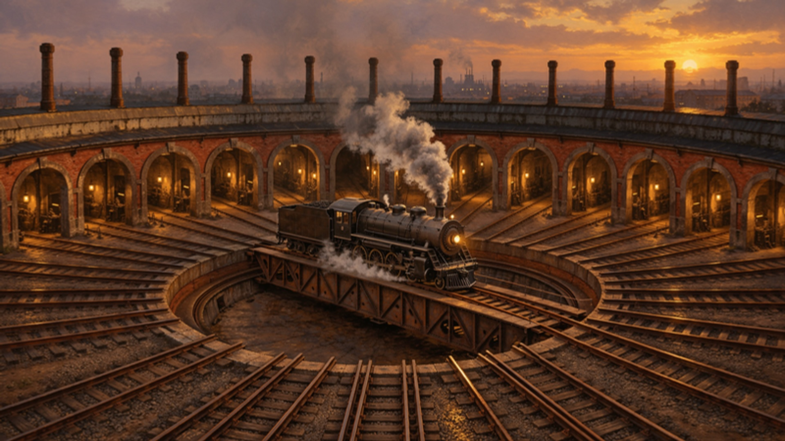

# 第 04 章 旋轉的巨獸心臟——彰化扇形車庫、蒸汽火車與轉盤調度美學

> **時代座標**：大正十一年（1922）至當代  
> **地理定位**：彰化機務段扇形車庫（WGS84: 24.0858°N, 120.5392°E）  
> **核心圖騰**：12 股放射狀紅磚鋼混扇形車庫、360 度中央旋轉鋼構轉盤、「國王」DT668 與「復駛先鋒」CK124 蒸汽機車、黑手技師長嘴油壺與 50°C 火箱投煤  
> **影視規格**：4K 劇院級分鏡腳本 &bull; 雙人對談學術播客 &bull; 4 大蒸汽熱力學與工坊文化對照表

---

## 導言：百噸鋼鐵巨獸的優雅圓舞曲

清晨五點半，中臺灣彰化的天色還是一片深邃的靛藍。空氣裡飄散著一種奇特而沉醉的氣味——那是焦煤燃燒後的辛香、高溫汽缸潤滑油的微甜，以及冰冷鐵軌上露水的清新。

在彰化火車站北端這座呈 99 度角扇形展開的紅磚與鋼筋混凝土巨大車庫前，一個高達七十歲的老司機員與年輕技師正站在中央圓坑的鋼橋邊，仰望著那頭剛結束夜間「升火暖機」的巨獸。伴隨一聲猶如沉睡巨龍甦醒般的低沉長嘯，全重超過一百二十四公噸、號稱臺鐵「蒸汽機車國王」的 **DT668**，亮起車頭耀眼的金色大燈，吐著濃厚如雲絮般的乳白蒸汽，緩緩駛上了直徑超過二十公尺的**中央旋轉轉盤（Turntable）**。



就在司機員拉緊氣壓煞車的瞬間，轉盤上的齒輪馬達發出規律而深沉的「嗡——嗡——」低鳴。一百多噸重的鋼鐵巨獸竟然像芭蕾舞者般，在這座僅僅依賴中央滾珠軸承支撐的鋼橋上，優雅、從容地開始 360 度平穩旋轉！當轉盤精準對準前往縱貫線正線的出庫股道，插銷「喀嚓」鎖定，DT668 發出有節奏的排氣聲「嚓——嚓——嚓——」，正式踏上征途。

這座建於 1922 年、至今仍在真實運作的「**彰化扇形車庫**」，是臺灣鐵道史上無可取代的「活化石」。全臺當年共有六座扇形車庫，如今臺北、新竹、嘉義、高雄皆已化為歷史塵煙，唯有這座十二股道的半圓扇形殿堂跨越了一個世紀的戰爭、地震、電氣化浪潮與拆除危機，至今依然在每一個清晨，奏響著水火淬鍊的蒸汽交響曲。

---

## 第一節 山海交會的心臟地帶：為何偏偏是「彰化」？

要理解這顆心臟為什麼會跳動在彰化，我們必須先把視角拉回 **1922 年（大正十一年）十月**。

這一年，為了舒緩舊山線陡坡造成的貨運大塞車，總督府鐵道部修築的西部「海岸線（竹南—大甲—彰化）」正式全線貫通。自此之後，臺灣西部的鐵路網不再只是一條單線，而是在中臺灣形成了一個極為關鍵的「**大寫字母 O 字型雙線交會口**」——北端的交會點在竹南，而南端匯聚山線、海線並接通南下嘉南平原縱貫動脈的總閘口，正是**彰化**！

### 一、 蒸汽機車的「體能極限」與調度核心
在沒有電力架空線的蒸汽時代，火車頭是一台需要「不斷進食、排泄與喘息」的機械生物：
1. **換掛補機的物理必然**：由南部嘉南平原北上載運數百噸砂糖與稻米的列車，駛入彰化後若要改走山線（經臺中、豐原翻越 25‰～26‰ 的苗栗勝興陡坡），單靠一輛平原高速車頭會直接滑輪爬不動！列車必須停靠彰化進行「解連換掛」，交給擁有六顆甚至八顆動輪的重型爬坡蒸汽機車（或前後推拉「補機」）。
2. **「打火床」與「洗鍋」的生死週期**：蒸汽火車行駛大約一至兩百公里，火箱內的煤炭就會結出厚重的爐渣堵塞進氣孔（降低鍋爐壓力），水櫃裡的清水也耗盡見底。同時，臺灣河川水質富含礦物質，鍋爐內壁每隔一段時間就會積聚厚厚的水垢（Scale）；如果不定期排空熱水並進行「洗鍋（洗罐）」，水垢阻隔熱傳導，鍋爐鋼板就會在 1,200°C 烈火下燒紅變形甚至發生驚天大爆炸！

因此，1922 年鐵道部在彰化站北側興建了配備完備的「彰化機關庫」（初建 6 股道，隨後陸續擴建成經典的 **12 股放射狀扇形車庫**），將這裡打造成為全臺灣最重要的機車調度、養護與「體檢醫院」。

### 二、 六大扇形車庫的消逝與世紀保衛戰
在日治至戰後初期，臺灣島上共有六座扇形車庫：臺北、新竹、彰化、嘉義、高雄、高雄港。
然而 1979 年西部幹線電氣化完成、柴油與電力機車接管幹線後，需要轉盤調頭的單向蒸汽巨獸全面退場。在 1970 至 1990 年代的都會開發浪潮中，其餘五座扇形車庫被視為「過時且佔地的工業廢墟」，相繼遭到怪手無情夷平。

到了 1994 年，臺鐵甚至已經核定計畫——準備拆除彰化扇形車庫，改建為現代化的電聯車檢修基地！
所幸在這場千鈞一髮的危機中，一群熱血的彰化地方文史工作者、鐵道文化協會成員與臺鐵內部深愛蒸機的老師傅聯手發起了「**搶救彰化扇形車庫大行動**」。經過六年奔走請願，彰化扇形車庫終於在 **2000 年**獲得保留並指定為縣定古蹟，更在建庫一百週年的 **2022 年**，由文化部正式公告升格為**國定古蹟**！全臺灣唯一會呼吸、依然停駐著真實火車頭的「活古蹟」，就這樣奇蹟般地被我們留了下來。

---

## 第二節 轉盤上的極簡力學：九十九度扇形的空間魔法

走進彰化扇形車庫，即使是不懂機械的人，也會瞬間被它那種宛如古羅馬競技場與達文西幾何機械結合般的視覺秩序所震撼。這座建築到底藏著什麼樣的空間魔法與物理力學？

```text
                    彰化扇形車庫（12 股道 × 360° 中央轉盤）空間力學示意圖

                        [1] [2] [3] [4] [5] [6] [7] [8] [9] [10][11][12]
                         ╲   ╲   ╲   │   │   │   │   │   │   ╱   ╱   ╱
                          ╲   ╲   ╲  │   │  半圓紅磚鋼混車庫 ╱   ╱   ╱  ◄── 每股設排煙煙囪＋地溝
                           ╲   ╲   ╲ │   │   │   │   │   │ ╱   ╱   ╱
                            ╲   ╲   ╲│   │   │   │   │   │╱   ╱   ╱
                             └───────────┬───────┬───────────┘
                                         │       │
                                  ╔══════╧═══════╧══════╗
                                  ║   ◎  360° 旋轉轉盤   ║  ◄── 支點：中央高強度推力軸承
                                  ║  (平衡質心即可旋轉)  ║      早期靠雙人推桿 / 後改馬達驅動
                                  ╚══════════╤══════════╝
                                             │
                       ══════════════════════╧═══════════════════════  進庫主正線 / 補煤加水台
```

### 一、 為什麼要把車庫蓋成「扇形」？
在寸土寸金的鐵路調車場裡，如果要用傳統的「道岔（Turnout）」把一條軌道並排分出 12 條停車坑，每一組道岔都要佔據三十公尺以上的轉換距離，光是道岔區就得拉出長達兩三百公尺的「咽喉區」才能展開這 12 條軌道！
然而，聰明的鐵道工程師利用幾何學的圓心原理：把 12 條檢修股道像展開的摺扇一樣（呈現 99 度弧角）指向同一圓心，在圓心處只設一座**直徑約 20 公尺（後期擴改為 21 公尺級）的圓形深坑與旋轉鋼橋（轉盤）**。這個極簡設計，硬生生省下了三分之二以上的土地面積，讓 12 頭重型火車頭能在最緊湊的距離內完成集結！

### 二、 槓桿平衡的奇蹟：「兩個人推動百噸巨獸」
中央轉盤真正的魔法，在於它極致純粹的古典物理力學。
轉盤鋼橋底下並不是一整塊鐵板磨擦地面，它的核心秘密在於正中心那一顆龐大且精密的**鋼鐵樞軸與高強度推力滾珠軸承（Pivot & Thrust Bearing）**。鋼橋兩端與圓坑邊緣軌道接觸的小鋼輪，其實只負責防傾倒，幾乎不承擔重量。

當一輛重達百噸的蒸汽機車開上轉盤時，調車員會打出手勢，讓司機員前後微調幾公分，將這頭巨獸的**「整體質心」精準停在轉盤正中央的圓心軸承正上方**！
一旦達成完美的力矩平衡，摩擦力會驟降至極小值。在彰化扇庫尚未加裝電動馬達與減速齒輪的早期年代，不需要起重機，只要兩位庫房工人站上轉盤兩頭，握住木製推桿順時針邁步前行——**靠著區區兩個人類的雙腿肌肉，竟然就能穩穩推動上百公噸的鋼鐵巨獸在空中優雅旋轉**，將火車頭從進庫股道轉進任何一個空的檢修坑，甚至完成 **180 度車頭調頭**！

### 三、 高聳煙囪與地溝裡的建築巧思
扇形車庫建築本體（1～12 股）同樣處處透著實用美學：
- **屋頂上的煙囪森林**：每股道屋頂正上方都高聳立著一支獨立排煙煙囪（Smoke Jack），正對停放在下方機車的煙囪口。當技師在室內升火檢查氣壓時，濃煙會直接垂直被抽送出室外高空，保護庫內人員免遭一氧化碳毒氣侵害。
- **高窗採光與地溝坑**：庫房背面設計了大片拱形或矩形鋼框玻璃窗，屋頂則有階梯狀高側氣窗，引入充足自然天光；地面中央下方挖鑿了 1.2 公尺深的磚砌地溝，讓「黑手技師」能不彎腰直接站在巨獸腹部下方進行檢查。

---

## 第三節 蒸汽熱力學交響：認識鎮守庫房的三大國寶巨獸

如果說扇形車庫是跳動的心臟，那麼停在各股道裡的蒸汽機關車，就是流淌著滾燙血液的鋼鐵靈魂。

不同於現代電聯車或高鐵按下按鈕即出發，蒸汽火車是一套完全「看得見、聽得到、摸得著」的熱力學實踐藝術。在火箱裡高達 1,200°C 的焦煤烈焰，穿過鍋爐裡上百根銅製或鋼製煙管，將數公噸清水煮沸為高達 14 至 16 公斤/平方公分（kg/cm²）的高壓蒸汽；蒸汽聚集到車頂圓弧形的「**蒸氣包（Steam Dome）**」，經司機員手拉調速閥衝入兩側巨大汽缸推動活塞；再由車輪外側那組複雜如螳螂手臂般閃亮舞動的「**華氏汽閥連桿機構（Walschaerts Valve Gear）**」精準控制氣閥開關與正反車方向，將直線運動化為動輪咬緊鋼軌的磅礴力量！

在彰化扇形車庫的百年歷史與當代動態復駛保存中，最著名的三輛傳奇代表分別是「**復駛先鋒 CK124**」、「**蒸汽國王 DT668**」與「**蒸汽女王 CT273**」：

1. **CK124（2-6-2T 水櫃式蒸機，1936 年日本車輛製）**：
   它是臺灣支線鐵道與復駛文化的絕對英雄。車體兩側自備水箱與後方煤櫃（無須加掛後方大煤水車），整備重量僅 50.85 公噸、長度精巧、軸距短，能輕鬆轉過極急彎道與爬上舊山線、集集線。1979 年停駛後原本靜態保存於北投，2001 年在臺鐵高雄機廠與彰化扇庫老師傅全力整修下奇蹟復活，成為臺灣第一輛重新冒出白煙奔跑的動態保存蒸汽機車！
2. **DT668（2-8-0 煤水車式蒸機，1941 年川崎車輛製）**：
   如果你站在扇形車庫的轉盤旁，看到它駛出來一定會屏住呼吸——它是**全臺灣鐵道史上最龐大、重量最重、牽引力最強的「蒸汽火車之王」**！車長接近 20 公尺，加上後方煤水車重達 **124.46 公噸**，底部擁有八顆直徑 1,400 公釐的連動巨輪（一顆顆閃著金屬油光），牽引力高達 17,000 公斤以上。在戰後經濟起飛時代，它專門拖掛幾十節滿載水泥、煤炭與糖包的重型貨運列車奔馳縱貫線，2011 年復駛完成後即長駐彰化扇形車庫鎮守！
3. **CT273（4-6-2 煤水車式「貴婦人」，1943 年川崎車輛製）**：
   相較於厚重威猛的貨運國王 DT668，CT273（原日治 C57 形）則以其修長優雅的「太平洋式」車身與高達 **1,750 公釐（比人還高！）的六顆超大動輪**聞名，被譽為「蒸汽火車中的貴婦人」。大動輪賦予它每小時高達 **100 公里**的驚人高速巡航能力，當年專責牽引西部幹線最高級「特急 / 急行」客車，風馳電掣。

---

## 第四節 水火淬鍊的「黑手魂」：司機員與修車匠的生死日常

在冷氣司機室與微電腦監控系統誕生前，駕馭與維護這群蒸汽巨獸，需要人類最極致的身體感知、團隊默契與汗水淬鍊。這些全身沾滿煤灰與機油的鐵道人，自豪地稱自己為「**黑手**」。

### 一、 凌晨兩點的「升火儀式」與「50°C 梅花投煤術」
蒸汽機車絕對無法隨開隨走。如果早班列車預計在清晨七點發車，機務段的生火工早在凌晨兩點就得走進庫房，先在火箱鐵條上鋪好乾燥木柴與蘸油棉紗點燃，再一層層加上煤炭引燃，耗費 **4 到 6 個小時**讓數千公升的冷水緩慢升溫起壓——倘若急著用猛火催壓，鍋爐鋼板內外受熱不均就會撕裂變形！

一旦火車駛上正線，駕駛室裡更是宛如煉獄。夏季炎熱加上前方鍋爐門的輻射高溫，駕駛室溫度動輒突破 **50°C**！在行進劇烈搖晃中，司機員緊盯前方軌道號誌並掌控氣壓煞車與蒸汽節流閥；身旁的「**司爐工（火夫）**」則必須在每小時數十趟次的頻率下，單憑雙臂力量掄起長柄鐵鍬，展現令現代運動員都自愧不如的「**梅花投煤術**」：
- 左腳踩踏板瞬間開啟高溫火箱門（熾熱火光撲面而來），
- 雙手甩出鐵鍬將煤塊精準、分散地拋灑在火床的「左角、右角、前緣、中央」（若堆在一起會缺氧冒黑煙且掉壓！），
- 右腳鬆開踏板火門轟然閉合，整套動作必須在 **兩秒鐘內完成**！

### 二、 死盯「水面計」與長嘴油壺的溫柔聽診
比高溫更致命的，是「**鍋爐乾燒**」。司機員與火夫必須每幾分鐘就檢查玻璃「水面計（Water Gauge）」水位：如果水位過低導致爐頂鋼板在缺水狀態下燒成紅鐵，此時若貿然開啟注水器灌入冷水，冷水接觸 800°C 紅鐵會在一毫秒內氣化膨脹上千倍，引發連整個火車頭都會炸飛的毀滅性鍋爐爆炸！

而在進站或回返扇形車庫後，檢修坑裡的師傅們則展現出截然不同的細膩溫柔：
- **「點油」聽診**：老師傅左手拿手電筒、右手提著一個有著幾十公分細長銅嘴的「**點油壺**」，沿著車輪連桿巡視。他們先用手指背去感覺銅套軸承的溫度（滾燙代表摩擦缺油），再用長嘴油壺精準滴入濃稠黃油，並用檢修小鐵錘輕敲每一顆螺絲：「聲音清脆代表鎖緊，聲音悶啞代表鬆脫或金屬內部出現疲勞裂痕！」
- **鑽入火箱「洗罐」**：當機車熄火冷卻至微溫（約 40～50°C 仍悶熱如蒸籠），年輕學徒得戴上厚布口罩與護目鏡，整個人彎腰鑽進狹窄漆黑的火箱與煙室裡，用鋼刷與刮刀一吋一吋刮除厚重的煤灰與鍋爐水垢——這就是臺灣老一輩黑手口中「做火車頭，必須是水裡來、火裡去」的硬骨頭精神！

---

## 結語：守護一世紀的島嶼機械靈魂

2022 年秋天，彰化扇形車庫迎來了它的百年慶典。

一百多年來，這座呈 99 度角展開的紅磚建築見證了日治時期的蒸汽全盛年代、見證了戰後經濟起飛時期滿載農工物資日夜奔馳的 DT668、見證了電氣化後差點被怪手吞噬的危機，更見證了進入二十一世紀後，當 CK124 與 DT668 再次鳴響汽笛、在年輕一代攝影師與孩子們驚喜的目光中緩緩駛上中央轉盤的那份感動。

現代的高鐵 700T 與太魯閣號當然更快速、更安靜、更整潔；但在那些全封閉、毫無溫度與氣味的流線型塑膠車殼裡，我們往往忘記了「移動」背後所需要承載的物理代價與人類情感。而彰化扇形車庫正是那顆提醒著我們初心與根源的心臟——只要中央轉盤的齒輪還在轉動、只要紅磚庫房前還飄散著淡淡煤煙與潤滑油的氣味，這座島嶼上關於蒸汽、鋼鐵與黑手職人的英雄故事，就永遠不會結束。

---

## 附錄一：第 04 章四大技術史與鐵道職人工藝深度對照表

### 表 1：臺灣歷史上六大扇形車庫興衰變遷全覽表
| 車庫名稱 | 建置時期與規格 | 戰略定位 | 歷史命運與現況 |
| :--- | :--- | :--- | :--- |
| **彰化扇形車庫** | **1922 年**始建（6 股擴至 **12 股**）<br>99 度展開、鋼混磚造 | 1922 海線通車後山海線交會總樞紐 | **唯一現存且維持運作**！2000 年列縣定古蹟，**2022 年升格國定古蹟**。 |
| **臺北扇形車庫** | 日治初期建置、戰後為北部最大機務基地 | 縱貫線北端始發站與宜蘭線調度中心 | 1990 年代配合臺北鐵路地下化與新站都更工程拆除。 |
| **新竹扇形車庫** | 日治時期建置（鄰近新竹驛北側） | 桃園台地爬坡與竹南山海分歧前站整備 | 1980 年代隨蒸汽機車全面退役後拆除，原址改建調車場。 |
| **嘉義扇形車庫** | 日治時期建置（鄰近北回歸線與糖鐵樞紐） | 嘉南平原幹線整備，旁有阿里山北門機庫 | 1990 年代電氣化後拆除改建一般電車調度線。 |
| **高雄 & 高雄港扇形車庫** | 日治中後期擴建，高雄港線為雙區重要基地 | 縱貫線南端終點及海陸貨運港區轉運核心 | 先後於 1970–1990 年代隨港區貨運萎縮與站區改造拆除。 |

### 表 2：彰化扇形車庫三大動態保存「國寶蒸汽機車」諸元對比表
| 規格項目 | CK124（原日治 C12 形） | DT668（原日治 D51 形） | CT273（原日治 C57 形） |
| :--- | :--- | :--- | :--- |
| **俗稱與地位** | 復駛先鋒（支線輕巧客貨機） | **蒸汽國王**（全臺最重最強貨運機） | **蒸汽女王 / 貴婦人**（特快客運王者） |
| **軸式分類** | **2-6-2T**（1C1 水櫃式，無獨立煤水車） | **2-8-0**（1D 煤水車式） | **4-6-2**（2C1 太平洋式煤水車式） |
| **車體總長** | 11,350 mm | **19,730 mm** | 20,280 mm |
| **整備總重** | 50.85 公噸 | **124.46 公噸** | 115.45 公噸 |
| **動輪配置與直徑** | 6 顆動輪（直徑 1,400 mm） | 8 顆動輪（直徑 1,400 mm） | 6 顆動輪（直徑 **1,750 mm**） |
| **鍋爐工作壓力** | 14.0 kg/cm² | **15.0 kg/cm²** | **16.0 kg/cm²** |
| **最大設計速度** | 75 km/h | 70 km/h | **100 km/h** |
| **動態復駛年份** | **2001 年**（全臺第一輛動態復活蒸機） | **2011 年**（歷經數年精細大修重返） | **2014 年**（重現東部與縱貫線特快風華） |

### 表 3：蒸汽機車「熱力學運作循環」與黑手技師保養工項對照表
| 熱力學子系統 | 物理轉換原理 | 黑手檢修與操作關鍵工藝 | 若保養疏失之致命風險 |
| :--- | :--- | :--- | :--- |
| **1. 燃燒系統（火箱）** | 煤炭與氧氣混合高溫燃燒（1,200°C）釋放化學熱能 | 發車前 **4–6 小時升火**；行進間執行兩秒內完成的「**梅花投煤術**」；到站「打火床」清爐渣 | 煤炭堆積窒息造成蒸汽失壓（火車趴窩）、爐條高溫燒熔變形。 |
| **2. 傳熱系統（鍋爐/煙管）** | 煙氣流過上百根煙管煮沸水室產生 15 kg/cm² 飽和/過熱蒸汽 | 嚴格監控玻璃「**水面計**」水位；定期熄火鑽入鍋爐人工「**洗罐**」刮除鈣鎂水垢 | **鍋爐乾燒閃爆**（全車炸毀）或水垢過厚導致鋼板過熱燒穿。 |
| **3. 膨脹做功（汽缸與汽閥）** | 高壓蒸汽推動活塞前後往復，經華氏連桿控制進排氣正時 | 以**長嘴點油壺**「點油」潤滑汽缸與銅套、以手指溫度觸感與鐵錘聽音檢診連桿裂痕 | 軸承缺油「咬死（燒軸）」鎖死動輪，造成連桿折斷甚至車身脫軌。 |
| **4. 旋轉與調度（動輪與轉盤）** | 連桿將往復直線推力化為轉矩驅動鋼輪；轉盤達成 360° 調向 | 精準停止於轉盤中央軸承支點取得平衡，極低阻力下完成 12 股進出與 180° 調頭 | 質心偏離過大壓損轉盤端輪或造成機車於出庫端落軌翻覆。 |

### 表 4：動力世代交替——蒸汽機關車 vs 現代電力 / 柴電機車職人文化演變表
| 比較維度 | 蒸汽時代（1922–1979 扇庫黃金期） | 現代電力與高鐵時代（1979–當代） | 鐵道文化意義演進 |
| :--- | :--- | :--- | :--- |
| **啟動前置時間** | 須提前 **4–6 小時生火暖機**升壓，全天候輪班值守 | 插鑰匙 / 啟動開關 **3 至 5 分鐘**完成電腦自檢即可發車 | 從「侍奉有生命的生物」轉化為「操作精準冷靜的資訊機器」。 |
| **駕駛室工作環境** | 50°C 酷熱、煤粉飄飛、雙人高強度體力與聽覺配合 | 恆溫空調、全靜音隔熱隔音、單人坐姿數位螢幕監控 | 徹底解放工人極端肉體耗損，卻也讓身體與機械的親密聯繫消退。 |
| **故障排除模式** | 依賴「手摸溫度、耳聽錘音、鼻聞焦味」的**師徒口傳手感** | 依賴標準化模組更換與 OBD-II / 電腦故障碼自動回報 | **彰化扇形車庫**成為當代保存臺灣手作機械職魂的最後聖殿。 |

---

## 附錄二：4K 影視級微距分鏡腳本（8 大鏡頭設計）

### 【場景 1】 凌晨五點的鋼鐵呼吸（黎明前・彰化扇形車庫外圍）
- **景別**：大遠景（Extreme Wide Shot） &rarr; 推軌特寫（Dolly-in）
- **鏡頭運動**：在藍黑色的黎明薄霧中，鏡頭從高空緩慢俯瞰 99 度展開的彰化扇形車庫弧形屋頂與十二支排煙煙囪；其中三支煙囪正緩緩升起濃鬱乳白的焦煤煙柱，隨風散入橘紅色的東方天際。
- **畫面焦點**：庫房大門緩緩推開，昏黃的鎢絲燈光與火箱內透出的炙熱橘紅火焰，把一輛黑色蒸汽機車的巨型輪廓投影在濕潤的鋼軌上。
- **光影色調**：深夜靛藍與熾熱爐火橙紅形成的極端冷暖對比，蒸汽帶有絲綢般的半透明質感。
- **環境音效**：遠處黎明雞鳴與鳥囀、庫房內鍋爐升壓到達臨界點時安全閥發出的高頻微弱「嘶——」洩氣聲、沉重的鐵門滑軌開門聲。
- **旁白台詞**：
  > 「清晨五點，當城市還在沉睡，這座建於 1922 年的彰化扇形車庫早就開始呼吸。全臺灣曾經有六座這樣的車庫，但只有它跨越了一個世紀，成為全島鐵道文化最後一顆仍在跳動的鋼鐵心臟。」

---

### 【場景 2】 1922 年的山海總閘口（歷史地圖轉場・彰化站線網）
- **景別**：俯視桌景動畫（Top-down Map Animation） &rarr; 檔案影像交錯
- **鏡頭運動**：攝影機俯拍鋪在木桌上的 1922 年臺灣總督府鐵道線網圖，兩道金色鋼軌線分別沿著「竹南—苗栗山線」與「竹南—大甲海線」向南奔流，最終在「彰化」二字上方耀眼交會！
- **畫面焦點**：古董黃銅羅盤與圓規在「彰化」位置畫出一個 99 度的扇形幾何標記，無縫融接為當日彰化機關庫竣工時的黑白歷史工程藍圖。
- **光影色調**：古典泛黃羊皮紙與藍曬圖的知性歷史紋理，搭配如血液般流動的金色光軌特效。
- **環境音效**：木製算盤撥動聲、鉛筆在設計圖上俐落畫弧線的沙沙聲、遠方兩列車交會的汽笛二重奏。
- **旁白台詞**：
  > 「1922 年海線全通，山海雙線在彰化交會。因為這座地理咽喉必須負責換掛爬坡車頭、補煤加水與檢修鍋爐，全島最龐大的機車心臟，從此在彰化落地生根。」

---

### 【場景 3】 平衡的奇蹟：轉盤上的華爾滋（早晨・中央旋轉轉盤）
- **景別**：低角度超廣角（Low-Angle Wide） &rarr; 環繞旋轉跟拍（Orbital Tracking Shot）
- **鏡頭運動**：攝影機架設在中央轉盤鋼橋正邊緣跟隨轉動！隨著重達 124 公噸的 DT668 巨獸精準停靠橋心，畫面呈現車體與背後 12 股紅磚庫房大門相對旋轉的驚人視覺震撼。
- **畫面焦點**：特寫轉盤正下方那顆承載上百噸重量的中央推力軸承鋼柱，以及庫工早期推著木槓桿或是電動馬達齒輪咬合轉動的精密結構。
- **光影色調**：晨曦金光穿透飛揚的煤塵與水霧，在黑色鍋爐金屬漆面上折射出剛毅如鏡的光芒。
- **環境音效**：電動馬達啟動的深沉「嗡——」低頻震動、齒輪咬合的金屬節奏聲、最後鋼栓精準插進對軌槽時極具權威感的「喀嚓！」巨響。
- **旁白台詞**：
  > 「全重超過一百二十四公噸的國王級蒸汽巨獸，只需要在中央軸承上取得平衡，早期甚至只要兩名庫工推桿就能優雅旋轉三百六十度。這是工業幾何與古典槓桿力學的極致浪漫。」

---

### 【場景 4】 50°C 駕駛室裡的梅花舞步（日景微距・火箱與司爐工）
- **景別**：狹窄空間手持攝影（Tight Handheld） &rarr; 微距極特寫（Macro）
- **鏡頭運動**：鏡頭擠進悶熱狹小的蒸機駕駛室裡，緊貼資深司爐工布滿煤灰汗水的雙臂！左腳一踩，火箱門猛然滑開，1,200°C 的耀眼白橘色火光瞬間照亮整個螢幕！
- **畫面焦點**：司爐工手中長柄鐵鍬以完美弧線甩出煤塊，煤炭像黑雨般精準落入火焰左、右、中三處死角；旁邊的司機員眼睛死死鎖定玻璃管「水面計」中上下輕微晃動的水線！
- **光影色調**：炙熱暴烈的熔岩橘紅、深邃煤黑與閃閃發亮的鋼鐵反光，汗珠在熱氣蒸騰中清晰可見。
- **環境音效**：火箱門打開瞬間如猛虎咆哮般的呼呼燃燒聲、鐵鍬刮過煤炭堆的「沙啦」聲、火車高速行進的劇烈震動與金屬撞擊感。
- **旁白台詞**：
  > 「在沒有冷氣的五十度鐵皮空間裡，這不是開車，是與水火共舞！兩秒鐘一鍬的梅花投煤術、死盯著玻璃水面計防止鍋爐乾燒爆炸——每一哩前進的背後，都是火夫與司機員用生命磨練出的手感。」

---

### 【場景 5】 地溝裡的長嘴油壺聽診術（日景室內・第 4 股檢修坑）
- **景別**：地溝仰拍（Pit-level Low Angle） &rarr; 細節特寫（Macro）
- **鏡頭運動**：攝影機蹲伏在 1.2 公尺深的油污檢修地溝裡，向上仰視佔滿整個畫面的 DT668 巨型動輪與連桿腹底！一位滿頭白髮的老師傅手持長嘴黃銅點油壺，細心地為每一處銅套注入機油。
- **畫面焦點**：老師傅摘下手套，用裸露的手背輕觸軸承感知溫度；隨即舉起小鐵錘「噹！噹！」輕敲一顆螺栓，在清脆金屬回音中露出滿意的微笑。
- **光影色調**：庫房側面高窗斜射進來的冷調自然天光，照亮油漬金屬與老師傅臉上刻滿歲月的皺紋。
- **環境音效**：安靜車庫內滴水回音、檢修小鐵錘敲擊實心鋼鐵的清脆「叮！叮！」聲、濃稠機油滴落銅套的細微液體音。
- **旁白台詞**：
  > 「對黑手師傅而言，冰冷的蒸汽火車是有體溫、有脾氣的生命。用手背試軸承溫度、聽鐵錘敲擊螺絲的清脆或悶啞，全臺灣最後一批修車職人，用五十年功力傾聽著這頭巨獸的脈搏。」

---

### 【場景 6】 三大國寶的極速與力學交鋒（蒙太奇・CK124、DT668、CT273）
- **景別**：動態跟拍三分割／交叉剪輯（Dynamic Tracking Montage）
- **鏡頭運動**：快節奏交叉對比三輛鎮庫名機——精巧輕快的 **CK124** 在綠色森林鐵橋轉彎；重裝國王 **DT668** 的八顆動輪咬死鋼軌拖動長龍貨車吐出巨型黑煙；而「貴婦人」**CT273** 比人還高（1,750mm）的巨型動輪在陽光下飛速旋轉，連桿高速往復化為一道銀色殘影！
- **畫面焦點**：特寫華氏汽閥連桿（Walschaerts Valve Gear）精密優雅的往復運動，每一道排氣「嚓—嚓—」都精準同步推進。
- **光影色調**：飽和濃鬱的電影工業色彩，閃亮的黃銅銘牌、漆黑鍋爐車身與翠綠稻田藍天。
- **環境音效**：由緩入急、漸強轟鳴的連桿與鋼軌交響節奏，搭配高亢穿透雲霄的三音階蒸汽汽笛長鳴！
- **旁白台詞**：
  > 「支線靈巧的 CK124、牽引力無敵的蒸汽國王 DT668、以及追求極速的貴婦人 CT273——這群在彰化扇形車庫受過護理的國寶名機，寫下了臺灣近代化最熱血的馬力傳奇。」

---

### 【場景 7】 怪手前夕的世紀保衛戰（1994–2022・歷史檔案與古蹟立面）
- **景別**：檔案新聞畫面感（Archival Feel） &rarr; 莊嚴平推（Slow Push-in）
- **鏡頭運動**：畫面從 1990 年代臺北、高雄等五座扇形車庫接連拆除傾倒的震撼影像切出，停在差點被夷平的彰化扇形車庫牆前；鏡頭緩緩推近，無數鐵道文化學者、青年與市民站在轉盤前牽手守護，最終升華為 2022 年「國定古蹟」百歲慶典上萬人仰望 CK124 噴吐煙花的榮耀瞬間！
- **畫面焦點**：紅磚牆面歷經百年滄桑的磚紋，與一群孩子坐在轉盤觀景台邊興奮指著火車的燦爛笑容。
- **光影色調**：從 90 年代危機時刻的灰暗壓抑，驟然轉化為百年慶典金光璀璨的溫暖節慶色調。
- **環境音效**：拆遷推土機刺耳的工業噪音戛然而止，隨即轉為萬人掌聲與火車頭出庫時充滿生命力的安全閥排氣聲。
- **旁白台詞**：
  > 「1994 年，這座車庫也曾面臨怪手拆除的死刑判決。是無數愛鐵道的人與老職人的堅持，才從推土機輪下搶回了全臺最後一座活體古蹟，讓它迎來建庫一百年的國定榮耀。」

---

### 【場景 8】 百年轉盤上的永恆凝望（當代黃昏・高空拉升遠景）
- **景別**：高空垂直拉升俯拍（Crane / Drone Pull-up）
- **鏡頭運動**：黃昏的夕陽把彰化扇形車庫染成一面燃燒的紅銅色畫布。一輛復駛的蒸汽列車與旁邊正線軌道上閃亮流線的現代化白色高鐵／自強號電聯車在同一畫面裡錯身而過！無人機緩緩垂直拉高，將這座 99 度的扇形幾何圖騰與整個彰化大都會夜景收入全景。
- **畫面焦點**：轉盤中心的金色鋼橋如同鐘錶指針般發出溫暖微光，永遠守護著這座島嶼的鐵道起源。
- **光影色調**：濃烈深情、如黃金般閃爍的日落暮色與深藍華燈初上的對比。
- **環境音效**：蒸汽機悠遠深沉的汽笛餘音與現代電聯車高速呼嘯的風聲交織，最後在溫暖厚實的大提琴與銅管合奏聲中緩緩落幕。
- **旁白台詞**：
  > 「時代的高鐵跑得再快，總需要一個記得從何出發的心臟。只要彰化扇形車庫的轉盤還在旋轉，水火淬鍊的黑手職人精神，就會在這座島嶼的鐵軌上，繼續傳唱下一個一百年。」
