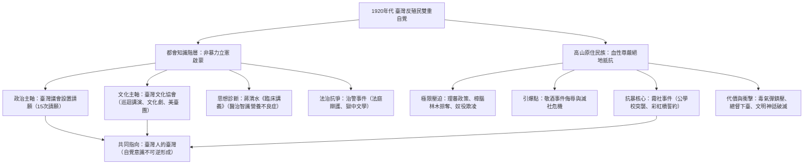

# 第15章 臺灣人的臺灣——文化協會、議會設置請願運動與霧社事件的警鐘 考證史料專卷

> **專案代號**：Project FormosaChronicles  
> **時期分類**：第五時期：日治時期的統治轉型與抗爭（1895 – 1945）  
> **核心歷史坐標**：臺北大稻埕臺灣文化協會舊址（靜修女學校／大安醫院，25.0565, 121.5098） / 南投仁愛霧社公學校舊址（24.0167, 121.1333）  
> **文獻定位**：提供章節專題長文、分鏡腳本設計、NotebookLM 雙軌影音生成與 Whisper 語音辨識提示詞之核心學術考證依據。

---

## 壹、 歷史脈絡：大正民主浪潮與民族自決的時代回響（1918–1920）

### 一、 第一次世界大戰後的全球思潮激盪
1. **威爾遜「民族自決」原則（1918）**：
   - 美國總統威爾遜（Woodrow Wilson）於 1918 年發表「十四點和平原則」（Fourteen Points），宣示各民族享有決定自身政治命運之權利，在全世界被壓迫弱小民族間引發劇烈震盪。
   - 1919 年朝鮮爆發「三一獨立運動」，中國爆發「五四愛國運動」，強烈震撼留學日本東京的臺灣青年學生。
2. **日本內地之「大正民主」（Taisho Democracy）浪潮**：
   - 日本國內政黨政治抬頭（原敬組織首座平民政黨內閣）、吉野作造提倡「民本主義」、普選運動風起雲湧。
   - 自由主義與憲政思想在帝國學術界發酵，使早稻田大學、明治大學、東京帝國大學等地的臺灣留學生深受啟發，開始思索臺灣在帝國體制下的憲政地位與人權保障。

### 二、 留日青年政治團體的萌芽與路線大轉折
1. **東京新民會與《臺灣青年》（1920）**：
   - 1920 年 1 月，林獻堂、蔡惠如、蔡培火、林呈祿、彭華英等留日精英在東京成立「新民會」，以推動臺灣政治改革、啟蒙民眾為宗旨。
   - 1920 年 7 月創刊《臺灣青年》雜誌，成為近代臺灣知識分子首個思想啟蒙重鎮。
2. **由「六三法撤廢運動」轉向「臺灣議會設置請願運動」的劃時代論辯**：
   - **六三法背景**：1896 年日本國會通過「法律第六十三號」（簡稱《六三法》），授權臺灣總督得以發布具有法律效力之律令，使總督集行政、立法、司法、軍事大權於一身，形成憲政畸形體制。
   - **同化主義之陷阱（六三法撤廢論）**：早期留日學生主張撤廢六三法，要求將日本憲法與內地法律一體適用於臺灣。但法學理論家林呈祿敏銳指出：若完全撤廢六三法、實施「內地延長主義」，臺灣人將完全被同化吞併，失去作為特殊歷史文化主體的自主性。
   - **自治主義的立憲主張（議會設置論）**：林呈祿提出「臺灣議會設置論」——臺灣具有獨特的歷史、風土、語言與種族特性，應確立為帝國的「特別統治區」；廢除總督的律令獨裁權，而在臺灣設立一個民選的「特別議會」，由全體臺灣人民選舉議員，行使立法協贊權與預算審查權。這一思想奠定了臺灣近代憲政運動與非暴力反殖民抗爭的理論基石。

---

## 貳、 非暴力抗爭主力：臺灣議會設置請願運動（1921–1934）

### 一、 十五年十五次請願的壯闊歷程
1. **運動的發端與組織**：
   - 1921 年 1 月 30 日，由霧峰林家林獻堂領銜，蔡培火、林呈祿等 178 位留日學生與島內仕紳連署，向日本帝國議會兩院提出第一回《臺灣議會設置請願書》。
   - 運動自 1921 年起，每年向帝國議會定期請願，持續整整 14 年，累計遞交 15 次請願書。
2. **簽署規模與社會階層擴散**：
   - 請願簽署人數迅速由第 1 回的 178 人，擴大到第 5 回（1924）的 1,000 人、第 7 回（1926）的 2,470 人，其後歷次回合皆達數千人，甚至動員至基層自耕農、市井店鋪與青年知識分子。
   - 運動總經費主要由林獻堂、蔡惠如等富紳傾力資助，青年幹部則在全島各市街莊頂風冒雪巡迴宣傳連署。

### 二、 請願書核心理論架構與訴求
1. **立憲法理依據**：
   - 依據《大日本帝國憲法》第 37 條「帝國議會之協贊」及第 82 條「請願權」之保障，主張臺灣人身為帝國臣民，依法享有憲法請願自由。
   - 指出臺灣總督府以「律令」代法律，實為赤裸的「專制總督政治」，違反近代權力分立原則。
2. **特別立法與財政自主**：
   - 臺灣每年繳納數千萬日圓稅款，並已實現財政獨立，但預算全由總督府單方面壟斷審定。因此必須設立由臺灣住民民選的議會，以落實「無代表不納稅」之現代憲政原則。

### 三、 殖民當局的嚴密打壓與「有力者大會」之反制
1. **總督府的圍堵策略**：
   - 歷任總督（特別是軍人出身之田健治郎、伊澤多喜男等）視議會運動為「包藏獨立禍心」的叛亂萌芽。
   - 總督府暗中唆使辜顯榮等親日士紳於 1923 年召開「有力者大會」，發表「反對請願宣言」，謊稱臺灣人民智未開、安居樂業，強烈反對設立特別議會，製造「臺灣人反對自治」的官方虛假輿論。
2. **請願運動的歷史地位**：
   - 雖然 15 次請願在帝國議會中皆遭貴族院與眾議院保守多數否決，但它成功將「臺灣問題」國際化與合法化，使殖民者無法隨意以武力鎮壓，成為臺灣近代長達十餘年最持久、最深遠的立憲政治長征。

---

## 參、 啟蒙巨浪：臺灣文化協會創立與全島啟蒙實踐（1921–1927）

### 一、 臺灣文化協會的創立（1921年10月17日）
1. **成立背景與大稻埕誓師**：
   - 為了培育議會請願運動之群眾土壤，打破臺灣人「怕死、愛錢、愛面子」與缺乏政治意識之弱點，蔣渭水、林獻堂等人決定在島內組織啟蒙文化團體。
   - 1921 年 10 月 17 日下午，臺灣文化協會於臺北大稻埕靜修女子學校（今靜修高中）舉行創立大會，全島各地代表一千餘人齊聚一堂。
   - 林獻堂推舉為總理，蔣渭水任專務理事，確立會址於大稻埕大安醫院（今延平北路二段）。
2. **蔣渭水名篇《臨床講義——關於名為臺灣的患者》（1921年11月30日）**：
   - 蔣渭水以宜蘭名醫、總督府醫學校畢業生之專業身分，在《臺灣文化協會會報》創刊號發表震撼東亞之寓言散文：
     - **患者姓名**：臺灣（Taiwan）。
     - **原籍**：中華民國福建省泉州府。
     - **年齡**：移籍日本帝國 27 歲。
     - **病名**：智識營養不良症（Malnutrition of Knowledge）。
     - **症狀**：頭部肥大（缺乏思想力）、身軀孱弱（道德頹廢）、視力昏花（目光短淺迷信）。
     - **原因**：自清代受長久壓迫，改隸日本後，殖民政策偏重勞役農工，智育政策極度匱乏。
     - **處方箋**：正規學校教育、補習教育、幼兒園、新聞社、圖書館、讀報社，最大量服用「文化運動」，二十年內即可根治康復，成為世界一等健兒。

### 二、 文協的四大啟蒙武器與全島巡迴實踐
1. **巡迴講演會（全島思想啟蒙轟炸）**：
   - 講演隊成員包括蔣渭水、蔡培火、石煥長、韓石泉、林幼春、黃朝琴等。
   - 深入全臺城鎮與農村，宣講民主自由、世界大勢、衛生防疫、迷信破除、農工權益。
   - 全盛期（1925–1926 年）一年在全臺舉辦達 315 場次，聽眾累積突破 11 萬人次，成為近代臺灣最大規模的大眾民主教室。
2. **讀報社（打破資訊壟斷與文盲障礙）**：
   - 於全臺設立超過數十處讀報社，免費提供《臺灣民報》、《臺灣新民報》及日本進步報刊，由專人讀報講評，使廣大不識字的底層勞工、農民得以吸取現代時事。
3. **文化劇（新劇革命，打破舊俗與迷信）**：
   - 成立「文化劇團」，摒棄傳統歌仔戲之神鬼迷信，改演現代白話話劇。
   - 劇本諷刺殖民警察蠻橫、批判守舊地主、反對納妾、打破買賣婚姻與早婚，引起社會巨大共鳴。
4. **美臺團（活動寫真／電影巡迴放映隊）**：
   - 1926 年由蔡培火成立「美臺團」，自日本購置發電機與放映機，由熱血青年騎腳踏車載運設備深入偏鄉農村。
   - 放映世界科學、社會新知紀錄片，並由青年現場以臺語配音解說（辯士），吸引成千上萬未曾見過電影的農民攜家帶眷觀影。

### 三、 《臺灣民報》——臺灣人的唯一言論機關
- 1923 年 4 月，《臺灣民報》創刊於東京（後經長期抗爭，於 1927 年獲准遷回臺灣臺北發行）。
- 以白話文與日文合刊，由黃呈聰、黃朝琴、林呈祿主筆，堅持「臺灣人的立場」，揭露總督府暴政、批判糖業剝削、報導世界民運，被譽為「臺灣人的喉舌」、「照破黑暗的晨鐘」。

---

## 肆、 體制威嚇與越挫越勇：治警事件（1923–1924）

### 一、 事件起因：總督府之政治羅織
- 1923 年 1 月，蔣渭水、蔡培火等人為強化請願運動組織，向臺北州警務部提出成立「臺灣議會期成同盟會」，隨即遭禁止。
- 蔣渭水等人遂於 1923 年 2 月移師日本東京，依據日本內地法制合法成立「臺灣議會期成同盟會」。
- 總督府警務局認定此舉公然挑釁總督威權，決定痛下殺手。

### 二、 1923 年 12 月 16 日全島大搜捕
- 清晨，總督府出動全臺特高警察與憲兵，在全臺同步搜捕 99 名政治運動幹部，查抄大量書籍文稿，蔣渭水、蔡培火、石煥長、蔡惠如、林幼春、陳逢源等 41 人遭正式提起公訴。
- 罪名：違反《治安警察法》第 8 條第 2 項（未經許可組織政治結社）。

### 三、 跨國大審判與反殖民講壇
1. **法庭辯論成為政治啟蒙講壇**：
   - 一審（1924 年）全體被告獲判無罪，法官認定期成同盟會在東京合法成立，在臺活動並未違法，引發總督府震怒撤換檢察官。
   - 二審總督府施壓改判，蔣渭水、蔡培火獲判徒刑 4 個月；石煥長、蔡惠如、林幼春等判 3 個月。
2. **入獄悲歌與全島英雄式歡送**：
   - 1925 年 2 月入監服刑時，蔣渭水、蔡培火自臺北出發，數萬名臺灣民眾沿途夾道歡呼，焚香燃竹、獻花歌唱，將殖民監獄轉化為民族英雄之勳章。
   - 蔡惠如作《意難忘》名闋：「無端橫逆，任風雨摧殘。休道男兒心膽碎，自古英雄淚痕乾。看從前，岳武穆、文天祥，一線江山。」成為獄中文學不朽經典。
   - **歷史效應**：治警事件非但未能消滅抗爭，反而徹底打破臺灣民眾對日本警察的心理恐懼，使民族意識遍地開花。

---

## 伍、 運動的分化與成熟：臺灣民眾黨、工農運動與地方自治聯盟（1927–1931）

### 一、 文協左右分裂（1927）
- 1927 年 1 月 3 日臺灣文化協會於新竹召開臨時會員大會，以連溫卿為首之無產階級社會主義派（左派）取得文協領導權，主張階級鬥爭；林獻堂、蔣渭水、蔡培火等溫和民族主義派（右派）集體退場。

### 二、 臺灣民眾黨成立（1927年7月10日）
1. **臺灣歷史上第一個合法政黨**：
   - 1927 年 7 月 10 日於臺中成立「臺灣民眾黨」，由蔣渭水、謝春木等主導，推舉林獻堂為顧問。
   - **三大政治綱領**：
     1. 確立民本政治（爭取普選權、制定臺灣憲政）。
     2. 建設合理經濟組織（保障農工權益、打破財閥壟斷）。
     3. 改廢不合理社會習俗（廢除妹仔、納妾、迷信）。
2. **向國際聯盟（League of Nations）控訴鴉片專賣（1930）**：
   - 總督府欲重開鴉片特許吸食牌照圖利，蔣渭水以臺灣民眾黨名義，於 1930 年 1 月直接發國際電報向日內瓦國際聯盟鴉片委員會告御狀。
   - 國際聯盟派調查團實地抵臺調查，總督府在國際輿論強大壓力下被迫收回惡法，並成立「更生院」戒毒機構。這是臺灣歷史上首次透過國際多邊外交重挫殖民統治的輝煌勝利。
3. **臺灣工友總聯盟（1928）與政黨被禁（1931）**：
   - 蔣渭水於 1928 年整合全島工會，成立「臺灣工友總聯盟」（會員達數萬人）。
   - 1931 年 2 月 18 日，總督府下達結社禁止令，強制解散臺灣民眾黨。同年 8 月 5 日，蔣渭水因傷寒英年早逝（年僅 40 歲），臺北舉辦空前絕後的「大眾葬」，數千群眾淚灑街頭。

---

## 陸、 武裝抗暴的絕響與尊嚴浩劫：霧社事件（1930）

### 一、 總督府「理蕃政策」之極限殘暴與結構性壓迫
1. **五年理蕃計畫與武力沒收獵槍**：
   - 第五任總督佐久間左馬太自 1910 年推動「五年理蕃計畫」，動用正規軍砲擊原住民部落，架設數百公里通電鐵絲網之「隘勇線」，強繳原住民賴以生存的獵槍。
2. **林野官有化與殘酷奴役**：
   - 總督府將中央山脈原住民祖靈傳統獵場全數收歸「官有」，引進三井物產等財閥大肆開採樟腦與檜木。
   - 賽德克族 Tgdaya 群六社（馬赫坡、荷歌、波阿崙、斯庫、羅多夫、塔羅灣）長期被強徵為無償苦力，搬運沉重木材修建日本警察分室，遭日警動輒皮鞭抽打與辱罵。
3. **通婚政策與文化踐踏**：
   - 日本為監控部落推行「和蕃政策」，鼓勵巡查娶頭目女兒，但日警調職後往往無情遺棄妻子兒女，使部落深感奇恥大辱。
   - 霧社公學校培育之「模範蕃」花岡一郎（Dakis Nobing）、花岡二郎（Dakis Nawi），雖受高等師範與警察教育，但在殖民體制下薪水與地位遠低於同級日警，深陷雙重身分認同撕裂之痛苦深淵。
4. **導火線：敬酒事件（1930年10月）**：
   - 馬赫坡社青年舉行婚宴，頭目莫那·魯道長子達多·莫那熱情上前向巡邏巡查吉村克己敬酒，因手上宰豬沾有血跡，吉村嫌惡並以警棍毆打達多·莫那，隨後引發互毆。事後莫那·魯道親自帶鹿皮攜禮道歉，仍遭吉村揚言嚴懲，部落面臨滅社危機。

### 二、 1930 年 10 月 27 日：霧社公學校起義爆發
1. **運動會突襲**：
   - 10 月 27 日清晨，霧社公學校舉行全聯運動會，聚集大量日本官員、警察與眷屬。
   - 莫那·魯道率領六社約三百位賽德克勇士，兵分多路切斷電話線、奪取各警察駐在所軍械，隨後突襲公學校操場，擊斃 134 名日本人。
2. **賽德克族的信仰核心——彩虹橋誓約（Hakaw Utux）**：
   - 莫那·魯道與族人深刻明白日本帝國的軍事科技實力，此役絕無勝算。莫那·魯道向族人誓言：「日本人比濁水溪的石頭還多，但我們不是為了求生而戰，我們是為了做一個驕傲的賽德克人，洗淨恥辱，跨過彩虹橋，去見祖靈！」

### 三、 帝國殘酷鎮壓：違反國際公約之毒氣戰與二次霧社事件
1. **現代化軍隊與毒氣彈轟炸**：
   - 總督府緊急調派陸軍臺南步兵第二聯隊、山砲隊、飛行第八聯隊進駐霧社，出動飛機偵察與轟炸。
   - 面對熟悉山林地形、退守馬赫坡岩窟堅守的賽德克戰士，日軍竟違反《日內瓦公約》，發射三氯硝基甲烷（嘔吐性／糜爛性毒氣瓦斯彈，日軍代號「甲種彈」與「綠彈」），殘害老弱婦孺。
2. **慘烈自縊與莫那·魯道之死**：
   - 為免糧食匱乏連累戰士抗戰，數百名賽德克婦女在馬赫坡森林深處集體自縊。
   - 莫那·魯道見大勢已去，槍殺妻子後深入深山岩洞開槍自盡，遺體直至三年後（1933）才被尋獲，半具化為白骨，另一半風乾為木乃伊。
3. **「以蕃制蕃」與二次霧社事件（1931年4月25日）**：
   - 日警唆使世仇道澤群（Tuda）突襲收容所內繳械之起義六社殘民，殘殺 216 人。
   - 剩餘約 298 名遺族於 1931 年 5 月被強制遷往北港溪畔之「川中島」（今清流部落），在嚴密監視下度過殘生。

### 四、 霧社事件對殖民統治的毀滅性衝擊
1. **總督府統治高層集體引咎辭職**：
   - 臺灣總督石塚英藏、總務長官人見次郎、警務局長石垣倉治被迫黯然辭職下臺。
2. **日本帝國國會質詢與「文明神話」破滅**：
   - 日本在野黨在帝國議會發起猛烈質詢，斥責總督府理蕃政策殘酷野蠻，甚至在國際聯盟引發強烈譴責。
   - 霧社事件徹底宣告了後藤新平以來「科學統治」、「文明開化」神話的徹底破產：在鋼鐵、鐵路與現代化外表下，殖民統治的底色依然是赤裸裸的種族歧視與血腥剝削。

---

## 柒、 歷史總結與辯證架構：文協的筆墨與霧社的獵槍

### 一、 雙軌並進的歷史張力
1. **平原與城市的文鬥**：林獻堂、蔣渭水等人以立憲、法制、演說、報刊與電影為武器，將抗爭納入現代法治體制內，逼迫殖民者面對其自身的制度矛盾。
2. **高山與密林的武鬥**：莫那·魯道與賽德克族人則以肉身與獵槍，在退無可退的絕境中，以死明志，戳穿了殖民者引以為傲的「文明偽裝」。
3. **歷史的終極啟示**：文協的筆墨與霧社的獵槍，共同鑄就了 1920–1930 年代臺灣社會的主體覺醒——從那一刻起，臺灣人不再只是被統治的客體，而是自覺爭取尊嚴與自由的主人。

---

## 捌、 關鍵字庫與 Whisper 提示詞彙（Prompt Dictionary）

臺灣史, 第15章, 臺灣人的臺灣, 大正民主, 民族自決, 威爾遜, 新民會, 臺灣青年, 六三法撤廢, 內地延長主義, 臺灣議會設置請願運動, 林獻堂, 蔡培火, 林呈祿, 蔣渭水, 臺灣文化協會, 靜修女學校, 大安醫院, 臨床講義, 智識營養不良症, 文化講演會, 讀報社, 文化劇, 美臺團, 蔡惠如, 臺灣民報, 有力者大會, 治安警察法, 治警事件, 意難忘, 臺灣民眾黨, 國際聯盟, 鴉片專賣, 臺灣工友總聯盟, 大眾葬, 理蕃政策, 佐久間左馬太, 五年理蕃計畫, 隘勇線, 賽德克族, 莫那·魯道, 達多·莫那, 霧社公學校, 馬赫坡社, 荷歌社, 波阿崙社, 斯庫社, 羅多夫社, 塔羅灣社, 彩虹橋, Hakaw Utux, 花岡一郎, 花岡二郎, 吉村克己, 敬酒事件, 毒氣彈, 三氯硝基甲烷, 川中島, 清流部落, 石塚英藏, 人見次郎
