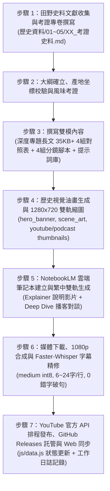

# 《舌尖上的臺灣》專題寫作與數位文庫計畫書

> **計畫代號**：Project TasteOfFormosa  
> **專案全稱**：《舌尖上的臺灣——風土、移民與味蕾交響曲》（Taste of Formosa: The Culinary History of Taiwan）  
> **倉儲目標**：`clive520/taste-of-formosa`  
> **責任人員**：專案負責人 暨 AI 協同助理（Antigravity）  
> **生效日期**：2026 年 11 月 10 日  

---

## 壹、 計畫願景與總體定位

### 一、 為什麼是「舌尖上的臺灣」？
如果說《臺灣史》是從政治、軍事、經濟與制度的宏觀維度，記錄這座島嶼四百年間波瀾壯闊的生存奮鬥；那麼《舌尖上的臺灣》，則是從最溫暖、最親近、卻又最深刻的**「飲食日常」**切入，重新還原島嶼子民的生活血肉。

飲食從來不只是生理需求的滿足，更是一部**「凝固的社會文化史」**：
- 一碗熱氣騰騰的肉燥飯，封存著清領時期閩南農民與稻作水網的拓荒血脈；
- 一壺帶著熟果蜜香的東方美人茶，見證了十九世紀淡水開港、大稻埕洋行與全球航運貿易的風雲；
- 晨曦中一碗清甜鮮美的溫體牛肉湯，折射出臺灣從敬畏水牛「耕牛不食」的古老農業禁忌，走向現代冷鏈與屠宰衛生的破戒轉型；
- 一盤焦香撲鼻的眷村水餃與紅燒牛肉麵，承載著戰後百萬軍民渡海來臺的顛沛鄉愁與落地生根；
- 而一杯風靡全球的珍珠奶茶與當代米其林主廚的在地風土解構，更象徵著這座島嶼在歷經數百年多元文明洗禮後，對自我身分的自信綻放。

本專案旨在突破傳統美食指南（僅限推薦店家、美味修辭或烹飪步驟）的淺層框架，**將每一道經典臺灣滋味視為一個歷史切片**，探尋其背後的風土氣候、族群流動、農業科技、性別勞動與全球貿易，打造兼具學術厚度、人間煙火與視聽傳播力的新一代臺灣飲食文化數位文庫。

---

### 二、 六大核心價值與架構哲學

1. **風土與地理坐標（Terroir & Spatial Context）**：
   - 每一道臺灣食物皆深植於特定的山水土壤與氣候。
   - 文庫將嚴格為每一道代表飲食與代表產地標註 **WGS84 精確地理坐標**，結合互動式地圖，讓讀者清晰看見「產地、產季與歷史發源地的空間網絡」。
2. **族群融合與歷史年輪（Ethnic Stratification & Temporal Flow）**：
   - 從南島先民的煙燻採集、荷西明鄭的蔗糖鹿皮、清領開墾的閩粵米食，到日治現代農學（蓬萊米、鐵道便當）、戰後大江大海的眷村麵點，再到現代手搖飲與新臺菜復興。
   - 呈現臺灣如何以極大的包容力，將多元族群的滋味淬鍊為獨一無二的島嶼共同味覺。
3. **學術考證與人類學深度（Anthropological Rigor）**：
   - 擺脫道聽途說的民間穿鑿附會，深入挖掘古籍方志（《臺灣府志》、《諸羅縣志》、《裨海紀遊》）、日治農業試驗所檔案、戰後老報紙副刊與口述歷史。
   - 每章配備**專屬史料考證專卷**與**4 組學術深度對照表**。
4. **影視級美學與人間煙火（Cinematic & Sensory Aesthetics）**：
   - 告別生硬的歷史枯燥感，文字充滿豐富的味覺通感與文學張力。
   - 為每章設計 **4 組影視級分鏡腳本**，並繪製古典寫實油畫（描繪產地晨曦、大火鑊氣、夜市燈火、老街攤位）。
5. **NotebookLM 雙軌影音與自然語意字幕（Audio-Visual Synergy）**：
   - 延續廣受好評的雙軌模式：**焦點解說影片（Heritage 史詩紀錄片）** ＋ **播客深度對談（Deep Dive 兩位主持人美食文化對談）**。
   - 結合 Faster-Whisper 多線程轉錄與二次語意精修，產出 **6～24 字/行、0 錯別字破句** 的影視級繁體中文字幕。
6. **開放自託管與多端體驗（Open & Interactive Web Portal）**：
   - 建立獨立專案網站與 GitHub Pages，具備**章節矩陣視圖、美食歷史時間軸、Leaflet 互動飲食地圖與全文本沉浸式閱讀器**，無損音訊全數託管於 GitHub Releases。

---

## 貳、 五大風味維度與 15 大專題架構表

本專案依據臺灣飲食文明的形成脈絡，劃分為 **五大風味維度**，精選 **15 個最具代表性、文化深度的經典飲食主題**：

```
                    【《舌尖上的臺灣》五大風味維度】
   ┌──────────────────────────────────────────────────────────────┐
   │ 第一篇：山海風土與島嶼原味（南島採集、大航海與海洋恩賜）     │
   ├──────────────────────────────────────────────────────────────┤
   │ 第二篇：唐山渡海與閩粵交融（清領開墾、肉臊米食與府城甜香）   │
   ├──────────────────────────────────────────────────────────────┤
   │ 第三篇：帝國之眼與東洋滋味（日治農學、蓬萊米與鐵路摩登）     │
   ├──────────────────────────────────────────────────────────────┤
   │ 第四篇：大江大海與眷村融合（戰後移民、老兵牛肉麵與夜市盛宴） │
   ├──────────────────────────────────────────────────────────────┤
   │ 第五篇：島嶼綻放與世界舞台（珍珠奶茶傳奇、風土米其林與新臺菜）│
   └──────────────────────────────────────────────────────────────┘
```

### 📋 全系列 15 章節總體詳細架構清單

| 篇章分類 | 代號 | 章節完整名稱 | 時代背景與核心脈絡 | 核心地理座標 (WGS84) | 關鍵食物、人物與文化密碼 |
| :--- | :---: | :--- | :--- | :--- | :--- |
| **第一篇：山海風土與島嶼原味** | `ch01` | **粟米、野豬與香料火種——南島先民的煙燻、採集與土地智慧** | 史前文明～早期原住民族群 | 屏東三地門排灣族部落<br>`22.7135, 120.6548` | 小米、假酸漿葉、醃肉（Cinavu/Qavay）、馬告（山胡椒）、刺蔥、小米酒。土地共存與部落共享哲學。 |
| | `ch02` | **大航海的蔗香與鹿皮——荷西東印度公司、糖業拓墾與熱帶果物登陸** | 1624 – 1662<br>大航海荷西時期 | 臺南安平熱蘭遮城周邊<br>`22.9997, 120.1605` | 甘蔗種植、黑糖外銷、鹿肉乾、荷蘭豆、芒果、蓮霧引進。全球大航海貿易下的島嶼熱帶物產洗禮。 |
| | `ch03` | **黑水溝的鹹香與烏金——沿海鹽田、討海人補給與烏魚子傳奇** | 17 – 19 世紀<br>明鄭至清領前期 | 臺南七股鹽山與將軍漁港<br>`23.1550, 120.1085` | 七股瓦盤鹽田、冬至烏魚潮（烏金）、烏魚旗、澎湖石滬、海味蝦米柴魚乾貨。海洋子民的鹽味保存智慧。 |
| **第二篇：唐山渡海與閩粵交融** | `ch04` | **一碗肉臊的百年身世——黑豬肉、紅蔥頭與醬油工藝如何奠定庶民味覺之王** | 1684 – 1900s<br>清領拓墾至日治初期 | 彰化鹿港舊街市與彰化市區<br>`24.0560, 120.4326` | 滷肉飯、肉燥飯（南北大論戰）、紅蔥頭爆香、黑豆蔭油釀造、豬油拌飯。稻作農耕社會最深沉的熱量犒賞。 |
| | `ch05` | **水牛禁忌與清晨的甘甜——臺南溫體牛肉湯的破戒身世與屠宰冷鏈微革命** | 1960s – 當代<br>農業禁忌到現代食肉 | 臺南善化肉品市場與安平運河<br>`23.1342, 120.2985` | 耕牛禁食傳統、善化牛墟、凌晨黃金 4 小時現宰溫體牛、牛大骨蔬果清湯。農業敬畏與產地直送的味覺革命。 |
| | `ch06` | **廟埕香火與米食變奏——炊粿、米苔目、米粉與紅龜粿的歲時禮俗** | 清領中後期～日治<br>常民生活與民俗祭祀 | 新竹北門街與新竹都城隍廟<br>`24.8048, 120.9658` | 新竹米粉（九降風）、客家粄條、草仔粿、紅龜粿、油粿、米苔目。敬天謝神的稻米千變萬化身姿。 |
| | `ch07` | **甘甜的舌尖密碼——為什麼臺南人的菜這麼甜？明鄭煮糖、府城富庶與貴族炫耀心理學** | 明鄭東寧～清領全盛期 | 臺南府城孔廟周邊與赤崁街區<br>`22.9975, 120.2025` | 鱔魚意麵、白糖粿、臺南羹湯、椪糖。蔗糖產地優勢、富甲天下象徵、甜味入菜的階級炫耀與風雅記憶。 |
| **第三篇：帝國之眼與東洋滋味** | `ch08` | **改變世界的綠色奇蹟——磯永吉的蓬萊米育種、嘉南平原大穀倉與日本米食革命** | 1895 – 1945<br>日治農學與殖民經濟 | 臺北臺灣大學磯永吉小屋<br>`25.0135, 121.5375` | 磯永吉、末永仁、竹子湖原種田、在來米 vs. 蓬萊米（中村種）、嘉南大圳灌溉。改寫東亞稻作歷史的農業奇蹟。 |
| | `ch09` | **汽笛聲中的木片便當——縱貫鐵路通車、生啤酒、喫茶店與鐵路便當的摩登生活** | 1908 – 1970s<br>鐵道現代化與生活巨變 | 嘉義阿里山奮起湖車站<br>`23.5052, 120.6948` | 縱貫鐵路通車、高砂麥酒（建國啤酒廠）、日式咖哩洋食、奮起湖木片便當、池上米便當。鐵道網絡串聯的時間與速度滋味。 |
| | `ch10` | **山嵐間的東方美人——大稻埕洋行、新竹苗栗客庄膨風茶與征服世界的烏龍傳奇** | 1860s – 1930s<br>開港外貿黃金年代 | 新竹北埔客家老街與峨眉茶區<br>`24.6998, 121.0578` | 膨風茶（東方美人）、小綠葉蟬叮咬著涎、約翰·陶德（John Dodd）、李春生、大稻埕精製茶洋行。征服維多利亞女王的世界茶香。 |
| **第四篇：大江大海與眷村融合** | `ch11` | **那一碗鄉愁的紅湯——岡山豆瓣醬、四川老兵與臺灣紅燒牛肉麵的混血傳奇** | 1949 – 1980s<br>戰後移民與眷村融合 | 高雄岡山空軍眷村與臺北永康街<br>`22.7958, 120.2965` | 岡山辣豆瓣醬、川味小碗牛肉湯、老兵麵攤、酸菜、牛油牛筋。大江大海在臺灣融合出的全新「臺式川味」名菜。 |
| | `ch12` | **晨光裡的麵粉香——美援麵粉、燒餅油條、清漿與眷村水餃烙餅的庶民突圍** | 1950s – 1980s<br>美援時代與北方麵食普及 | 臺北華山市場阜杭豆漿與眷村舊址<br>`25.0442, 121.5248` | 美援麵粉袋（中美合作）、永和豆漿、燒餅油條、清漿、槓子頭、韭菜水餃、蔥油餅。南北物產與主食習慣的大翻轉。 |
| | `ch13` | **黑夜裡的流動盛宴——辦桌（總鋪師）文化的鼎盛、夜市宵夜經濟與「客廳即工廠」的深夜慰藉** | 1960s – 1990s<br>工業化起飛與庶民社交 | 高雄內門（總鋪師之鄉）與臺北寧夏夜市<br>`22.9425, 120.4615` | 內門總鋪師、辦桌八仙桌（封肉、紅蟳米糕、烏骨雞湯）、夜市蚵仔煎、生炒花枝、鹽酥雞。臺灣人熱鬧互助的人情味頂峰。 |
| **第五篇：島嶼綻放與世界舞台** | `ch14` | **吸管裡的黑色奇蹟——春水堂、翰林與珍珠奶茶席捲全球百億美元的商業神話** | 1980s – 當代<br>手搖茶革命與全球出海 | 臺中市四維街春水堂創始店<br>`24.1378, 120.6725` | 泡沫紅茶、樹薯粉圓、波霸奶茶、封口機發明、全球手搖茶供應鏈（進軍美日歐東南亞）。街頭手搖飲演變為跨國科技化供應鏈。 |
| | `ch15` | **當代風土的米其林交響——從路邊攤到世界殿堂，當代臺灣主廚的土地認同與新臺菜復興** | 2010s – 當代<br>文化尋根與世界共鳴 | 臺北市大安區精緻臺菜旗艦聚落<br>`25.0330, 121.5435` | 新臺菜運動、RAW、山海樓、本土原生食材（破布子、馬告、紅藜、發酵地瓜）、米其林星級認可、全系列歷史大結語。 |

---

## 參、 七大標準工作流程（SOP Pipeline）

本專案全面繼承《臺灣史》經驗，採用標準化、高度工業化且保證最高品質的生產閉環：



### 1. 步驟 1：史料考證專卷撰寫
- **路徑**：`舌尖上的臺灣/歷史資料/[篇章目錄]/[番號]_考證史料.md`
- **內容標準**：
  - 嚴謹追溯該食物/作物之生物學、農學引進或料理誕生之真實文獻與年代；
  - 引用一手古籍、清代志書、日治試驗報告或耆老訪談口述；
  - 產地與代表店家 WGS84 座標考證（精確至小數點後四位）；
  - 建立 Whisper 專用「專有名詞與食材字典庫」。

### 2. 步驟 2：深度專題長文撰寫
- **路徑**：`舌尖上的臺灣/[篇章目錄]/第XX章_[主題名稱].md`
- **長度標準**：每篇 30~45 KB（約 1.2 萬～2 萬字）。
- **結構標準**：
  - 頂部影音超連結（說明影片、播客影片、GitHub Releases 無損音訊）；
  - 引人入勝的導言（以食物香氣與市井特寫開場）；
  - 4～5 個層層遞進的歷史小節（探討起源、流變、社會變革與味蕾記憶）；
  - **4 組學術深度對照分析表**（食材品種演進、南北風味流派、經濟數據、烹飪科學）；
  - **4 組影視級分鏡腳本**（黎明備料、火候翻炒、深夜小攤、跨洋出海之動態場景描繪）；
  - 深刻富有人文哲思的篇末結語。

### 3. 步驟 3：提示詞庫與 YouTube 描述設定
- `chXX_desc.txt`：繁體中文說明影片 YouTube 完整描述（含核心看點、時間戳、地標坐標、標籤）；
- `chXX_podcast_desc.txt`：繁體中文播客深度對談 YouTube 完整描述；
- `chXX_prompt.txt`：NotebookLM 專用提示詞（嚴格鎖定繁體中文、飲食文化歷史深度）與 Faster-Whisper 詞庫。

### 4. 步驟 4：視覺插畫與 1280x720 雙軌縮圖
- 使用高解析度寫實油畫風格（Dramatic Realistic Oil Painting），強調 Rembrandt 式溫暖光影與厚塗筆觸；
- 雙軌高點擊封面縮圖：
  - 說明影片縮圖：1280x720 HD、大字體、黃白強對比、主題徽章、無 Emoji；
  - 播客對談縮圖：1280x720 HD、深藍/科技暖金配色、特色副標。

### 5. 步驟 5：NotebookLM 雲端雙軌影音生成
- 建立專屬筆記本並上傳雙來源文獻（長文 ＋ 考證史料）；
- 觸發繁體中文說明影片（Explainer Video, Heritage, `zh-TW`）；
- 觸發繁體中文播客深度對談（Deep Dive Audio, `zh-TW`）。

### 6. 步驟 6：媒體下載、1080p 合成與 Faster-Whisper 字幕精修
- 自動下載 `.mp4` 說明影片與 `.m4a` 播客音訊；
- 上傳音訊至 GitHub Releases `v1.0.0` 雲端資產庫；
- 使用 FFmpeg 搭配封面油畫與音訊合成 1080p 播客影音；
- 運行 Faster-Whisper `medium`（`int8` 量化）轉錄，並經由 `refine_srts` 雙向合併與拆分演算法，產出 **單行 6～24 字、平均 13～15 字、0 錯字破句** 之影視級自然語意字幕。

### 7. 步驟 7：YouTube 官方 API 排程發布與文庫同步
- 自動刷新 OAuth Token，調用 `youtube_api_uploader.py`；
- 上傳影片、設定封面、掛載繁中字幕軌、加入官方播放清單「舌尖上的台灣」；
- 更新 `js/data.js` 前端配置並記錄於 `工作日誌.md`；
- Git Commit 並推送至 GitHub 主分支。

---

## 肆、 專案目錄結構規範

```text
d:\Antigravity\科技歷史\舌尖上的臺灣/
├── 00_專案計畫與規範/
│   ├── 舌尖上的臺灣專題寫作與數位文庫計畫書.md
│   ├── 工作日誌.md
│   ├── 章節標準完工檢核清單_SOP.md
│   ├── 影視級字幕製作標準作業程序_SOP.md
│   ├── 文章與旁白腳本標準模板_TEMPLATE.md
│   └── (各章生成輔助腳本及提示詞)
├── 01_山海風土與島嶼原味/     (ch01 ~ ch03)
├── 02_唐山渡海與閩粵交融/     (ch04 ~ ch07)
├── 03_帝國之眼與東洋滋味/     (ch08 ~ ch10)
├── 04_大江大海與眷村融合/     (ch11 ~ ch13)
├── 05_島嶼綻放與世界舞台/     (ch14 ~ ch15)
├── 歷史資料/
│   ├── 01_山海風土與島嶼原味/
│   ├── 02_唐山渡海與閩粵交融/
│   ├── 03_帝國之眼與東洋滋味/
│   ├── 04_大江大海與眷村融合/
│   └── 05_島嶼綻放與世界舞台/
├── assets/
│   ├── images/                (ch01 ~ ch15 圖片與縮圖)
│   └── audio/                 (本機暫存音訊)
├── css/
│   └── style.css              (數位文庫現代化樣式)
├── js/
│   └── data.js                (15 章全域資料配置)
├── index.html                 (三重視圖首頁：網格 / 時間軸 / 產地地圖)
├── article.html               (沉浸式長文閱讀器與影音播放器)
└── .gitignore                 (排除巨型 .mp4/.m4a 媒體檔)
```

---

## 伍、 品質標準與驗收指標

1. **考證標準**：不得採用未經考證的鄉野傳奇作為定論，涉及傳說需註明「民間相傳」；食材學名、外來作物引進年代、農學育種數據均需具備文獻支撐。
2. **文字標準**：全篇嚴格採用臺灣標準繁體中文（教育部標準字體），地道臺語詞彙與原住民食材需標註通用羅馬拼音或慣用漢字（如：肉臊飯、Cinavu、馬告 Makauy、碰糖）。
3. **影音字幕標準**：
   - 語音純淨：嚴格確保 NotebookLM 繁體中文（`zh-TW`）發音；
   - 字幕排版：單行字數嚴格控制在 6～24 字（平均 13～16 字），斷句符合自然講話語氣，杜絕 1～4 字之孤立贅字破句；
   - 錯字率：人名、地名、食材與化學名詞 0 錯別字。
4. **YouTube 發布標準**：
   - 影片規格：1080p Full HD；
   - 封面縮圖：1280x720 HD，文字大且清晰，無 Emoji；
   - 播放清單：全數加入「舌尖上的台灣」專屬清單，排程公開時間精確設定。

---

## 陸、 結語：寫給這座島嶼的情書

每一道在夜市鐵板上滋滋作響的蚵仔煎、每一碗在清晨巷口冒著蒸氣的肉燥飯、每一壺在崇山峻嶺間烘焙著蜜香的東方美人，都是這座島嶼在四百年間對生活、對土地、對親友最深情的傾訴。

讓我們以同樣嚴謹、熾熱且飽含溫度的匠心，啟動《舌尖上的臺灣》！
