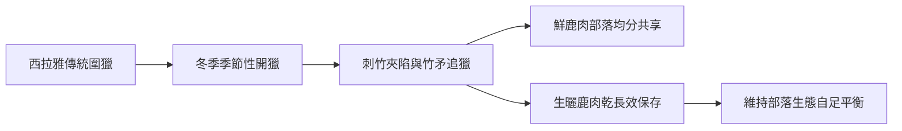
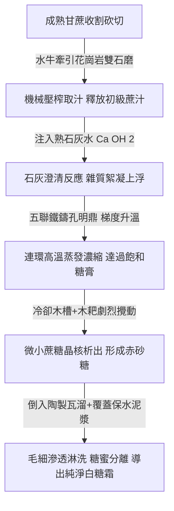

# 第 02 章 大航海的蔗香與鹿皮——荷西東印度公司、糖業拓墾與熱帶果物登陸

> **文庫導讀**：  
> 1624 年，荷蘭東印度公司（VOC）在臺南大員沙洲築起熱蘭遮城。這座矗立於季風航道上的要塞，不僅將臺灣強行推上了世界貿易舞臺，更在島嶼平原上引爆了一場前所未有的「味覺與生態革命」。在此之前，數以萬計的梅花鹿在刺竹林與草澤間奔馳，原住民以長矛圍獵、生曬鹿肉乾；在此之後，水牛拖曳著沉重花崗岩石磨，蔗田如綠浪般席捲嘉南平原，焦甜濃烈的蔗糖煙雲晝夜不散。  
> 伴隨荷蘭蓋倫帆船而來的，還有遠跨重洋的「哥倫布大交換」——荷蘭豆、檨仔（芒果）、蓮霧、番椒與釋迦，悄然在紅瓦聚落間扎根。這是一段混雜著火藥、皮革腐腥、熱帶果酸與焦糖甜香的大航海傳奇。

---

## 🎧 數位多媒體隨行導讀模組

> [!TIP]
> 本章提供兩種規格之影音隨行體驗，讀者可點擊下方連結同步聆聽或觀賞：
> - 🎬 **影視級精華解說短片（9 分鐘）**：[點此前往 YouTube 觀賞高畫質影片（排程 2026-11-14 17:30 首播）](https://youtu.be/anxoGeGVLz4)
> - 🎙️ **深度對談 Podcast 長片（23 分鐘）**：[點此前往 YouTube 收聽完整雙人辯證（排程 2026-11-14 19:30 首播）](https://youtu.be/zEvu1lJY54Q)
> - 📻 **離線無損音訊串流**：[GitHub Releases 官方高音質 M4A 下載](https://github.com/clive520/taiwan-history/releases/download/v1.0.0/food_ch02_podcast_deepdive.m4a)

---

## 🌅 引言：熱蘭遮城的晨霧與甜鹹交織的季風

1638 年深秋的一個破曉時分，一艘吃水深沉的荷蘭三桅蓋倫大帆船（Galleon）正緩緩駛出熱蘭遮城（Kasteel Zeelandia）守護的大員內海（臺江內海）。

站在城堡最高層的稜堡上望去，安平外海的潮水在晨光中翻滾著灰白色的浪花。季風由東北方向呼嘯而來，帶來鹹澀的水氣。然而，只要微風稍微偏轉，從東方遼闊的赤崁平原（Provintia）吹來，空氣中那股濃烈的氣味便會瞬間改變——那是上百座糖廍（Sugar Mill）同時點火熬糖所蒸騰出的焦甜焦糖香，混雜著港邊碼頭上數萬張壓製生鹿皮散發出的原始羶味與粗鹽辛香。

這股甜與鹹、文明與荒野、商業利潤與生態巨變相互撕扯的氣味，正是 17 世紀臺灣在世界史舞臺上的最初氣味。

在荷蘭東印度公司（Vereenigde Oostindische Compagnie, 簡稱 VOC）登陸之前，這座島嶼的西部平原是西拉雅族（Siraya）等平埔原住民族與數十萬頭臺灣梅花鹿共同棲息的曠野。千百年來，先民遵循著季節的節律，在冬日圍獵鹿群，割肉生曬，視鹿為祖靈的恩賜。

然而，當荷蘭人的望遠鏡與鵝毛筆越過大洋，這片平原隨即被納入一條精密的全球資本主義輸送帶：
- 臺灣平原奔馳的**野鹿**，變成了日本長崎出島（Dejima）武士盔甲上不可或缺的防磨皮料；
- 肥沃鬆軟的**黏質土壤**，在引進水牛深耕後，化為供應波斯、歐洲與日本貴族茶桌的雪白結晶——**蔗糖**；
- 就連今天臺灣人餐桌上不可或缺的青翠**荷蘭豆**、夏日消暑的**檨仔（芒果）**、晶瑩清甜的**蓮霧**，也是在這一時期隨著 VOC 的商船首次登陸臺灣。

這是一部用糖蜜、汗水、皮革與異域種子寫成的島嶼開拓史。

---

## 🏹 第一幕：熱蘭遮城下的鹿皮海嘯——大航海時代的臺灣第一波全球化

### 1. 平原上的褐色波濤：西拉雅人的傳統鹿獵
在 17 世紀初荷蘭人來到臺灣之前，嘉南平原的生態景觀與今日截然不同。那時沒有密集的農田與水圳，取而代之的是茂密的刺竹林、高聳的菅芒草澤，以及無邊無際的闊葉林地。

根據 1628 年荷蘭首位駐臺傳教士甘治士（Georgius Candidius）在《臺灣略記》（*A Short Description of the Island of Formosa*）中的親眼觀察：
> 「這個島嶼上的野鹿數量多得令人難以置信。當鹿群在平原上奔跑時，大地為之震動，褐色的脊背起伏宛如波濤海浪……」

對於新港社（Sinkan）、麻豆社（Mattau）、蕭壠社（Soulang）的西拉雅族人而言，鹿群是維繫部落生存與男子成年榮譽的核心。族人捕鹿有嚴格的季節限制——只有在每年十月到翌年四月的農閒涼季，部落長老才會宣布開獵。

西拉雅青壯男子手持竹矛，帶著訓練有素的獵犬，成百上千人在平原上排開，以火驅趕、以夾竹陷阱截擊。獵得的野鹿，皮毛製成禦寒衣物與睡墊，鹿角雕刻為工具，而鹿肉則被帶回部落，在火塘邊由全族共享。剩餘的鹿肉，族人會用海鹽醃漬，掛在竹架上藉由強勁的冬季乾燥季風與熱帶陽光迅速風乾，製成能保存數月之久的「生曬鹿肉乾」（荷蘭文獻稱 *hertenvleesch*）。

這種狩獵模式是一種封閉的、自給自足的生態循環。原住民只取生存所需，從不進行無止境的商業性掠奪。



### 2. 武士的盔甲與長崎的白銀：鹿皮如何變成硬通貨？
然而，荷蘭東印度公司的到來徹底粉碎了這種千百年的生態平衡。

VOC 來到遠東的核心目標是打入封閉的日本市場，以換取日本豐富的白銀與銅。而當時正處於德川幕府初期的日本，各地大名與武士階層對一種物資有著近乎狂熱的剛性需求——**上等鹿皮**。

日本傳統武士盔甲（大鎧）在關節受力處、胸甲內襯、刀鞘裹皮以及將領出征時所穿的「陣羽織」（Jinbaori），必須使用極具韌性、透氣、吸汗且耐摩擦的厚實鹿皮。經過防腐蹂鞣後的福爾摩沙梅花鹿皮，纖維緻密，耐磨度遠勝日本本土的小型鹿種，在日本被視為無可取代的軍需奢侈品。

荷蘭人敏銳地嗅到了這條暴利的黃金通道。大員商館長官立刻在大員設立收購總部，向原住民開出了難以抗拒的交換條件：一張完整無破損的優質乾鹿皮，可以換取數尺色彩豔麗的棉布、幾顆瑪瑙珠，或者珍貴無比的鐵鍋與鐵刀。

### 3. 贌社制度（Pacht）：商業資本對平原生態的降維打擊
為了極大化獲取鹿皮，荷蘭人設計了一套極其冷酷且高效的代理人制度——**贌社制度（Pacht）**。

公司每年在熱蘭遮城舉行公開招標，將各原住民部落的商業獨佔經營權拍賣給出價最高的漢人資本家（稱為「贌商」）。得標的贌商取得專屬特許狀後，帶領大量漢人雇工進駐部落。贌商不僅壟斷了部落所有的民生必需品供應，更引進了漢人發明的鐵製「倒鉤夾」與深坑陷阱，開始日以繼夜、不分季節地對平原上的鹿群展開滅絕式撲殺。

《熱蘭遮城日記》（*De Dagregisters van het Kasteel Zeelandia*）中留下了令人觸目驚心的商業帳目：
- 1636 年，大員出口至日本的鹿皮達到 **10 萬張**；
- 1638 年，出口量攀升至 **15 萬張** 的歷史天花板；
- 伴隨而來的，是每年數萬公斤的醃製鹿肉乾，裝滿一艘又一艘戎克船，運往福建泉州、廈門，成為閩南平民百姓主要的肉食蛋白質來源。

短短三十年間，曾如褐色海潮般奔馳於平原上的數十萬頭臺灣梅花鹿，在刺骨的全球資本擴張中被屠戮殆盡。到了 1650 年代後期，長官日記中開始頻繁出現「捕鹿所得日漸稀疏，獵人空手而歸」的沉痛記載。

野鹿的消失，宣告了臺灣平原採集漁獵時代的終結。這座島嶼若要繼續為東印度公司榨取利潤，就必須轉向一場更深、更廣、更具掠奪性的生產方式——**全面農業拓墾與甘蔗革命**。

---

## 🍬 第二幕：嘉南平原的甜蜜革命——荷蘭東印度公司的王田、水牛與糖業拓墾

### 1. 糖比香料更甜：VOC 的遠東戰略轉向
在 17 世紀的歐洲與東亞，精製糖絕非今日隨手可得的平價調味品，而是象徵身分、地位與財富的「白色黃金」。

在歐洲，糖被視為珍貴的藥材與貴族宴席上的防腐靈丹；在日本，茶道風行與和菓子文化的興起，讓高級白糖成為大名貴族競相追逐的極品；在波斯（今伊朗），宮廷對於純淨砂糖的需求更是深不可測。當時掌控全球香料貿易的荷蘭東印度公司很快意識到：**熱帶蔗糖的利潤率，絲毫不亞於摩鹿加群島的肉豆蔻與丁香！**

然而，爪哇島的甘蔗種植受到土地與季風限制，無法無限制擴張。荷蘭長官將目光投向了安平對岸那片廣袤平坦、氣候高溫多雨、冬季乾爽分明的赤崁平原——這裡正是全世界最理想的熱帶甘蔗培育溫床！

```text
┌────────────────────────────────────────────────────────────────────────┐
│               17 世紀荷蘭東印度公司遠東「糖業黃金三角」                │
├───────────────────┬────────────────────────────────────────────────────┤
│ 臺灣大員（產地）   │ 嘉南平原大規模蔗田＋水牛深耕＋石磨糖廍煎糖         │
│ 日本長崎（出島）   │ 臺灣白糖/黑糖銷往京都、江戶 ➔ 換回大量日本白銀     │
│ 巴達維亞/波斯/歐洲 │ 優質砂糖經巴達維亞轉口 ➔ 銷往波斯灣與荷蘭本土      │
└───────────────────┴────────────────────────────────────────────────────┘
```

### 2. 「王田」與「水牛」：臺灣近代農業的動力革命
為了在短時間內將荒蕪的鹿場改造成整齊劃一的萬頃蔗田，荷蘭東印度公司推行了兩項徹底重塑臺灣農業面貌的劃時代政策：

#### A. 王田制度（Crown Land / Koningsakker）
荷蘭人宣告全臺灣的土地皆為荷蘭東印度公司所有，即所謂的「王田」。公司自福建沿海大量招募因明末戰亂、饑荒而流離失所的漢人農民渡海來臺。公司提供土地、農具與種子，漢人農民作為佃農進行開墾，收穫的甘蔗與稻米則需繳納十分之一的實物稅（稱為「什一稅」，Decima），其餘產量則由公司以固定官價保證收購。

#### B. 跨海引進耕作巨獸——「水牛」
在漢人移民到來之前，臺灣原住民並無馴化大型役畜的傳統，農作僅靠人力以木鋤淺掘。而嘉南平原的黏重土壤若要深耕種植深根性的甘蔗，單靠人力難以勝任。

1630 年代起，荷蘭大員長官親自下令，派遣船隊多次前往南洋爪哇島、蘇門答臘以及澎湖，跨海載運了數千頭體格健壯、耐高溫濕熱的**印度水牛（Bubalus bubalis）**登陸大員。

水牛的引入，是臺灣農業史上的第一場「內燃機級」動力革命！水牛厚重的蹄爪踏碎了堅硬的泥土，粗壯的肩胛拖動著沉重的鐵製翻土犁，將深層肥沃的泥土翻上地表。嘉南平原從刀耕火種的原始荒原，在數年之內演化為渠圳縱橫、沃野千里的現代農業平原。

到 1650 年代，臺灣每年向海外輸出的砂糖總量已突破 **200 萬斤（約 1,200 公噸）**！臺灣一躍成為東印度公司在東亞最重要的糧糖保障庫，赤崁也被時人形容為「蔗葉翻浪，蔗香數里」。

---

## ⚙️ 第三幕：從雙石磨到連環鼎——臺灣古法製糖的物理與生化工程

大航海時代的糖業之所以能創造驚人的商業帝國，關鍵在於一套將**水牛動力學**、**高溫熱力學**與**微界面化學**完美結合的工藝體系——這就是遍布南臺灣平原的**「糖廍」（Sugar Mill）**。

走進一座 17 世紀的糖廍，你看到的絕非原始簡陋的土法煉製，而是一座經過極其精密工程計算的生化加工廠。



### 1. 雙石磨糖車：剪切力壓榨的物理極限
糖廍的核心是一座高約三公尺的圓錐形茅草大棚。棚屋中央矗立著製糖的核心引擎——**石磨糖車**。

這座機器由兩座直徑約一公尺、高約一公尺五的堅硬花崗岩石滾輪緊密咬合而成。兩頭被蒙住雙眼的水牛繫於長木槓上，在圓形磨道上不知疲倦地繞圈牽引，驅動兩座重達數噸的石輪以極高的扭力反向旋轉。

當蔗工將一捆捆去除葉片的甘蔗送入兩石輪間極為狹窄的夾縫時，高達數千磅的機械剪切力瞬間粉碎了堅韌的甘蔗外皮與木質纖維。伴隨著清脆的甘蔗爆裂聲，晶瑩翠綠、帶著微甜草香的甘蔗原汁如瀑布般激射而出，順著石座下緣鑿出的導流槽，源源不絕地流入地下的儲汁木桶中。

### 2. 石灰水澄清法：精妙的微觀膠體化學
剛壓榨出來的甘蔗汁極其渾濁，不僅含有高達 15% 的懸浮微粒、泥沙與游離纖維，更富含大量的多酚氧化酶、果膠（Pectin）與可溶性植物蛋白質。如果不立刻處理，甘蔗汁在南臺灣 35 度的烈日下會在數小時內發酵酸敗，將珍貴的雙醣（蔗糖）水解為無法結晶的單醣（葡萄糖與果糖）。

此時，熬糖師傅展現了驚人的化學直覺——**熟石灰澄清法**。

師傅將預先調配好的生石灰乳（氫氧化鈣，$\text{Ca(OH)}_2$）按嚴格比例注入溫熱的甘蔗汁中。這個動作引發了連鎖的化學反應：
1. **中和有機酸**：石灰迅速中和了甘蔗中的蘋果酸、草酸等游離酸，將汁液 pH 值從微酸（5.0～5.5）拉升至微鹼性（7.2～7.6），徹底阻止了蔗糖的反轉水解；
2. **蛋白質絮凝變性**：高溫與鈣離子使得帶負電荷的果膠質與蛋白質分子迅速去水化、變性凝聚，形成一層厚實黑褐色的浮渣泡沫（俗稱「糖泡」）；
3. **沉澱不溶性鈣鹽**：雜質被包裹在磷酸鈣等微晶中沉入池底。

蔗工手持長柄竹絲網，迅速撈去浮在液面上的濃稠糖泡。原本渾濁暗綠的生蔗汁，在石灰的點化下，瞬間化為一鍋金黃透明、香氣純淨的無暇糖露。

### 3. 連環五聯鼎：熱能階梯蒸發的熱力學極致
澄清後的糖汁被舀入整排並列的大鐵鼎中——這就是名震東亞的「五聯孔明鼎」。

熬糖竈的設計堪稱 17 世紀能源循環的典範。竈底燃燒的不是昂貴的木炭，而是剛剛被石磨壓榨乾淨、經過烈日暴曬一天的**廢甘蔗渣（Bagasse）**。甘蔗渣含有高密度的木質素與纖維素，燃燒時火焰純淨、無煙且熱值極高，實現了 100% 的生質能源自給自足！

五口直徑超過一公尺的鑄鐵大鼎順著熱氣煙道由低到高階梯排列：
- 第一鼎（尾鼎）：溫度約 70～80℃，用於預熱糖汁並進行二次沉澱；
- 第二、三鼎（中鼎）：溫度提升至 90～100℃，水分劇烈蒸發，糖度從 15°Brix 迅速濃縮至 50°Brix；
- 第四、五鼎（正鼎）：溫度逼近 110～115℃，糖漿在猛火中劇烈翻滾，水分活度降至臨界點。

經驗老到的熬糖大師傅凝視著鼎中翻騰的氣泡：當氣泡由初期的細碎水泡，轉化為稠密、黏重、緩慢破裂的巨型「金黃魚眼泡」時，師傅用竹籤蘸起一滴糖漿滴入冷水中——若糖滴遇水即刻凝固成晶瑩硬脆的珠狀，便暴喝一聲：「出糖！」

蔗工們齊聲呼應，以長柄銅勺將滾燙如熔岩的深金黃色糖膏舀出，傾倒進長方形的巨大冷卻木槽（糖槽）中。

```text
┌────────────────────────────────────────────────────────────────────────┐
│                   傳統糖廍五聯鼎熬糖溫度與生化指標對照                 │
├───────────┬─────────┬───────────────┬──────────────────────────────────┤
│ 鼎位名稱  │ 溫度範圍│ 糖液濃度      │ 核心物理/化學反應                │
├───────────┼─────────┼───────────────┼──────────────────────────────────┤
│ 第一鼎(尾)│ 70~80℃  │ 15 ~ 25° Brix │ 預熱、膠體雜質終極浮聚、微酸沉澱 │
│ 第二鼎    │ 85~95℃  │ 25 ~ 40° Brix │ 水分初步蒸發、梅納褐變反應啟動   │
│ 第三鼎(中)│ 95~102℃ │ 40 ~ 60° Brix │ 劇烈沸騰脫水、黏度急遽攀升       │
│ 第四鼎    │102~108℃ │ 60 ~ 75° Brix │ 焦糖化反應、散發堅果與花果焦香   │
│ 第五鼎(正)│108~115℃ │ 75 ~ 88° Brix │ 達到過飽和臨界、形成細微晶核母液 │
└───────────┴─────────┴───────────────┴──────────────────────────────────┘
```

### 4. 瓦溜淋泥法：大航海時代的「分子脫色技術」
從熱鼎傾倒至木槽的糖膏，在工匠手持木耙飛速的翻動攪拌下迅速散熱。空氣的混入與剪切力的攪動，促使無數微米級的蔗糖晶核在母液中均勻析出。半小時後，糖膏冷卻凝固，便形成了我們今日熟知的香濃赤砂糖（黑糖）。

然而，荷蘭東印度公司在歐洲與日本最垂涎的，不是粗黑糖，而是價格高達黑糖三倍以上的純白晶瑩**「雪花白糖」**！

在沒有離心機、沒有活性碳吸附技術的 17 世紀，臺灣的製糖師傅究竟是如何將深黑褐色的糖膏變成白雪般的白糖？答案隱藏在一種名為**「瓦溜淋泥」**的鬼斧神工之中：

1. **裝填瓦溜**：工匠將半凝固的赤砂糖膏填入漏斗形狀、下端帶有微小孔洞的陶製容器——「瓦溜」中。瓦溜下承陶甕，置於陰涼通風的糖房內；
2. **鋪覆白泥**：在瓦溜上層平鋪一層厚約數公分的細膩黃泥漿或白黏土泥膏；
3. **微孔毛細淋洗**：泥漿中的水分由於毛細管作用與重力效應，以極其緩慢的微米級速度向下滴滲。水分穿透糖層時，巧妙地溶解並洗滌了包裹在八面體蔗糖晶體表層的深褐色糖蜜（Molasses），而較難溶解的純蔗糖結晶本體則完好保留；
4. **黑白分流**：被洗脫的深黑色糖蜜從瓦溜底孔滴入下方的陶甕中，成為濃縮甘醇的黑糖蜜（常用於釀酒或烹調）；而瓦溜上方的糖粒，經過二十餘天的淋洗與曬乾後，赫然化為如初雪般無暇、散發著純淨甘甜的頂級白糖！

這項源自閩南、在南臺灣發揚光大的瓦溜淋泥法，被譽為大航海時代農業化學的奇蹟。正是這甕甕白糖，裝滿了荷蘭人的貨艙，換回了數以萬計的長崎白銀，奠定了臺灣數百年「糖金」的根基。

---

## 🥭 第四幕：大交換在南臺灣登陸——荷蘭豆、檨仔、蓮霧與熱帶果物地圖

荷蘭東印度公司帶給臺灣的，遠不止甘蔗與鹿皮的商業利潤。

伴隨著頻繁穿梭於荷蘭、巴達維亞（雅加達）、菲律賓、馬六甲與大員之間的武裝商船，全球物種大交換（The Columbian Exchange）的浪潮鋪天蓋地湧入臺灣。荷蘭人為了補充船員長途航行所需的維生素 C、改善商館官員與士兵單調的飲食，積極自世界各地引進了各類熱帶果樹與蔬菜。

這些在 17 世紀初登陸安平與赤崁的外來物種，在南臺灣充沛的陽光與肥沃的沖積平原上找到了最完美的歸宿，最終徹底融入臺灣的本土文化，成為今日無人不知的在地風味。

```text
┌────────────────────────────────────────────────────────────────────────┐
│             大航海時代外來風土作物在臺登陸考證矩陣                     │
├─────────┬──────────────┬─────────────┬─────────────────────────────────┤
│ 作物名稱│ 原生地／引進路徑   │ 歷史文獻稱謂│ 風土融合與現代臺灣飲食文化      │
├─────────┼──────────────┼─────────────┼─────────────────────────────────┤
│ 荷蘭豆  │ 歐洲經巴達維亞至大員 │ 荷蘭豆、雪豆│ 至今臺灣民間仍保留荷蘭之名，快炒│
│ 檨仔    │ 印度／爪哇經VOC引進  │ 檨仔、番檨  │ 即臺灣土芒果，青果醃糖鹽成情人果│
│ 蓮霧    │ 爪哇島原產，荷蘭引進 │ 璉霧、爪哇蒲│ 屏東林邊與高雄六龜之黑色黑珍珠  │
│ 番茄    │ 南美洲經西班牙引進   │ 柑仔蜜、番柿│ 臺南特有沾醬油、薑末、糖粉之吃法│
│ 番椒    │ 中南美洲大航海傳入   │ 番薑、辣椒  │ 岡山豆瓣醬與戰後辣味牛肉麵之前身│
│ 番石榴  │ 熱帶美洲經荷西傳入   │ 芭樂、番桃  │ 沾梅子粉食用，南臺灣庭院最普遍果│
│ 番荔枝  │ 熱帶美洲經VOC引進    │ 釋迦、佛頭果│ 臺東卑南代表性物產，甜度冠絕群果│
└─────────┴──────────────┴─────────────┴─────────────────────────────────┘
```

### 1. 荷蘭豆：一段將統治者名字吃下肚的趣味歷史
今天臺灣任何一處傳統菜市場或熱炒店裡，點一盤「清炒荷蘭豆」或「荷蘭豆炒臘肉」，沒有人會覺得這是一道異國料理。

然而，這種莢脆、粒甜、豆香清冽的蔬菜，原產於地中海沿岸。荷蘭人佔領臺灣後，由於思念故鄉的豌豆湯，遂將其種子自歐洲經巴達維亞引進臺灣南部試種。令人驚喜的是，臺灣南部的暖冬氣候極度適合其生長，豆莢比歐洲原產更為鮮嫩多汁。

漢人移民和平埔原住民見這種蔬菜全由「紅毛荷蘭人」所帶來，便直截了當地稱其為「荷蘭豆」。數百年過去了，紅毛要塞早已傾頹，荷蘭統治者早已揚帆離去，但這三個字卻永遠銘刻在臺灣人的舌尖上，成為歷史最溫柔也最堅固的活化石。

### 2. 檨仔（土芒果）：烈日下的酸甜戀曲
「檨」這個字，在《康熙字典》中甚至難以尋覓，它是臺灣人為了這種南洋果實專門創造或音譯的本土漢字。

16 世紀末，荷蘭船隊在印尼爪哇島發現了這種散發著強烈松節油芳香、多汁而濃甜的漆樹科果實（*Mangifera indica*）。荷蘭人將其苗木帶至大員，栽植於赤崁商館周邊與今日臺南新化、白河一帶的丘陵地。

臺灣人依據南洋馬來語系的原名音譯，稱之為**「檨仔」（臺語讀音：Suāinn-á）**。

這種最初引進的品種，正是今日老一輩臺灣人最魂牽夢縈的「臺灣土芒果」。土芒果果實雖小、纖維較粗，但其香氣極其霸道濃烈。每年初夏未成熟的青芒果，果核尚未木質化，果肉酸澀生津。智慧的臺灣婦女將其削皮切片，用粗鹽殺青揉去澀水，再拌入赤砂糖慢醃——這道在冰菓室裡飄香百年的名點**「情人果」（檨仔青）**，其歷史的源頭，正是熱蘭遮城外那一株株迎風搖曳的荷蘭樹苗。

### 3. 蓮霧與番字輩果物：熱帶海風的甘霖
另一項改變南臺灣景觀的果物是**蓮霧（Wax Apple）**。

原產於馬來半島與安達曼群島的蓮霧，同樣由荷蘭人自爪哇引進臺灣。初期引進時，文獻稱其為「璉霧」或「爪哇蒲桃」。在缺水的南臺灣濱海沙地，蓮霧樹展現了頑強的耐鹽鹼生命力，其果實清脆、海綿質水分充沛，微酸微甜，成為烈日下勞作農夫最好的解渴恩物。

此外，所有名字帶有**「番」字**的蔬果——番茄（柑仔蜜）、番椒（辣椒）、番石榴（芭樂）、番荔枝（釋迦）、番薯（地瓜）——幾乎無一例外都是在大航海時代的浪潮中，跨越太平洋或印度洋登陸臺灣。它們豐富了原本以粟米、芋頭為主的島嶼菜單，更奠定了後續數百年臺灣料理中鮮明、多元、包容的雜糅性格。

---

## 🌊 第五幕：尾聲——蔗田深處的歷史餘韻與島嶼味覺基因

1662 年 2 月，經歷了九個月的殘酷圍城血戰，最後一任荷蘭大員長官揆一（Frederick Coyett）在熱蘭遮城簽署了投降協議。荷蘭軍隊敲著軍鼓、揚著軍旗，登上殘存的船隻，永遠駛離了大員港灣。

三十八年的荷蘭統治畫上了句點，但大航海時代留在臺灣土地上的刻痕，卻早已化為無法抹滅的味覺基因：
- 荷蘭人走了，但數千頭引進的**水牛**留了下來，繼續在嘉南平原的泥濘中奮力翻耕，陪伴臺灣農民走過鄭氏、清代與日治，直到農機轟鳴的現代；
- 荷蘭人走了，但**糖廍與蔗田**留了下來。鄭成功軍隊正是依靠荷蘭人打下的農業基礎得以屯田自足；隨後建立的「糖郊」更將臺灣糖推向亞洲巔峰；
- 甚至，今日聞名遐邇的**「臺南甜」**——臺南料理那種獨樹一幟、連炒鱔魚、滷肉飯都要下重糖的味覺習慣，其歷史根源正是源於這段赤崁周邊糖廍林立、糖蜜隨處可得、食糖代表著極致富裕與榮耀的大航海記憶！

當我們今天漫步在臺南安平的老街上，看著熱蘭遮城的殘破紅磚外牆；當我們在盛夏的冰菓室裡大口咬下酸甜冰涼的情人果；當我們在黃昏的市場裡買下一把青綠脆嫩的荷蘭豆——我們口中咀嚼的，不僅僅是一份食物的美味，更是四百年前那座孤懸於波濤之中的海島，與整部世界文明史激烈交會的壯闊回聲。

---

## 📚 附錄一：學術考證一手文獻清單
1. **荷蘭檔案**：
   - *De Dagregisters van het Kasteel Zeelandia* (1624–1662)（江樹生主譯，《熱蘭遮城日記》全四冊，臺南市政府印行）。
   - Coyett, Frederick. *'t Verwaerloosde Formosa* (1675)（甘為霖英譯、李雄揮中譯，《被遺誤的臺灣》，前衛出版社）。
   - Candidius, Georgius. *A Short Description of the Island of Formosa* (1628).
2. **明清文獻**：
   - 陳第，《東番記》（1603 年收錄於沈有容《閩海贈言》）。
   - 郁永河，《裨海紀遊》（1697 年臺灣採硫日記，記載臺南糖廍與鹿肉風俗）。
   - 高拱乾修，《臺灣府志》（1696 年，詳載早期糖廍結構與瓦溜淋泥工藝）。
3. **近代研究**：
   - 曹永和，《臺灣早期歷史研究》、《臺灣早期歷史研究續集》，聯經出版。
   - 韓家寶（Pol Heyns），《荷蘭時代臺灣的經濟·土地與稅務》，播種者出版。
   - 中村孝志，《荷蘭時代臺灣史研究》，稻鄉出版社。

---

## 🎬 附錄二：全篇影視分鏡腳本與微距視覺設計

### 分鏡一：熱蘭遮城外海的季風商船與鹿皮裝船（宏觀史詩）
- **景別**：超廣角俯瞰轉中景。
- **畫面**：1640 年初春的大員港灣（安平外海），熱蘭遮城紅白磚石要塞在晨曦中高聳。數十艘荷蘭三桅蓋倫大帆船（Galleon）與漢人雙桅戎克船交錯。碼頭上，數百捆壓製得極為方正、散發著粗鹽與皮革野性氣息的乾鹿皮，正由高懸的滑輪吊桿運入幽暗的船艙。
- **音效**：海浪拍打防波堤聲、水手帶節奏的荷蘭語吆喝、粗麻繩摩擦滑輪的咿呀呻吟、海鷗盤旋鳴叫。

### 分鏡二：赤崁糖廍的水牛牽引與蔗香沸騰（工藝微距）
- **景別**：特寫 $\rightarrow$ 微距 $\rightarrow$ 全景。
- **畫面**：汗流浹背的水牛蒙著雙眼，在泥濘圓形走道上沉重邁步，帶動兩座粗糙花崗岩石磨發出沉悶的轟鳴。剛切斷的紫皮甘蔗送入石磨夾縫，甘蔗纖維瞬間被碾碎破裂，晶瑩碧綠的甘蔗汁如清泉般激射流出。鏡頭迅速拉至棚屋深處：五口相連的巨型鐵鼎下，燃燒著曬乾的甘蔗渣，火光將熬糖師傅古銅色的臉龐照得發亮。鼎內金黃色的糖漿如熔岩般咕嘟翻滾，蒸騰起濃郁、微焦、帶有花果香氣的甜美白霧。
- **音效**：沉重的石磨碾壓聲、甘蔗纖維破裂的清脆碎響、鐵鼎內高溫糖漿黏稠破泡聲、熬糖師傅竹勺舀動的潑灑聲。

### 分鏡三：瓦溜滴漏中的黑白分離（微距化學）
- **景別**：極限微距（Extreme Close-Up）。
- **畫面**：陶製漏斗（瓦溜）內，厚重濕潤的白泥漿靜靜覆蓋在暗褐色糖膏上。鏡頭切入糖粒縫隙：微米級的水分子極度緩慢地滲透，包裹在蔗糖八面體結晶外圍的深黑色糖蜜被水流帶走，順著重力如墨滴般墜落底甕。原本晦暗的結晶體，在洗去糖蜜後逐漸顯露出純淨、璀璨如雪花般的半透明白色幾何晶面。
- **音效**：水滴極緩慢滴落底甕的「叮咚」回音，靜謐而充滿自然科學的肅穆感。

### 分鏡四：熱帶果物在紅瓦院落的登陸（生活風土）
- **景別**：陽光中景 $\rightarrow$ 特寫。
- **畫面**：赤崁民居紅磚院落中，一株剛種下數年的茂密印尼檨仔（芒果）樹在南臺灣烈日下搖曳。幾顆卵圓形、青中透紅的果實掛在枝頭。樹蔭下的竹桌上，放著一盤剛切開的青芒果切片，旁邊佐著一小碟粗糖與海鹽；一位平埔婦女正將剛摘下的鮮嫩荷蘭豆丟入滾燙的油鍋中，豆莢在鐵鍋中爆出翠綠耀眼的色澤。
- **音效**：熱帶蟬鳴聲、微風拂過芒果厚葉的沙沙聲、鐵鍋快炒青豆的滋滋熱油聲。

---

## 🌐 附錄三：重要歷史物產中荷語對照表
| 中文名稱 | 荷蘭文原名 | 當代意義與備註 |
| :--- | :--- | :--- |
| **大員 / 熱蘭遮城** | Tayouan / Kasteel Zeelandia | 今臺南安平，VOC 在臺總部 |
| **普羅民遮城** | Fort Provintia | 今臺南赤崁樓，行政與農業拓墾中心 |
| **鹿皮** | Hertenvel | 每年外銷日本 10～15 萬張之重要戰略物資 |
| **鹿肉乾** | Hertenvleesch | 西拉雅人生曬、漢商收購銷往閩南之平民肉食 |
| **砂糖 / 白糖** | Suiker / Witte suiker | 銷往日本、波斯與歐洲之高價商品 |
| **甘蔗** | Suikerriet | 嘉南平原大面積種植之主要經濟作物 |
| **糖廍** | Suikermolen | 水牛牽引石磨壓榨與鐵鼎熬煮之製糖工坊 |
| **水牛** | Waterbuffel | 自爪哇引進之深耕與製糖役用巨獸 |
| **王田** | Koningsakker | 荷蘭東印度公司所有並招募漢人佃墾之農地 |
| **贌社制度** | Pacht | 部落貿易獨占權包稅標售制度 |
| **荷蘭豆** | Doperwten / Peulvruchten | 歐洲引進之食用莢豌豆，民間留存荷蘭之名 |
| **檨仔（芒果）** | Mango / Mangga | 爪哇引進之漆樹科果樹，臺語音譯南洋原名 |
| **蓮霧** | Jamboes / Wax apple | 爪哇引進之熱帶水潤果樹 |
